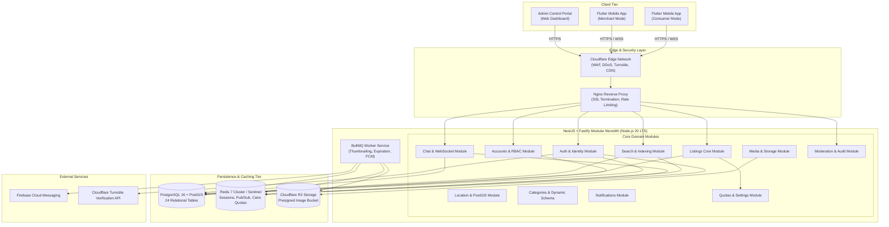
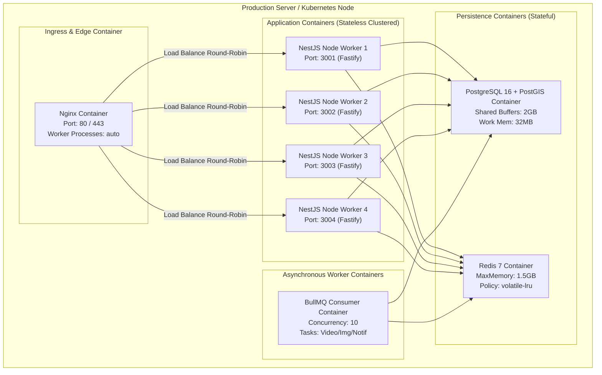
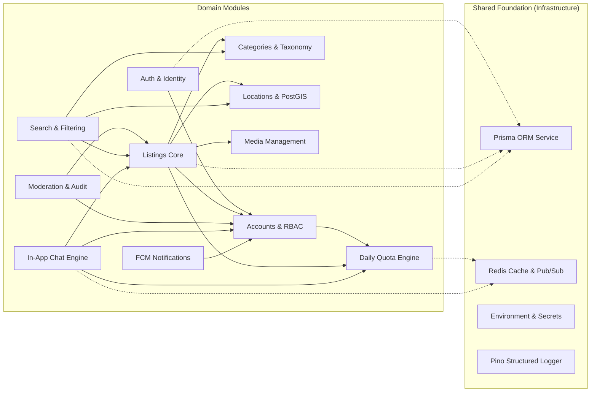
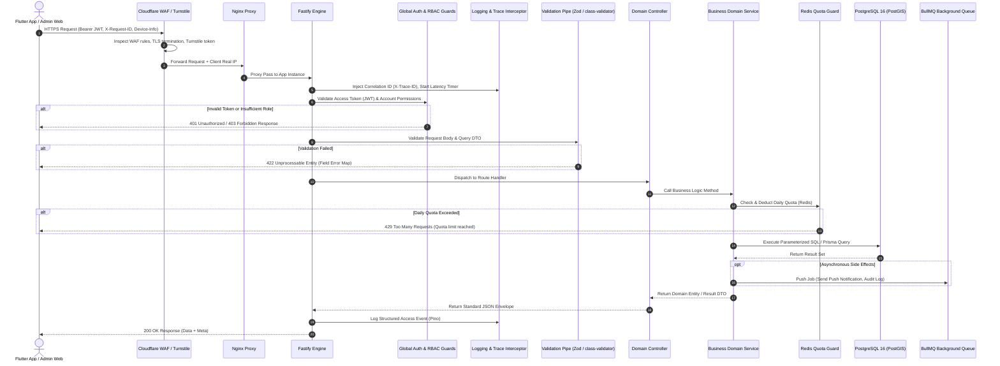
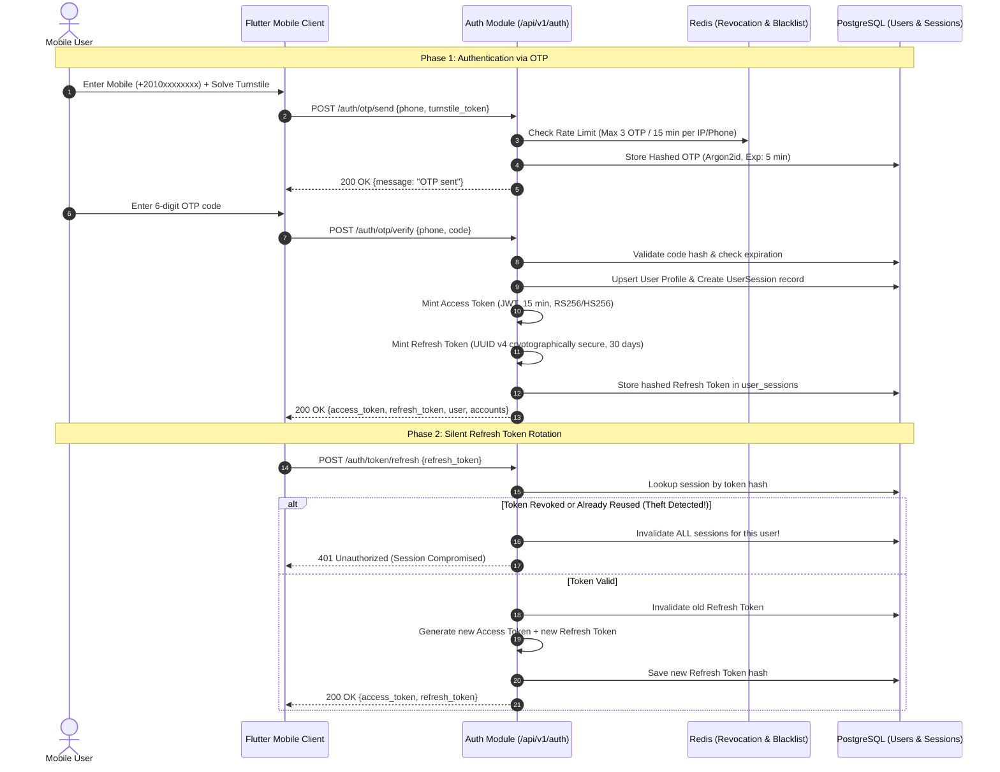
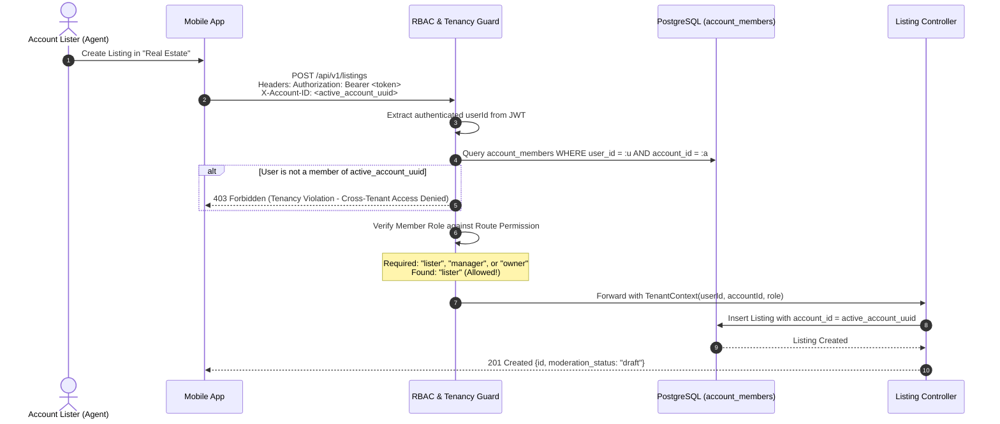
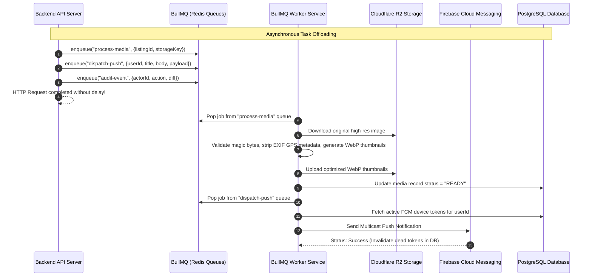
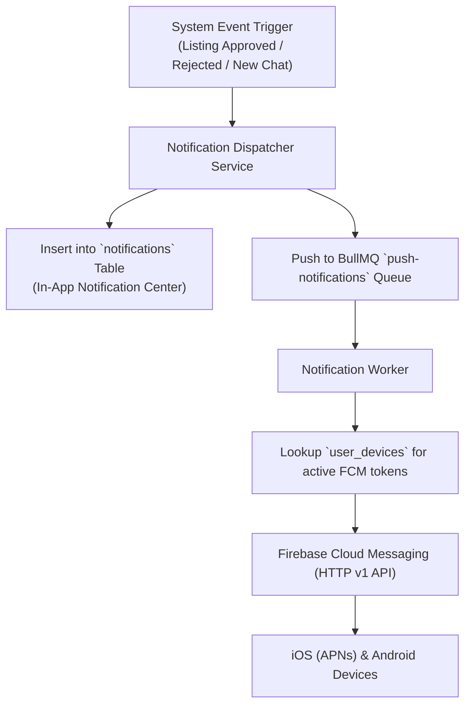
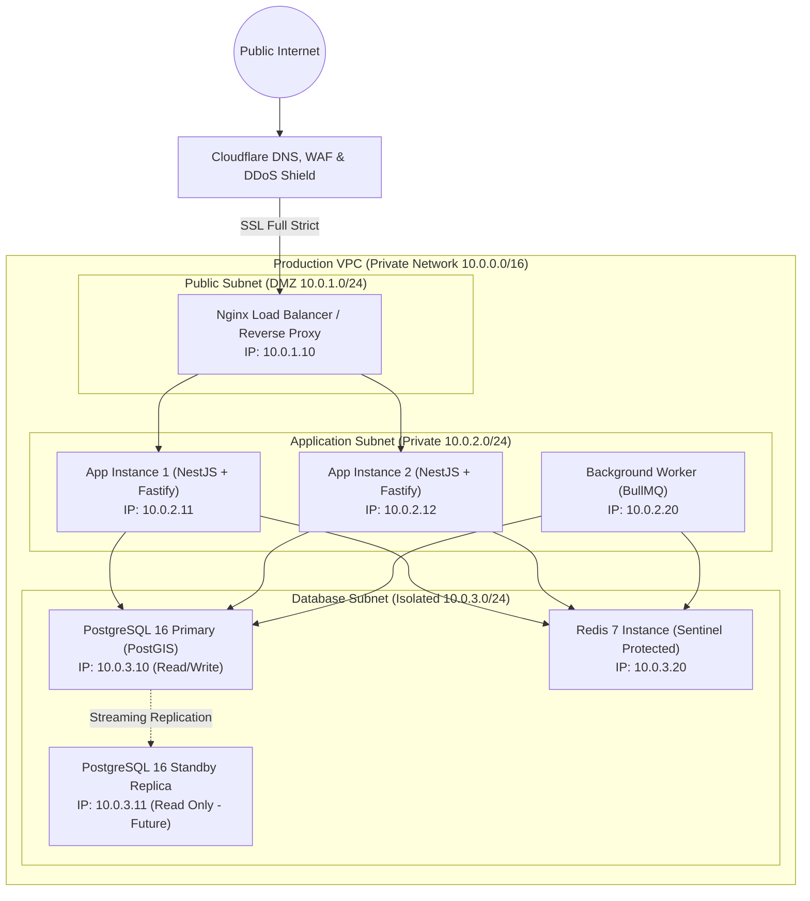

# Deal One — Comprehensive Backend Architecture Document

## 1. System Architecture Overview

Deal One is architected as an enterprise-grade **Modular Monolith** engineered for high concurrency, low latency, robust data isolation, and smooth maintainability. The system serves multiple client applications (Flutter Android/iOS apps for consumers and merchants, and an administrative web control portal for moderation and operations) from a unified, strictly modular backend.

---

### 1.1 Architectural Pattern: The Modular Monolith

Rather than introducing distributed microservice overhead during the launch phase, Deal One enforces domain separation at compile time and runtime within a single monolithic codebase.

#### Rules of the Modular Monolith:
1. **Explicit Module Boundaries:** The codebase is partitioned into distinct Bounded Contexts.
2. **Encapsulated Data Access:** No module may directly query the database tables belonging to another module. All cross-domain operations must execute via designated Module Public Services / Domain Interfaces.
3. **No Circular Dependencies:** Module dependencies follow a strict directed acyclic graph (DAG).
4. **Shared Infrastructure:** Database connections, Redis caches, object storage adapters, and logging pipelines are provided as shared core infrastructure.
5. **Microservices Ready (Extractability):** In the event of extreme scale, any module (such as Search or Real-time Chat) can be carved out into an independent service without refactoring core business logic.

---

### 1.2 High-Level System Architecture Diagram

---

### 1.3 Container & Service Architecture Diagram

---

### 1.4 Backend Module Dependency Architecture

---

### 1.5 Detailed Request Lifecycle

---

### 1.6 Authentication & Token Rotation Flow

---

### 1.7 Authorization & Multi-Tenant RBAC Flow

---

### 1.8 Background Job & Worker Architecture Flow

---

### 1.9 Operational Notification Flow

---

### 1.10 Deployment & Infrastructure Topology

---

## 2. Key Architecture Decisions Summary

| Decision ID | Topic | Selected Choice | Rationale & Trade-offs |
|---|---|---|---|
| **ADR-001** | Platform Strategy | Hybrid Multi-Category Platform | Balances common foundation with category-specific business rules. Avoids building separate apps while preventing rigid unified tables. |
| **ADR-002** | Core System Design | Shared Core Architecture | Identity, auth, multi-tenant accounts, media, and chat are standardized across all categories, eliminating duplicate systems. |
| **ADR-003** | Data Modeling | Hybrid Relational + JSONB (GIN) | High-performance relational core tables for standard search keys alongside indexed JSONB attributes for custom category fields. |
| **ADR-004** | Trust & Safety | Tiered Account Verification | Mandatory official document audit per account type (`individual`, `company`, `factory`, `office`, `store`) before public listing visibility. |
| **ADR-005** | Identity Model | Multi-Tenant Independent Accounts | Separates personal user identity from commercial entities. Enables multiple team members and multi-business ownership. |
| **ADR-006** | Spatial Privacy | Two-Tier Geographic Coordinates | Exact coordinates (`physical_lat/lng`) are stored securely for PostGIS distance sorting; fuzzed coordinates (`display_lat/lng`) are served publicly. |
| **ADR-007** | Listing State | 3 Orthogonal Status Axes | Decouples moderation (`draft/pending/approved/rejected`), publication (`published/hidden/archived`), and stock (`available/reserved/sold`). |
| **ADR-008** | Transaction Scope | Strict V1 Contact-Only Scope | Excludes online payment gateways and checkout in V1 to maximize market listing liquidity and reduce launch complexity. |
| **ADR-012** | Backend Pattern | Modular Monolith | Single codebase with strict compile-time boundaries. Lowers cloud infrastructure costs and eliminates distributed transaction failures. |
| **ADR-013** | Tech Stack | NestJS + Fastify + PostgreSQL + Redis | High I/O performance (Fastify), enterprise architectural discipline (NestJS), spatial capabilities (PostGIS), and rapid caching (Redis). |

---

## 3. Scalability Strategy & Load Capacity Engineering

The Deal One backend is engineered for stateless horizontal scaling.

### 3.1 Engineering Capacity Targets

| Concurrency Tier | Target Concurrent Users (CCU) | Expected Requests/sec (RPS) | Infrastructure Footprint | Key Potential Bottlenecks & Mitigations |
|---|---|---|---|---|
| **Tier 1 (Launch)** | 100 CCU | 50 – 150 RPS | 1x App Server (4 vCPU, 8GB RAM), 1x DB (2 vCPU, 4GB RAM), Redis (2GB) | Unindexed DB queries. *Mitigation:* Ensure strict composite B-tree & GIST indexes on all search queries. |
| **Tier 2 (Growth)** | 1,000 CCU | 500 – 1,200 RPS | 2x App Servers (4 vCPU each), 1x DB (4 vCPU, 16GB RAM), Redis (4GB) | DB connection pool exhaustion. *Mitigation:* PgBouncer connection pooler; keep pool size at 25-30 per app instance. |
| **Tier 3 (Scale)** | 5,000 CCU | 2,500 – 5,000 RPS | 4x App Servers behind Nginx round-robin, DB Primary (8 vCPU, 32GB RAM) + Read Replica | High PostGIS distance calculation overhead. *Mitigation:* Redis caching of district centroids & popular category listings (TTL: 60s). |
| **Tier 4 (Peak)** | 10,000 CCU | 5,000 – 12,000 RPS | 8x Clustered App Nodes, Dedicated DB Primary (16 vCPU, 64GB RAM) + 2 Read Replicas, Redis Cluster | Redis memory saturation for daily quotas & chat Pub/Sub. *Mitigation:* Sharded Redis; offload historical chat logs to cold storage. |

### 3.2 Core Architectural Principles for High Concurrency
1. **100% Stateless Application Instances:** No local memory state or file persistence exists on API nodes. Sessions are verified via cryptographically signed JWTs and checked against Redis blacklists. Any app node can handle any request.
2. **Database Connection Pooling (PgBouncer / Prisma Tuning):** Each NestJS instance maintains a tuned connection pool limit (max 20–25 connections) to prevent saturating PostgreSQL's backend process table.
3. **Multi-Level Caching:**
   - *HTTP Layer:* Edge caching for immutable category taxonomies, governorates, and cities (Cache-Control: public, max-age=86400).
   - *Application Layer:* Redis cache for popular feed listings and seller account profiles (TTL: 60–180 seconds with cache eviction on listing modification).
   - *Database Layer:* PostgreSQL `shared_buffers` sized to 25% of RAM with query plans verified using `EXPLAIN ANALYZE`.
4. **Rate Limiting & Abuse Defense:** Redis sliding window rate limiters protect OTP generation (3 per 15 min), login attempts (5 per 15 min), and public search requests (60 per minute per IP).
