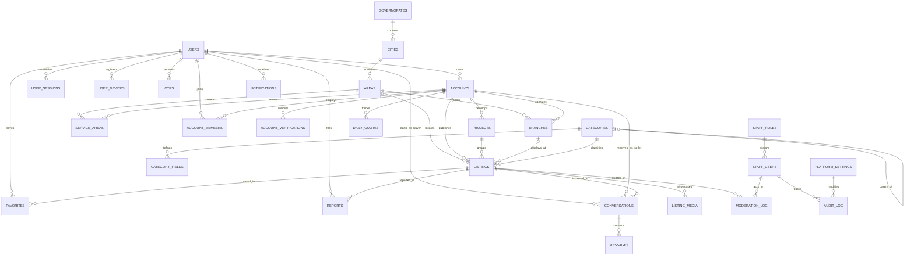

# Deal One — Database Architecture & Schema Specification

## 1. Database Overview & Technology Decisions

- **Engine:** PostgreSQL 16 Enterprise with PostGIS Spatial Extension.
- **Character Encoding:** `UTF8` with collation `ar_EG.UTF-8` (Arabic - Egypt).
- **Timezone Storage:** All timestamps stored as `TIMESTAMPTZ` (UTC). Business day boundaries for quotas resolve against timezone `'Africa/Cairo'`.
- **Primary Keys:** UUID v4 (`gen_random_uuid()`) for business entities to prevent ID enumeration/IDOR attacks; sequential `BIGSERIAL` / `INTEGER` reserved only for administrative reference tables (Governorates, Cities).
- **Money & Precision:** Monetary amounts stored as `NUMERIC(14, 2)` (never floating point).

---

## 2. Complete Entity-Relationship Diagram (ERD)



---

## 3. Detailed Table-by-Table Data Dictionary

### Module 1: Geography & Administrative Divisions

#### 1. `governorates`
- **Purpose:** Stores Egypt's 27 official governorates.
- **Columns:**
  - `id`: `INT GENERATED ALWAYS AS IDENTITY PRIMARY KEY`
  - `name_ar`: `VARCHAR(100) NOT NULL` (e.g., 'القاهرة')
  - `name_en`: `VARCHAR(100) NOT NULL` (e.g., 'Cairo')
  - `slug`: `VARCHAR(100) UNIQUE NOT NULL`
  - `is_active`: `BOOLEAN NOT NULL DEFAULT TRUE`
  - `sort_order`: `INT NOT NULL DEFAULT 0`
- **Indexes:** `CREATE UNIQUE INDEX uq_gov_slug ON governorates(slug);`

#### 2. `cities`
- **Purpose:** Administrative cities and centers within each governorate.
- **Columns:**
  - `id`: `INT GENERATED ALWAYS AS IDENTITY PRIMARY KEY`
  - `governorate_id`: `INT NOT NULL REFERENCES governorates(id) ON DELETE RESTRICT`
  - `name_ar`: `VARCHAR(150) NOT NULL` (e.g., 'مدينة نصر')
  - `name_en`: `VARCHAR(150) NOT NULL` (e.g., 'Nasr City')
  - `slug`: `VARCHAR(150) NOT NULL`
  - `is_active`: `BOOLEAN NOT NULL DEFAULT TRUE`
- **Indexes:** `CREATE UNIQUE INDEX uq_city_gov_slug ON cities(governorate_id, slug);`

#### 3. `areas`
- **Purpose:** Granular neighborhoods, districts, and postal clusters with administrative centroid coordinates.
- **Columns:**
  - `id`: `UUID PRIMARY KEY DEFAULT gen_random_uuid()`
  - `city_id`: `INT NOT NULL REFERENCES cities(id) ON DELETE RESTRICT`
  - `name_ar`: `VARCHAR(150) NOT NULL` (e.g., 'الحي السابع')
  - `name_en`: `VARCHAR(150) NOT NULL` (e.g., 'District 7')
  - `centroid`: `GEOMETRY(Point, 4326) NOT NULL` (Administrative center coordinate)
  - `is_active`: `BOOLEAN NOT NULL DEFAULT TRUE`
- **Indexes:**
  - `CREATE INDEX idx_areas_city ON areas(city_id);`
  - `CREATE INDEX idx_areas_centroid ON areas USING GIST (centroid);`

---

### Module 2: Identity, Authentication & Sessions

#### 4. `users`
- **Purpose:** Human personal identities and master authentication records.
- **Columns:**
  - `id`: `UUID PRIMARY KEY DEFAULT gen_random_uuid()`
  - `phone`: `VARCHAR(20) UNIQUE NOT NULL` (E.164 format: `+2010xxxxxxxx`)
  - `email`: `VARCHAR(255) UNIQUE`
  - `password_hash`: `VARCHAR(255)` (Argon2id format, optional for OTP-only users)
  - `full_name`: `VARCHAR(120) NOT NULL`
  - `avatar_url`: `VARCHAR(500)`
  - `is_phone_verified`: `BOOLEAN NOT NULL DEFAULT FALSE`
  - `is_email_verified`: `BOOLEAN NOT NULL DEFAULT FALSE`
  - `is_active`: `BOOLEAN NOT NULL DEFAULT TRUE`
  - `preferred_language`: `VARCHAR(5) NOT NULL DEFAULT 'ar'`
  - `created_at`: `TIMESTAMPTZ NOT NULL DEFAULT NOW()`
  - `updated_at`: `TIMESTAMPTZ NOT NULL DEFAULT NOW()`
  - `deleted_at`: `TIMESTAMPTZ` (Soft delete timestamp)
- **Indexes:**
  - `CREATE UNIQUE INDEX uq_users_phone ON users(phone) WHERE deleted_at IS NULL;`
  - `CREATE UNIQUE INDEX uq_users_email ON users(email) WHERE email IS NOT NULL AND deleted_at IS NULL;`

#### 5. `user_sessions`
- **Purpose:** Active Refresh Token rotation records and session security metadata.
- **Columns:**
  - `id`: `UUID PRIMARY KEY DEFAULT gen_random_uuid()`
  - `user_id`: `UUID NOT NULL REFERENCES users(id) ON DELETE CASCADE`
  - `refresh_token_hash`: `VARCHAR(255) NOT NULL` (SHA-256 hash of random refresh token)
  - `device_fingerprint`: `VARCHAR(255)`
  - `user_agent`: `VARCHAR(500)`
  - `ip_address`: `INET NOT NULL`
  - `is_revoked`: `BOOLEAN NOT NULL DEFAULT FALSE`
  - `expires_at`: `TIMESTAMPTZ NOT NULL`
  - `created_at`: `TIMESTAMPTZ NOT NULL DEFAULT NOW()`
  - `last_used_at`: `TIMESTAMPTZ NOT NULL DEFAULT NOW()`
- **Indexes:**
  - `CREATE INDEX idx_sessions_user_revoked ON user_sessions(user_id, is_revoked);`
  - `CREATE INDEX idx_sessions_hash ON user_sessions(refresh_token_hash);`

#### 6. `user_devices`
- **Purpose:** Registered mobile devices and FCM push notification tokens.
- **Columns:**
  - `id`: `UUID PRIMARY KEY DEFAULT gen_random_uuid()`
  - `user_id`: `UUID NOT NULL REFERENCES users(id) ON DELETE CASCADE`
  - `fcm_token`: `TEXT NOT NULL`
  - `platform`: `VARCHAR(10) NOT NULL CHECK (platform IN ('android', 'ios'))`
  - `app_version`: `VARCHAR(30)`
  - `last_seen_at`: `TIMESTAMPTZ NOT NULL DEFAULT NOW()`
  - `created_at`: `TIMESTAMPTZ NOT NULL DEFAULT NOW()`
- **Indexes:**
  - `CREATE UNIQUE INDEX uq_user_device_token ON user_devices(user_id, fcm_token);`

#### 7. `otps`
- **Purpose:** Cryptographically hashed short-lived SMS OTP tokens.
- **Columns:**
  - `id`: `UUID PRIMARY KEY DEFAULT gen_random_uuid()`
  - `phone`: `VARCHAR(20) NOT NULL`
  - `code_hash`: `VARCHAR(255) NOT NULL`
  - `attempts`: `SMALLINT NOT NULL DEFAULT 0`
  - `is_consumed`: `BOOLEAN NOT NULL DEFAULT FALSE`
  - `expires_at`: `TIMESTAMPTZ NOT NULL`
  - `created_at`: `TIMESTAMPTZ NOT NULL DEFAULT NOW()`
- **Indexes:**
  - `CREATE INDEX idx_otp_lookup ON otps(phone, expires_at, is_consumed);`

---

### Module 3: Multi-Tenant Accounts & RBAC

#### 8. `accounts`
- **Purpose:** Independent commercial or personal selling entities (ADR-005).
- **Columns:**
  - `id`: `UUID PRIMARY KEY DEFAULT gen_random_uuid()`
  - `owner_user_id`: `UUID NOT NULL REFERENCES users(id) ON DELETE RESTRICT`
  - `account_type`: `VARCHAR(20) NOT NULL CHECK (account_type IN ('individual', 'company', 'factory', 'office', 'store'))`
  - `display_name`: `VARCHAR(150) NOT NULL`
  - `slug`: `VARCHAR(160) UNIQUE NOT NULL`
  - `bio`: `TEXT`
  - `logo_url`: `VARCHAR(500)`
  - `banner_url`: `VARCHAR(500)`
  - `verification_status`: `VARCHAR(20) NOT NULL DEFAULT 'pending' CHECK (verification_status IN ('pending', 'approved', 'rejected'))`
  - `is_active`: `BOOLEAN NOT NULL DEFAULT TRUE`
  - `created_at`: `TIMESTAMPTZ NOT NULL DEFAULT NOW()`
  - `updated_at`: `TIMESTAMPTZ NOT NULL DEFAULT NOW()`
  - `deleted_at`: `TIMESTAMPTZ`
- **Indexes:**
  - `CREATE INDEX idx_accounts_owner ON accounts(owner_user_id);`
  - `CREATE INDEX idx_accounts_verification ON accounts(verification_status, is_active);`

#### 9. `account_members`
- **Purpose:** Team members assigned to an account with explicit RBAC roles.
- **Columns:**
  - `id`: `UUID PRIMARY KEY DEFAULT gen_random_uuid()`
  - `account_id`: `UUID NOT NULL REFERENCES accounts(id) ON DELETE CASCADE`
  - `user_id`: `UUID NOT NULL REFERENCES users(id) ON DELETE CASCADE`
  - `role`: `VARCHAR(20) NOT NULL CHECK (role IN ('owner', 'manager', 'lister', 'responder'))`
  - `created_at`: `TIMESTAMPTZ NOT NULL DEFAULT NOW()`
- **Constraints & Indexes:**
  - `CREATE UNIQUE INDEX uq_account_user ON account_members(account_id, user_id);`
  - `CREATE INDEX idx_account_members_user ON account_members(user_id);`

#### 10. `account_verifications`
- **Purpose:** Official commercial registration files, national IDs, and verification records.
- **Columns:**
  - `id`: `UUID PRIMARY KEY DEFAULT gen_random_uuid()`
  - `account_id`: `UUID NOT NULL REFERENCES accounts(id) ON DELETE CASCADE`
  - `document_type`: `VARCHAR(50) NOT NULL` (e.g., 'commercial_register', 'tax_card', 'national_id', 'practice_license')
  - `document_number`: `VARCHAR(100)`
  - `file_url`: `VARCHAR(500) NOT NULL`
  - `status`: `VARCHAR(20) NOT NULL DEFAULT 'pending' CHECK (status IN ('pending', 'approved', 'rejected'))`
  - `rejection_reason`: `TEXT`
  - `reviewed_by_staff_id`: `UUID REFERENCES staff_users(id) ON DELETE SET NULL`
  - `reviewed_at`: `TIMESTAMPTZ`
  - `created_at`: `TIMESTAMPTZ NOT NULL DEFAULT NOW()`
- **Indexes:**
  - `CREATE INDEX idx_verifications_status ON account_verifications(status, created_at);`

#### 11. `branches`
- **Purpose:** Physical commercial stores, showrooms, and warehouse branches.
- **Columns:**
  - `id`: `UUID PRIMARY KEY DEFAULT gen_random_uuid()`
  - `account_id`: `UUID NOT NULL REFERENCES accounts(id) ON DELETE CASCADE`
  - `area_id`: `UUID NOT NULL REFERENCES areas(id) ON DELETE RESTRICT`
  - `name`: `VARCHAR(150) NOT NULL` (e.g., 'فرع التجمع الخامس')
  - `address`: `TEXT NOT NULL`
  - `location`: `GEOMETRY(Point, 4326) NOT NULL` (Physical GPS coordinates)
  - `phone`: `VARCHAR(20)`
  - `working_hours`: `JSONB DEFAULT '{}'`
  - `is_main`: `BOOLEAN NOT NULL DEFAULT FALSE`
  - `created_at`: `TIMESTAMPTZ NOT NULL DEFAULT NOW()`
- **Indexes:**
  - `CREATE INDEX idx_branches_account ON branches(account_id);`
  - `CREATE INDEX idx_branches_location ON branches USING GIST (location);`

#### 12. `service_areas`
- **Purpose:** Geographic operational coverage zones for service providers and distributors.
- **Columns:**
  - `id`: `UUID PRIMARY KEY DEFAULT gen_random_uuid()`
  - `account_id`: `UUID NOT NULL REFERENCES accounts(id) ON DELETE CASCADE`
  - `area_id`: `UUID NOT NULL REFERENCES areas(id) ON DELETE CASCADE`
  - `radius_km`: `INT NOT NULL DEFAULT 10`
  - `created_at`: `TIMESTAMPTZ NOT NULL DEFAULT NOW()`
- **Indexes:**
  - `CREATE UNIQUE INDEX uq_service_area ON service_areas(account_id, area_id);`

#### 13. `projects`
- **Purpose:** Real estate developments and compounds grouping individual listings.
- **Columns:**
  - `id`: `UUID PRIMARY KEY DEFAULT gen_random_uuid()`
  - `account_id`: `UUID NOT NULL REFERENCES accounts(id) ON DELETE RESTRICT`
  - `area_id`: `UUID NOT NULL REFERENCES areas(id) ON DELETE RESTRICT`
  - `name`: `VARCHAR(200) NOT NULL` (e.g., 'كمبوند هايد بارك')
  - `status`: `VARCHAR(30) NOT NULL CHECK (status IN ('under_construction', 'ready_to_move'))`
  - `delivery_date`: `DATE`
  - `description`: `TEXT`
  - `created_at`: `TIMESTAMPTZ NOT NULL DEFAULT NOW()`
- **Indexes:**
  - `CREATE INDEX idx_projects_account ON projects(account_id);`

---

### Module 4: Categories & Dynamic Fields Taxonomy

#### 14. `categories`
- **Purpose:** Two-level hierarchical taxonomy for the 6 core sectors.
- **Columns:**
  - `id`: `UUID PRIMARY KEY DEFAULT gen_random_uuid()`
  - `parent_id`: `UUID REFERENCES categories(id) ON DELETE RESTRICT`
  - `name_ar`: `VARCHAR(150) NOT NULL`
  - `name_en`: `VARCHAR(150) NOT NULL`
  - `slug`: `VARCHAR(150) UNIQUE NOT NULL`
  - `icon_url`: `VARCHAR(500)`
  - `sort_order`: `INT NOT NULL DEFAULT 0`
  - `is_active`: `BOOLEAN NOT NULL DEFAULT TRUE`
  - `created_at`: `TIMESTAMPTZ NOT NULL DEFAULT NOW()`
- **Indexes:**
  - `CREATE INDEX idx_categories_parent ON categories(parent_id);`

#### 15. `category_fields`
- **Purpose:** Dynamic attribute schema definitions per subcategory.
- **Columns:**
  - `id`: `UUID PRIMARY KEY DEFAULT gen_random_uuid()`
  - `category_id`: `UUID NOT NULL REFERENCES categories(id) ON DELETE CASCADE`
  - `field_key`: `VARCHAR(50) NOT NULL` (e.g., 'rooms', 'mileage_km', 'unit_of_measure')
  - `label_ar`: `VARCHAR(150) NOT NULL`
  - `label_en`: `VARCHAR(150) NOT NULL`
  - `field_type`: `VARCHAR(20) NOT NULL CHECK (field_type IN ('text', 'number', 'select', 'multi_select', 'boolean'))`
  - `is_required`: `BOOLEAN NOT NULL DEFAULT FALSE`
  - `is_filterable`: `BOOLEAN NOT NULL DEFAULT TRUE`
  - `validation_rules`: `JSONB NOT NULL DEFAULT '{}'` (min, max, options list)
  - `sort_order`: `INT NOT NULL DEFAULT 0`
  - `is_active`: `BOOLEAN NOT NULL DEFAULT TRUE`
- **Indexes:**
  - `CREATE UNIQUE INDEX uq_cat_field_key ON category_fields(category_id, field_key);`

---

### Module 5: Listings, Media & Values (ADR-003, ADR-006, ADR-007)

#### 16. `listings`
- **Purpose:** Central entity for all advertisements with orthogonal status axes and two-tier coordinates.
- **Columns:**
  - `id`: `UUID PRIMARY KEY DEFAULT gen_random_uuid()`
  - `account_id`: `UUID NOT NULL REFERENCES accounts(id) ON DELETE RESTRICT`
  - `category_id`: `UUID NOT NULL REFERENCES categories(id) ON DELETE RESTRICT`
  - `area_id`: `UUID NOT NULL REFERENCES areas(id) ON DELETE RESTRICT`
  - `branch_id`: `UUID REFERENCES branches(id) ON DELETE SET NULL`
  - `project_id`: `UUID REFERENCES projects(id) ON DELETE SET NULL`
  - `title`: `VARCHAR(200) NOT NULL`
  - `description`: `TEXT NOT NULL`
  - `price`: `NUMERIC(14, 2) NOT NULL CHECK (price >= 0)`
  - `currency`: `VARCHAR(3) NOT NULL DEFAULT 'EGP'`
  - `listing_kind`: `VARCHAR(20) NOT NULL CHECK (listing_kind IN ('sale', 'rent', 'buy', 'service', 'product'))`
  - `contact_channel`: `VARCHAR(20) NOT NULL DEFAULT 'in_app' CHECK (contact_channel IN ('in_app', 'external'))`
  - `moderation_status`: `VARCHAR(20) NOT NULL DEFAULT 'draft' CHECK (moderation_status IN ('draft', 'pending', 'approved', 'rejected'))`
  - `publication_status`: `VARCHAR(20) NOT NULL DEFAULT 'unpublished' CHECK (publication_status IN ('unpublished', 'published', 'hidden', 'archived'))`
  - `availability_status`: `VARCHAR(20) NOT NULL DEFAULT 'available' CHECK (availability_status IN ('available', 'reserved', 'sold', 'rented', 'out_of_stock', 'discontinued'))`
  - `physical_location`: `GEOMETRY(Point, 4326) NOT NULL` (Exact GPS coordinate - Confidential)
  - `display_location`: `GEOMETRY(Point, 4326) NOT NULL` (Fuzzed coordinate - Public)
  - `attributes`: `JSONB NOT NULL DEFAULT '{}'` (Dynamic fields matching category_fields)
  - `views_count`: `INT NOT NULL DEFAULT 0`
  - `contact_reveals_count`: `INT NOT NULL DEFAULT 0`
  - `approved_at`: `TIMESTAMPTZ`
  - `refreshed_at`: `TIMESTAMPTZ NOT NULL DEFAULT NOW()`
  - `expires_at`: `TIMESTAMPTZ NOT NULL`
  - `created_at`: `TIMESTAMPTZ NOT NULL DEFAULT NOW()`
  - `updated_at`: `TIMESTAMPTZ NOT NULL DEFAULT NOW()`
  - `deleted_at`: `TIMESTAMPTZ`
- **Indexes:**
  - `CREATE INDEX idx_listings_search ON listings(moderation_status, publication_status, availability_status, category_id, refreshed_at DESC) WHERE deleted_at IS NULL;`
  - `CREATE INDEX idx_listings_physical_loc ON listings USING GIST (physical_location);`
  - `CREATE INDEX idx_listings_attributes_gin ON listings USING GIN (attributes jsonb_path_ops);`
  - `CREATE INDEX idx_listings_account ON listings(account_id);`

#### 17. `listing_media`
- **Purpose:** Image attachments and video metadata for listings.
- **Columns:**
  - `id`: `UUID PRIMARY KEY DEFAULT gen_random_uuid()`
  - `listing_id`: `UUID NOT NULL REFERENCES listings(id) ON DELETE CASCADE`
  - `media_type`: `VARCHAR(10) NOT NULL CHECK (media_type IN ('image', 'video'))`
  - `storage_key`: `VARCHAR(500) NOT NULL`
  - `public_url`: `VARCHAR(500) NOT NULL`
  - `thumbnail_url`: `VARCHAR(500)`
  - `sort_order`: `SMALLINT NOT NULL DEFAULT 0`
  - `is_primary`: `BOOLEAN NOT NULL DEFAULT FALSE`
  - `processing_status`: `VARCHAR(20) NOT NULL DEFAULT 'ready' CHECK (processing_status IN ('pending', 'ready', 'failed'))`
  - `created_at`: `TIMESTAMPTZ NOT NULL DEFAULT NOW()`
- **Indexes:**
  - `CREATE INDEX idx_media_listing ON listing_media(listing_id, sort_order);`

---

### Module 6: User Engagement, Favorites & Reports

#### 18. `favorites`
- **Purpose:** User bookmarked listings.
- **Columns:**
  - `id`: `UUID PRIMARY KEY DEFAULT gen_random_uuid()`
  - `user_id`: `UUID NOT NULL REFERENCES users(id) ON DELETE CASCADE`
  - `listing_id`: `UUID NOT NULL REFERENCES listings(id) ON DELETE CASCADE`
  - `created_at`: `TIMESTAMPTZ NOT NULL DEFAULT NOW()`
- **Indexes:**
  - `CREATE UNIQUE INDEX uq_user_favorite ON favorites(user_id, listing_id);`
  - `CREATE INDEX idx_favorites_user ON favorites(user_id, created_at DESC);`

#### 19. `reports`
- **Purpose:** User abuse reports against listings or accounts.
- **Columns:**
  - `id`: `UUID PRIMARY KEY DEFAULT gen_random_uuid()`
  - `reporter_user_id`: `UUID NOT NULL REFERENCES users(id) ON DELETE CASCADE`
  - `listing_id`: `UUID REFERENCES listings(id) ON DELETE CASCADE`
  - `reported_account_id`: `UUID REFERENCES accounts(id) ON DELETE CASCADE`
  - `reason`: `VARCHAR(30) NOT NULL CHECK (reason IN ('scam', 'inappropriate', 'false_info', 'duplicate', 'prohibited', 'other'))`
  - `details`: `TEXT`
  - `status`: `VARCHAR(20) NOT NULL DEFAULT 'open' CHECK (status IN ('open', 'resolved', 'dismissed'))`
  - `resolved_by_staff_id`: `UUID REFERENCES staff_users(id) ON DELETE SET NULL`
  - `resolution_notes`: `TEXT`
  - `resolved_at`: `TIMESTAMPTZ`
  - `created_at`: `TIMESTAMPTZ NOT NULL DEFAULT NOW()`
- **Indexes:**
  - `CREATE INDEX idx_reports_status ON reports(status, created_at);`

---

### Module 7: In-App Chat & Real-Time Messaging

#### 20. `conversations`
- **Purpose:** Listing-bound bidirectional chat sessions between buyer and seller account.
- **Columns:**
  - `id`: `UUID PRIMARY KEY DEFAULT gen_random_uuid()`
  - `listing_id`: `UUID NOT NULL REFERENCES listings(id) ON DELETE CASCADE`
  - `buyer_user_id`: `UUID NOT NULL REFERENCES users(id) ON DELETE RESTRICT`
  - `seller_account_id`: `UUID NOT NULL REFERENCES accounts(id) ON DELETE RESTRICT`
  - `status`: `VARCHAR(20) NOT NULL DEFAULT 'open' CHECK (status IN ('open', 'closed', 'archived'))`
  - `last_message_text`: `VARCHAR(500)`
  - `last_message_at`: `TIMESTAMPTZ NOT NULL DEFAULT NOW()`
  - `created_at`: `TIMESTAMPTZ NOT NULL DEFAULT NOW()`
- **Indexes:**
  - `CREATE UNIQUE INDEX uq_conversation_pair ON conversations(listing_id, buyer_user_id);`
  - `CREATE INDEX idx_conv_buyer ON conversations(buyer_user_id, last_message_at DESC);`
  - `CREATE INDEX idx_conv_seller ON conversations(seller_account_id, last_message_at DESC);`

#### 21. `messages`
- **Purpose:** Granular chat messages with 3-step delivery receipts.
- **Columns:**
  - `id`: `UUID PRIMARY KEY DEFAULT gen_random_uuid()`
  - `conversation_id`: `UUID NOT NULL REFERENCES conversations(id) ON DELETE CASCADE`
  - `sender_user_id`: `UUID NOT NULL REFERENCES users(id) ON DELETE RESTRICT`
  - `body`: `TEXT NOT NULL`
  - `status`: `VARCHAR(20) NOT NULL DEFAULT 'sent' CHECK (status IN ('sent', 'delivered', 'read'))`
  - `sent_at`: `TIMESTAMPTZ NOT NULL DEFAULT NOW()`
  - `delivered_at`: `TIMESTAMPTZ`
  - `read_at`: `TIMESTAMPTZ`
- **Indexes:**
  - `CREATE INDEX idx_messages_conv ON messages(conversation_id, sent_at);`

---

### Module 8: Notifications, Quotas & Platform Control

#### 22. `notifications`
- **Purpose:** In-app notification center records.
- **Columns:**
  - `id`: `UUID PRIMARY KEY DEFAULT gen_random_uuid()`
  - `user_id`: `UUID NOT NULL REFERENCES users(id) ON DELETE CASCADE`
  - `type`: `VARCHAR(50) NOT NULL` (e.g., 'listing_approved', 'listing_rejected', 'chat_message', 'quota_alert')
  - `title`: `VARCHAR(200) NOT NULL`
  - `body`: `TEXT NOT NULL`
  - `payload`: `JSONB DEFAULT '{}'`
  - `is_read`: `BOOLEAN NOT NULL DEFAULT FALSE`
  - `created_at`: `TIMESTAMPTZ NOT NULL DEFAULT NOW()`
- **Indexes:**
  - `CREATE INDEX idx_notif_user ON notifications(user_id, is_read, created_at DESC);`

#### 23. `daily_quotas`
- **Purpose:** Historical consumption ledger for daily quota usage (synced from Redis at Cairo midnight).
- **Columns:**
  - `id`: `UUID PRIMARY KEY DEFAULT gen_random_uuid()`
  - `account_id`: `UUID NOT NULL REFERENCES accounts(id) ON DELETE CASCADE`
  - `quota_type`: `VARCHAR(30) NOT NULL CHECK (quota_type IN ('listings', 'messages', 'contact_reveal'))`
  - `usage_date`: `DATE NOT NULL` (Cairo Date)
  - `used_count`: `INT NOT NULL DEFAULT 0`
  - `limit_snapshot`: `INT NOT NULL`
- **Indexes:**
  - `CREATE UNIQUE INDEX uq_account_quota_date ON daily_quotas(account_id, quota_type, usage_date);`

#### 24. `platform_settings`
- **Purpose:** Dynamically editable system parameters and default quotas.
- **Columns:**
  - `key`: `VARCHAR(100) PRIMARY KEY`
  - `value`: `JSONB NOT NULL`
  - `description`: `TEXT`
  - `updated_by_staff_id`: `UUID REFERENCES staff_users(id) ON DELETE SET NULL`
  - `updated_at`: `TIMESTAMPTZ NOT NULL DEFAULT NOW()`

---

### Module 9: Staff, Moderation & Audit Trails (Immutable Records)

#### 25. `staff_roles`
- **Purpose:** Role specifications for internal operators.
- **Columns:**
  - `id`: `INT GENERATED ALWAYS AS IDENTITY PRIMARY KEY`
  - `name`: `VARCHAR(50) UNIQUE NOT NULL` (e.g., 'super_admin', 'admin', 'moderator', 'support')
  - `permissions`: `JSONB NOT NULL DEFAULT '[]'`

#### 26. `staff_users`
- **Purpose:** Administrative operators distinct from public users.
- **Columns:**
  - `id`: `UUID PRIMARY KEY DEFAULT gen_random_uuid()`
  - `email`: `VARCHAR(255) UNIQUE NOT NULL`
  - `password_hash`: `VARCHAR(255) NOT NULL`
  - `full_name`: `VARCHAR(120) NOT NULL`
  - `role_id`: `INT NOT NULL REFERENCES staff_roles(id) ON DELETE RESTRICT`
  - `is_active`: `BOOLEAN NOT NULL DEFAULT TRUE`
  - `created_at`: `TIMESTAMPTZ NOT NULL DEFAULT NOW()`

#### 27. `moderation_log`
- **Purpose:** Append-only immutable log for all review actions (ADR-007). No UPDATE or DELETE permitted.
- **Columns:**
  - `id`: `UUID PRIMARY KEY DEFAULT gen_random_uuid()`
  - `staff_id`: `UUID REFERENCES staff_users(id) ON DELETE SET NULL`
  - `target_type`: `VARCHAR(30) NOT NULL CHECK (target_type IN ('listing', 'account', 'report', 'verification'))`
  - `target_id`: `UUID NOT NULL`
  - `action`: `VARCHAR(30) NOT NULL CHECK (action IN ('approve', 'reject', 'suspend', 'verify', 'dismiss'))`
  - `reason_code`: `VARCHAR(50)`
  - `notes`: `TEXT`
  - `created_at`: `TIMESTAMPTZ NOT NULL DEFAULT NOW()`
- **Indexes:**
  - `CREATE INDEX idx_mod_log_target ON moderation_log(target_type, target_id, created_at DESC);`
  - `CREATE INDEX idx_mod_log_staff ON moderation_log(staff_id, created_at DESC);`

#### 28. `audit_log`
- **Purpose:** Append-only security and sensitive administrative changes trail.
- **Columns:**
  - `id`: `UUID PRIMARY KEY DEFAULT gen_random_uuid()`
  - `actor_type`: `VARCHAR(20) NOT NULL CHECK (actor_type IN ('staff', 'user', 'system'))`
  - `actor_id`: `UUID`
  - `action`: `VARCHAR(100) NOT NULL`
  - `target_entity`: `VARCHAR(50) NOT NULL`
  - `target_id`: `UUID`
  - `ip_address`: `INET`
  - `user_agent`: `VARCHAR(500)`
  - `diff_payload`: `JSONB`
  - `created_at`: `TIMESTAMPTZ NOT NULL DEFAULT NOW()`
- **Indexes:**
  - `CREATE INDEX idx_audit_target ON audit_log(target_entity, target_id, created_at DESC);`

---

## 4. Concurrency Control & Transaction Boundaries

1. **Daily Quota Increment (Race Condition Prevention):**
   - High-frequency daily counters (`contact_reveals`, `chat_starts`, `listing_posts`) are updated atomically in Redis using Lua scripts:
     ```lua
     local current = redis.call('INCR', KEYS[1])
     if current == 1 then
       redis.call('EXPIREAT', KEYS[1], ARGV[1]) -- Expire at Cairo midnight
     end
     if current > tonumber(ARGV[2]) then
       return -1 -- Limit exceeded
     end
     return current
     ```
2. **Concurrent Listing Edits and Moderation:**
   - When a moderator reviews a listing, the query uses `SELECT ... FOR UPDATE` with `NOWAIT` to prevent two staff members from reviewing the same pending listing simultaneously.
   - When a seller updates an already approved listing, an optimistic concurrency check verifies `updated_at`. If approved, any substantial field modification automatically flips `moderation_status` to `'pending'`.
3. **Database Migration Strategy:**
   - All migrations are written in Prisma and native SQL idempotently (`CREATE INDEX CONCURRENTLY` for production safety).
   - Zero-downtime column migrations adhere to the Expand/Contract pattern: new columns are added nullable or with defaults, backend logic is deployed, then legacy columns are phased out.
