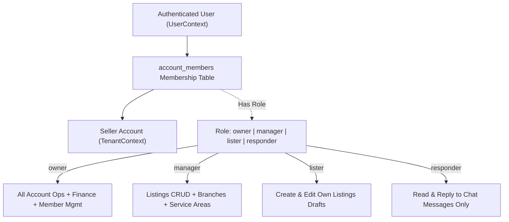

# Deal One — Security Architecture & Hardening Guide

## 1. Security Framework & Compliance Baseline

Security in **Deal One** is an active, non-negotiable architectural boundary. The platform complies with:
- **OWASP Application Security Verification Standard (ASVS) Level 2**
- **OWASP API Security Top 10 (2023 Edition)**
- **Egyptian Personal Data Protection Law (Law No. 151 of 2020)**

---

## 2. OWASP API Security Top 10 Threat Mitigation Matrix

| OWASP Vulnerability | Threat Vector in Classifieds Platform | Deal One Mandatory Defense Mechanism |
|---|---|---|
| **API1:2023 Broken Object Level Authorization (BOLA)** | A malicious user manipulates `listing_id` or `account_id` in URL parameters to edit/delete another merchant's property or ad. | **TenantContext Guard & Resource Ownership Verification:** Every mutating controller requires `@TenantContext()`. The repository enforces `WHERE id = :id AND account_id = :active_account_id`. Foreign entity modification returns `404 Not Found` (never revealing existence). |
| **API2:2023 Broken Authentication** | Credential stuffing, brute force on 6-digit OTPs, token replay, weak password reset. | **Argon2id Hashing + Redis Rate Limiter + Cloudflare Turnstile:** OTP endpoints enforce 3 requests/15 min limit. 5 wrong OTP attempts permanently burn the OTP. Silent Refresh Token Rotation with immediate revocation of all family sessions upon reuse detection. |
| **API3:2023 Broken Object Property Level Authorization** | Mass Assignment attacks where a client injects `"is_active": true`, `"verification_status": "approved"`, or `"role": "owner"` during update. | **Strict DTO Whitelisting:** Fastify + NestJS `ValidationPipe({ whitelist: true, forbidNonWhitelisted: true })` powered by Zod / class-validator. System/audit/status fields are strictly prohibited from incoming request schemas. |
| **API4:2023 Unrestricted Resource Consumption** | Rapid querying of PostGIS endpoints causing CPU spikes; unbounded media uploads exhausting storage. | **Sliding Window Rate Limiting (Redis):** Search limited to 60 req/min/IP. PostGIS spatial radius capped at 50 km. Max 10 images per listing. Presigned URLs enforce file size caps (max 10MB per image) via AWS S3 Content-Length-Range policy. |
| **API5:2023 Broken Function Level Authorization (BFLA)** | Normal user calling `/api/v1/admin/moderation/listings/{id}/decision`. | **Hierarchical Role Guards (RBAC):** Strict separation of `users` (public clients) from `staff_users` (admin portal). Public JWTs lack staff claims. Endpoint guards evaluate fine-grained permissions (`moderation:write`) on every admin route. |
| **API6:2023 Unrestricted Access to Sensitive Business Flows** | Automated bots scraping phone numbers, bulk-creating spam listings, or automating WhatsApp outreach. | **Midnight Quotas Engine + Cloudflare Turnstile:** Contact reveals and listing submissions require solving Turnstile bot puzzles and consume daily quotas tracked atomically in Redis (`Africa/Cairo` midnight reset). |
| **API7:2023 Server-Side Request Forgery (SSRF)** | Supplying external URLs in image imports or webhook callbacks to scan internal infrastructure. | **No Server-Side Fetching:** The backend never downloads media from arbitrary user-supplied URLs. Clients upload directly to Cloudflare R2 using presigned URLs. External image imports are strictly prohibited. |
| **API8:2023 Security Misconfiguration** | Verbose error stack traces leaked in responses, default credentials, exposed `/metrics` or `/docs`. | **Sanitized Production Errors & Helmet:** Production mode disables Swagger UI and stack traces. Fastify Helmet sets strict headers (`Content-Security-Policy`, `X-Content-Type-Options: nosniff`, `Strict-Transport-Security`). Prometheus metrics bound to internal network interface only. |
| **API9:2023 Improper Inventory Management** | Zombie or shadow API endpoints left exposed from earlier development phases. | **Centralized API Gateway & OpenAPI Contracts:** All endpoints are cataloged in `openapi.yaml`. Automated CI tests verify that no unmapped Fastify controller routes exist outside the audited inventory. |
| **API10:2023 Unsafe Consumption of APIs** | Blindly trusting data from Firebase Cloud Messaging, SMS gateways, or webhooks. | **Cryptographic Signature Verification:** Webhook callbacks (e.g., SMS provider delivery receipts) verify HMAC-SHA256 signatures before processing payloads. |

---

## 3. Authentication & Session Architecture

### 3.1 Token Lifetime & Rotation Strategy
1. **Access Token (Short-Lived):**
   - **Format:** Cryptographically signed JSON Web Token (JWT).
   - **Algorithm:** RS256 (asymmetric with private key on server) or HS256 with 256-bit high-entropy secret.
   - **Expiry:** **15 minutes**.
   - **Claims:** `sub` (userId), `phone`, `jti` (unique token ID), `iat`, `exp`.
2. **Refresh Token (Long-Lived with Strict Single-Use Rotation):**
   - **Format:** Opaque 128-bit UUID v4 token.
   - **Storage:** Stored in database table `user_sessions` as a **SHA-256 hash** alongside IP address, User-Agent, and device fingerprint.
   - **Expiry:** **30 days**.
   - **Replay & Theft Defense:** When a refresh token is exchanged, it is immediately revoked, and a new token pair is issued. If a client attempts to use an already-revoked refresh token, the server triggers an **Immediate Breach Revocation**: *all active sessions for that user are permanently destroyed*, forcing a full re-login and logging a critical security event.

### 3.2 Phone Verification (SMS OTP) Protection
- **Length & Character Set:** 6 numeric digits (`0-9`), generated via `crypto.randomInt(100000, 999999)`.
- **Hashing:** OTP codes are hashed with Argon2id before storage in table `otps`.
- **Lifetime:** Exactly **5 minutes**.
- **Lockout Policy:**
  - Maximum **5 failed verification attempts**. Upon the 5th failed attempt, the OTP is invalidated.
  - Maximum **3 OTP requests per 15 minutes** per phone number and per IP address via Redis sliding window counter.
  - Obligatory Cloudflare Turnstile bot verification token on `/auth/otp/send`.

### 3.3 Password Security
- For users opting into password authentication and all administrative `staff_users`:
  - **Algorithm:** **Argon2id** (Memory: 64MB, Iterations: 3, Parallelism: 4).
  - **Policy:** Minimum 10 characters, at least 1 uppercase letter, 1 lowercase letter, 1 digit, and 1 special symbol. Passwords checked against the HaveIBeenPwned top 100,000 compromised passwords list.

---

## 4. Multi-Tenant Authorization & BOLA/IDOR Defenses

### 4.1 Tenancy & Role Separation Model


### 4.2 The Golden Rule of Database Isolation
Under no circumstances may an API query fetch or modify a tenant-owned resource using only the client-provided entity ID.
- **Vulnerable Code Pattern (DO NOT USE):**
  ```typescript
  // VULNERABLE TO BOLA / IDOR!
  await prisma.listing.update({
    where: { id: params.listingId },
    data: updateDto,
  });
  ```
- **Mandatory Production Defense Pattern:**
  ```typescript
  // SECURE MULTI-TENANT ISOLATION
  const listing = await prisma.listing.findFirst({
    where: {
      id: params.listingId,
      accountId: tenantContext.activeAccountId, // Mandatory tenant constraint
      deletedAt: null,
    },
  });

  if (!listing) {
    throw new NotFoundException('Listing not found'); // Never reveal existence across tenants
  }
  ```

---

## 5. Media & File Upload Hardening

Direct multi-gigabyte uploads to application servers create Denial of Service vulnerabilities and execute arbitrary code. Deal One isolates uploads via Cloudflare R2:

```
[Flutter Mobile App] ──(1) Request Presigned URL──► [NestJS API] (Enforces Auth, Size Cap & MIME)
        │                                                    │
        │                                          (2) Returns Presigned R2 PUT URL (TTL: 15 min)
        ▼                                                    ▼
[Cloudflare R2 Bucket] ◄──(3) Direct Binary Upload (PUT)──────┘
        │
        └──(4) Webhook Notification / API Confirmation
                │
                ▼
        [BullMQ Worker] ──(5) Validate Magic Bytes, Strip GPS EXIF, Transcode to WebP
```

### File Security Controls:
1. **Direct Presigned PUT URLs:** Uploads go directly from mobile client to Cloudflare R2. Application servers never buffer file uploads.
2. **AWS S3 Content-Length-Range Policy:** The Presigned URL policy cryptographically limits the upload size to a maximum of **10 megabytes** for images and **100 megabytes** for video clips.
3. **Magic Byte Verification:** When the worker processes the file, it reads the initial file header bytes (`image/jpeg`: `FF D8 FF`, `image/png`: `89 50 4E 47`, `image/webp`: `52 49 46 46`) rather than trusting the client-supplied file extension.
4. **EXIF Privacy Scrubbing:** All uploaded photos are processed using `sharp` to strip all EXIF metadata (camera serial, date, and GPS coordinates) before generating public WebP thumbnails, preventing property stalking.

---

## 6. Security Logging, Auditing & SIEM Readiness

1. **Immutable Moderation Trail (`moderation_log`):**
   - Records every approval, rejection, suspension, and verification decision.
   - Insert-only (PostgreSQL table permissions revoke `UPDATE` and `DELETE` for the app role).
2. **Administrative Audit Trail (`audit_log`):**
   - Captures actor identity, IP address, user agent, action timestamp, and full before/after JSON diff of modified system settings or account statuses.
3. **Structured Security Telemetry:**
   - Pino logs output structured JSON events with `security_event: true` for:
     - Consecutive failed OTP attempts.
     - Token rotation reuse detection.
     - BOLA access attempts across tenants.
     - Daily quota exhaustion events.
