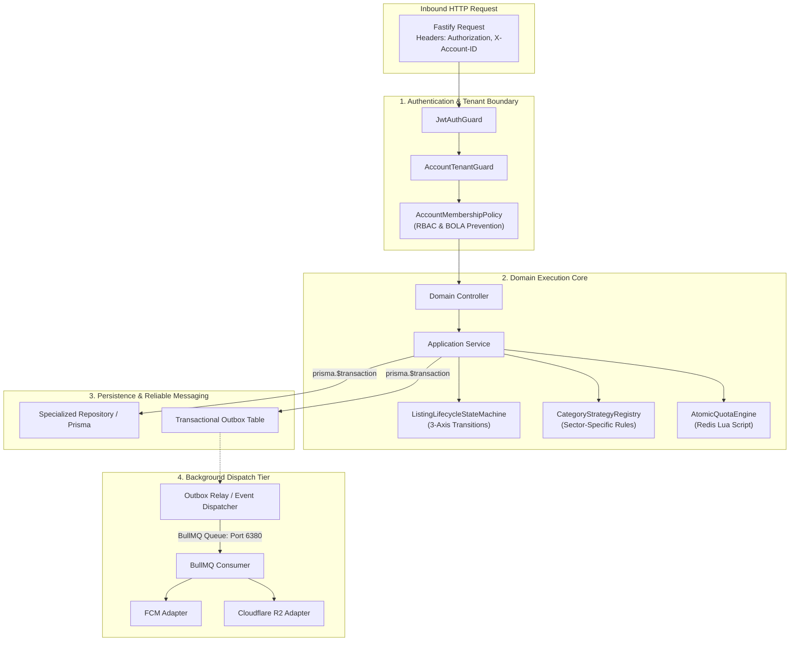
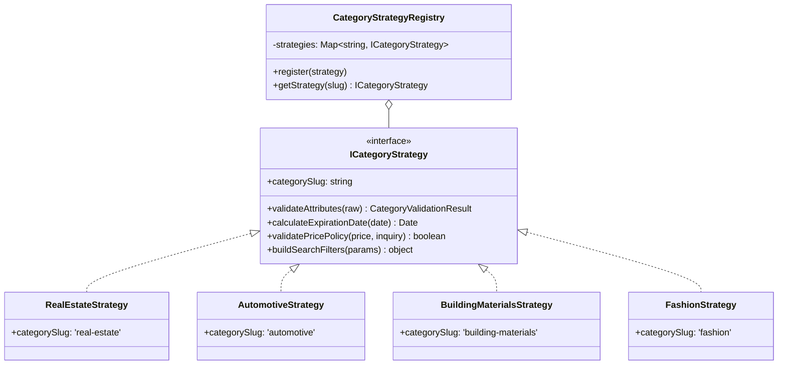
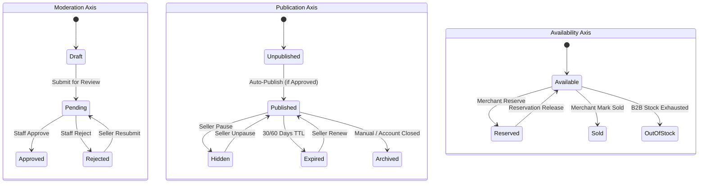
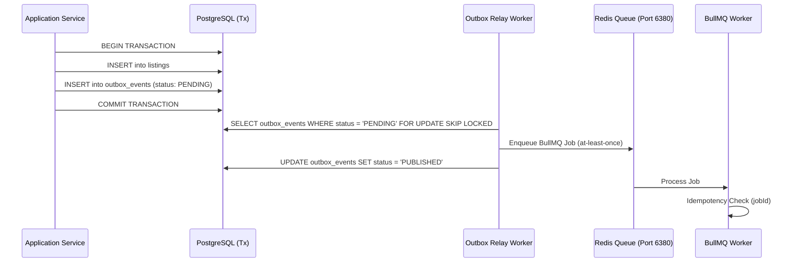

# Deal One — System-Specific Backend Design Patterns Specification

**Document Reference:** `27_BACKEND_DESIGN_PATTERNS.md`  
**Architecture Version:** `1.0.0-ENTERPRISE-SIGN-OFF`  
**Sign-off Status:** APPROVED ARCHITECTURAL SPECIFICATION  
**Target Platform:** NestJS + Fastify + PostgreSQL 16 (PostGIS) + Redis 7 (Dual Topology)  

---

## 1. Architectural Philosophy & Evaluation Matrix

In Deal One (a Hybrid Multi-Category Classifieds & B2B Marketplace), design patterns are adopted strictly to resolve verifiable domain challenges: multi-tenancy, diverse sectoral listing behaviors, orthogonal lifecycle states, and concurrency-sensitive quota constraints. No pattern is introduced as speculative abstraction or ritual boilerplate.

### 1.1 Required Patterns Evaluation Matrix

| Pattern | Verdict | Where It Is Used in Deal One | Where It Is Strictly FORBIDDEN |
|---|:---:|---|---|
| **Repository Pattern** | **ADOPT (Pragmatic)** | Data access for `Listings`, `Accounts`, `Orders`, and PostGIS queries where raw SQL or complex filtering rules must be encapsulated. | Generic `BaseRepository<T>` that wraps simple Prisma CRUD without domain behavior. |
| **Unit of Work** | **ADOPT (Prisma Transactions)** | Critical multi-table state mutations (e.g., Listing publication + Outbox event emission + Quota ledger record). Implemented natively via `prisma.$transaction()`. | Wrapping every read query or single-table update in explicit transactional objects. |
| **Strategy Pattern** | **ADOPT** | `CategoryStrategyEngine` (sectoral attribute validation, expiration, and pricing), SMS Gateway adapters, and payment verification. | Dynamic behaviors that can be declared with simple metadata configurations. |
| **Factory / Registry Pattern** | **ADOPT** | `CategoryStrategyRegistry` for compile-time and runtime strategy resolution, and Outbox event deserializer. | Creating trivial DTOs, standard NestJS services, or simple domain entities. |
| **Adapter Pattern** | **ADOPT** | Boundary adapters for external third parties: Cloudflare R2, SMS Misr, Paymob, Cloudflare Turnstile, and Firebase Cloud Messaging (FCM). | Adapting internal NestJS modules to one another. |
| **State Pattern / Finite State Machine** | **ADOPT** | `ListingLifecycleStateMachine` managing the 3 orthogonal lifecycle axes (`moderation`, `publication`, `availability`). | Simple boolean toggles (e.g., `is_active`, `is_phone_verified`). |
| **Specification Pattern** | **ADOPT** | `ListingSearchSpecification` composing PostGIS spatial filters, price ranges, and dynamic JSONB category attributes into safe parameterized queries. | Micro-queries or simple ID lookups (`findById`). |
| **Policy Pattern** | **ADOPT** | Multi-tenant account access, team role capabilities (`owner`, `manager`, `lister`, `responder`), and BOLA/IDOR prevention guards. | Simple authentication checks handled by standard JWT verification. |
| **Domain Events** | **ADOPT** | Communicating asynchronous intent across boundaries (e.g., `ListingApprovedEvent`, `QuotaDepletedEvent`, `MessageSentEvent`). | Internal procedural step execution within the same transactional boundary. |
| **Transactional Outbox** | **ADOPT** | Relational `outbox_events` table ensuring database mutations and BullMQ job dispatches are atomic and immune to dual-write failures. | Non-critical telemetry, metrics collection, or transient cache updates. |
| **CQRS Lite** | **ADOPT** | Separation of write commands (state machines, transactions) from optimized read queries (PostGIS spatial search, listing details). | Full Event Sourcing, separate read-model databases, or microservice CQRS frameworks. |
| **Observer Pattern** | **REJECT (Favor BullMQ/Outbox)** | Replaced by Transactional Outbox + BullMQ async jobs for durability and zero loss on process crash. | In-memory EventEmitter for critical business operations. |
| **Decorator Pattern** | **ADOPT** | NestJS method decorators for `@CurrentAccount()`, `@CurrentUser()`, `@RequirePermissions()`, and `@AuditTrace()`. | Complex business domain calculations or data transformations. |

---

## 2. Forbidden Anti-Patterns (Quality Guardrails)

The following architectural anti-patterns are strictly forbidden:

1. **God Services:** A single service exceeding 350 lines or managing multiple domain aggregates (e.g., a service handling auth, user profile, account switching, and device tokens).
2. **Fat Controllers:** Controllers must contain zero business logic, zero raw SQL, and zero direct database calls. Their sole responsibility is HTTP parsing, DTO validation, delegation, and status code mapping.
3. **Giant Switch Statements:** Using `switch(category)` or `if (cat === 'real_estate')` across disparate services. Sectoral behavior must be dispatched via the `CategoryStrategyEngine`.
4. **Circular Dependencies:** Module imports must form a Directed Acyclic Graph (DAG). Cross-module direct dependencies are resolved through Domain Events or Public Domain Interfaces.
5. **Generic `BaseRepository<T>`:** Never write boilerplate CRUD wrappers around Prisma methods that provide zero domain value. Repositories exist only when encapsulating specialized domain queries.
6. **Interface Pollution:** Never create an `IListingService` interface if there is only ever one implementation in the monolith. Interfaces are required only at architectural boundaries (adapters, strategies, ports).
7. **Direct Database Access from Controllers:** Bypassing the domain/service layer to invoke Prisma directly in controllers is an immediate build rejection.
8. **Overengineering / Distributed Overkill:** Never introduce Kafka, gRPC, microservices, or complex event-sourcing frameworks where PostgreSQL and Redis natively solve the problem.

---

## 3. Deep-Dive: System-Specific Design Patterns



---

### Pattern A: Multi-Tenant Account Architecture

#### 1. Problem
In Deal One, an individual user identity can own or be invited as a team member (`manager`, `lister`, `responder`) to multiple commercial accounts (`company`, `factory`, `store`, `individual`). A request must execute strictly within an isolated Account Context without leaking data across accounts (Broken Object Level Authorization / BOLA).

#### 2. Architecture & Contracts
- **Account Context:** Captured from the verified JWT and optional `X-Account-ID` HTTP header.
- **Tenant Scope Guard:** Ensures the calling user has active membership in the target account.
- **Repository-Level Enforcement:** Every mutation query for listings, branches, projects, or orders must include `account_id` in its `WHERE` clause.

```typescript
export interface AccountContext {
  readonly accountId: string;
  readonly userId: string;
  readonly accountType: 'individual' | 'company' | 'factory' | 'office' | 'store';
  readonly memberRole: 'owner' | 'manager' | 'lister' | 'responder';
  readonly permissions: ReadonlySet<string>;
}

export interface ITenantScopedRepository<T> {
  findById(accountContext: AccountContext, id: string): Promise<T | null>;
  findMany(accountContext: AccountContext, filter: unknown): Promise<T[]>;
  create(accountContext: AccountContext, data: unknown): Promise<T>;
  update(accountContext: AccountContext, id: string, data: unknown): Promise<T>;
  delete(accountContext: AccountContext, id: string): Promise<boolean>;
}
```

#### 3. Verification & Guardrails
- **Automated Test:** An integration test verifies that requesting a listing belonging to `Account B` using an authenticated session bound to `Account A` returns `403 Forbidden` / `404 Not Found`.
- **Complexity Cost:** Requires passing `AccountContext` through service methods.
- **Alternatives Rejected:** Multi-database tenancy (unjustified infrastructure overhead) or Row Level Security (RLS) policies in Postgres (adds friction with ORMs and connection pools).

---

### Pattern B: Category Strategy Engine

#### 1. Problem
Deal One spans highly divergent business categories:
- **Real Estate:** High price, requires project reference, delivery date, rooms, bathrooms, finishing type, 60-day expiry.
- **Automotive:** Vehicle condition, mileage, brand, model, transmission, fuel type, 60-day expiry.
- **Fashion:** FMCG, size, color, gender, condition, fixed price mandatory, 30-day expiry.
- **Building Materials:** B2B industrial, spot price fluctuations, `price_on_inquiry: true` allowed, minimum order quantities, 30-day expiry.

Scattering `if (category === 'automotive')` across the codebase leads to monolithic failure and regression bugs.

#### 2. Architecture & Contracts
The **Category Strategy Engine** utilizes a **Strategy + Registry Pattern**:

```typescript
export interface CategoryValidationResult {
  readonly isValid: boolean;
  readonly errors: Record<string, string>;
  readonly sanitizedAttributes: Record<string, any>;
}

export interface ICategoryStrategy {
  readonly categorySlug: string;
  
  validateAttributes(rawAttributes: Record<string, any>): Promise<CategoryValidationResult>;
  calculateExpirationDate(submissionDate: Date): Date;
  validatePricePolicy(price: number, priceOnInquiry: boolean): { isValid: boolean; reason?: string };
  buildSearchFilters(filterParams: Record<string, any>): Record<string, any>;
}

export interface ICategoryStrategyRegistry {
  register(strategy: ICategoryStrategy): void;
  getStrategy(categorySlug: string): ICategoryStrategy;
}
```



#### 3. Verification & Guardrails
- **Automated Test:** Submitting a Building Material listing with `price: 0` and `price_on_inquiry: true` passes validation, while submitting a Real Estate listing with `price: 0` is rejected with `VALIDATION_ERROR: Mandatory price required`.
- **Complexity Cost:** Modest class count expansion; offsets hundred-line conditional blocks.
- **Alternatives Rejected:** Pure database schema definitions without code strategies (fails to handle dynamic expiration or cross-field validation rules).

---

### Pattern C: Listing Lifecycle State Machine

#### 1. Problem
A listing’s state is multidimensional. Collapsing lifecycle into a single `status` column produces state confusion (e.g., what does `EXPIRED` mean if the ad was also `REJECTED` by a moderator?).

#### 2. Architecture: Orthogonal 3-Axis Lifecycle
As dictated by ADR-007, Deal One decouples lifecycle into three independent orthogonal axes:
1. **Moderation Axis:** `draft` -> `pending` -> `approved` | `rejected`
2. **Publication Axis:** `unpublished` -> `published` -> `hidden` | `archived` | `expired`
3. **Availability Axis:** `available` -> `reserved` | `sold` | `rented` | `out_of_stock`

Only an ad with `moderation = approved`, `publication = published`, and `availability = available` is indexable and visible in the public buyer feed.



#### 3. Transition Rules & Guards
All transitions must pass through the `ListingLifecycleStateMachine`:

```typescript
export interface StateTransitionCommand {
  readonly listingId: string;
  readonly accountContext: AccountContext;
  readonly targetAxis: 'moderation' | 'publication' | 'availability';
  readonly targetState: string;
  readonly reason?: string;
}

export interface IListingStateMachine {
  transition(command: StateTransitionCommand): Promise<void>;
  assertCanPublish(listing: { moderationStatus: string; publicationStatus: string; availabilityStatus: string }): boolean;
}
```

Direct SQL updates to status columns outside the state machine are strictly forbidden.

---

### Pattern D: Atomic Quota Engine

#### 1. Problem
Under high concurrency, multiple team members or bot attacks could submit listings or reveal seller phone numbers simultaneously, bypassing business quotas and causing race conditions.

#### 2. Architecture & Contracts
- **Tier Limits:**
  - `individual`: 3 listings/day, 15 contact reveals/day, 20 chats/day.
  - `company` / `store`: 30 listings/day, 100 contact reveals/day, unlimited chats.
- **Reset Boundary:** Every midnight at `00:00:00 Africa/Cairo`.
- **Atomic Redis Lua Script:**
  Increments the counter and establishes TTL to the exact Cairo midnight timestamp in a single atomic cycle.

```lua
-- Atomic Quota Increment & TTL Establishment
local key = KEYS[1]
local cairoMidnightTimestamp = tonumber(ARGV[1])
local limit = tonumber(ARGV[2])

local current = redis.call('INCR', key)
if current == 1 then
    redis.call('EXPIREAT', key, cairoMidnightTimestamp)
end

if current > limit then
    return {0, current, limit} -- Quota Exceeded (allowed = false)
else
    return {1, current, limit} -- Allowed (allowed = true)
end
```

```typescript
export interface QuotaCheckResult {
  readonly allowed: boolean;
  readonly currentUsage: number;
  readonly limit: number;
  readonly resetsAt: Date;
}

export interface IQuotaEngine {
  consumeQuota(
    accountId: string,
    quotaType: 'listings' | 'contact_reveals' | 'chats',
    accountType: string
  ): Promise<QuotaCheckResult>;
  
  getRemainingQuota(
    accountId: string,
    quotaType: 'listings' | 'contact_reveals' | 'chats',
    accountType: string
  ): Promise<QuotaCheckResult>;
}
```

#### 3. Verification & Guardrails
- **Automated Test:** 50 concurrent requests fired against an account with a limit of 3 listings result in exactly 3 successful operations and 47 `QUOTA_EXCEEDED` responses.
- **Persistence Ledger:** A background cron job synchronizes Redis usage to the `daily_quotas` table at Cairo midnight.

---

### Pattern E: Search & Discovery Architecture (PostGIS + Specification)

#### 1. Problem
Filtering across categories, bounding boxes, fuzzy GPS coordinates, price ranges, and dynamic attributes without downloading unindexed rows into Node.js memory.

#### 2. Architecture & Contracts
- **Specification Pattern:** Encapsulates composable query predicate objects.
- **PostGIS Geospatial Predicates:**
  1. `ST_DWithin(physical_location, ST_MakePoint(lng, lat)::geography, radius_meters)` filters candidate records using the spatial GIST index.
  2. `ST_Distance(physical_location, ST_MakePoint(lng, lat)::geography)` calculates exact distance for sorting.
- **Privacy Fuzzing:** The search API returns `display_location` (fuzzed administrative point), keeping `physical_location` confidential until an authorized reveal.

```typescript
export interface SearchQuerySpecification {
  readonly categorySlug?: string;
  readonly governorateId?: number;
  readonly cityId?: number;
  readonly areaId?: string;
  readonly coordinates?: { lat: number; lng: number; radiusKm: number };
  readonly priceMin?: number;
  readonly priceMax?: number;
  readonly dynamicAttributes?: Record<string, any>;
  readonly page: number;
  readonly limit: number;
  readonly sortBy: 'refreshed_at' | 'price_asc' | 'price_desc' | 'distance';
}

export interface ISearchQueryBuilder {
  buildWhereClause(spec: SearchQuerySpecification): { sql: string; params: any[] };
  buildOrderByClause(spec: SearchQuerySpecification): string;
}
```

---

### Pattern F: Domain Events & Transactional Outbox Pattern

#### 1. Problem
Publishing an event (e.g., to Redis or BullMQ) after database commit creates dual-write inconsistency: if the broker is unavailable or the process crashes right after DB commit, background jobs (notifications, indexing, thumbnailing) are permanently lost.

#### 2. Architecture & Contracts
1. **Single Transaction Boundary:** When an entity changes state (e.g., a listing is created or approved), the business record and an `OutboxEvent` are written in the *same* database transaction:
   ```typescript
   await prisma.$transaction(async (tx) => {
     await tx.listing.create({ data: listingData });
     await tx.outboxEvent.create({
       data: {
         id: uuidv4(),
         aggregateType: 'Listing',
         aggregateId: listingId,
         eventType: 'LISTING_SUBMITTED',
         payload: { listingId, accountId },
         status: 'PENDING',
       },
     });
   });
   ```
2. **Reliable Relay:** An asynchronous BullMQ Outbox Processor reads pending events, enqueues them into BullMQ workers on Redis Queue (Port 6380), and marks them `PUBLISHED` upon confirmed dispatch.



---

### Pattern G: Authorization Architecture (RBAC & BOLA Prevention)

#### 1. Problem
Preventing Broken Object Level Authorization (BOLA/IDOR), ensuring merchants can only mutate their own assets, and enforcing team member privileges within an account.

#### 2. Policy-Based Architecture
- **Authentication:** Decodes JWT access token and populates `CurrentUser`.
- **Account Membership Guard:** Verifies `X-Account-ID` against `account_members` table (cached in Redis for 5 minutes).
- **Policy Enforcement:**
  - `CanPublishListingPolicy`: User must possess `owner`, `manager`, or `lister` role in the account.
  - `CanRespondChatPolicy`: User must possess `owner`, `manager`, or `responder` role.
  - `CanManageTeamPolicy`: User must possess `owner` or `manager` role.

---

### Pattern H: External Services Adapter Contracts (Ports & Adapters)

To ensure zero vendor lock-in, all third-party integrations implement clean TypeScript interfaces:

1. **Object Storage Port (`IStorageAdapter`):**
   - Current: Cloudflare R2 (S3-compatible API).
   - Alternative: AWS S3, MinIO.
2. **SMS Gateway Port (`ISmsGatewayAdapter`):**
   - Current: SMS Misr.
   - Alternative: Vodafone Egypt, Twilio.
3. **CAPTCHA Verification Port (`ICaptchaVerifierAdapter`):**
   - Current: Cloudflare Turnstile.
   - Alternative: Google reCAPTCHA v3.
4. **Push Notification Port (`IPushNotificationAdapter`):**
   - Current: Firebase Cloud Messaging (FCM HTTP v1).
5. **Payment Gateway Port (`IPaymentGatewayAdapter`):**
   - Current: Paymob Egypt.

```typescript
export interface IStorageAdapter {
  generatePresignedUploadUrl(key: string, contentType: string, expiresInSeconds: number): Promise<string>;
  deleteObject(key: string): Promise<boolean>;
  getPublicUrl(key: string): string;
}

export interface ISmsGatewayAdapter {
  sendOtp(phone: string, code: string): Promise<{ success: boolean; messageId?: string }>;
}
```

---

## 4. Architectural Sign-off & Compliance

The patterns detailed in this document adhere strictly to the Deal One ADR specifications:
- **ADR-001 / ADR-002 / ADR-003:** Category Strategy Engine & Dynamic Attributes.
- **ADR-005:** Multi-Tenant Account Architecture.
- **ADR-006 / ADR-009:** Two-Tier PostGIS Spatial Discovery.
- **ADR-007:** Orthogonal 3-Axis Listing Lifecycle State Machine.
- **ADR-013:** Fastify + Dual Redis Topology.
