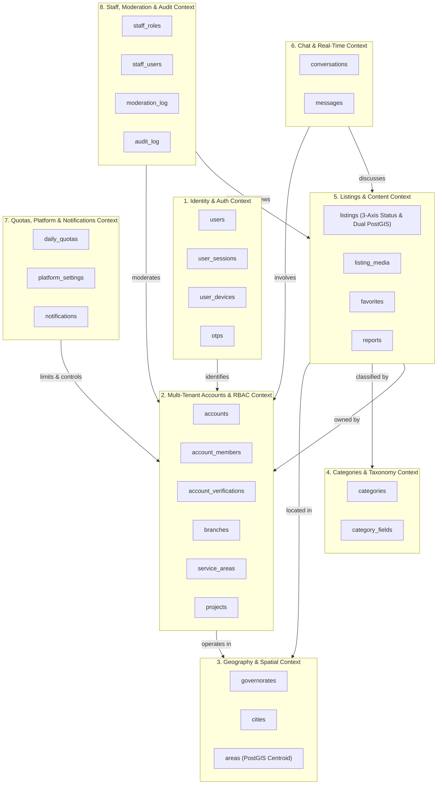
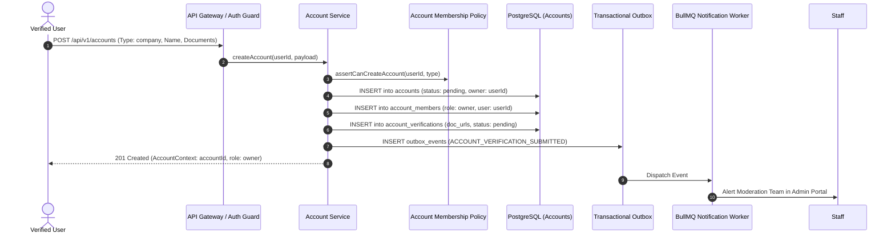
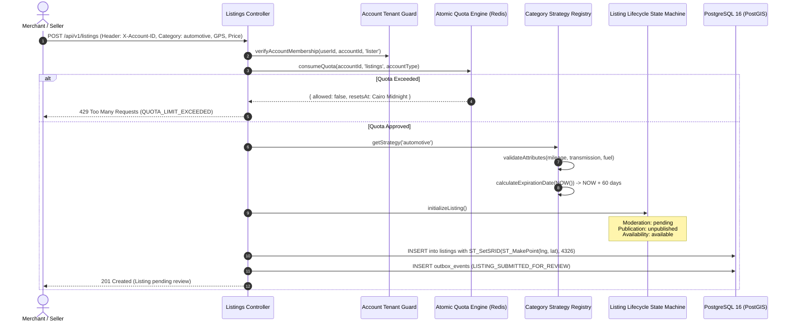
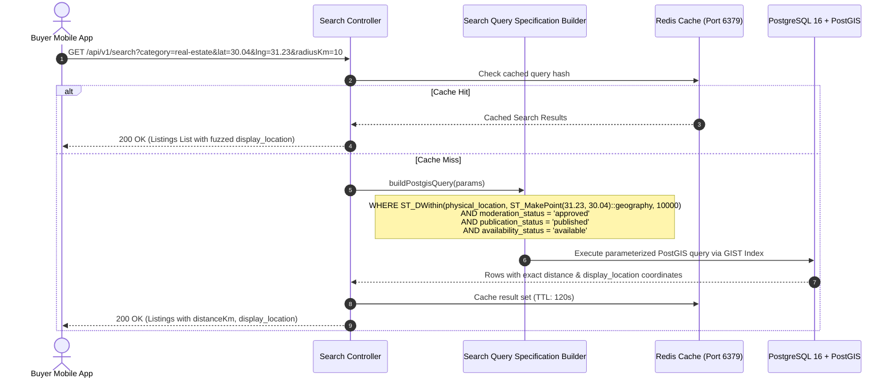
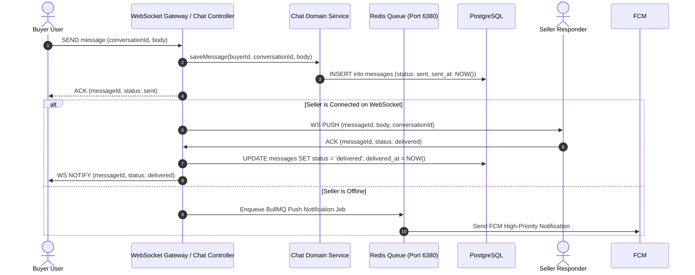

# Deal One — Domain Architecture & Bounded Contexts Map

**Document Reference:** `28_DOMAIN_ARCHITECTURE_MAP.md`  
**Architecture Version:** `1.0.0-ENTERPRISE-SIGN-OFF`  
**Sign-off Status:** APPROVED ARCHITECTURAL SPECIFICATION  
**Scope:** Complete Domain Map, Bounded Contexts, Entity Allocations, and Key Operational Flows  

---

## 1. Domain Bounded Contexts & Module Registry

Deal One is structured into **8 Bounded Contexts** adhering strictly to Domain-Driven Design (DDD) principles within a Modular Monolith.

---

## 2. Table-to-Context Mapping Matrix (28 Relational Tables)

| # | Table Name | Bounded Context | Aggregate Root | Data Access Scope | Primary Index Type |
|---|---|---|---|---|---|
| 1 | `governorates` | Geography | Governorate | Shared Public Read | B-Tree |
| 2 | `cities` | Geography | Governorate | Shared Public Read | B-Tree |
| 3 | `areas` | Geography | Governorate | Spatial Search | GIST (`centroid`) |
| 4 | `users` | Identity & Auth | User | Private Identity | B-Tree |
| 5 | `user_sessions` | Identity & Auth | User | Auth Boundary | B-Tree (TTL) |
| 6 | `user_devices` | Identity & Auth | User | Push Target | B-Tree |
| 7 | `otps` | Identity & Auth | User | Transient Auth | B-Tree (Hash) |
| 8 | `accounts` | Multi-Tenant Accounts | Account | Tenant Root | B-Tree (Slug) |
| 9 | `account_members` | Multi-Tenant Accounts | Account | Tenant Security | B-Tree (Composite) |
| 10 | `account_verifications` | Multi-Tenant Accounts | Account | Compliance | B-Tree |
| 11 | `branches` | Multi-Tenant Accounts | Account | Tenant Spatial | GIST (`location`) |
| 12 | `service_areas` | Multi-Tenant Accounts | Account | Tenant Territory | B-Tree |
| 13 | `projects` | Multi-Tenant Accounts | Account | Real Estate Sub-Root | B-Tree |
| 14 | `categories` | Categories & Taxonomy | Category | Shared Taxonomy | B-Tree (Slug) |
| 15 | `category_fields` | Categories & Taxonomy | Category | Dynamic Attributes | B-Tree (Composite) |
| 16 | `listings` | Listings & Content | Listing | Public/Tenant Asset | GIST (`physical_loc`) + GIN (`attributes`) |
| 17 | `listing_media` | Listings & Content | Listing | Media Attachments | B-Tree |
| 18 | `favorites` | Listings & Content | User | User Engagement | B-Tree (Composite) |
| 19 | `reports` | Listings & Content | Listing / User | Trust & Safety | B-Tree |
| 20 | `conversations` | Chat & Real-Time | Conversation | Direct Messaging | B-Tree (Pair) |
| 21 | `messages` | Chat & Real-Time | Conversation | Message Stream | B-Tree (Chronological) |
| 22 | `notifications` | Governance | User | Notification Center | B-Tree (Chronological) |
| 23 | `daily_quotas` | Governance | Account | Quota Ledger | B-Tree (Date Composite) |
| 24 | `platform_settings` | Governance | PlatformSettings | Configuration Root | B-Tree (PK Key) |
| 25 | `staff_roles` | Administration | StaffUser | RBAC Permissions | B-Tree |
| 26 | `staff_users` | Administration | StaffUser | Admin Operator | B-Tree |
| 27 | `moderation_log` | Administration | StaffUser | Immutable Audit | B-Tree (Append Only) |
| 28 | `audit_log` | Administration | StaffUser | Immutable Audit | B-Tree (Append Only) |

---

## 3. End-to-End Operational Flow Architectures

### Flow 1: Multi-Tenant Account Onboarding & Verification

---

### Flow 2: Listing Submission, Category Strategy Validation & Orthogonal Lifecycle

---

### Flow 3: Geospatial Search & Discovery with Privacy Fuzzing

---

### Flow 4: Real-Time Chat Message Delivery with 3-Step Receipts

---

## 4. Cross-Module Communication Governance

1. **Rule of Direct Isolation:** No module may import another module's Prisma repository or internal service classes.
2. **Public Ports:** A module exposes an `@Injectable()` Public Domain Facade (e.g., `CategoriesPublicService`, `AccountsPublicService`) exposing only clean DTOs.
3. **Asynchronous Decoupling:** Non-transactional cross-boundary updates (such as sending push notifications or updating search cache) MUST occur asynchronously through Domain Events dispatched to the Transactional Outbox.
4. **Zero Circular Imports:** Enforced by ESLint rule `import/no-cycle` at compile time and CI build gates.
