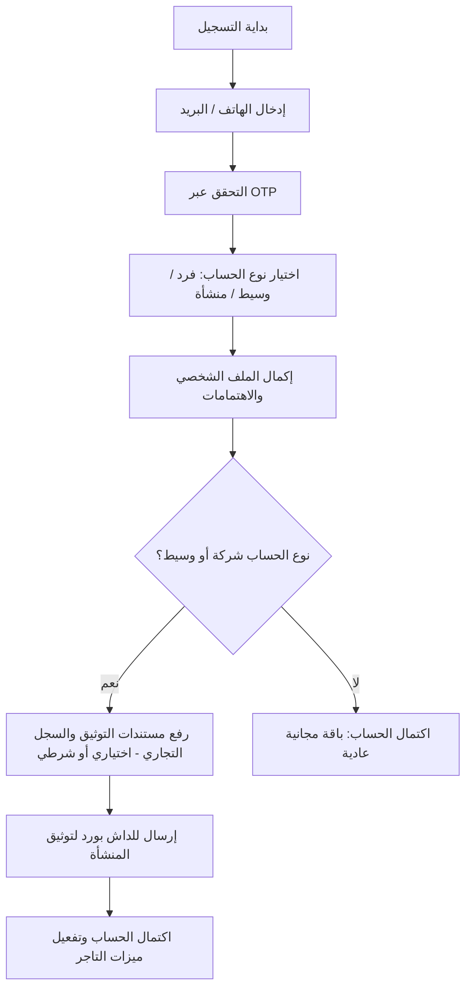
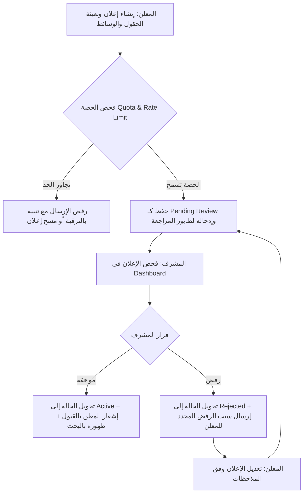

# وثيقة متطلبات البرمجيات (SRS)
## منصة الإعلانات المبوبة للعقارات ومواد البناء والخدمات والمشروعات

**الإصدار:** 1.1 — معمارية البوابات القطاعية، حوكمة الإعلانات، وحدود الحصص والمراجعة  
**اللغة:** العربية  
**حالة الوثيقة:** مسودة شاملة محدثة وفق متطلبات البوابات المتخصصة والتحكم المركزي

---

## 1. المقدمة

### 1.1 الغرض من الوثيقة
تحدد هذه الوثيقة نطاق المنصة، بنيتها التفاعلية، أصحاب المصلحة، مراحل التسجيل والورك فلو، دورة حياة الإعلانات واعتمادها الإداري، وحدود الحصص والاستخدام. تُستخدم كأساس لتصميم المعمارية وتطوير واجهات Flutter ولوحة الإدارة وقواعد البيانات.

### 1.2 وصف المنتج
منصة إعلانات مبوبة ذكية متعددة القطاعات (Multi-Vertical Marketplace)، تجمع أربعة قطاعات اقتصادية حيوية:
1. **العقارات:** للبيع والإيجار والمشروعات السكنية والتجارية.
2. **مواد البناء والتوريد:** تجارة الجملة والتجزئة وتوريدات المواقع الإنشائية.
3. **الخدمات والمقاولات:** التشطيبات، الصيانة، الحرف التخصصية، ونقل المعدات.
4. **المشروعات والفرص الاستثمارية:** شراكات، أراضٍ استثمارية، وتمويل مشروعات.

**معمارية الواجهات (Verticalized Portals Architecture):**
يعمل كل قطاع كـ "بوابة متخصصة" (Dedicated Vertical Portal) لها:
- **شاشة رئيسية مخصصة (Dedicated Home):** تتوافق كلياً مع طبيعة القطاع (مثلاً: بحث جغرافي وخريطة للعقارات، دليل توريدات وكتالوج مواد للبناء، دليل فنيين ومقاولين للخدمات، ملخصات استثمارية للمشروعات).
- **شريط تنقل سفلي سياقي (Contextual Bottom Navigation Bar):** تتغير عناصر النافبار السفلي تلقائياً بحسب القطاع النشط لتقديم الأدوات الأكثر أهمية للمستخدم في ذلك المجال، مع وجود خيار دائم للتبديل السريع بين القطاعات (Global Sector Switcher) في الشريط العلوي (App Header).

### 1.3 أهداف المنتج
- منح كل قطاع هويته الوظيفية الكاملة دون إجبار المستخدم على تجربة عامة مشتتة.
- تمكين الإدارة من ضبط الجودة وحوكمة المحتوى عبر اشتراط المراجعة والموافقة المسبقة في لوحة التحكم (Admin Dashboard) قبل ظهور الإعلان للجمهور.
- فصل وتصنيف شرائح المستخدمين (أفراد، وسطاء، تجار وموردين، شركات) وضبط حصص النشر (Quotas) ومكافحة الإغراق (Anti-spam).
- مسار تسجيل سلس وتدريجي يبدأ بالبساطة ويتدرج نحو التحقق المؤسسي.

### 1.4 المصطلحات
- **البوابة القطاعية (Sector Portal):** بيئة التصفح المخصصة لقطاع معين تشمل شاشته الرئيسية والنافبار وأدوات البحث الخاصة به.
- **مبدّل القطاعات العام (Global Sector Switcher):** مكوّن واجهة علوي يتيح التنقل الفوري بين البوابات الأربع.
- **الإعلان (Listing):** المنشور المعروض للبيع أو الشراء أو الخدمة بعد اعتماده.
- **طابور المراجعة (Moderation Queue):** قائمة الإعلانات المعلقة في لوحة الإدارة بانتظار فحص المشرف واعتمادها أو رفضها.
- **حصة النشر (Listing Quota):** الحد الأقصى المسموح به من الإعلانات النشطة أو المنشورة لكل مستخدم في فترة زمنية.
- **التحقق من الهوية والمنشأة (KYC / KYB):** إجراءات التوثيق الرسمية للمستخدمين الأفراد والشركات.

---

## 2. نطاق النظام

### 2.1 داخل النطاق
- تطبيق موبايل (Flutter) يدعم Android وiOS باتجاه RTL ولغة عربية متقنة.
- معمارية بوابات قطاعية مستقلة مع أشرطة تنقل سياقية قابلة للتبديل بسلاسة.
- نظام تسجيل مرن متعدد المراحل (الهاتف + OTP، تصنيف الحساب، إكمال الملف، التوثيق).
- نظام تقسيم المستخدمين (أفراد، وسطاء، منشآت/موردون) بصلاحيات وحصص مختلفة.
- نظام مراجعة واعتماد الإعلانات عبر لوحة إدارة ويب، مع إشعار المستخدم بالنتيجة وأسباب الرفض.
- نظام حدود وحصص النشر (Quotas & Rate Limits) لمنع الإغراق وضبط الجودة.
- إدارة الإعلانات والبحث المخصص والفلاتر المتوافقة مع طبيعة كل قطاع.
- المفضلة وطلبات التسعير والتواصل المباشر.
- لوحة إدارة متقدمة لإدارة المحتوى، المستخدمين، البلاغات، والتصنيفات.

### 2.2 خارج النطاق في الإصدار الأول
- بوابات الدفع الإلكتروني المدمجة (يتم الاعتماد في البداية على التواصل المباشر ونظام الاشتراكات اليدوية/التجريبية).
- التعاقد الرقمي الملزم أو نقل الملكية القانونية عبر المنصة.
- مكالمات الصوت والفيديو المباشرة داخل التطبيق.

---

## 3. تصنيف المستخدمين والأدوار (User Segmentation & Roles)

ينقسم مستخدمو المنصة إلى مستويين رئيسيين: المستخدمون الخارجيون (مستخدمو التطبيق) ومستخدمو الإدارة.

### 3.1 المستخدمون الخارجيون (التطبيق)
1. **الزائر (Guest):**
   - يمكنه تصفح جميع البوابات والإعلانات واستخدام الفلاتر العامة.
   - يُلزم بالتسجيل عند: إضافة إعلان، إضافة للمفضلة، مراسلة المعلن، أو إرسال طلب تسعير.
2. **المشتري / الباحث (Buyer / Seeker):**
   - يبحث عن عقارات، يطلب عروض أسعار لمواد بناء أو خدمات، ويتابع الفرص الاستثمارية.
   - يمتلك ملفاً شخصياً، قائمة مفضلة، وسجل طلبات التسعير والرسائل.
3. **المعلن الفرد (Individual Private Seller):**
   - يبيع أو يؤجر أصوله الخاصة (شقة شخصية، سيارة، فائض مواد).
   - يخضع لحدود نشر مجانية مقيدة (مثلاً: 2 إعلان نشط كحد أقصى).
   - تخضع إعلاناته للمراجعة الإلزامية قبل النشر.
4. **الوسيط / المسوق العقاري (Broker / Independent Agent):**
   - يسوّق عقارات لصالحه أو لصالح عملاء.
   - يتطلب توثيق رقم الهوية والترخيص المهني (إن وجد).
   - يحصل على حصة نشر أعلى أو باقات تسويقية مخصصة مع شارة "وسيط معتمد".
5. **المنشأة / التاجر / المورد / شركة المقاولات (Business / Verified Merchant):**
   - حساب مخصص لشركات التطوير العقاري، مصانع ومعارض مواد البناء، وشركات المقاولات والتشطيب.
   - يتطلب توثيق السجل التجاري والبطاقة الضريبية (KYB).
   - يمتلك صفحة شركة مخصصة (Company Profile / Showroom)، حصص نشر مرتفعة، إمكانية رفع كتالوجات مجمعة، واستقبال طلبات عروض الأسعار الرسمية (RFQs).

### 3.2 مستخدمو الإدارة (لوحة التحكم)
1. **مشرف المحتوى (Content Moderator):**
   - مراجعة الإعلانات الجديدة والمعدلة في "طابور المراجعة".
   - قبول الإعلان أو رفضه مع تحديد السبب (من قائمة أسباب معيارية أو كتابة سبب مخصص).
   - مراجعة البلاغات الواردة من المستخدمين واتخاذ إجراءات الحظر أو الحذف.
2. **مدير النظام (Super Admin):**
   - إدارة أقسام وتصنيفات المنصة وحقولها المخصصة.
   - تحديد وتعديل حصص النشر (Quotas) لكل فئة من المستخدمين.
   - إدارة حسابات المشرفين، سجل التدقيق (Audit Logs)، وإحصاءات الأداء والتشغيل.

---

## 4. المتطلبات الوظيفية

### 4.1 الحساب، الهوية، ومراحل التسجيل (Registration & Onboarding Workflow)
- **FR-AUTH-001 (المرحلة 1: التحقق الأولي السريع):** يبدأ التسجيل برقم الهاتف متبوعاً بكود التحقق لمرة واحدة (SMS OTP) أو البريد الإلكتروني وكلمة المرور، لتقليل الاحتكاك (Friction) عند البدء.
- **FR-AUTH-002 (المرحلة 2: تصنيف نوع الحساب):** يختار المستخدم نوعه:
  - فرد (مشتري/بائع عادي).
  - وسيط مستقل / مهني.
  - منشأة / شركة / مورد.
- **FR-AUTH-003 (المرحلة 3: إكمال الملف واختيار الاهتمامات):**
  - الفرد: الاسم الكامل، المدينة/المنطقة، والقطاعات التي يهتم بمتابعتها.
  - الوسيط: الاسم التجاري/الشخصي، المنطقة الجغرافية للتغطية، ورقم الترخيص.
  - الشركة: اسم المنشأة، الشعار، العنوان، نوع النشاط (تطوير، توريد، مقاولات)، وأرقام الاتصال الرسمية.
- **FR-AUTH-004 (المرحلة 4: التوثيق ورفع المستندات - Verification):**
  - خطوة اختيارية للأفراد لتوثيق الهوية (شارة موثق).
  - خطوة إلزامية أو شرطية للمنشآت والمكاتب الراغبة في حصص نشر تجارية وفتح صفحات المعارض وشارة الاعتماد.
  - تظل حالة الحساب التجاري "قيد مراجعة التوثيق" حتى يعتمده المشرف في لوحة الإدارة.
- **FR-AUTH-005 (حفظ الجلسة والأمان):** دعم تسجيل الدخول التلقائي مع رموز وصول JWT وتحديث آمن، وفرض التحقق على الخادم لكل طلب.

### 4.2 البوابات القطاعية وشرائط التنقل المتخصصة (Sector Portals & Navigation)
- **FR-PORTAL-001 (المبدل العام للقطاعات - Global Sector Switcher):**
  - شريط علوي بارز ومستمر في كل البوابات يسمح بالانتقال بلمسة واحدة بين القطاعات الأربعة:
    1. العقارات
    2. مواد البناء والتوريد
    3. الخدمات والمقاولات
    4. المشروعات والاستثمار
  - يحفظ النظام آخر قطاع نشط للمستخدم ويستعيده عند فتح التطبيق مجدداً.
- **FR-PORTAL-002 (بوابة العقارات - Real Estate Vertical):**
  - **الرئيسية (Home):** لافتات مميزة، وصول سريع (شراء / إيجار / تجاري)، شريط بحث جغرافي، وفلاتر العقار (غرف، مساحة، سعر).
  - **النافبار السفلي المخصص (Custom Bottom Bar):**
    1. *الرئيسية:* استعراض العقارات والفرص السكنية والتجارية.
    2. *الخريطة:* استكشاف العقارات جغرافياً حول المستخدم أو في حي محدد.
    3. *أضف إعلان:* إضافة عقار للبيع أو الإيجار (وفق الحصة).
    4. *المفضلة:* العقارات المحفوظة ومقارنتها.
    5. *حسابي:* إدارة إعلانات العقارات والمحادثات.
- **FR-PORTAL-003 (بوابة مواد البناء - Building Materials Vertical):**
  - **الرئيسية (Home):** تصنيفات المواد (حديد، أسمنت، كهرباء، سباكة، تشطيبات)، مؤشرات أسعار السوق اليومية التقديرية (إن توفرت)، وعروض الجملة.
  - **النافبار السفلي المخصص (Custom Bottom Bar):**
    1. *الرئيسية:* المنتجات والعروض الرائجة.
    2. *دليل الموردين:* تصفح المصانع والشركات والموزعين المعتمدين.
    3. *طلب توريد / تسعير (RFQ):* نموذج مخصص لطلب كميات وتلقي عروض أسعار من الموردين.
    4. *عروضي / المفضلة:* طلبات التسعير المقدمة والمنتجات المحفوظة.
    5. *حسابي:* إدارة إعلانات المواد وعروض الأسعار.
- **FR-PORTAL-004 (بوابة الخدمات والمقاولات - Services & Contractors Vertical):**
  - **الرئيسية (Home):** تصنيفات المهن (تشطيب، سباكة، كهرباء، مقاولات عامة، ديكور، صيانة)، الحرفيون الموصى بهم، وسابقة الأعمال (Portfolio).
  - **النافبار السفلي المخصص (Custom Bottom Bar):**
    1. *الرئيسية:* الخدمات ومقدمو الأعمال.
    2. *دليل الشركات والفنيين:* بحث حسب التخصص والنطاق الجغرافي وسابقة الأعمال.
    3. *اطلب خدمة / معاينة:* استمارة وصف العمل وطلب معاينة أو عرض سعر مباشر.
    4. *طلباتي:* متابعة حالة طلبات الصيانة والتشطيب ومحادثات الفنيين.
    5. *حسابي:* إدارة بطاقة الفني/الشركة وإعلانات الخدمات.
- **FR-PORTAL-005 (بوابة المشروعات والاستثمار - Investment Projects Vertical):**
  - **الرئيسية (Home):** مشروعات التطوير، أراضٍ استثمارية، فرص شراكة صناعية وعقارية، ومعلومات الجدوى التقديرية.
  - **النافبار السفلي المخصص (Custom Bottom Bar):**
    1. *الرئيسية:* أحدث الفرص والمشروعات الاستثمارية.
    2. *الكتالوج والفرص:* فرز وتصفية حسب رأس المال المطلوب وحجم المشروع وموقعه.
    3. *اعرض فرصة:* نشر مشروع أو أرض استثمارية مع رفع المستندات الرسمية.
    4. *الاهتمامات المحفوظة:* الفرص المتابعة.
    5. *حسابي:* متابعة المستثمرين المهتمين والتواصل.

### 4.3 دورة حياة الإعلانات وحوكمة المراجعة والاعتماد (Ad Lifecycle & Dashboard Moderation)
- **FR-MOD-001 (حتمية المراجعة الإدارية - Mandatory Pre-Moderation):**
  - لا يُنشر أي إعلان جديد أو مُعدّل تعديلاً جوهرياً على المنصة بصورة فورية، بل يدخل تلقائياً في حالة `قيد المراجعة` (Pending Review).
- **FR-MOD-002 (دورة حياة الإعلان - Listing State Machine):**
  1. `مسودة (Draft):` إعلان محفوظ لدى المستخدم لم يُرسل بعد للمراجعة.
  2. `قيد المراجعة (Pending Review):` تم إرسال الإعلان، ويظهر في طابور مراجعة لوحة الإدارة.
  3. `معتمد ومنشور (Active / Approved):` وافق عليه المشرف، ويصبح مرئياً لجميع المستخدمين في نتائج البحث والقطاع.
  4. `مرفوض (Rejected):` رُفض من المشرف مع إرسال سبب الرفض المحدد للمعلن (مثلاً: صور غير لائقة، تصنيف خاطئ، سعر وهمي، نقص تفاصيل).
  5. `مُعاد تقديمه (Resubmitted):` قيام المستخدم بتعديل الإعلان المرفوض وإعادة إرساله للمراجعة.
  6. `موقوف مؤقتاً (Paused / Inactive):` أوقفه المعلن مؤقتاً (مثلاً: تم الاتفاق المبدئي على البيع).
  7. `منتهي أو مباع (Sold / Expired):` إعلان انتهت صلاحيته الزمنية أو أشار صاحبه إلى إتمام الصفقة.
  8. `محظور / محذوف إدارياً (Banned / Deleted):` حذف إداري بسبب بلاغ أو مخالفة جسيمة.
- **FR-MOD-003 (أدوات المشرف في لوحة الإدارة - Admin Moderation Tools):**
  - عرض طابور المراجعة مرتباً حسب الأقدمية أو الأولوية.
  - شاشة تفصيلية لفحص الإعلان: البيانات المكتوبة، الموقع، أرقام التواصل، معرض الصور مع تكبير الصور، ورابط فحص رقم هاتف المعلن وتاريخه في المنصة.
  - زر موافقة سريع بنقرة واحدة (One-click Approval) مع نشر الإعلان فوراً.
  - زر رفض مع نافذة لاختيار سبب الرفض من قائمة معيارية (مثلاً: "السعر غير واقعي"، "الصور تحتوي على علامات مائية مخالفة"، "القسم غير ملائم") مع إمكانية إضافة ملاحظة مخصصة للمعلن.
  - إرسال إشعار فوري (Push Notification / In-App) للمعلن بنتيجة المراجعة فور صدور القرار.
- **FR-MOD-004 (قواعد تعديل الإعلان المنشور):**
  - التعديلات البسيطة (مثل تصحيح خطأ إملائي في الوصف) قد لا تتطلب إعادة المراجعة.
  - التعديلات الجوهرية (تغيير السعر، تغيير الصور، تغيير العنوان أو القطاع) تعيد الإعلان تلقائياً إلى حالة `قيد المراجعة` لتفادي التلاعب بعد الموافقة.

### 4.4 حدود وحصص الإدخال ومكافحة الإغراق (Listing Quotas & Rate Limits)
- **FR-QUOTA-001 (حدود الإعلانات النشطة بحسب نوع الحساب):**
  - *المستخدم الفرد:* حد أقصى (مثلاً: 2 إعلان نشط في آن واحد، وحد شهري بـ 3 إعلانات جديدة).
  - *الوسيط المعتمد:* باقة مرنة (مثلاً: 10 إلى 25 إعلاناً نشطاً).
  - *الشركة / المنشأة:* باقات تجارية (50، 100، أو غير محدود وفق مستوى الاشتراك أو الاتفاق).
  - عند محاولة نشر إعلان يتجاوز الحصة، يظهر للمستخدم تنبيه يوضح سبب المنع، مع خيار أرشفة إعلان قديم أو ترقية الحساب.
- **FR-QUOTA-002 (حدود الوسائط والصور):**
  - حد أقصى للصور في الإعلان المجاني للأفراد: 6 صور.
  - حد أقصى لحسابات المنشآت والشركات: حتى 15 صورة + ملف PDF (مخطط هندسي أو مواصفات فنية) أو رابط فيديو تعريفي.
  - الحد الأقصى لحجم الصورة الواحدة: 5 ميجابايت مع ضغطها وتحويلها تلقائياً على الخادم إلى صيغ الويب الحديثة (WebP).
- **FR-QUOTA-003 (مكافحة السبام وتكرار النشر - Rate Limiting):**
  - منع المستخدم من إرسال أكثر من إعلان واحد كل 15 دقيقة لمنع نشر الإعلانات المتكررة عبر البرمجيات الآلية (Bots).
  - منع تكرار نفس عنوان الإعلان أو صوره بدقة تطابق تتجاوز 90% خلال 30 يوماً.
  - فرض حد أقصى لطول النصوص (مثلاً: العنوان 100 حرف، الوصف 2000 حرف) وحد أدنى لضمان جودة المحتوى (العنوان لا يقل عن 10 أحرف، والوصف لا يقل عن 30 حرفاً).

### 4.5 الإعلانات والتصنيفات
- **FR-LIST-001:** يجب أن يستطيع المستخدم استعراض الإعلانات المنشورة والنشطة.
- **FR-LIST-002:** يجب تصنيف كل إعلان ضمن قطاع وتصنيف فرعي مناسبين.
- **FR-LIST-003:** يجب أن تعرض بطاقة الإعلان البيانات الأساسية ذات الصلة بنوع الإعلان.
- **FR-LIST-004:** يجب أن يستطيع المعلن إنشاء إعلان وتعديله وإيقافه أو حذفه وفق السياسة والحصص المحددة.
- **FR-LIST-005:** يجب التحقق من صحة المدخلات والوسائط على الخادم قبل الإرسال للمراجعة.
- **FR-LIST-006:** يجب إظهار شارات التوثيق فقط عند تحقق حالة اعتماد موثقة في النظام (فرد موثق، وسيط مرخص، شركة معتمدة).

### 4.6 العقارات
- **FR-REA-001:** يجب دعم إعلانات البيع والإيجار السكني والتجاري.
- **FR-REA-002:** يجب أن تتضمن بيانات العقار النوع والموقع والسعر والمساحة، مع حقول اختيارية مثل عدد الغرف والحمامات والتشطيب والتأثيث.
- **FR-REA-003:** يجب إتاحة الفلترة حسب نوع العرض والموقع والسعر والمساحة والخصائص المتاحة.
- **FR-REA-004:** يجب إظهار بيانات الإعلان الفعلية فقط، وإخفاء الحقول غير المتاحة بدل اختلاقها.
- **FR-REA-005:** يجب أن يكون هناك عرض تفاصيل للعقار يتضمن الوسائط والوصف وبيانات التواصل المسموح بعرضها.

### 4.7 مواد البناء والتوريد
- **FR-MAT-001:** يجب دعم إعلانات مواد مثل الأسمنت والحديد والكابلات والبلاط والبورسلين وغيرها من التصنيفات التي يديرها المسؤول.
- **FR-MAT-002:** يجب أن يدعم الإعلان وحدة القياس والسعر وتوافر الكمية عند إدخالها.
- **FR-MAT-003:** يجب تمييز سعر الجملة أو التوريد المباشر فقط عندما يقدم المعلن هذه البيانات.
- **FR-MAT-004:** توفير ميزة "طلب تسعير توريد مجمع" تتيح للمشتري إرسال مواصفات الكمية لتصل للموردين المسجلين في القسم.

### 4.8 الخدمات والمقاولات
- **FR-SRV-001:** يجب دعم إعلانات الخدمات مثل التشطيب والسباكة والكهرباء والصيانة ونقل الأثاث.
- **FR-SRV-002:** يجب أن يحتوي إعلان الخدمة على الوصف ونطاق التغطية ووسيلة التواصل وسابقة الأعمال.
- **FR-SRV-003:** يمكن للمستخدم إرسال طلب معاينة أو تسعير يتضمن وصف العمل والموقع والموعد المفضل وبيانات التواصل.
- **FR-SRV-004:** لا تظهر تقييمات أو شارات اعتماد إلا إذا كان النظام يدعمها ببيانات حقيقية وسياسة واضحة.

### 4.9 المشروعات والاستثمار
- **FR-INV-001:** يجب دعم إعلانات الأراضي والمشروعات التطويرية والفرص الاستثمارية وفق تصنيفات الإدارة.
- **FR-INV-002:** يجب أن تعرض المساحة والموقع وحالة التراخيص وأي بيانات مالية عند توفرها والتحقق من مصدرها.
- **FR-INV-003:** يجب عدم تقديم أي عائد متوقع باعتباره مضمونًا والتأكيد على إخلاء المسؤولية القانوني.

### 4.10 البحث والفلاتر
- **FR-SRCH-001:** يجب توفير بحث نصي في الإعلانات المنشورة.
- **FR-SRCH-002:** يجب أن تتغير اقتراحات البحث والحقول والفلاتر بحسب البوابة القطاعية النشطة.
- **FR-SRCH-003:** يجب دعم الفلترة والفرز حسب الحقول المتاحة في كل قطاع.
- **FR-SRCH-004:** يجب أن تعرض نتائج البحث حالة فارغة واضحة ومقترحات بديلة عند عدم وجود نتائج.

### 4.11 المفضلة والتواصل
- **FR-COM-001:** يجب أن يستطيع المستخدم المسجل إضافة الإعلان إلى المفضلة الخاصة بكل قطاع وإزالته منها.
- **FR-COM-002:** توفير وسيلة تواصل واضحة ومباشرة (اتصال هاتفي، واتساب، أو رسائل داخلية إن اعتمدت).
- **FR-COM-003:** حماية خصوصية الاتصال وإمكانية إخفاء رقم الهاتف أو إتاحته للمستخدمين المسجلين فقط.

### 4.12 الوسائط
- **FR-MEDIA-001:** فحص نوع الملف، ضغط الصور، تحويلها إلى WebP، وتوليد صور مصغرة على الخادم.
- **FR-MEDIA-002:** منع رفع وسائط تتجاوز العدد المسموح بحسب باقة المستخدم وحصته.
- **FR-MEDIA-003:** تخزين الوسائط في خدمة Object Storage مع CDN لحماية الأداء والسرعة.

### 4.13 الإشعارات
- **FR-NOTIF-001:** إرسال إشعار فوري للمعلن بنتيجة مراجعة إعلانه (موافقة أو رفض مسبب).
- **FR-NOTIF-002:** إشعار أصحاب الحسابات التجارية والموردين بطلبات التسعير الجديدة (RFQs).

### 4.14 البلاغات والإشراف
- **FR-MOD-REP-001:** إمكانية إبلاغ المستخدمين عن إعلانات مخالفة أو احتيالية مع بيان السبب.
- **FR-MOD-REP-002:** طابور بلاغات مخصص في لوحة الإدارة لاتخاذ قرارات الحذف أو التحذير أو حظر المستخدم.

### 4.15 لوحة الإدارة (Admin Dashboard)
- **FR-ADMIN-001:** طابور فحص الإعلانات (Moderation Queue) مع أدوات قبول/رفض مسبب بنقرة واحدة.
- **FR-ADMIN-002:** إدارة الحصص (Quotas) والاشتراكات وحدود النشر لكل فئة مستخدمين.
- **FR-ADMIN-003:** مراجعة واعتماد طلبات توثيق الوسطاء والشركات (KYC / KYB Verification).
- **FR-ADMIN-004:** سجل تدقيق (Audit Trail) يسجل هوية المشرف ووقت القرار وأي تعديلات تمت.

---

## 5. المتطلبات غير الوظيفية
*(المتبقي كما هو في النسخة التأسيسية)*

### 5.1 الأداء
- **NFR-PERF-001:** استجابة API لا تتجاوز 500ms للعمليات المعتادة.
- **NFR-PERF-002:** ترقيم صفحات سلس أو Lazy Loading مع كاش للقوائم المستقرة.

### 5.2 الأمان وحوكمة النشر
- **NFR-SEC-001:** التحقق التام من مدخلات الإعلانات لمنع هجمات الحقن والروابط الخبيثة.
- **NFR-SEC-002:** Rate Limiting لمنع هجمات الحرمان وإغراق المنصة بالإعلانات الوهمية.
- **NFR-SEC-003:** تطبيق RBAC الصارم في لوحة التحكم وتدقيق عمليات المشرفين.

---

## 6. التصور المعماري المبدئي
- **تطبيق الموبايل:** Flutter (يدعم التبديل الديناميكي بين بوابات القطاعات وتبديل NavigationBar سياقياً).
- **لوحة الإدارة:** Next.js / React مع Tailwind CSS ولوحة تحكم حديثة لطابور المراجعة.
- **Backend API:** Node.js / Go / Python (Modular Monolith) مع نظام Events لإشعارات المراجعة.
- **قاعدة البيانات:** PostgreSQL مع فهارس جغرافية (PostGIS إن لزم) ومحرك بحث نصي.

---

## 7. نموذج بيانات أولي عالي المستوى (Data Model Entities)
- **User:** المعرف، الهاتف، البريد، كلمة المرور المشفرة، الدور (Guest, Individual, Broker, Business, Moderator, Admin).
- **UserProfile:** الاسم، الصورة، المدينة، العنوان، إعدادات الخصوصية، تفضيل القطاع الافتراضي.
- **UserVerification:** نوع التوثيق (فرد/شركة)، السجل التجاري، الرقم القومي، صور المستندات، حالة التوثيق (Pending, Approved, Rejected)، وتاريخ المراجعة.
- **ListingQuota:** معرف المستخدم، عدد الإعلانات النشطة المسموح بها، عدد الإعلانات المستهلكة، تاريخ التجديد الشهري، والحد الأقصى للصور لكل إعلان.
- **Sector:** المعرف، الاسم (عقارات، مواد بناء، خدمات، مشروعات)، الأيقونة، مسار التوجيه، إعدادات النافبار المخصص.
- **Category:** المعرف، القطاع الأب، الاسم، الحقول الإضافية المطلوبة.
- **Listing:** المعرف، المعلم، القطاع، التصنيف، العنوان، الوصف، السعر، العملة، الموقع الجغرافي، الحالة (`draft`, `pending_review`, `active`, `rejected`, `resubmitted`, `paused`, `sold`)، تاريخ الإنشاء، تاريخ المراجعة، وملاحظات المشرف.
- **ModerationQueueItem:** معرف الإعلان، تاريخ الدخول للطابور، المشرف المخصص، سبب الرفض إن وجد، وملاحظة داخلية.
- **RejectionReasonTemplate:** قائمة أسباب الرفض المعيارية الجاهزة في الداش بورد لسهولة وسرعة اختيار المشرف.
- **ListingMedia:** معرف الإعلان، رابط الصورة، النوع، الترتيب، الحجم، والنسخ المصغرة (Thumbnails).
- **RealEstateDetails / BuildingMaterialDetails / ServiceDetails / InvestmentProjectDetails:** الجداول المتخصصة لحقول كل قطاع.
- **QuoteRequest (RFQ):** خاص بقطاع مواد البناء والخدمات للتسعير المباشر والمجمع.
- **Favorite & Report & Notification & AuditLog.**

---

## 8. قواعد العمل (Business Rules)
- **BR-001:** كل إعلان ينتمي إلى قطاع وتصنيف معتمدين في النظام.
- **BR-002:** العقارات هو القطاع الافتراضي للمستخدم الجديد ما لم يغير تفضيله.
- **BR-003 (حتمية الموافقة):** لا يظهر الإعلان للجمهور إلا إذا كانت حالته `active` بعد مراجعته وموافقة المشرف عليه في لوحة الإدارة.
- **BR-004 (تطبيق الحصص):** لا يسمح النظام للمعلن بإنشاء إعلان جديد إذا وصل إلى الحد الأقصى لحصته من الإعلانات النشطة المسموحة لنوع حسابه.
- **BR-005 (حماية التعديل):** إذا قام المعلن بتعديل بيانات جوهرية (السعر، الصور، العنوان) على إعلان منشور، يتحول الإعلان فوراً إلى `pending_review` ويُخفى من القوائم العامة لحين إعادة اعتماده.
- **BR-006 (مكافحة السبام):** لا يجوز للمستخدم إرسال أكثر من إعلان واحد للمراجعة خلال نافذة زمنية مدتها 15 دقيقة.
- **BR-007 (أسباب الرفض المسببة):** لا يجوز للمشرف رفض أي إعلان دون تحديد سبب معتمد وإرساله للمعلن في إشعار واضح ليتمكن من معالجته.
- **BR-008 (التوثيق والترخيص):** لا تُمنح شارات التوثيق (مكتب معتمد / مورد رسمي) إلا بعد مراجعة المستندات الرسمية والموافقة عليها يدوياً من المشرف.

---

## 9. سير العمل وحالات الاستخدام الرئيسية (Workflows & Use Cases)

### 9.1 ورك فلو تسجيل المستخدم وتحديد الهوية (Registration Workflow)

### 9.2 ورك فلو البوابات والنافبار المتخصص (Sector Switching Workflow)
- يفتح المستخدم التطبيق -> يتم تحميل البوابة الافتراضية (العقارات) أو آخر بوابة تم حفظها.
- يتغير شريط التنقل السفلي (Bottom Navigation) ليعرض خيارات خاصة بالقطاع (مثلاً: في العقارات يظهر زر "الخريطة"، وفي مواد البناء يظهر "دليل الموردين وطلب تسعير").
- يضغط المستخدم على "مبدل القطاعات" في الهيدر -> تنبثق لوحة أو شريط يتيح الانتقال الفوري لقطاع آخر.
- يتم التبديل بسلاسة دون تسجيل خروج، مع تحديث الصفحة الرئيسية والنافبار السفلي وفلاتر البحث.

### 9.3 ورك فلو نشر ومراجعة الإعلان في لوحة التحكم (Listing & Moderation Workflow)

### 9.4 ورك فلو الباحث والمشتري (Buyer / Seeker Workflow)
- تصفح البوابة -> استخدام البحث الجغرافي أو فلاتر المواصفات.
- معاينة صفحة الإعلان والاطلاع على شارة توثيق المعلن وسابقة أعماله.
- خيارات التواصل: اتصال مباشر، مراسلة، أو تقديم "طلب تسعير / عرض سعر رسمي (RFQ)".

## 10. معايير قبول الإصدار الأول
- يمكن للمستخدم إنشاء حساب وتسجيل الدخول والخروج وفق آلية المصادقة المعتمدة.
- تظهر العقارات كقطاع افتراضي، ويعمل التبديل بين القطاعات الأربعة.
- يستعيد التطبيق آخر قطاع مختار بعد إعادة التشغيل.
- تعمل قوائم الإعلانات والبحث والفلاتر مع بيانات حقيقية من API.
- لا تظهر حقول أو شارات غير مدعومة ببيانات فعلية.
- يمكن للمستخدم إدارة المفضلة وإنشاء إعلان وفق الصلاحيات.
- يستطيع المشرف مراجعة الإعلانات والبلاغات من لوحة الإدارة.
- تعمل الواجهة العربية RTL دون تداخل أو قص أساسي في الشاشات المستهدفة.
- توجد اختبارات للمسارات الحرجة وتوثيق لطريقة تشغيل المشروع ونشره.
- تم اختبار النسخ الاحتياطي والاستعادة ومراجعة إعدادات الأمن الأساسية قبل الإطلاق.

## 11. الاختبارات المطلوبة
- اختبارات وحدات لمنطق الصلاحيات والتحقق من بيانات الإعلانات.
- اختبارات تكامل للمصادقة والإعلانات والبحث والمفضلة والوسائط.
- اختبارات API للأدوار والوصول غير المصرح به والتحقق من المدخلات.
- اختبارات واجهة لتبديل القطاعات وحفظ التفضيل وحالات التحميل والفراغ والخطأ.
- اختبارات RTL على أحجام شاشة متعددة.
- اختبارات تحميل تشمل أنماط استخدام متوقعة وذروة متفقًا عليها.
- اختبار استعادة نسخة احتياطية وتوثيق النتيجة.

## 12. المخاطر والقرارات المفتوحة
يجب حسم هذه البنود قبل تثبيت التصميم التفصيلي:
1. هل السوق المستهدف مصر فقط أم مصر ودول أخرى؟ يؤثر ذلك في العملة والعناوين والأرقام والقوانين.
2. ما وسائل التسجيل المعتمدة: الهاتف، البريد الإلكتروني، أم كلاهما؟
3. هل الرسائل داخل التطبيق مطلوبة في الإصدار الأول، أم يكتفى بوسائل تواصل خارجية؟
4. هل توجد باقات مدفوعة أو ترويج للإعلانات؟ وما نموذج تحصيل الرسوم؟
5. هل توجد عملية تحقق رسمية للموردين ومقدمي الخدمات والإعلانات العقارية؟
6. هل الدفع الإلكتروني ضمن الإصدار الأول؟ إذا نعم، يجب تحديد مزود الدفع والتسويات والاسترداد والامتثال.
7. ما سياسة الإشراف والبلاغات والمحتوى المحظور والاستئناف؟
8. ما ميزانية الاستضافة ومستوى التوفر المستهدف؟
9. هل الفيديو ميزة أساسية في الإصدار الأول أم مرحلة لاحقة؟
10. ما اللغات المطلوبة عند الإطلاق؟

## 13. مخرجات المرحلة التالية
بعد اعتماد هذه الوثيقة، يُنصح بإنتاج المخرجات التالية بالترتيب:
1. قائمة المتطلبات النهائية والأولويات لكل إصدار.
2. مخططات تدفق المستخدم وحالات الاستخدام التفصيلية.
3. ERD كامل ومخطط دورة حياة الإعلان.
4. API Contract / OpenAPI مع نماذج الطلب والاستجابة والأخطاء.
5. مخطط صلاحيات RBAC وسياسات الخصوصية والاحتفاظ بالبيانات.
6. وثيقة المعمارية التفصيلية وخطة النشر والنسخ الاحتياطي والمراقبة.
7. خطة اختبار مرتبطة بمعرّفات المتطلبات.
8. خطة تنفيذ مرحلية مع معايير قبول واضحة.

---

**تنبيه:** هذه الوثيقة مسودة تأسيسية مبنية على نطاق المنتج المعروف حاليًا. لا ينبغي اعتبار الافتراضات التقنية أو البنود غير المحسومة قرارات نهائية قبل مراجعتها واعتمادها من أصحاب المشروع والفريق التقني.
