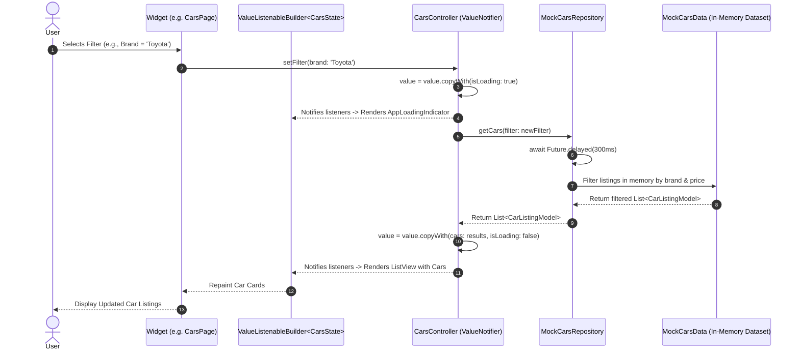
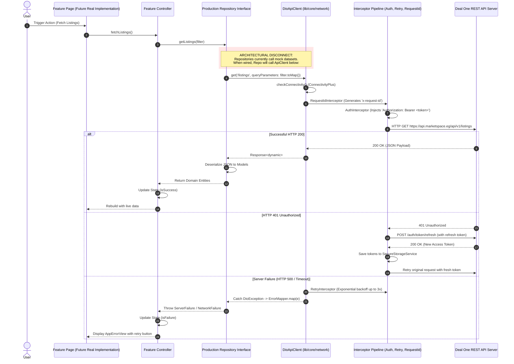

# 05 – State Management & Reactive Data Flow Architecture

## 1. State Management Architectural Pattern

The Deal One mobile application implements a lightweight, native reactive state management architecture based entirely on Flutter's core primitives:

1. **`ValueNotifier<TState>`**: Acts as the reactive ViewModel / Controller holding an immutable state instance.
2. **`ValueListenableBuilder<TState>` & `ListenableBuilder`**: Subscribes UI widgets directly to controller changes, triggering surgical rebuilds exclusively for interested widget subtrees.
3. **`AppDependenciesScope` (`InheritedWidget`)**: Provides ambient, testable dependency injection across the widget hierarchy without external libraries like `get_it` or `riverpod`.
4. **Dart 3 Pattern Matching (`AsyncState<T>`)**: Utilized in shared layers ([lib/shared/state/async_state.dart](file:///home/ibrahim-elshishtawy/flutter%20project/market_space/market_space/lib/shared/state/async_state.dart)) as an exhaustive sealed union (`AsyncInitial`, `AsyncLoading`, `AsyncSuccess`, `AsyncFailure`).

---

## 2. Module State Management Inventory

| Feature / Domain | Controller Class | Base State Primitive | State Object Class | Persistence |
|---|---|---|---|---|
| **Market Sector** | `SectorController` | `ValueNotifier<MarketSector>` | `MarketSector` enum | `SharedPreferences` (`app_selected_sector`) |
| **Theme System** | `ThemeController` | `ValueNotifier<ThemeMode>` | `ThemeMode` enum | `SharedPreferences` (`app_theme_mode`) |
| **Locale / i18n** | `LocaleController` | `ValueNotifier<Locale>` | `Locale` | `SharedPreferences` (`app_language_code`) |
| **Real Estate** | `RealEstateController` | `ValueNotifier<RealEstateState>` | `RealEstateState` | Memory Only |
| **Real Estate Reels**| `ReelsController` | `ValueNotifier<ReelsState>` | `ReelsState` | Memory Only |
| **Cars** | `CarsController` | `ValueNotifier<CarsState>` | `CarsState` | Memory Only |
| **Fashion** | `FashionController` | `ValueNotifier<FashionState>` | `FashionState` | Memory Only |
| **Fashion Cart** | `FashionCartController` | `ValueNotifier<FashionCartState>`| `FashionCartState` | Memory Only |
| **Materials Cart** | `BuildingMaterialsCartController` | `ValueNotifier<CartState>` | `BuildingMaterialCartModel` | Memory Only |
| **Materials Orders**| `BuildingMaterialsOrderController`| `ValueNotifier<OrderState>` | `BuildingMaterialOrderModel` | Memory Only |
| **Services Booking**| `HomeServicesBookingController` | `ValueNotifier<BookingState>` | `ServiceBookingModel` | Memory Only |
| **Services Catalog**| `HomeServicesCatalogController` | `ValueNotifier<CatalogState>` | `List<HomeServiceModel>` | Memory Only |
| **Appliances Cart**| `HomeAppliancesCartController` | `ValueNotifier<ApplianceCart>`| `HomeApplianceCartState` | Memory Only |
| **Explore Hub** | `ExploreController` | `ValueNotifier<ExploreState>` | `ExploreState` | Memory Only |
| **My Activity** | `UnifiedActivityController` | `ValueNotifier<UnifiedActivityState>` | `UnifiedActivityState` | Memory Only |
| **Favorites Hub** | `UnifiedFavoritesController` | `ValueNotifier<FavoritesState>` | `UnifiedFavoritesState` | Memory Only |
| **User Profile** | `ProfileController` | `ValueNotifier<ProfileState>` | `UserProfileState` | Memory Only |
| **Notifications** | `NotificationController` | `ValueNotifier<NotificationState>` | `NotificationState` | Memory Only |

---

## 3. State Lifecycle and Ownership Rules

### 3.1 Global Scoped Controllers
- **Ownership**: Instantiated in `initializeDependencies()` inside [lib/bootstrap/bootstrap.dart](file:///home/ibrahim-elshishtawy/flutter%20project/market_space/market_space/lib/bootstrap/bootstrap.dart) and held by the `AppDependencies` container.
- **Scope**: Outlives individual screens; maintains state across the entire user session.
- **Lifecycle**: Initialized before `runApp()` -> Mounted in `AppDependenciesScope` -> Persists until application termination. Never disposed during screen pops.
- **Examples**: `SectorController`, `ThemeController`, `LocaleController`, `NotificationController`, `UnifiedFavoritesController`, `UnifiedActivityController`.

### 3.2 Screen / Feature Scoped Controllers
- **Ownership**: Can either be resolved from `AppDependencies.of(context)` or created locally with optional constructor dependency injection:
  ```dart
  _controller = widget.controller ?? UnifiedActivityController();
  ```
- **Lifecycle**: If created locally, the hosting `StatefulWidget` overrides `dispose()` to invoke `_controller.dispose()`. If passed from `AppDependencies`, disposal is skipped to maintain container ownership.

---

## 4. End-to-End Data Flow Sequence Diagrams

### 4.1 Implemented Data Flow: UI to In-Memory Mock Repository

This diagram models the **actual, active runtime data path** across all features:



---

### 4.2 Designed vs Unwired Flow: UI to DioApiClient & Remote Backend

This diagram depicts the **architectural design intent** implemented in `lib/core/network/`, illustrating where the current data layer disconnect exists:



---

## 5. Cross-Feature Reactive State Communication

Cross-feature communication is handled cleanly without event buses or complex messaging systems:

1. **Unified Favorites Aggregator**:
   - `UnifiedFavoritesController` is passed to `GlobalFavoritesPage`.
   - When a user taps favorite on a property, car, fashion item, or appliance, the respective feature updates its local state and notifies `UnifiedFavoritesController` to keep the global favorites tab in sync.
2. **Unified Activity Aggregator**:
   - `UnifiedActivityController` aggregates orders and bookings across Building Materials, Home Services, and Home Appliances into a single timeline.
3. **Sector Switcher Notification**:
   - When `SectorController.setSector(MarketSector.cars)` is invoked from the Home Hub, the global bottom navigation and current route adapt dynamically through `SectionNavigationRegistry`.
