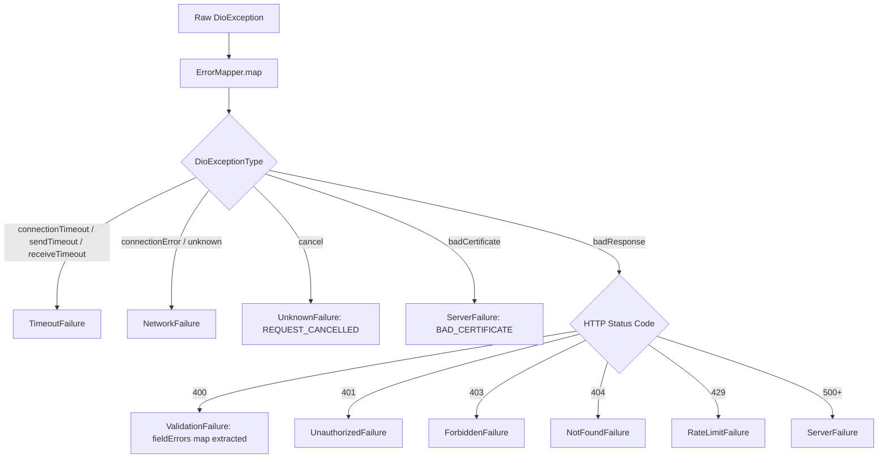

# 06 – Backend Communication & API Integration Design

## 1. Networking Infrastructure Architecture

The networking subsystem is implemented under `lib/core/network/` centered around the `DioApiClient` class ([lib/core/network/api_client.dart](file:///home/ibrahim-elshishtawy/flutter%20project/market_space/market_space/lib/core/network/api_client.dart)), implementing the `ApiClient` contract interface.

```
DioApiClient (lib/core/network/api_client.dart)
├── Base URL: AppConfig.apiBaseUrl
│   ├── Development: 'http://localhost:3000/api/v1'
│   ├── Staging:     'https://staging-api.marketspace.eg/api/v1'
│   └── Production:  'https://api.marketspace.eg/api/v1'
├── Timeouts:
│   ├── Connect Timeout: 15s (Dev/Stage), 10s (Prod)
│   ├── Receive Timeout: 15s (Dev/Stage), 10s (Prod)
│   └── Send Timeout:    15s (Dev/Stage), 10s (Prod)
└── Interceptor Pipeline:
    ├── 1. RequestIdInterceptor (Injects 'X-Request-ID: req-$timestamp-$random')
    ├── 2. AuthInterceptor (Injects 'Authorization: Bearer <token>', handles 401 expiration)
    ├── 3. NetworkLoggingInterceptor (Active only when AppConfig.enableLogging is true)
    └── 4. RetryInterceptor (Retries transient errors on GET/HEAD up to 2 times)
```

---

## 2. Interceptor Pipeline Specifications

### 2.1 Request ID Interceptor (`RequestIdInterceptor`)
- **Source File**: [request_id_interceptor.dart](file:///home/ibrahim-elshishtawy/flutter%20project/market_space/market_space/lib/core/network/interceptors/request_id_interceptor.dart)
- **Implementation**: Generates a microsecond-precision pseudo-unique trace ID using `DateTime.now().microsecondsSinceEpoch` and `Random().nextInt(1000000)`:
  ```dart
  'req-$timestamp-$randomSuffix'
  ```
- **Header**: Appends header `X-Request-ID` to all outgoing HTTP requests for distributed request tracing.

### 2.2 Authentication Interceptor (`AuthInterceptor`)
- **Source File**: [auth_interceptor.dart](file:///home/ibrahim-elshishtawy/flutter%20project/market_space/market_space/lib/core/network/interceptors/auth_interceptor.dart)
- **Request Hook**: Asynchronously retrieves the current token from `TokenProvider.getAccessToken()`. If present, appends:
  ```
  Authorization: Bearer <accessToken>
  ```
- **Error Hook (HTTP 401)**: When an HTTP 401 response is intercepted from the backend, triggers the optional `onSessionExpired?.call()` callback.

### 2.3 Transient Retry Interceptor (`RetryInterceptor`)
- **Source File**: [retry_interceptor.dart](file:///home/ibrahim-elshishtawy/flutter%20project/market_space/market_space/lib/core/network/interceptors/retry_interceptor.dart)
- **Filter Criteria**:
  - Only applies to **idempotent HTTP methods** (`GET` or `HEAD`).
  - Only triggers on **transient network errors**: `DioExceptionType.connectionTimeout`, `sendTimeout`, or `connectionError`.
- **Policy**: Up to `maxRetries: 2` attempts with linear backoff:
  $$\text{Delay} = \text{retryDelay (1000ms)} \times (\text{attempt} + 1)$$

### 2.4 Network Logging Interceptor (`NetworkLoggingInterceptor`)
- **Source File**: [network_logging_interceptor.dart](file:///home/ibrahim-elshishtawy/flutter%20project/market_space/market_space/lib/core/network/interceptors/network_logging_interceptor.dart)
- **Behavior**: Injected only when `appConfig.enableLogging` is `true`. Logs requests, headers, response status codes, and error bodies through `AppLoggerImpl`.

---

## 3. Disconnect Between Networking Core and Feature Repositories

> [!CRITICAL]
> **Architectural Disconnect**:
> While the networking core (`DioApiClient`, `ApiEndpoints`, `ApiHeaders`, interceptors, `ErrorMapper`) is fully written, tested, and instantiated into `AppDependencies` in `bootstrap.dart`:
>
> **Not a single feature repository in `lib/features/` or `lib/shared/` makes HTTP calls through `ApiClient`**.
>
> All 13 business features currently read from static mock collections (`MockRealEstateData`, `MockCarsData`, `MockFashionData`, `MockBuildingMaterialsData`, `MockHomeAppliancesData`, `MockHomeServicesData`).
>
> Consequently, the API endpoints defined below in `ApiEndpoints` represent the **pre-coded contract specification for the future backend**, but are currently unwired.

---

## 4. Declared API Endpoint Inventory

The following table documents the exact endpoints declared in [lib/core/network/api_endpoints.dart](file:///home/ibrahim-elshishtawy/flutter%20project/market_space/market_space/lib/core/network/api_endpoints.dart):

| Feature Domain | HTTP Method | Endpoint Path in Code | Parameter Pattern | Target Request / Payload | Target Response Model | Current Mobile Implementation Status |
|---|---|---|---|---|---|---|
| **Authentication** | `POST` | `/auth/otp/send` | None | `{ "phoneNumber": String }` | `{ "status": String, "expiresIn": int }` | **DECLARED / UNWIRED** (No UI screen calls this) |
| **Authentication** | `POST` | `/auth/otp/verify` | None | `{ "phoneNumber": String, "otp": String }` | `{ "accessToken": String, "refreshToken": String, "user": Map }` | **DECLARED / UNWIRED** (No UI screen calls this) |
| **Authentication** | `POST` | `/auth/token/refresh` | None | `{ "refreshToken": String }` | `{ "accessToken": String, "refreshToken": String }` | **DECLARED / UNWIRED** (AuthInterceptor wired to callback) |
| **Authentication** | `POST` | `/auth/logout` | None | None (Bearer header) | `{ "status": "LOGGED_OUT" }` | **DECLARED / UNWIRED** (ProfilePage shows dummy SnackBar) |
| **Categories** | `GET` | `/categories` | None | None | `List<CategoryModel>` | **DECLARED / UNWIRED** (Features use local mock categories) |
| **Categories** | `GET` | `/categories/$categorySlug/fields` | Path param (`categorySlug`) | Dynamic category slug | `List<CategoryFieldModel>` | **DECLARED / UNWIRED** (Dynamic form rendering unwired) |
| **Listings** | `GET` | `/listings` | Query params | Filter query map | `PaginatedResponse<ListingModel>` | **DECLARED / UNWIRED** (Features use local mock listings) |
| **Listings** | `GET` | `/listings/$listingId` | Path param (`listingId`) | Listing ID string | `ListingDetailModel` | **DECLARED / UNWIRED** (Detail pages use mock repositories) |
| **Favorites** | `GET` | `/listings/favorites` | Query params | None (Bearer header) | `List<ListingModel>` | **DECLARED / UNWIRED** (Favorites use in-memory repository) |
| **Favorites** | `POST` / `DELETE`| `/listings/$listingId/favorite` | Path param (`listingId`) | Listing ID string | `{ "isFavorite": bool }` | **DECLARED / UNWIRED** (In-memory toggle only) |
| **Media / Storage** | `POST` | `/media/upload-urls` | None | `{ "files": List<FileInfo> }` | `List<PresignedUrlModel>` | **DECLARED / UNWIRED** (No live binary uploads implemented) |
| **Media / Video** | `POST` | `/media/video-token` | None | `{ "reelId": String }` | `{ "streamToken": String }` | **DECLARED / UNWIRED** (Reels use direct mock video URLs) |
| **Media / Video** | `GET` | `/videos/feed` | Query params | `{ "page": int, "limit": int }` | `List<ReelModel>` | **DECLARED / UNWIRED** (Reels feed uses mock repository) |
| **Payments** | `POST` | `/payments/checkout` | None | Order payload | `{ "checkoutSessionUrl": String }`| **DECLARED / UNWIRED** (Checkouts simulate instant confirmation) |

---

## 5. Network Error & Exception Mapping

Error translation is executed centrally through [lib/core/errors/error_mapper.dart](file:///home/ibrahim-elshishtawy/flutter%20project/market_space/market_space/lib/core/errors/error_mapper.dart), converting raw `DioException` instances into structured `AppFailure` types:



When UI widgets encounter an `AppFailure`, it can be handed to `AppErrorView` ([lib/shared/widgets/app_error_view.dart](file:///home/ibrahim-elshishtawy/flutter%20project/market_space/market_space/lib/shared/widgets/app_error_view.dart)), which presents localized error descriptions with an actionable retry button.

---

## 6. Real-Time & Binary Upload Capabilities

- **WebSocket Integration**: **NOT IMPLEMENTED**. There are no web sockets, STOMP clients, or streaming sockets in the codebase.
- **Push Notification Integration**: **NOT IMPLEMENTED**. No Firebase Cloud Messaging (FCM) or native push gateway exists.
- **Multipart Uploads**: **NOT IMPLEMENTED**. While `/media/upload-urls` is defined, no image/video picker or `dio.FormData` multipart serialization exists in any feature module.
