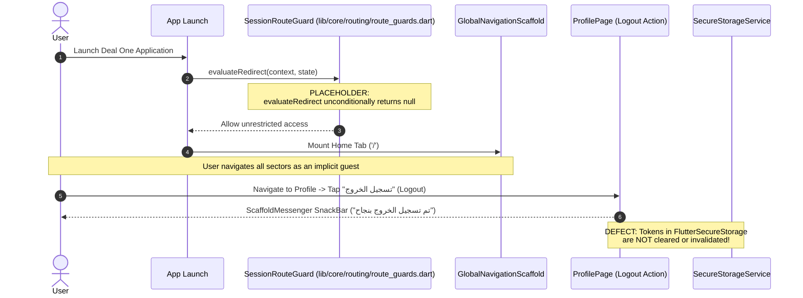

# 09 – Authentication, Security & Permissions Analysis

## 1. Security Feature Classification Matrix

The table below strictly classifies the implementation status of all authentication and security mechanisms across the Deal One mobile codebase:

| Security Feature | Implementation Classification | Concrete Codebase Evidence |
|---|---|---|
| **OTP Verification Flow** | **NOT IMPLEMENTED** | Endpoints declared in `ApiEndpoints`, but no UI screens, forms, or controllers exist |
| **User Registration / Login** | **NOT IMPLEMENTED** | No login screens exist; application boots directly into `GlobalNavigationScaffold` |
| **Token Storage** | **IMPLEMENTED** | `SecureTokenProvider` stores access and refresh tokens in `FlutterSecureStorage` |
| **Token Refresh Mechanism** | **PARTIALLY IMPLEMENTED** | Callback coded in `AuthInterceptor`, but never triggered because HTTP calls are unwired |
| **Logout Functionality** | **MOCK / HARDCODED** | `ProfilePage` triggers a `SnackBar` without clearing secure storage tokens |
| **Session Persistence** | **PARTIALLY IMPLEMENTED** | `SessionState` exists in core, but session validity is never validated against a backend |
| **Route Protection / Guards** | **PLACEHOLDER** | `SessionRouteGuard` implements `RouteGuard`, but unconditionally returns `null` |
| **Role-Based UI Filtering** | **NOT IMPLEMENTED** | No distinction between Buyer, Seller, Broker, or Contractor roles in the UI |
| **Biometric Authentication** | **NOT IMPLEMENTED** | `local_auth` package is not installed; no biometric API calls exist |
| **Internet Access (Android)**| **CRITICAL DEFECT** | `android.permission.INTERNET` is missing from `android/app/src/main/AndroidManifest.xml` |
| **Camera & Media Permissions**| **NOT IMPLEMENTED** | Missing from both `AndroidManifest.xml` and `ios/Runner/Info.plist` |
| **Location Services Permission**| **NOT IMPLEMENTED** | No location permissions declared, despite presence of `flutter_map` |
| **Push Notification Permissions**| **NOT IMPLEMENTED** | No APNS or FCM notification permissions configured |

---

## 2. Authentication Architecture & Current Session Reality

---

## 3. Cryptographic Token Storage & In-Flight Security

### 3.1 Token Storage Security
- **Class**: [SecureTokenProvider](file:///home/ibrahim-elshishtawy/flutter%20project/market_space/market_space/lib/core/security/secure_token_provider.dart)
- **Engine**: [SecureStorageService](file:///home/ibrahim-elshishtawy/flutter%20project/market_space/market_space/lib/core/storage/secure_storage_service.dart) wrapping `FlutterSecureStorage`.
- **Operating System Backends**:
  - **Android**: Uses Android Keystore to encrypt tokens using AES ciphers inside `EncryptedSharedPreferences`.
  - **iOS**: Uses Apple Keychain Services with `kSecAttrAccessibleAfterFirstUnlock`.
- **Assessment**: Token storage implementation is sound and ready for production once wired to an authentication service.

### 3.2 Transport Layer Security (TLS)
- **Base URLs**: Configured with HTTPS protocol in staging and production (`https://api.marketspace.eg/api/v1`).
- **Certificate Pinning**: **NOT IMPLEMENTED**. `DioApiClient` does not configure custom `SecurityContext` certificates or public key hash validation. The client is therefore vulnerable to man-in-the-middle (MITM) proxy inspection if installed root certificates are compromised on user devices.

---

## 4. Mobile Operating System Permissions Audit

### 4.1 Android Permissions (`android/app/src/main/AndroidManifest.xml`)
Inspection of [AndroidManifest.xml](file:///home/ibrahim-elshishtawy/flutter%20project/market_space/market_space/android/app/src/main/AndroidManifest.xml) reveals:
- **Critical Defect**: The production manifest **completely lacks** the `<uses-permission android:name="android.permission.INTERNET"/>` declaration.
- While Flutter automatically injects this permission in debug builds via `android/app/src/debug/AndroidManifest.xml`, compiling a **release APK / AAB (`flutter build apk --release`) will result in an application that cannot connect to the internet**, crashing or failing all remote requests silently.
- **Missing Hardware Permissions**:
  - `<uses-permission android:name="android.permission.CAMERA"/>`
  - `<uses-permission android:name="android.permission.READ_MEDIA_IMAGES"/>`
  - `<uses-permission android:name="android.permission.ACCESS_FINE_LOCATION"/>`

### 4.2 iOS Permissions (`ios/Runner/Info.plist`)
Inspection of [Info.plist](file:///home/ibrahim-elshishtawy/flutter%20project/market_space/market_space/ios/Runner/Info.plist) reveals:
- Standard default Flutter template.
- **Missing Apple Privacy Declarations**:
  - `NSCameraUsageDescription` (Required for taking property reel videos)
  - `NSPhotoLibraryUsageDescription` (Required for selecting listing photos)
  - `NSLocationWhenInUseUsageDescription` (Required for centering interactive property maps on user location)
- Any attempt to invoke native device hardware or location services on iOS without these keys will trigger immediate OS-level application termination.

---

## 5. Client-Side Validation vs Backend Security Boundary

> [!IMPORTANT]
> **Security Boundary Warning**:
> Client-side input validation (e.g. `InputNormalizers.normalizePhoneNumber` or form validators) is implemented solely for user experience and interface feedback.
> Client-side validation **does not provide backend security**. When connecting to real backend services, all sanitization, authentication verification, and permission authorization checks must be enforced authoritatively on the server.
