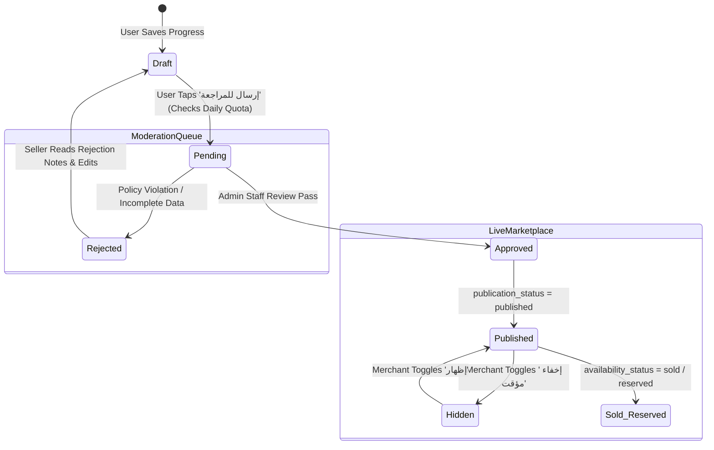
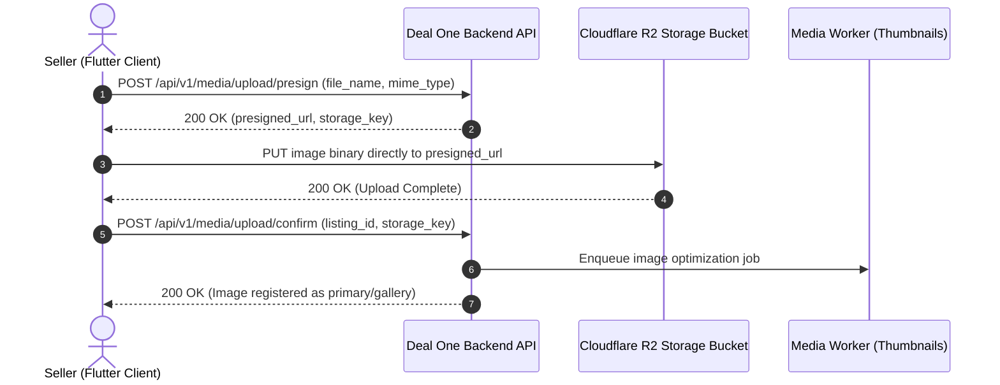

# 13 — Listing Creation & Editing Specification

## 1. Listing Engine Architecture & Lifecycle Overview

The Deal One listing engine powers advertisement publishing across all six commercial verticals. In compliance with **ADR-003 (Category-Driven Rules)**, **ADR-006 (Two-Tier Geography)**, and **ADR-007 (Orthogonal Status Axes)**, listing creation is architected around dynamic category schemas and strict pre-publication moderation:



---

## 2. Multi-Step Listing Creation Wizard

To prevent overwhelming users with an enormous form, the creation flow is organized into a clean 5-step wizard:

```
Step 1: Category & Trade Selection    (SCR-LST-001)
  ↓
Step 2: Dynamic Category Attributes   (SCR-LST-002)
  ↓
Step 3: Title, Price, Description & Contact Channel
  ↓
Step 4: Media Upload & Gallery Sort   (SCR-LST-003)
  ↓
Step 5: Two-Tier Location & Privacy   (SCR-LST-004)
  ↓
Step 6: Review & Moderation Submit    (SCR-LST-005)
```

---

## 3. Screen Specifications

### Screen: Category & Sector Selector (`SCR-LST-001`)

#### 1. Screen Identity
- **Screen ID:** `SCR-LST-001`
- **Module:** Module N: Listing Creation
- **Screen Name (AR):** اختيار قسم الإعلان الرئيسي والفرعي
- **Screen Name (EN):** Create Listing: Category & Subcategory Selector
- **Current Status:** **NOT IMPLEMENTED**
- **V1 Status:** **APPROVED V1**
- **Primary User Role:** Seller / Account Member (`owner`, `manager`, `lister`)
- **Entry Routes:** Global "+" Floating Action Button, My Activity Feed (`SCR-ACT-002`)
- **Exit Routes:** `SCR-LST-002` (Dynamic Form)

#### 2. Layout Structure & UI Components
1. **Header:** "أضف إعلاناً جديداً" with Step 1 of 5 indicator bar.
2. **Main Sector Selection (6 Large Cards):**
   - Real Estate (عقارات)
   - Building Materials (مواد بناء وتشييد)
   - Home Services (خدمات وصيانة)
   - Home Appliances (أجهزة وديكور)
   - Cars (سيارات ومركبات)
   - Fashion (أزياء وملابس)
3. **Subcategory Expansion Sheet:** Tapping a sector opens its approved subcategories (e.g. Real Estate $\to$ شقق للبيع، شقق للإيجار، فيلات، تجاري).
4. **Active Account Context Pill:** Displays active publishing identity (e.g. "النشر باسم: شركة هيكل للمقاولات" or "حسابك الشخصي").

---

### Screen: Dynamic Category Listing Form (`SCR-LST-002`)

#### 1. Screen Identity
- **Screen ID:** `SCR-LST-002`
- **Module:** Module N: Listing Creation
- **Screen Name (AR):** نموذج الحقول الديناميكية حسب القسم
- **Screen Name (EN):** Dynamic Category Listing Form
- **Current Status:** **NOT IMPLEMENTED**
- **V1 Status:** **APPROVED V1**
- **API Dependencies:** `API-CAT-002: Get Subcategory Dynamic Field Definitions` (`GET /api/v1/categories/:id/fields`), `API-LST-001: Create New Listing (Draft)` (`POST /api/v1/listings`)

#### 2. Dynamic Form Fields Rendering Engine
The client renders native UI inputs dynamically mapped from `category_fields` schema:

| `field_type` | Rendered Flutter Widget | Validation & Behavior |
|---|---|---|
| `number` | `TextFormField` (Keyboard: `TextInputType.number`) | Validates `min` / `max` numerical bounds |
| `text` | `TextFormField` (Keyboard: `TextInputType.text`) | Validates max characters, trimming |
| `select` | Dropdown or Segmented Chip Selector | Single choice selection from options array |
| `multi_select`| Horizontal Scrolling Filter Chips | Multiple choice toggles (e.g. Available Sizes) |
| `boolean` | `SwitchListTile` with custom accessible track | Toggles true/false flag |

#### 3. Core Universal Marketplace Fields (Always Required)
- **Listing Title:** Max 120 characters, Cairo Bold font.
- **Description:** Long-form narrative (Min 20, Max 2,000 characters).
- **Price:** Numeric input in Egyptian Pounds (`EGP` / `ج.م`). Checkbox for "قابل للتفاوض" (Negotiable).
- **Contact Channel (`contact_channel`):**
  - `in_app`: In-app chat only.
  - `external`: Allow WhatsApp and direct phone calls (audited via `API-SRC-003`).

---

### Screen: Media Upload & Gallery Reordering (`SCR-LST-003`)

#### 1. Screen Identity
- **Screen ID:** `SCR-LST-003`
- **Module:** Module N: Listing Creation
- **Screen Name (AR):** رفع وترتيب صور وفيديوهات الإعلان
- **Screen Name (EN):** Media Upload & Sort (Presigned Cloudflare R2)
- **Current Status:** **NOT IMPLEMENTED**
- **V1 Status:** **APPROVED V1**
- **API Dependencies:** `API-MED-001: Request Presigned Upload URL` (`POST /api/v1/media/upload/presign`), `API-MED-002: Confirm Media Upload` (`POST /api/v1/media/upload/confirm`)

#### 2. Media Upload Technical Workflow


#### 3. UI Components & Interaction Behavior
- **Upload Box:** Dashed border container with camera icon and "أضف صور الإعلان (حتى ١٠ صور)".
- **Reorderable Grid View:** Drag-and-drop thumbnail grid allowing sellers to adjust photo display order.
- **Primary Cover Badge:** First photo in order displays a prominent "الصورة الرئيسية" badge.
- **Delete Action:** Trash icon on each thumbnail with instant deletion confirmation.

---

### Screen: Two-Tier Location & Privacy Picker (`SCR-LST-004`)

#### 1. Screen Identity
- **Screen ID:** `SCR-LST-004`
- **Module:** Module N: Listing Creation
- **Screen Name (AR):** محدد الموقع ذو المستويين (سري/عام)
- **Screen Name (EN):** Two-Tier Location & Privacy Picker
- **Current Status:** **NOT IMPLEMENTED**
- **V1 Status:** **APPROVED V1 (Core Architectural Mandate - ADR-006)**

#### 2. Architectural Privacy Rules (ADR-006)
1. **Confidential Physical Location (`physical_location`):**
   - The seller drops a pin on the exact GPS coordinate of the apartment, warehouse, or car inspection lot.
   - **Strict Privacy Rule:** This coordinate is NEVER sent to other mobile clients. It is stored exclusively in PostGIS to calculate distance queries (`ST_Distance`).
2. **Public Display Location (`display_location` / `area_id`):**
   - The system automatically fuzzes the coordinate to the administrative district centroid (`areas.centroid`), or allows the seller to pick the general neighborhood.
   - Public users only see: "الموقع التقريبي: التجمع الخامس، بالقرب من شارع التسعين".

---

### Screen: Listing Submission Status & Moderation Queue (`SCR-LST-006`)

#### 1. Screen Identity
- **Screen ID:** `SCR-LST-006`
- **Module:** Module N: Listing Creation
- **Screen Name (AR):** شاشة تأكيد الإرسال وقيد المراجعة
- **Screen Name (EN):** Submission Confirmation & Status Screen
- **Current Status:** **NOT IMPLEMENTED**
- **V1 Status:** **APPROVED V1**
- **API Dependency:** `API-LST-002: Submit Listing for Moderation Review` (`POST /api/v1/listings/:id/submit`)

#### 2. Layout Structure & UI Components
- **Success Animated Illustration:** Subtle green checkmark or clock hourglass animation.
- **Headline:** "تم إرسال إعلانك بنجاح للمراجعة!"
- **Timeline / Status Stepper:**
  - `[✓] تم إنشاء المسودة`
  - `[●] قيد مراجعة فريق الدعم والرقابة (تستغرق عادة من ١٥ إلى ٦٠ دقيقة)`
  - `[○] الاعتماد والظهور العام للجمهور`
- **Quota Impact Note:** "تم استهلاك إعلان ١ من ٥ إعلانات متبقية في حصتك اليومية".
- **Primary Action:** "الانتقال إلى إعلاناتي" $\to$ `SCR-ACT-002` (My Activity).
- **Secondary Action:** "العودة للرئيسية" $\to$ `RouteNames.root`.
