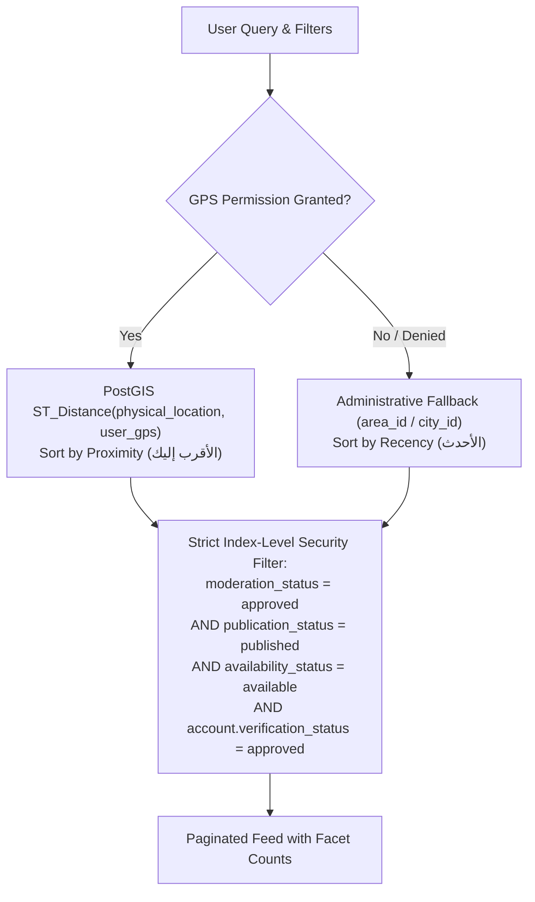

# 14 — Search & Filters UI Specification

## 1. Search Engine Architecture & Egyptian Linguistic Rules

The Deal One search subsystem provides cross-sector exploration across hundreds of thousands of commercial listings. In accordance with **ADR-005 (Search Approach)**, **ADR-006 (Geographic Architecture)**, and the approved Search & Filters Architecture document, the search engine utilizes PostgreSQL full-text search with customized Arabic linguistic stemming, `pg_trgm` fuzzy matching for Egyptian colloquial terms, and PostGIS spatial indexing:



---

## 2. Screen Specifications

### Screen: Cross-Sector Explore & Search (`SCR-SRC-001`)

#### 1. Screen Identity
- **Screen ID:** `SCR-SRC-001`
- **Module:** Module M: Search & Explore
- **Screen Name (AR):** محرك البحث والاستكشاف الشامل
- **Screen Name (EN):** Cross-Sector Explore & Search Page
- **Current Status:** **IMPLEMENTED** ([lib/features/explore/presentation/pages/explore_page.dart](file:///home/ibrahim-elshishtawy/flutter%20project/market_space/market_space/lib/features/explore/presentation/pages/explore_page.dart))
- **V1 Status:** **APPROVED V1**
- **Primary User Role:** All
- **Entry Routes:** Bottom Navigation Tab 1 (`/explore`), Home Search Bar Tap
- **Exit Routes:** `SCR-SRC-003` (Filter Bottom Sheet), Listing Details across all 6 sectors

#### 2. Layout Structure
```
+-------------------------------------------------------------+
| SEARCH BAR & DOCK (Auto-focused on entry)                   |
| [Back/Search Icon] [ Input: "ابحث بالكلمات أو الماركة..." ] [X] [Filter (3)] |
+-------------------------------------------------------------+
| ACTIVE SECTOR & GEOGRAPHIC SCOPE CHIPS                      |
| [الكل ▼]  [📍 التجمع الخامس، القاهرة]  [للبيع فقط]  [رتب حسب: الأحدث ▼] |
+-------------------------------------------------------------+
| DYNAMIC SEARCH RESULTS FEED (SliverList / Staggered Grid)   |
| Results Header: "تم العثور على ١٤٢ إعلان مطابق"              |
|                                                             |
| [Listing Card 1: شقة للبيع في التجمع]                       |
| [Listing Card 2: سيارة تويوتا كورولا]                       |
| [Listing Card 3: حديد تسليح عز ١٦ مم]                       |
+-------------------------------------------------------------+
```

---

### Screen: Universal Search Filter Sheet (`SCR-SRC-003`)

#### 1. Screen Identity
- **Screen ID:** `SCR-SRC-003`
- **Module:** Module M: Search & Explore
- **Screen Name (AR):** لوحة الفلاتر الشاملة متعددة الأقسام
- **Screen Name (EN):** Universal Search Filter Bottom Sheet
- **Current Status:** **PARTIAL** (Sector-specific filter sheets exist in Flutter)
- **V1 Status:** **APPROVED V1**
- **API Dependency:** `API-SRC-001: Unified Multi-Category Search & Filter` (`POST /api/v1/search`)

#### 2. Universal & Category-Specific Filter Controls
1. **Sector & Category Cascader:** Radio segment for the 6 sectors, expanding to relevant subcategories.
2. **Price Range Inputs:** Dual numeric inputs in EGP:
   - Minimum Price (`min_price`)
   - Maximum Price (`max_price`)
3. **Geographic Location Filter:** Tapping opens `SCR-SRC-004` (Governorate $\to$ City $\to$ Area).
4. **Proximity Radius Slider (If GPS active):** Continuous slider from `1 km` to `50 km`.
5. **Category-Specific Dynamic Facets:** Injected dynamically based on selected category (e.g. Bedrooms for Real Estate, Model Year for Cars).
6. **Bottom Action Footer:**
   - "إعادة ضبط" (Reset all filters to defaults).
   - "تطبيق الفلاتر (عرض ١٤٢ نتيجة)" (Primary button with real-time result count preview).

---

### Screen: Administrative Location Selector (`SCR-SRC-004`)

#### 1. Screen Identity
- **Screen ID:** `SCR-SRC-004`
- **Module:** Module M: Search & Explore
- **Screen Name (AR):** نافذة اختيار الموقع والمحافظة
- **Screen Name (EN):** Administrative Location Selector Modal Sheet
- **Current Status:** **PARTIAL** (Hardcoded in profile dialogs)
- **V1 Status:** **APPROVED V1**
- **API Dependencies:** `API-GEO-001: List Governorates & Cities` (`GET /api/v1/locations/governorates`), `API-GEO-002: List Areas` (`GET /api/v1/locations/cities/:city_id/areas`)

#### 2. Layout Structure & UI Components
- **Search Header:** "اختر المحافظة والمدينة" with search bar for fast filtering.
- **Current Location Button:** "استخدام موقعي الحالي عبر الـ GPS 📍" (Requests GPS permission with graceful fallback).
- **Three-Tier Cascading Selector:**
  1. **Governorate Level (٢٧ محافظة):** Cairo, Giza, Alexandria, Gharbia, Dakahlia, etc.
  2. **City / Markaz Level:** Tanta, El Mahalla, Nasr City, New Cairo, Sheikh Zayed, etc.
  3. **Neighborhood / Area Level (`areas`):** Fifth Settlement, First Settlement, District 7, etc.
- **Outcome:** Updates the global location filter and recalculates active feed distances.

---

## 3. Search Query Payload Specification (`API-SRC-001`)

```json
{
  "q": "شقة للبيع",
  "category_id": "a1b2c3d4-0002-4000-8000-000000000001",
  "area_id": "8f7b3c20-4a11-4f1b-9e2a-112233445566",
  "lat": 30.0131,
  "lng": 31.2089,
  "radius_km": 15,
  "min_price": 2000000,
  "max_price": 6000000,
  "sort_by": "distance_asc",
  "attributes": {
    "rooms": "3",
    "finishing_type": "ultra_lux"
  },
  "cursor": null,
  "limit": 20
}
```

---

## 4. Sorting Options & Search States

### 4.1 Supported Sorting Orders
- `newest` (Default): `refreshed_at DESC`
- `distance_asc` (When GPS enabled): `ST_Distance ASC`
- `price_asc`: `price ASC`
- `price_desc`: `price DESC`

### 4.2 Empty Search State (`AppEmptyState`)
- **Visual:** Magnifying glass with dotted trail icon.
- **Headline:** "لم نجد أي نتائج مطابقة لبحثك"
- **Helpful Suggestions:**
  - "تأكد من كتابة الكلمات بشكل صحيح دون أخطاء إملائية".
  - "جرب إزالة بعض الفلاتر لتوسيع نطاق البحث".
  - "قم بتوسيع النطاق الجغرافي ليشمل كامل المحافظة".
- **Action Button:** "مسح جميع الفلاتر".
