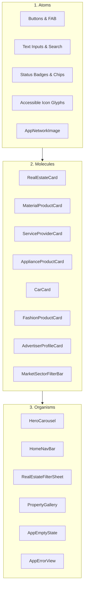

# 18 — Reusable Components Catalog & Component Library

## 1. Component Architecture & Design Principles

Deal One follows an **Atomic Design System** hierarchy implemented in Flutter. Every component conforms to:
1. **WCAG 2.2 AA Contrast Compliance:** Built strictly on `AppColors` monochrome and semantic tokens.
2. **Bidirectional Adaptability:** Flawless horizontal mirroring in Arabic (`TextDirection.rtl`) and English (`TextDirection.ltr`).
3. **Strict Touch Ergonomics:** Minimum interactive bounding box of $48 \times 48\text{ dp}$ on all clickable elements.
4. **Resilience to Dynamic Font Scaling:** Supports system font size scaling up to $200\%$ without clipping text.

---

## 2. Master Component Inventory

---

## 3. Atomic Components

### 3.1 Buttons & Action Controls

#### Component: `AppPrimaryButton`
- **Flutter Widget:** `ElevatedButton` with `AppThemeData.elevatedButtonTheme`
- **Default Height:** 48.0 dp (Full-width in mobile dialogs and persistent bottom bars).
- **Corner Radius:** `AppRadii.md` (12.0 dp).
- **Light Theme:** Surface `#111111`, Text `#FFFFFF`.
- **Dark Theme:** Surface `#FFFFFF`, Text `#111111`.
- **States:**
  - `Normal`: Solid fill with 1.0dp subtle elevation.
  - `Hover / Focused`: Opacity 90% with 2.0dp border highlight.
  - `Pressed`: Scale transform down to `0.98` with standard Material InkSplash.
  - `Disabled`: Fill `AppColors.disabled` (`#BDBDBD` light / `#707070` dark), Text opacity 50%.
  - `Loading`: Displays centered $24\text{ dp}$ circular progress indicator in `onPrimary` color.

#### Component: `AppOutlinedButton`
- **Default Height:** 48.0 dp.
- **Border:** 1.5 dp solid border in `AppColors.borderOf(context)`.
- **Background:** Transparent.
- **Text Style:** `AppTextStyles.button` with `AppColors.textPrimaryOf(context)`.

#### Component: `AppDestructiveButton`
- **Default Height:** 44.0 dp.
- **Light Theme:** Background `#FEF2F2`, Text & Icon `#DC2626`, Border 1.0dp `#DC2626`.
- **Dark Theme:** Background `#450A0A`, Text & Icon `#EF4444`, Border 1.0dp `#EF4444`.

---

### 3.2 Form Inputs & Text Fields

#### Component: `AppTextField`
- **Height:** 52.0 dp.
- **Border Radius:** `AppRadii.md` (12.0 dp).
- **Background Fill:** `AppColors.surfaceSecondaryOf(context)` (`#F5F5F5` light / `#262626` dark).
- **Content Padding:** 16dp horizontal, 14dp vertical.
- **Label & Floating Behavior:** `FloatingLabelBehavior.auto` with Cairo Medium 14sp.
- **Input Borders:**
  - `enabledBorder`: 1.0dp `AppColors.border`.
  - `focusedBorder`: 2.0dp `AppColors.primary`.
  - `errorBorder`: 2.0dp `AppColors.error`.
- **RTL Alignment:** Text aligns right (`TextAlign.right`) with prefix icon at far right. Clear 'X' button appears at far left when input is non-empty.

---

### 3.3 Status Badges & Chips

#### Component: `AppStatusBadge`
- **Height:** 24.0 dp.
- **Padding:** 4dp vertical, 10dp horizontal.
- **Border Radius:** `AppRadii.sm` (8.0 dp).
- **Typography:** Cairo SemiBold 12sp.
- **Semantic Matrix:**
  - `approved` / `available`: Green tint container `#F0FDF4` (`#052E16` dark) with `#16A34A` text.
  - `pending` / `reserved`: Amber tint container `#FFFBEB` (`#451A03` dark) with `#D97706` text.
  - `rejected` / `sold`: Red tint container `#FEF2F2` (`#450A0A` dark) with `#DC2626` text.
  - `hidden` / `draft`: Neutral gray tint container `#EEEEEE` (`#303030` dark) with `#666666` text.

---

## 4. Commercial Listing Card Family

Each commercial sector implements a specialized card variant preserving shared structural rules:

| Card Component Name | Commercial Vertical | Image Aspect Ratio | Primary Specific Attributes Rendered | Codebase Source File |
|---|---|:---:|---|---|
| `RealEstateCard` | Real Estate | **16:10** | Bedrooms, Bathrooms, Area in m², Floor Level, Compound Name, Verified Broker Badge | `lib/features/real_estate/widgets/real_estate_card/` |
| `MaterialProductCard`| Building Materials | **4:3** | Price per Ton/Unit, Minimum Order Quantity (MOQ), Mill/Factory Brand, Delivery Tag | `lib/shared/widgets/market_widgets/material_product_card.dart` |
| `ServiceProviderCard`| Home Services | **1:1** (Avatar) | Rating Stars, Review Count, Trade Specialization, Service Radius Coverage, Quick Call | `lib/shared/widgets/market_widgets/service_provider_card.dart` |
| `ApplianceProductCard`| Home Appliances | **1:1** (Square) | Screen Size/Capacity, Energy Efficiency Class, Condition (New/Used), Agent Warranty | `lib/features/home_appliances/widgets/` |
| `CarCard` | Cars & Automotive | **16:9** | Manufacturing Year, Odometer (km), Transmission, Engine CC, Body Paint Condition | `lib/features/cars/widgets/` |
| `FashionProductCard` | Clothes & Fashion | **3:4** (Portrait) | Brand Tag, Sizing Chips (S/M/L/XL), Color Dots, Fabric Type, Store Location | `lib/features/fashion/widgets/` |

---

## 5. Structural Organisms

### 5.1 Bottom Navigation Bar (`HomeNavBar`)
- **Flutter Implementation:** [lib/features/home/widgets/home_nav_bar/home_nav_bar.dart](file:///home/ibrahim-elshishtawy/flutter%20project/market_space/market_space/lib/features/home/widgets/home_nav_bar/home_nav_bar.dart)
- **Height:** 64.0 dp + `MediaQuery.paddingOf(context).bottom`.
- **Background:** `AppColors.surfaceOf(context)` with 1.0dp top border `#E0E0E0` and subtle elevation.
- **Selected Tab Color:** `AppColors.primaryOf(context)`.
- **Unselected Tab Color:** `AppColors.textMutedOf(context)`.
- **Badging:** Red circular dot or numeric counter for Notifications and Messages tabs.

### 5.2 Empty States & Feedback (`AppEmptyState`)
- **Flutter Implementation:** [lib/shared/widgets/app_empty_state.dart](file:///home/ibrahim-elshishtawy/flutter%20project/market_space/market_space/lib/shared/widgets/app_empty_state.dart)
- **Structure:**
  - Monochrome Vector Graphic / Icon container (72x72 dp).
  - Headline: Cairo Bold 18sp.
  - Subtitle: Cairo Regular 14sp, max 2 lines with helpful context.
  - Action Button: Optional primary or outlined button to reset filters or explore.

### 5.3 Error Views & Retry (`AppErrorView`)
- **Flutter Implementation:** [lib/shared/widgets/app_error_view.dart](file:///home/ibrahim-elshishtawy/flutter%20project/market_space/market_space/lib/shared/widgets/app_error_view.dart)
- **Structure:** Red alert triangle icon, Egyptian Arabic error message, and "إعادة المحاولة" (Retry) action button that re-executes the failed `Future`.
