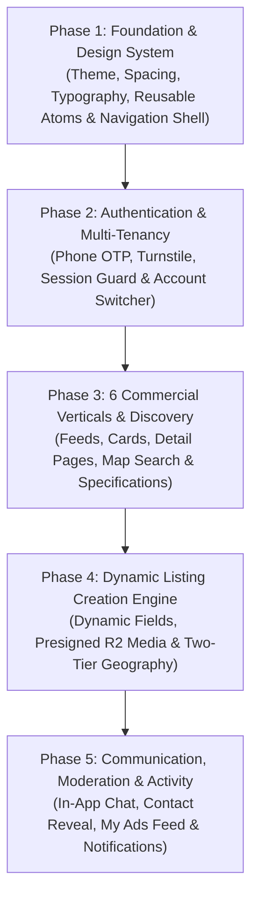

# 21 — UI Agent Implementation Guide & Execution Handbook

## 1. Purpose of this Guide

This handbook is the **technical execution directive** for the downstream **UI/UX Designer** or **AI UI Implementation Agent**. It translates the architectural requirements and screen specifications into an ordered, phased implementation plan with rigorous acceptance criteria.

Following this guide guarantees that the resulting mobile interface is cohesive, production-ready, accessible, and completely insulated from unapproved commerce features.

---

## 2. Screen Implementation Priority Order

Implementation MUST proceed through five strictly sequential phases. Do not begin a higher-numbered phase until the foundational contracts of previous phases are satisfied:

---

### Phase 1: Foundation & Design System Setup
1. **Design Tokens Verification:** Ensure `lib/core/theme/` contains all tokens from [03_GLOBAL_DESIGN_SYSTEM.md](03_GLOBAL_DESIGN_SYSTEM.md) (`AppColors`, `AppSpacing`, `AppRadii`, `AppTextStyles`).
2. **Atomic Widgets Build:** Implement `AppPrimaryButton`, `AppOutlinedButton`, `AppTextField`, `AppStatusBadge`, `AppNetworkImage`, `AppEmptyState`, `AppErrorView`.
3. **Navigation Shell Refinement:** Verify `GlobalNavigationScaffold` with 5 persistent tabs and `PopScope` hardware back routing ([04_GLOBAL_NAVIGATION_AND_SITEMAP.md](04_GLOBAL_NAVIGATION_AND_SITEMAP.md)).

### Phase 2: Authentication & Multi-Tenant Identity
1. **Phone Number Auth Sheet:** Build `SCR-AUT-001` with Egyptian mobile validation and Turnstile bot challenge.
2. **SMS OTP Verification:** Build `SCR-AUT-002` with 6-digit pin input, auto-paste, and timer.
3. **Session Route Guard:** Wire `SessionRouteGuard` to intercept protected actions without throwing unhandled exceptions.
4. **Account Switcher:** Build `SCR-SEL-002` modal sheet to pass `X-Account-ID` in HTTP requests.

### Phase 3: Commercial Verticals & Discovery
1. **Vertical Cards Family:** Build the 6 sector-specific cards (`RealEstateCard`, `MaterialProductCard`, `ServiceProviderCard`, `ApplianceProductCard`, `CarCard`, `FashionProductCard`).
2. **Feed Screens:** Build / Refactor `RealEstatePage`, `BuildingMaterialsPage`, `HomeServicesPage`, `HomeAppliancesPage`, `CarsPage`, `FashionPage`.
3. **Detail Screens:** Implement high-density specification grids and sticky contact action bars.
4. **Scope Sanity Check:** Ensure all cart and checkout buttons are completely removed or hidden from primary V1 routes.

### Phase 4: Dynamic Listing Creation Wizard
1. **Category Selector:** Implement `SCR-LST-001` with 6 core sectors and approved subcategories.
2. **Dynamic Form Engine:** Implement `SCR-LST-002` consuming `category_fields` from `API-CAT-002`.
3. **Media Upload Grid:** Implement `SCR-LST-003` with Presigned R2 uploads and drag-and-drop reordering.
4. **Two-Tier Location Picker:** Implement `SCR-LST-004` (Confidential GPS pin vs Approximate area display).
5. **Submission & Moderation Stepper:** Build `SCR-LST-006` indicating pending review status.

### Phase 5: Communication, Moderation & Activity Hub
1. **In-App Chat Engine:** Build `SCR-CHT-001` (Conversations list) and `SCR-CHT-002` (Chat room with pinned ad header).
2. **Audited Contact Reveal:** Implement `SCR-CHT-003` calling `API-SRC-003` before launching WhatsApp / Phone.
3. **My Advertisements Feed:** Transform Tab 2 into `SCR-ACT-002` with orthogonal status filters (`active`, `pending`, `rejected`, `hidden`, `sold`).
4. **Rejection Notes Modal:** Build `SCR-ACT-004` displaying support reviewer notes from `moderation_log`.
5. **Global Notifications Center:** Wire `SCR-NOT-001` with operational push triggers and deep linking.

---

## 3. Strict Acceptance Criteria for UI Completion

Before submitting any screen or component as complete, the implementing agent must verify all 8 quality gates:

| Quality Gate | Standard Requirement | Verification Method |
|---|---|---|
| **1. Accessibility** | WCAG 2.2 Level AA Contrast ($\ge 4.5:1$ text, $\ge 3:1$ graphics) | Color contrast checker on Light & Dark themes |
| **2. Touch Targets** | Minimum interactive bounding box of $48 \times 48\text{ dp}$ | Flutter Inspector touch bounds inspection |
| **3. Typography & Scaling**| Cairo / Tajawal font. No text clipping up to $200\%$ scaling | Test with system text scale factor set to 2.0 |
| **4. RTL Mirroring** | Flawless mirroring in Arabic (`ar`) with correct chevron directions | Switch locale between `ar` and `en` in runtime |
| **5. Currency Format** | Always formatted with Egyptian Pound: `١٥,٠٠٠ ج.م` / `15,000 EGP` | Verify across all price displays |
| **6. State Coverage** | All 5 fundamental states present: Initial, Shimmer, Populated, Empty, Error | Test with mock failures and empty datasets |
| **7. API Grounding** | Zero invented backend fields. Payload strictly matches `backend_blueprint/` | Validate against `20_SCREEN_TO_API_TRACEABILITY.md` |
| **8. V1 Scope Insulation**| Zero cart, checkout, or order flows exposed in active V1 UI | Code grep for cart / checkout buttons in main routes |
