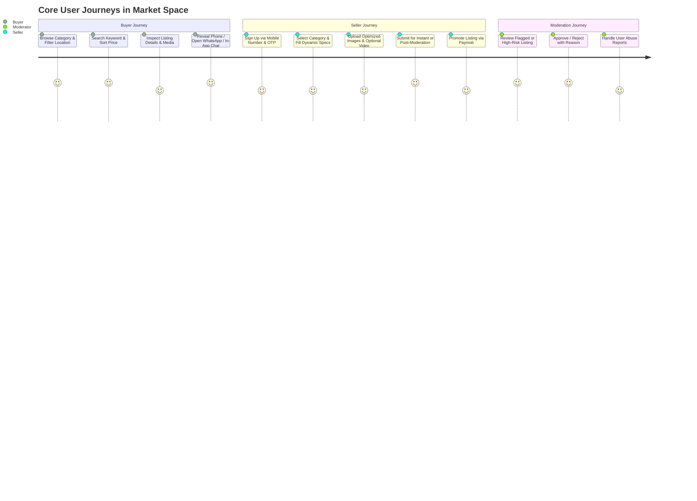

# Executive Summary — Market Space (سوق سبيس)
**Production-Minded Classifieds Marketplace Platform for Egypt**

---

## 1. Executive Overview & Product Vision
**Market Space** is an Arabic-first, mobile-centric classifieds marketplace engineered specifically for the Egyptian market. Inspired by the utility and ubiquity of platforms like Dubizzle/OLX, Market Space modernizes the peer-to-peer and SME commerce experience across Egypt's 27 governorates.

### 1.1 Core Value Proposition
- **Frictionless Local Discovery & Trading:** Effortlessly connect buyers and sellers across a deep taxonomy of localized categories (Vehicles, Real Estate, Electronics, Home, Jobs, Services).
- **Arabic-First, RTL Native Experience:** Complete Right-to-Left (RTL) localization from the ground up for Flutter mobile apps (iOS & Android) with seamless Arabic dialect and Modern Standard Arabic (MSA) phrasing, accompanied by English capability.
- **Trust, Verification & Safety:** Rigorous anti-spam, duplicate detection, automated phone verification, and a comprehensive moderation queue to protect consumers from fraudulent listings.
- **Optional Short-Form Video Highlights:** Innovative 15–30 second listing video showcases with vertical discovery reel, without compromising the lightweight speed and reliability of standard text/image classifieds.
- **Seamless Local Payment Ingestion:** Turnkey integration with Egyptian payment rail aggregator **Paymob** (supporting Meeza, debit/credit cards, and mobile wallets like Vodafone Cash, Orange Money, etc.) for featured listing promotions.

---

## 2. Target Users & Personas
| Persona | Profile & Intent | Primary Platform Surfaces |
| :--- | :--- | :--- |
| **Individual Sellers (C2C)** | Casual citizens selling personal used items (cars, phones, furniture) quickly and safely. | Mobile App (Flutter) |
| **Professional Traders & Small Dealers (B2C)** | Car dealerships, real estate brokers, and gadget shops managing recurring inventory. | Mobile App & Seller Dashboard |
| **Bargain Hunters & Buyers** | Consumers seeking verified deals filtered by governorate/city with transparent contact avenues. | Mobile App (Flutter) |
| **Operations & Trust/Safety Team** | Internal staff monitoring content, adjudicating reports, and managing dynamic taxonomy. | Web Admin (Next.js) |

---

## 3. Core User Journeys

---

## 4. MVP vs. Future Phases Scope Boundaries

| Capability | MVP (Phase 1 Target) | Phase 2 (Growth) | Later / Optional |
| :--- | :--- | :--- | :--- |
| **Taxonomy & Browse** | 14 root categories, 2-level hierarchy, dynamic specs via JSONB. | Multi-tier attribute trees, facet counts caching. | AI automatic category prediction from image. |
| **Location** | Egyptian Governorates (27) & Major Cities/Districts. | Polygon-based neighborhood radii. | Live GPS radius filtering with interactive map. |
| **Identity & Auth** | Mobile Phone + SMS OTP (primary) + Password fallback, JWT sessions. | Social Auth (Google, Apple ID). | National ID (Kyc) verified seller badge. |
| **Buyer-Seller Contact**| Phone reveal + WhatsApp deep link + In-app text chat (HTTP long-polling/SSE fallback). | WebSockets real-time chat with presence & delivery receipts. | Escrow payments, in-chat voice notes. |
| **Media & Video** | S3-compatible images (WebP resized), optional 30s video via Cloudflare Stream. | Automatic video watermarking, thumbnail selector. | Live streaming auctions or seller live Q&A. |
| **Monetization** | Paymob-powered listing bumps & "Featured" badges. | Subscription bundles for auto-dealers and brokers. | In-app banner ad network, commission checkout. |
| **Administration** | Next.js Admin dashboard with RBAC, moderation queue, user audit. | Granular moderator tiering, automated bulk actions. | Automated ML content toxicity scanning. |

---

## 5. Main Architectural Recommendation
- **Architecture Pattern:** A clean, decoupled **Modular Monolith** deployed initially to a single managed Virtual Private Server (VPS) with automated provisioning and Docker Compose.
- **Backend Technology:** **NestJS (TypeScript / Node.js)** using Fastify or Express.
  - *Rationale:* Shared TypeScript interfaces with the Next.js Admin portal, modular architecture mimicking DDD boundaries, enterprise DI container, built-in validation pipes, and stellar ecosystem integration for queues, Redis, and PostgreSQL.
- **Database:** **PostgreSQL 16** with a hybrid relational + `JSONB` schema for dynamic category attributes, and `pg_trgm` (trigram) indexing for Arabic/English keyword search.
- **Caching & Async Queues:** **Redis 7** powered by **BullMQ** for asynchronous job processing (image thumbnailing triggers, notification fan-outs, payment reconciliation, listing expirations).
- **Client Applications:** **Flutter** (Mobile iOS/Android) + **Next.js 14/15 App Router** (Internal Back-office Portal).
- **Media Ingestion:** Direct-to-Storage presigned URLs for Cloudflare R2 / AWS S3 (images) and Cloudflare Stream (videos), offloading massive bandwidth and CPU transcoding loads from the VPS.

---

## 6. Top Risks & Key Decisions Requiring Owner Approval

1. **SMS Provider Selection & Ingestion Cost (Egypt):**
   - *Risk:* SMS OTP costs in Egypt (via Twilio, Infobip, or local gateways like VictoryLink/SMS Misr) can escalate quickly during mass signups.
   - *Recommendation:* Start with SMS Misr or Infobip for local rates, backed by strict IP/device rate-limiting and a WhatsApp OTP fallback option.
2. **Apple & Google In-App Purchase (IAP) Policies for Promotions:**
   - *Risk:* Selling promotional listing features ("Featured Ad") directly in-app may trigger Apple/Google requirements to use In-App Purchases (taking 15–30% cuts), unless properly categorized under classifieds advertising exemptions.
   - *Recommendation:* Implement web-based top-up/checkout links or verify classifieds advertising IAP exemption guidelines prior to app store submission.
3. **Managed Video Cost (Cloudflare Stream vs. Self-hosted):**
   - *Risk:* Unchecked video ingestion can drive up storage and streaming costs.
   - *Recommendation:* Cloudflare Stream offers pay-per-minute storage and streaming ($5/1,000 min stored, $1/1,000 min streamed) which avoids VPS CPU saturation. Impose hard limits: max 1 video per listing, 30 seconds max duration, restricted to verified accounts or paid tiers if needed.
4. **Moderation Paradigm (Pre-publish vs. Post-publish):**
   - *Decision:* For MVP, adopt an **Immediate Publish with Automated Heuristic Filter & Post-Moderation** model for established categories, with **Pre-Moderation (Pending Review)** for newly registered accounts, sensitive categories (Jobs/Services), and high-frequency sellers.
