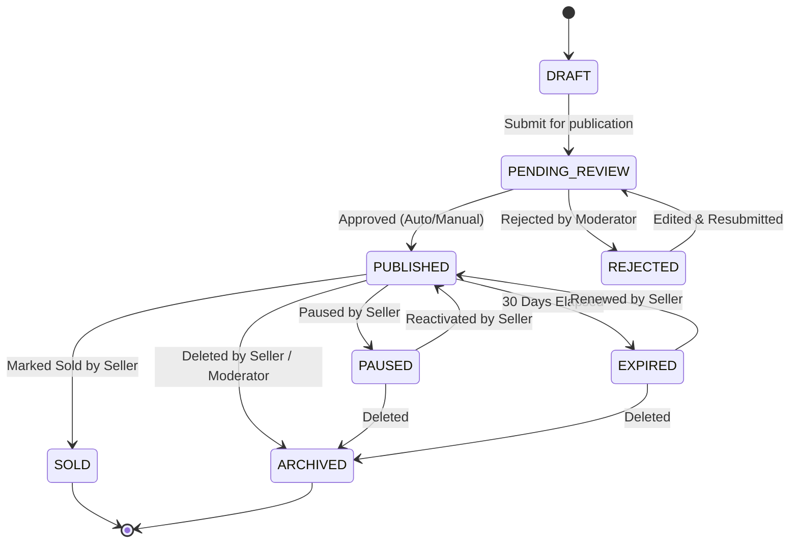

# Software Requirements Specification (SRS) — Market Space
**Document Version:** 1.0.0  
**Status:** Under Review (Phase 1 Deliverable)  
**Target Market:** Egypt (Primary)  

---

## 1. Introduction & Context

### 1.1 Purpose
This Software Requirements Specification (SRS) establishes the complete functional and non-functional requirements for the **Market Space** platform. It serves as the authoritative blueprint for development, quality assurance, system architecture, database design, and operational deployment.

### 1.2 Scope
Market Space is a modern, Arabic-first classifieds marketplace designed for Egyptian consumers and merchants. It encompasses:
- Cross-platform mobile applications for iOS and Android built with Flutter.
- An administrative web application built with Next.js.
- A secure, performant RESTful backend API deployed on a VPS utilizing PostgreSQL and Redis.
- Third-party integrations for SMS (local Egypt gateway), Object Storage (Cloudflare R2 / S3), Media Delivery/Video (Cloudflare Stream), Push Notifications (FCM), and Digital Payments (Paymob).

### 1.3 Definitions, Acronyms, and Abbreviations
- **MSA:** Modern Standard Arabic (العربية الفصحى).
- **RTL:** Right-to-Left writing and layout direction.
- **OTP:** One-Time Password sent via SMS.
- **RBAC:** Role-Based Access Control.
- **FCM:** Firebase Cloud Messaging.
- **JSONB:** Binary JSON format in PostgreSQL for schema-flexible attributes.
- **Paymob:** Leading payment aggregator in Egypt supporting cards, Meeza, and mobile wallets.
- **Trigram (`pg_trgm`):** PostgreSQL extension enabling fast fuzzy matching for Arabic and Latin text.

### 1.4 Stakeholders & User Classes
1. **Unauthenticated Visitor (Public User):** Can browse categories, search listings, view listing details, and view seller public summaries.
2. **Registered User (Buyer/Seller):** Can manage profiles, publish listings, upload media, initiate buyer-seller inquiries (reveal phone, launch WhatsApp, in-app chat), mark items sold, and purchase promotions.
3. **Moderator (Back-office Staff):** Can view moderation queues, approve/reject listings with standard reasons, adjudicate user abuse reports, and temporarily flag suspicious users.
4. **Super Administrator:** Has global access to category taxonomies, financial audit records, system configurations, feature flags, role assignments, and platform audit logs.

---

## 2. Business Rules (BR)

| Rule ID | Title | Description |
| :--- | :--- | :--- |
| **BR-AUTH-001** | Phone Uniqueness | Each registered account must be uniquely associated with a verified Egyptian mobile number (`+20XXXXXXXXXX`). |
| **BR-AUTH-002** | OTP Expiry & Throttling | An SMS OTP expires after exactly 180 seconds. A maximum of 3 OTP requests per phone number is permitted per 15-minute rolling window. |
| **BR-LIST-001** | Free Listing Quota | Standard individual users are permitted up to 5 active published listings concurrently per calendar month without payment. Additional listings require category-level promotion/posting fee. |
| **BR-LIST-002** | Listing Lifetime | A published listing remains active for 30 calendar days by default. 3 days prior to expiration, a notification is dispatched prompting renewal. |
| **BR-LIST-003** | Approximate Location | The system must never disclose the seller's exact GPS or street address on public listings. Only Governorate, City/District, and an optional 500m fuzzified radius map view are rendered. |
| **BR-MEDIA-001** | Image Limits | A listing must have at least 1 image and at most 10 images. Maximum file size per image is 8MB prior to client-side compression. Formats: JPEG, PNG, WebP. |
| **BR-MEDIA-002** | Single Video Policy | A listing may attach at most one video, with duration strictly capped at 30 seconds. Video uploads must be processed via Cloudflare Stream and verified server-side via webhooks. |
| **BR-PAY-001** | Non-Reversible Promotion | Listing promotions ("Featured", "Top Bump") become active immediately upon server-side webhook confirmation from Paymob. Payments are non-refundable once the promotion period begins unless approved by an admin. |
| **BR-PAY-002** | Authoritative Server Pricing | All pricing for promotions and posting fees is determined exclusively by the backend database. Client-submitted prices are rejected. |
| **BR-MOD-001** | Prohibited Items | Listings containing firearms, narcotics, counterfeit currency, prescription medications, or adult services must be immediately quarantined or rejected with immediate moderator alert. |

---

## 3. Functional Requirements (FR)

### 3.1 Authentication & Profile (`FR-AUTH`)
- **FR-AUTH-001 (Phone Registration & Verification):** The system shall allow users to initiate registration using an Egyptian mobile phone number, requiring SMS OTP verification before activating the account.
  - *Acceptance Criteria:* Submitting a valid `+20` 10-digit mobile number generates a 6-digit numeric OTP; verified submission returns an auth token pair (Access Token & Refresh Token).
- **FR-AUTH-002 (Password Fallback / Sign In):** Registered users with an active password may sign in using Phone + Password or Phone + OTP.
- **FR-AUTH-003 (Token Refresh & Invalidation):** The system shall issue a short-lived Access Token (15 min) and a long-lived Refresh Token (30 days). Logout or password reset must immediately invalidate all active refresh tokens for that session.
- **FR-AUTH-004 (User Profile Management):** Users shall be able to update their display name, avatar, preferred language (Arabic/English), and primary location (Governorate & City).
- **FR-AUTH-005 (Account Deletion & Data Privacy):** Users shall have the right to request account deletion in compliance with data privacy standards. All active listings are archived, personal identifiers anonymized, while retaining financial transaction audit trails for legal compliance.

### 3.2 Category & Dynamic Taxonomy (`FR-CAT`)
- **FR-CAT-001 (Two-Tier Hierarchy):** The system shall support a hierarchical taxonomy comprising Root Categories and Child Subcategories (e.g., *Vehicles* -> *Cars for Sale*).
- **FR-CAT-002 (Dynamic Attributes Specification):** Each subcategory shall have configurable attribute schemas defined in the backend (e.g., *Year*, *Mileage*, *Fuel Type*, *Bedrooms*, *Finishing*).
  - *Acceptance Criteria:* Dynamic fields support types `SELECT`, `MULTI_SELECT`, `NUMBER`, `TEXT`, and `BOOLEAN`, with flags for `is_required`, `is_filterable`, and min/max boundaries.
- **FR-CAT-003 (Multilingual Taxonomy):** Category names, attribute labels, and option values must be stored with localized strings (`name_ar` and `name_en`).
- **FR-CAT-004 (Safe Schema Evolution):** When an admin deactivates or updates a field, existing listings must retain historical values without causing validation failures or API crashes during read operations.

### 3.3 Listing Lifecycle & Management (`FR-LIST`)
- **FR-LIST-001 (Listing Creation Flow):** Sellers shall create listings with title, description, category, subcategory, price, condition (New/Used), dynamic attributes, location, and uploaded media keys.
- **FR-LIST-002 (Listing State Machine):** The system shall strictly enforce the listing lifecycle states:
  - `DRAFT`: Initial unfinished state; visible only to seller.
  - `PENDING_REVIEW`: Awaiting automated heuristic checks or human moderator adjudication.
  - `PUBLISHED`: Publicly searchable and viewable.
  - `REJECTED`: Declined by moderator; reason provided to seller.
  - `PAUSED`: Temporarily hidden by the seller; can be reactivated.
  - `EXPIRED`: Reached 30-day lifespan without renewal; hidden from public browse.
  - `SOLD`: Marked as completed by seller; publicly visible with "Sold" badge.
  - `ARCHIVED`: Deleted or purged from active index.
- **FR-LIST-003 (Direct Presigned Upload):** Media files shall be uploaded directly from client applications to object storage using short-lived signed URLs. The backend shall verify ownership and metadata before linking media to the listing.
- **FR-LIST-004 (Seller Listing Actions):** The seller shall be capable of editing details, pausing, reactivating, renewing, and marking their listing as Sold/Closed.

### 3.4 Search, Filter & Discovery (`FR-SEARCH`)
- **FR-SEARCH-001 (Keyword Search):** The system shall provide fast, full-text and fuzzy search across listing titles and descriptions supporting Arabic and English characters using `pg_trgm`.
- **FR-SEARCH-002 (Parametric Filtering):** Users shall be able to filter search results by:
  - Governorate and City.
  - Price range (Minimum / Maximum EGP).
  - Condition (`NEW`, `USED`).
  - Subcategory-specific dynamic fields (e.g., Year >= 2020, Bedrooms == 3).
  - Has Video (`boolean`).
- **FR-SEARCH-003 (Deterministic Sorting):** Search results shall support sorting by:
  - Most Recent (`created_at DESC`).
  - Price: Low to High (`price ASC`).
  - Price: High to Low (`price DESC`).
  - Featured / Promoted first, followed by creation timestamp.
- **FR-SEARCH-004 (Cursor-Based Pagination):** Listing feeds and search results must use deterministic cursor-based pagination (or indexed offset/limit) returning a standard page size (default 20 items) with `next_cursor` to prevent deep offset degradation.

### 3.5 Buyer-Seller Communication (`FR-COMM`)
- **FR-COMM-001 (Phone Number Reveal):** Buyers can tap "Call Seller". The system increments the listing's `contact_count` metric and securely provides the verified seller phone number.
- **FR-COMM-002 (WhatsApp Deep Link):** Buyers can tap "Chat on WhatsApp". The client launches WhatsApp using `https://wa.me/20XXXXXXXXXX?text=...` with pre-filled listing context (Title and Listing URL).
- **FR-COMM-003 (In-App Messaging MVP):** Authenticated users can exchange text messages inside the app.
  - *Acceptance Criteria:* A conversation is uniquely bound to `(listing_id, buyer_id, seller_id)`. Participants can list their conversations, read message history with pagination, and send text messages.
- **FR-COMM-004 (User Blocking & Spam Report):** Either participant can block another user, preventing future messages in the conversation, or report abusive messages.

### 3.6 Short-Form Video Discovery (`FR-VID`)
- **FR-VID-001 (Video Attachment):** Sellers with eligible listings may attach 1 video of up to 30 seconds.
- **FR-VID-002 (Direct Upload to Cloudflare Stream):** Client requests a direct upload token; video is transferred directly to Cloudflare Stream. Cloudflare webhooks notify the backend upon encoding completion.
- **FR-VID-003 (Vertical Reel Feed):** The mobile app provides a dedicated vertical swipe discovery feed displaying only active, approved listings with videos, overlaying title, price, location, seller avatar, and a "View Listing" CTA.

### 3.7 Monetization & Promotions (`FR-PAY`)
- **FR-PAY-001 (Promotional Packages):** The platform shall define packages:
  - `BUMP_UP`: Updates `refreshed_at` timestamp to push listing to top of browse feed once.
  - `FEATURED_7_DAYS`: Flags listing as featured with visual highlight badge for 7 days.
  - `FEATURED_14_DAYS`: Flags listing as featured with visual highlight badge for 14 days.
- **FR-PAY-002 (Paymob Checkout Initiation):** The backend creates an order with Paymob, generates a secure payment token, and returns the iframe/mobile checkout URL or SDK token.
- **FR-PAY-003 (Server-Side Webhook & Idempotency):** Paymob webhooks send transaction callbacks to `/api/v1/payments/webhook`.
  - *Acceptance Criteria:* The endpoint validates Paymob HMAC SHA512 signature, ensures idempotency against duplicate webhook deliveries, and only grants promotional entitlements upon verified `success: true`.

### 3.8 Moderation, Safety & Admin Dashboard (`FR-MOD` & `FR-ADM`)
- **FR-MOD-001 (Abuse Reporting):** Public users can report listings, users, or messages selecting standard reasons (`SPAM`, `FRAUD`, `OFFENSIVE`, `PROHIBITED_ITEM`, `DUPLICATE`).
- **FR-MOD-002 (Moderation Queue):** Moderators view pending items in Next.js back-office, with filters by risk flag, category, and report count.
- **FR-ADM-001 (Role-Based Access Control):** Granular roles: `SUPER_ADMIN`, `SUPPORT_AGENT`, `MODERATOR`.
- **FR-ADM-002 (Category Schema Builder):** Super admins can create and update subcategory dynamic field schemas via an intuitive admin UI.
- **FR-ADM-003 (Audit Trail):** Every administrative action (status override, user ban, schema modification) is logged to an immutable `audit_logs` table with actor ID, IP, timestamp, and JSON diff.

---

## 4. Non-Functional Requirements (NFR)

### 4.1 Performance & Scalability (`NFR-PERF`)
- **NFR-PERF-001 (API Response Latency):** 95% of public read API requests (`GET /listings`, `GET /categories`) must respond in < 150ms under normal load (excluding network transport).
- **NFR-PERF-002 (Search Execution Time):** Full-text trigram keyword search across 100,000 active listings must complete in < 200ms in PostgreSQL.
- **NFR-PERF-003 (Concurrent Connections):** The modular monolith on a standard 4-vCPU / 8GB RAM VPS must sustain 500 concurrent active HTTP/REST connections with < 1% CPU saturation spikes.

### 4.2 Security & Compliance (`NFR-SEC`)
- **NFR-SEC-001 (Zero Secret Leakage):** No API keys, JWT signing secrets, database credentials, or provider secrets shall exist in git repositories or client bundles.
- **NFR-SEC-002 (PII Protection):** Password hashes must use Argon2id or bcrypt (cost >= 12). Phone numbers and private messages must never be logged in application logs.
- **NFR-SEC-003 (Rate Limiting):** Strict rate limiting using Redis token bucket:
  - Auth/OTP: 5 requests / min per IP.
  - General Public API: 60 requests / min per IP.
  - In-app Chat: 20 messages / min per user.
- **NFR-SEC-004 (Object-Level Authorization):** Modifying a listing, viewing a private conversation, or updating an account must strictly verify that the JWT user ID owns the resource (`IDOR` prevention).

### 4.3 Localization & Usability (`NFR-LOC`)
- **NFR-LOC-001 (RTL-First Layout):** All mobile screens and public web pages must render natively in Right-to-Left (RTL) mode when Arabic is selected, with mirrored icons and correct text alignment.
- **NFR-LOC-002 (Dual Language Content):** System notifications, error envelopes, and static labels must be available in both Arabic (primary) and English.

### 4.4 Reliability & Maintainability (`NFR-REL`)
- **NFR-REL-001 (Uptime Target):** The core API shall target 99.5% uptime on the primary VPS host with automated process supervisor (PM2 or Docker auto-restart).
- **NFR-REL-002 (Database Backup):** Automated daily physical/logical PostgreSQL dumps (`pg_dump`) compressed and pushed to offsite object storage (Cloudflare R2) with 30-day retention.

---

## 5. Traceability Matrix

| Requirement ID | Module / Service | Data Entities | API Endpoints | Test Verification | Admin Surface |
| :--- | :--- | :--- | :--- | :--- | :--- |
| `FR-AUTH-001` | Auth Module | `users`, `otps` | `POST /auth/otp/send`, `POST /auth/otp/verify` | Integration / Unit | User Management |
| `FR-AUTH-003` | Auth Module | `user_sessions` | `POST /auth/refresh`, `POST /auth/logout` | Unit Auth Suite | Security Sessions |
| `FR-CAT-002` | Category Module | `categories`, `category_fields` | `GET /categories/{slug}/fields` | Integration Schema | Taxonomy Builder |
| `FR-LIST-001` | Listing Module | `listings`, `listing_attributes` | `POST /listings`, `GET /listings/{id}` | Lifecycle Unit Tests | Moderation Queue |
| `FR-LIST-002` | Listing Module | `listings`, `moderation_logs`| `PATCH /listings/{id}/status` | State Machine Tests | Listing Details |
| `FR-SEARCH-001`| Search Module | `listings` (GIN indexes) | `GET /listings/search` | Search Quality Suite | Analytics |
| `FR-COMM-003` | Chat Module | `conversations`, `messages` | `GET /conversations`, `POST /messages` | Multi-User Chat Test | Report Inspection |
| `FR-VID-002` | Video Module | `listing_media`, `video_tasks` | `POST /media/video/upload-token`, Webhook | Webhook Verification | Media Review |
| `FR-PAY-003` | Payment Module | `payments`, `promotions` | `POST /payments/checkout`, `POST /payments/webhook` | Idempotency Tests | Finance & Revenue |
| `FR-MOD-001` | Safety Module | `reports`, `audit_logs` | `POST /reports`, `GET /admin/reports` | Admin Role Tests | Report Resolution |
