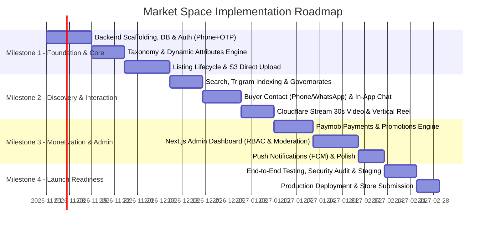

# MVP Scope and Implementation Roadmap — Market Space

---

## 1. Feature Prioritization & Phasing Matrix

The scope of **Market Space** is strictly categorized into three progressive release phases to prevent feature creep, de-risk operational costs, and accelerate the go-to-market milestone.

### 1.1 Classification Criteria
- **MVP (Milestone 1 — Launch Focus):** Non-negotiable capabilities necessary for peer-to-peer classifieds trading, user trust, basic monetization, and regulatory/operational viability in Egypt.
- **Phase 2 (Milestone 2 — Growth & Scale):** Advanced user convenience, real-time enhancements, enriched merchant toolsets, and deeper analytics.
- **Later / Optional (Milestone 3 — Expansion):** Advanced AI, automated machine learning moderation, escrow checkout, and third-party advertising networks.

---

### 1.2 Capability Classification Table

| Functional Domain | Feature Description | Scope Tier | Justification & Rationale |
| :--- | :--- | :---: | :--- |
| **Authentication** | Egyptian Phone Number + SMS OTP + Password | **MVP** | Universal login convention in Egypt; eliminates bot signups. |
| **Authentication** | Social Login (Google & Apple Sign-In) | **Phase 2** | Secondary convenience; Apple requires specific Guideline 4.8 compliance. |
| **Authentication** | National ID Verification (Digital KYC) | **Later** | High friction; requires Egyptian legal/data integration partner. |
| **Taxonomy** | 14 Root Categories, Subcategories, JSONB dynamic specs | **MVP** | Core to classifieds utility; allows customized filtering by car/flat/phone. |
| **Taxonomy** | Deep 4-level nested categories with faceted counts | **Phase 2** | Adds cache invalidation complexity; 2-level is ideal for MVP. |
| **Listings** | Listing Lifecycle (Draft -> Published -> Sold -> Expired) | **MVP** | Foundational data flow for peer-to-peer marketplace. |
| **Listings** | Multiple currency support (USD/EUR) | **Later** | Primary market is Egypt; EGP is strictly authoritative. |
| **Media** | S3/R2 Presigned Multi-image Upload (Max 10 images) | **MVP** | Fast client uploads; relieves VPS of media payload strain. |
| **Media** | Cloudflare Stream 30s Video Attachment & Reel Feed | **MVP** | Differentiating discovery feature; managed provider avoids VPS CPU bottleneck. |
| **Media** | AI Image Auto-Cropping & Background Cleanup | **Later** | High compute cost; not essential for initial user validation. |
| **Search & Browse** | Trigram Full-text Search, Gov/City filters, Price filters | **MVP** | Fundamental utility; buyers need to find local products easily. |
| **Search & Browse** | Dedicated Elasticsearch / OpenSearch cluster | **Phase 2** | PostgreSQL `pg_trgm` handles up to 250,000 listings efficiently on a VPS. |
| **Buyer Contact** | Phone Reveal click-counter + WhatsApp Deep Link | **MVP** | Standard trading behaviour in Egypt; immediate connection. |
| **Buyer Contact** | In-App Text Messaging (REST polling / SSE fallback) | **MVP** | Keeps privacy-conscious users inside the platform; protects phone numbers. |
| **Buyer Contact** | Full Real-time WebSockets Chat with Voice Notes | **Phase 2** | State synchronization overhead; text REST polling is reliable for MVP. |
| **Monetization** | Paymob Cards & Mobile Wallets for Featured & Bump promotions | **MVP** | Validates willingness to pay; essential revenue mechanism. |
| **Monetization** | Merchant Monthly Subscriptions & Storefront Pages | **Phase 2** | Requires commercial onboarding of enterprise auto/real-estate dealers. |
| **Monetization** | Escrow in-app buyer payment & shipping courier delivery | **Later** | Heavy legal, logistics, and dispute resolution overhead. |
| **Trust & Safety** | Abuse Reporting & Admin Review Queue | **MVP** | Mandatory for platform hygiene and legal safety in Egypt. |
| **Trust & Safety** | Automated Phone-based Duplicate Listing Detector | **Phase 2** | Algorithmic matching of titles/images to prevent spam reposts. |
| **Back-Office** | Next.js Admin: Moderation Queue, Category Builder, Audit Logs | **MVP** | Essential for internal team to manage platform operations without DB access. |

---

## 2. Milestone Delivery Roadmap

---

## 3. Milestone Definition of Done (DoD)

### Milestone 1: Foundation, Auth & Listings
1. **Repository & CI:** Modular monolith repository initialized with linting, formatting, pre-commit hooks, and Docker Compose development environment.
2. **Database:** PostgreSQL migrations applied, indexed tables created, seed scripts for Egyptian Governorates and Cities functional.
3. **Authentication:** Phone registration, SMS OTP generation/verification with rate limiting, JWT token pairs, and session revocation tested with > 90% unit coverage.
4. **Listing Lifecycle:** Complete CRUD, image presigned upload workflow, and state machine (`DRAFT` -> `PUBLISHED` -> `EXPIRED` -> `SOLD`) operational.

### Milestone 2: Discovery, Video & Communication
1. **Search & Filter:** Sub-200ms parametric search over 50,000 seeded listings using `pg_trgm` and `JSONB` path queries.
2. **Contact Flow:** Phone reveal counter works; WhatsApp deep links generate valid URLs with localized text; in-app conversations allow sending and reading text messages.
3. **Video Pipeline:** Direct upload to Cloudflare Stream returns video UID; webhook verifies encoding; mobile video feed serves active listings with video playback URLs.

### Milestone 3: Monetization, Admin & Moderation
1. **Payment Processing:** Paymob checkout generates valid transaction sessions; server-side webhook verifies HMAC SHA512 signature; promotional entitlements apply idempotently.
2. **Admin Web:** Next.js dashboard deployed with RBAC (`SUPER_ADMIN`, `MODERATOR`); moderators can review flagged listings, view reports, and ban abusive users.
3. **Notifications:** FCM triggers for new in-app messages and listing approval/rejection events.

---

## 4. Delivery Risks & Scope Control Rules

### 4.1 Strict Scope-Control Policy
- **No Unscheduled Features:** Any feature not documented in the MVP classification table requires an Architecture Decision Record (ADR) and explicit owner sign-off.
- **Provider Decoupling:** Third-party services (SMS, Object Storage, Payments) must sit behind clean interface abstractions (Repository / Adapter pattern) to allow swapping providers without rewriting business logic.
- **Client Fallbacks:** If video processing fails or is pending, the listing must seamlessly display its standard photos with zero functional degradation.
