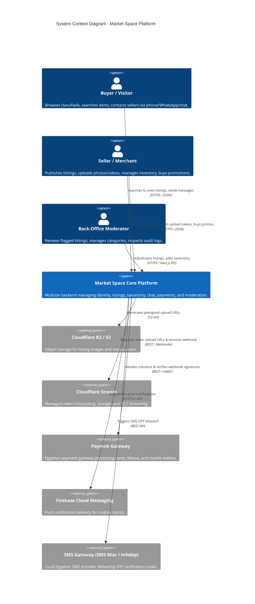
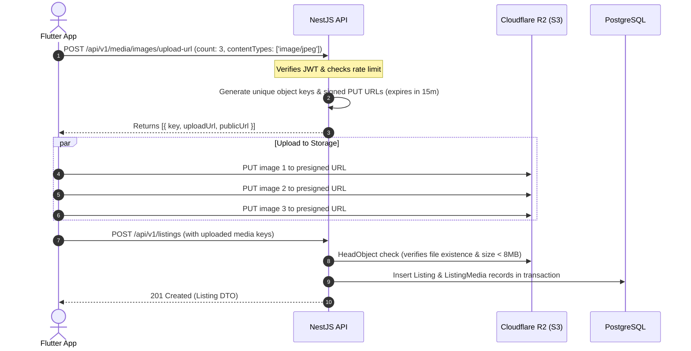
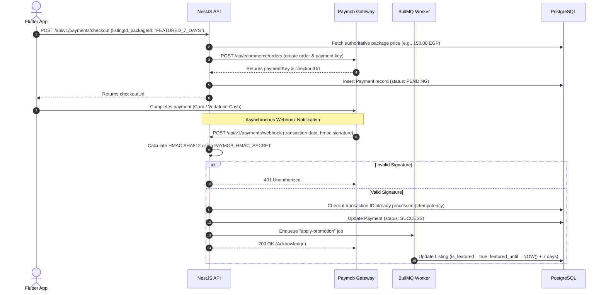

# System Architecture Specification — Market Space

---

## 1. Stack Evaluation & Technology Selection

### 1.1 Backend Framework Comparison
| Dimension | Option A: NestJS (TypeScript / Node.js) | Option B: Laravel (PHP 8.3) | Option C: Go (Gin / Fiber) |
| :--- | :--- | :--- | :--- |
| **Language & Typing** | TypeScript: End-to-end type safety, shared types with Next.js admin. | PHP 8.3: Dynamic with type hints; separate frontend interfaces. | Go: Static, compiled, strict types; requires separate TS types. |
| **Architectural Model**| Modular Monolith, native Dependency Injection, clean DDD boundaries. | MVC traditional framework, mature ecosystem. | Micro-libraries / Clean Architecture patterns. |
| **Concurrency & I/O** | Non-blocking event loop; superior for async notifications & I/O. | Process-per-request (PHP-FPM) or Swoole/Octane. | Ultra-lightweight Goroutines; high concurrency. |
| **Ecosystem & Tools** | Prisma / Drizzle ORM, BullMQ (Redis), Class-Validator, OpenAPI CLI. | Eloquent ORM, Laravel Queues, Horizon, Filament Admin. | GORM / sqlc, Asynq for queues. |
| **Team Synergy** | Single language (TypeScript) across Backend, Next.js Admin & Cloud functions. | PHP specialist needed; frontend team operates in TS. | High developer cognitive load for small multi-stack team. |
| **VPS Resource Usage** | ~150MB baseline RSS per Node instance; excellent memory footprint. | ~250MB+ under PHP-FPM pool load. | < 50MB compiled binary. |
| **Verdict** | **RECOMMENDED (Winner)** | Viable alternative, but split language overhead. | Overkill for MVP development velocity. |

**Selected Backend Architecture:** **NestJS with Fastify adapter** running on Node.js 20 LTS.
- *Reasoning:* Unified TypeScript ecosystem with Next.js back-office, modular architectural enforcement (Modules, Services, Controllers, Guards), native OpenAPI generation, and exceptional async job handling with BullMQ.

---

## 2. System Context & Container Architecture

### 2.1 System Context Diagram (C4 Context)



---

### 2.2 Container / Component Diagram (C4 Container)

```mermaid
C4Container
    title Container Diagram - Market Space (VPS Deployment)
    
    Container_Boundary(clients, "Client Applications")
        Component(mobile_app, "Flutter Mobile App", "Dart / Flutter", "iOS & Android clients for buyers and sellers.")
        Component(admin_portal, "Admin Web Portal", "Next.js / React / Tailwind", "Back-office web interface for moderators.")
    Container_Boundary(edge, "Edge & Ingress")
        Container(nginx, "Nginx Reverse Proxy", "Nginx / Let's Encrypt", "TLS termination, gzip/brotli compression, rate limiting.")
    Container_Boundary(backend_vps, "Modular Monolith VPS")
        Container(api_app, "NestJS API Server", "Node.js 20 / TypeScript", "Handles REST endpoints, business validation, and auth guards.")
        Container(worker_app, "Background Worker (BullMQ)", "Node.js 20 / TypeScript", "Processes asynchronous tasks (notifications, media callbacks, cleanups).")
        ContainerDb(postgres, "PostgreSQL 16", "PostgreSQL + pg_trgm", "Primary relational database & JSONB store.")
        ContainerDb(redis, "Redis 7", "In-Memory Datastore", "Queue broker, session cache, and rate limit counters.")
    Container_Boundary(external, "External Cloud Services")
        Container_Ext(storage, "Cloudflare R2", "S3 API", "Listing photo storage.")
        Container_Ext(stream, "Cloudflare Stream", "Video Service", "Video encoding and delivery.")
        Container_Ext(payments, "Paymob", "Payment Gateway", "Card & Wallet processing.")
    
    Rel(mobile_app, nginx, "Sends API requests", "HTTPS / JSON")
    Rel(admin_portal, nginx, "Back-office administrative requests", "HTTPS / JSON")
    Rel(nginx, api_app, "Proxies requests to port 3000", "HTTP")
    Rel(api_app, postgres, "Reads & writes transactional data", "TCP / Port 5432")
    Rel(api_app, redis, "Pushes background jobs & checks cache", "TCP / Port 6379")
    Rel(worker_app, redis, "Consumes jobs from queues", "TCP / Port 6379")
    Rel(worker_app, postgres, "Updates entity states", "TCP / Port 5432")
    Rel(api_app, storage, "Issues Presigned S3 URLs", "HTTPS")
    Rel(api_app, stream, "Issues Video Direct Upload Token", "HTTPS")
```

---

## 3. Module Boundaries & Dependency Rules

The backend adheres strictly to a **Modular Monolith** structure governed by explicit dependency boundaries:

```
src/
├── core/                   # Global cross-cutting concerns (Logger, Config, Database, Common Filters)
│   ├── config/             # Typed environment validation
│   ├── database/           # Prisma / Kysely PostgreSQL client & migrations
│   ├── redis/              # Redis connection pool & cache helper
│   ├── errors/             # Standard RFC 7807 Error Envelope & domain exceptions
│   └── guards/             # JWT Auth Guard, RBAC Roles Guard, RateLimit Guard
├── modules/
│   ├── auth/               # Phone verification, OTP generation, JWT session tokens
│   ├── users/              # User profiles, avatar updates, account settings, soft-delete
│   ├── categories/         # Root/Subcategory taxonomy, localized labels, dynamic field schemas
│   ├── listings/           # Core classifieds CRUD, state machine, lifecycle transitions
│   ├── media/              # Presigned S3 image URLs, upload confirmations, orphan cleanup
│   ├── search/             # Trigram search queries, parametric multi-filter engine
│   ├── chat/               # Conversations, messages, participant access control
│   ├── video/              # Cloudflare Stream integration, webhooks, vertical reel feed
│   ├── payments/           # Paymob order creation, HMAC webhook verification, promotion credits
│   ├── moderation/         # User abuse reports, manual review queue, audit trail logging
│   └── notifications/      # FCM push dispatcher, user preferences, notification inbox
└── workers/                # BullMQ background job consumers (media-processing, notifications, expiration)
```

### 3.1 Strict Architecture Rules
1. **No Circular Dependencies:** A module may import another module's public Service/Repository, but never create circular references.
2. **Encapsulated Data Access:** The `listings` module must not directly update tables in the `payments` module. Cross-module operations must use event emitters or domain service methods.
3. **Controller Decoupling:** Controllers only validate incoming requests using DTOs and delegate business execution to Services.
4. **Idempotent Background Jobs:** All worker jobs must be uniquely identified by job IDs to ensure idempotency.

---

## 4. Key Request & Data Flows

### 4.1 Direct-to-Storage Presigned Image Upload Flow



---

### 4.2 Paymob Monetization & Webhook Flow



---

## 5. Background Jobs & Worker Architecture (BullMQ)

Jobs are isolated in dedicated Redis queues to avoid blocking HTTP event loops:
1. **`media-cleanup-queue`:** Scans for abandoned presigned upload keys older than 24 hours without an associated listing, deleting them from R2.
2. **`listing-expiry-queue`:** Scheduled daily cron (02:00 AM Cairo Time) transitioning listings older than 30 days from `PUBLISHED` to `EXPIRED`.
3. **`notification-queue`:** Dispatches FCM push payloads asynchronously with exponential backoff retry (3 attempts).
4. **`video-webhook-queue`:** Handles Cloudflare Stream processing notifications, extracting video duration, resolutions, and updating `listing_media.processing_status`.

---

## 6. Deployment Topology & Scaling Path

### 6.1 Initial VPS Topology (Phase 1 Target)
- **Host Spec:** 4 vCPUs, 8 GB RAM, 160 GB NVMe SSD (e.g., Hetzner / DigitalOcean).
- **OS:** Ubuntu 24.04 LTS.
- **Process Supervision:** Docker Compose with health checks and restart policies.
- **Storage Strategy:** Database and Redis data mapped to persistent Docker volumes. Static assets strictly served via Cloudflare CDN / R2.

```
[ Internet ]
      │ (HTTPS / 443)
[ Cloudflare Proxy / CDN ]
      │ (Authenticated Origin Pull)
[ Nginx Reverse Proxy (VPS) ]
      ├──> /api/v1/*   ──> NestJS App Container (Port 3000)
      ├──> /admin/*    ──> Next.js App Container (Port 3001)
      └──> (Blocked)   ──> PostgreSQL (5432) & Redis (6379) bound to 127.0.0.1
```

### 6.2 Scale-Up Path (Post-50,000 Active Users)
1. **Vertical Scale:** Upgrade VPS to 8 vCPUs / 16 GB RAM if database cache hit ratio drops below 99%.
2. **Managed Database Separation:** Migrate PostgreSQL to a managed database cluster (e.g., DigitalOcean Managed PostgreSQL or AWS RDS) with automated point-in-time recovery.
3. **Horizontal App Tier:** Run multiple NestJS Node.js processes via PM2 cluster mode or scale across 2 lightweight app VPS nodes behind a managed load balancer.
4. **Search Offload:** Move search from PostgreSQL `pg_trgm` to a dedicated Elasticsearch or Meilisearch cluster once catalog exceeds 250,000 active listings.
