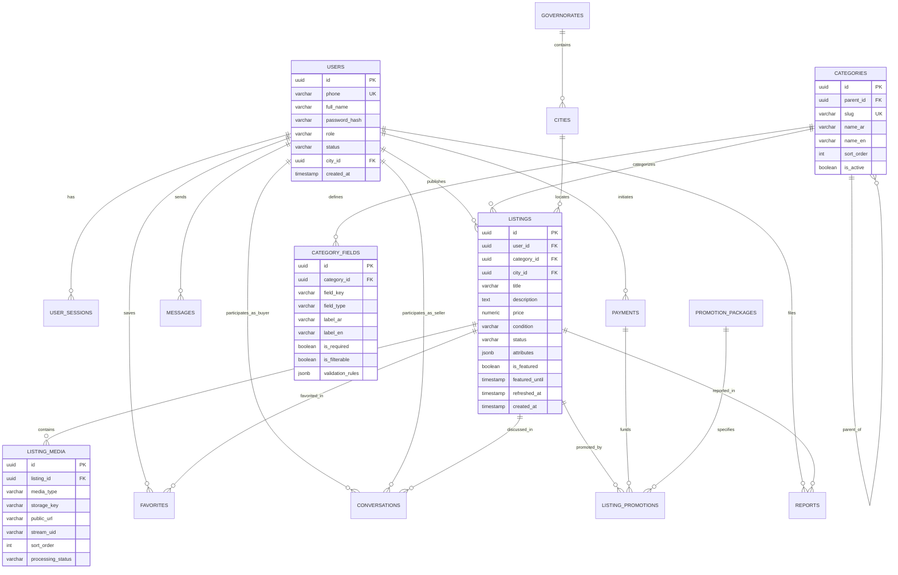

# Database Schema and Data Model — Market Space

---

## 1. Overview & Strategy

The data model for **Market Space** is built upon **PostgreSQL 16**. It balances relational integrity for critical operational domains (Authentication, Listings, Financial Transactions, Moderation) with document flexibility (`JSONB`) for category-specific dynamic attributes.

### 1.1 Key Principles
1. **Strong Relational Guarantees:** Foreign keys, `ON DELETE RESTRICT` for financial and listing records, and check constraints for finite states.
2. **Hybrid JSONB Attribute Engine:** Core listing fields (Price, Title, Description, Location, Condition) are normalized columns. Subcategory-specific dynamic fields (e.g. *Mileage*, *Bedrooms*, *Year*) reside in an indexed `attributes JSONB` column validated against backend category schemas.
3. **Optimized Search Indexing:** Native PostgreSQL Full-Text Search with `pg_trgm` (trigram) GIN indexes over Arabic and English text.
4. **Zero Unencrypted PII:** Phone numbers and emails are indexed; password hashes are stored via Argon2id; verification tokens are hashed or short-lived.

---

## 2. Entity Relationship Diagram (ERD)



---

## 3. Detailed Table Specifications

### 3.1 Geographic Location Reference Tables
```sql
CREATE TABLE governorates (
    id SERIAL PRIMARY KEY,
    name_ar VARCHAR(100) NOT NULL,
    name_en VARCHAR(100) NOT NULL,
    slug VARCHAR(100) UNIQUE NOT NULL,
    is_active BOOLEAN DEFAULT TRUE NOT NULL
);

CREATE TABLE cities (
    id SERIAL PRIMARY KEY,
    governorate_id INT NOT NULL REFERENCES governorates(id) ON DELETE RESTRICT,
    name_ar VARCHAR(150) NOT NULL,
    name_en VARCHAR(150) NOT NULL,
    slug VARCHAR(150) NOT NULL,
    is_active BOOLEAN DEFAULT TRUE NOT NULL,
    UNIQUE(governorate_id, slug)
);

CREATE INDEX idx_cities_governorate ON cities(governorate_id);
```

---

### 3.2 Authentication & User Profiles
```sql
CREATE TYPE user_role AS ENUM ('USER', 'MODERATOR', 'SUPER_ADMIN');
CREATE TYPE user_status AS ENUM ('PENDING_VERIFICATION', 'ACTIVE', 'SUSPENDED', 'DELETED');

CREATE TABLE users (
    id UUID PRIMARY KEY DEFAULT gen_random_uuid(),
    phone VARCHAR(20) UNIQUE NOT NULL,
    full_name VARCHAR(120) NOT NULL,
    email VARCHAR(255) UNIQUE,
    password_hash VARCHAR(255),
    role user_role DEFAULT 'USER' NOT NULL,
    status user_status DEFAULT 'PENDING_VERIFICATION' NOT NULL,
    avatar_url VARCHAR(500),
    preferred_language VARCHAR(5) DEFAULT 'ar' NOT NULL,
    governorate_id INT REFERENCES governorates(id) ON DELETE SET NULL,
    city_id INT REFERENCES cities(id) ON DELETE SET NULL,
    phone_verified_at TIMESTAMPTZ,
    last_login_at TIMESTAMPTZ,
    created_at TIMESTAMPTZ DEFAULT NOW() NOT NULL,
    updated_at TIMESTAMPTZ DEFAULT NOW() NOT NULL,
    deleted_at TIMESTAMPTZ
);

CREATE TABLE user_sessions (
    id UUID PRIMARY KEY DEFAULT gen_random_uuid(),
    user_id UUID NOT NULL REFERENCES users(id) ON DELETE CASCADE,
    refresh_token_hash VARCHAR(255) NOT NULL,
    user_agent VARCHAR(500),
    ip_address INET,
    is_revoked BOOLEAN DEFAULT FALSE NOT NULL,
    expires_at TIMESTAMPTZ NOT NULL,
    created_at TIMESTAMPTZ DEFAULT NOW() NOT NULL
);

CREATE INDEX idx_sessions_user ON user_sessions(user_id) WHERE is_revoked IS FALSE;

CREATE TABLE otps (
    id UUID PRIMARY KEY DEFAULT gen_random_uuid(),
    phone VARCHAR(20) NOT NULL,
    otp_code_hash VARCHAR(255) NOT NULL,
    attempts INT DEFAULT 0 NOT NULL,
    is_consumed BOOLEAN DEFAULT FALSE NOT NULL,
    expires_at TIMESTAMPTZ NOT NULL,
    created_at TIMESTAMPTZ DEFAULT NOW() NOT NULL
);

CREATE INDEX idx_otps_phone_active ON otps(phone, expires_at) WHERE is_consumed IS FALSE;
```

---

### 3.3 Category & Dynamic Schema Definition
```sql
CREATE TABLE categories (
    id UUID PRIMARY KEY DEFAULT gen_random_uuid(),
    parent_id UUID REFERENCES categories(id) ON DELETE RESTRICT,
    slug VARCHAR(100) UNIQUE NOT NULL,
    name_ar VARCHAR(150) NOT NULL,
    name_en VARCHAR(150) NOT NULL,
    icon_name VARCHAR(50),
    sort_order INT DEFAULT 0 NOT NULL,
    is_active BOOLEAN DEFAULT TRUE NOT NULL,
    created_at TIMESTAMPTZ DEFAULT NOW() NOT NULL,
    updated_at TIMESTAMPTZ DEFAULT NOW() NOT NULL
);

CREATE INDEX idx_categories_parent ON categories(parent_id);

CREATE TYPE field_type_enum AS ENUM ('TEXT', 'NUMBER', 'SELECT', 'MULTI_SELECT', 'BOOLEAN');

CREATE TABLE category_fields (
    id UUID PRIMARY KEY DEFAULT gen_random_uuid(),
    category_id UUID NOT NULL REFERENCES categories(id) ON DELETE CASCADE,
    field_key VARCHAR(50) NOT NULL,
    field_type field_type_enum NOT NULL,
    label_ar VARCHAR(150) NOT NULL,
    label_en VARCHAR(150) NOT NULL,
    is_required BOOLEAN DEFAULT FALSE NOT NULL,
    is_filterable BOOLEAN DEFAULT TRUE NOT NULL,
    validation_rules JSONB DEFAULT '{}'::jsonb NOT NULL,
    sort_order INT DEFAULT 0 NOT NULL,
    is_active BOOLEAN DEFAULT TRUE NOT NULL,
    UNIQUE(category_id, field_key)
);

CREATE INDEX idx_category_fields_lookup ON category_fields(category_id) WHERE is_active IS TRUE;
```

---

### 3.4 Listings & Attributes Engine
```sql
CREATE TYPE listing_condition AS ENUM ('NEW', 'USED', 'NOT_APPLICABLE');
CREATE TYPE listing_status AS ENUM (
    'DRAFT', 
    'PENDING_REVIEW', 
    'PUBLISHED', 
    'REJECTED', 
    'PAUSED', 
    'EXPIRED', 
    'SOLD', 
    'ARCHIVED'
);

CREATE TABLE listings (
    id UUID PRIMARY KEY DEFAULT gen_random_uuid(),
    user_id UUID NOT NULL REFERENCES users(id) ON DELETE RESTRICT,
    category_id UUID NOT NULL REFERENCES categories(id) ON DELETE RESTRICT,
    city_id INT NOT NULL REFERENCES cities(id) ON DELETE RESTRICT,
    title VARCHAR(180) NOT NULL,
    description TEXT NOT NULL,
    price NUMERIC(14, 2) NOT NULL CHECK (price >= 0),
    condition listing_condition DEFAULT 'USED' NOT NULL,
    status listing_status DEFAULT 'PENDING_REVIEW' NOT NULL,
    attributes JSONB DEFAULT '{}'::jsonb NOT NULL,
    contact_count INT DEFAULT 0 NOT NULL,
    view_count INT DEFAULT 0 NOT NULL,
    is_featured BOOLEAN DEFAULT FALSE NOT NULL,
    featured_until TIMESTAMPTZ,
    refreshed_at TIMESTAMPTZ DEFAULT NOW() NOT NULL,
    expires_at TIMESTAMPTZ DEFAULT (NOW() + INTERVAL '30 days') NOT NULL,
    rejection_reason TEXT,
    moderated_by UUID REFERENCES users(id),
    moderated_at TIMESTAMPTZ,
    created_at TIMESTAMPTZ DEFAULT NOW() NOT NULL,
    updated_at TIMESTAMPTZ DEFAULT NOW() NOT NULL
);

-- Search and filter indexes
CREATE EXTENSION IF NOT EXISTS pg_trgm;

CREATE INDEX idx_listings_feed ON listings (status, refreshed_at DESC) 
    WHERE status = 'PUBLISHED';

CREATE INDEX idx_listings_search_trgm_title ON listings USING gin (title gin_trgm_ops)
    WHERE status = 'PUBLISHED';

CREATE INDEX idx_listings_search_trgm_desc ON listings USING gin (description gin_trgm_ops)
    WHERE status = 'PUBLISHED';

CREATE INDEX idx_listings_category_price ON listings (category_id, price)
    WHERE status = 'PUBLISHED';

CREATE INDEX idx_listings_city ON listings (city_id, refreshed_at DESC)
    WHERE status = 'PUBLISHED';

CREATE INDEX idx_listings_attributes_gin ON listings USING gin (attributes jsonb_path_ops)
    WHERE status = 'PUBLISHED';
```

---

### 3.5 Media & Video Assets
```sql
CREATE TYPE media_type_enum AS ENUM ('IMAGE', 'VIDEO');
CREATE TYPE media_status_enum AS ENUM ('PENDING', 'READY', 'FAILED');

CREATE TABLE listing_media (
    id UUID PRIMARY KEY DEFAULT gen_random_uuid(),
    listing_id UUID NOT NULL REFERENCES listings(id) ON DELETE CASCADE,
    media_type media_type_enum NOT NULL,
    storage_key VARCHAR(500) NOT NULL,
    public_url VARCHAR(500) NOT NULL,
    thumbnail_url VARCHAR(500),
    stream_uid VARCHAR(100), -- Cloudflare Stream identifier for video
    duration_seconds NUMERIC(4, 1),
    sort_order INT DEFAULT 0 NOT NULL,
    processing_status media_status_enum DEFAULT 'READY' NOT NULL,
    created_at TIMESTAMPTZ DEFAULT NOW() NOT NULL
);

CREATE INDEX idx_listing_media_listing ON listing_media(listing_id, sort_order ASC);
```

---

### 3.6 In-App Buyer-Seller Conversations & Messages
```sql
CREATE TABLE conversations (
    id UUID PRIMARY KEY DEFAULT gen_random_uuid(),
    listing_id UUID NOT NULL REFERENCES listings(id) ON DELETE CASCADE,
    buyer_id UUID NOT NULL REFERENCES users(id) ON DELETE CASCADE,
    seller_id UUID NOT NULL REFERENCES users(id) ON DELETE CASCADE,
    last_message_text VARCHAR(500),
    last_message_at TIMESTAMPTZ DEFAULT NOW() NOT NULL,
    created_at TIMESTAMPTZ DEFAULT NOW() NOT NULL,
    UNIQUE(listing_id, buyer_id)
);

CREATE INDEX idx_conversations_buyer ON conversations(buyer_id, last_message_at DESC);
CREATE INDEX idx_conversations_seller ON conversations(seller_id, last_message_at DESC);

CREATE TABLE messages (
    id UUID PRIMARY KEY DEFAULT gen_random_uuid(),
    conversation_id UUID NOT NULL REFERENCES conversations(id) ON DELETE CASCADE,
    sender_id UUID NOT NULL REFERENCES users(id) ON DELETE CASCADE,
    message_text TEXT NOT NULL,
    is_read BOOLEAN DEFAULT FALSE NOT NULL,
    read_at TIMESTAMPTZ,
    created_at TIMESTAMPTZ DEFAULT NOW() NOT NULL
);

CREATE INDEX idx_messages_conversation ON messages(conversation_id, created_at ASC);
```

---

### 3.7 Payments & Promotions
```sql
CREATE TYPE payment_status AS ENUM ('PENDING', 'SUCCESS', 'FAILED', 'REFUNDED');
CREATE TYPE promo_type AS ENUM ('BUMP_UP', 'FEATURED_7_DAYS', 'FEATURED_14_DAYS');

CREATE TABLE promotion_packages (
    id VARCHAR(50) PRIMARY KEY,
    name_ar VARCHAR(100) NOT NULL,
    name_en VARCHAR(100) NOT NULL,
    type promo_type NOT NULL,
    price_egp NUMERIC(10, 2) NOT NULL,
    duration_days INT DEFAULT 0 NOT NULL,
    is_active BOOLEAN DEFAULT TRUE NOT NULL
);

CREATE TABLE payments (
    id UUID PRIMARY KEY DEFAULT gen_random_uuid(),
    user_id UUID NOT NULL REFERENCES users(id) ON DELETE RESTRICT,
    listing_id UUID NOT NULL REFERENCES listings(id) ON DELETE RESTRICT,
    package_id VARCHAR(50) NOT NULL REFERENCES promotion_packages(id) ON DELETE RESTRICT,
    amount_egp NUMERIC(10, 2) NOT NULL,
    gateway VARCHAR(30) DEFAULT 'PAYMOB' NOT NULL,
    gateway_order_id VARCHAR(100),
    gateway_transaction_id VARCHAR(100) UNIQUE,
    status payment_status DEFAULT 'PENDING' NOT NULL,
    raw_response JSONB,
    created_at TIMESTAMPTZ DEFAULT NOW() NOT NULL,
    updated_at TIMESTAMPTZ DEFAULT NOW() NOT NULL
);

CREATE INDEX idx_payments_user ON payments(user_id);
CREATE INDEX idx_payments_listing ON payments(listing_id);
```

---

### 3.8 Abuse Reports & Audit Trail
```sql
CREATE TYPE report_reason AS ENUM ('SPAM', 'FRAUD', 'OFFENSIVE', 'PROHIBITED_ITEM', 'DUPLICATE', 'OTHER');
CREATE TYPE report_status AS ENUM ('PENDING', 'REVIEWED', 'ACTION_TAKEN', 'DISMISSED');

CREATE TABLE reports (
    id UUID PRIMARY KEY DEFAULT gen_random_uuid(),
    reporter_id UUID REFERENCES users(id) ON DELETE SET NULL,
    listing_id UUID REFERENCES listings(id) ON DELETE CASCADE,
    reported_user_id UUID REFERENCES users(id) ON DELETE CASCADE,
    reason report_reason NOT NULL,
    notes TEXT,
    status report_status DEFAULT 'PENDING' NOT NULL,
    moderator_id UUID REFERENCES users(id) ON DELETE SET NULL,
    action_taken TEXT,
    created_at TIMESTAMPTZ DEFAULT NOW() NOT NULL,
    resolved_at TIMESTAMPTZ
);

CREATE INDEX idx_reports_pending ON reports(status, created_at ASC) WHERE status = 'PENDING';

CREATE TABLE audit_logs (
    id UUID PRIMARY KEY DEFAULT gen_random_uuid(),
    actor_id UUID REFERENCES users(id) ON DELETE SET NULL,
    actor_role VARCHAR(50) NOT NULL,
    action VARCHAR(100) NOT NULL,
    target_entity VARCHAR(50) NOT NULL,
    target_id UUID,
    ip_address INET,
    user_agent VARCHAR(500),
    diff_payload JSONB,
    created_at TIMESTAMPTZ DEFAULT NOW() NOT NULL
);

CREATE INDEX idx_audit_logs_target ON audit_logs(target_entity, target_id);
```

---

## 4. Privacy Classification & Data Protection

| Entity / Column | Classification | Privacy Handling & Retention Rules |
| :--- | :--- | :--- |
| `users.password_hash` | **Confidential** | Salted Argon2id. Never included in any API response or logs. |
| `users.phone` | **PII (Restricted)** | Publicly revealed only on active listing contact action. |
| `otps.otp_code_hash` | **Secret** | Hashed; auto-purged upon consumption or after 24 hours. |
| `listings.attributes` | **Public** | Cleaned and validated against schema before publishing. |
| `payments.raw_response` | **Financial Audit** | Stored for reconciliation; sanitized of card CVVs and credentials. |
| `messages.message_text`| **Private E2EE/Confidential** | Only queryable by conversation participants and moderation auditors. |
