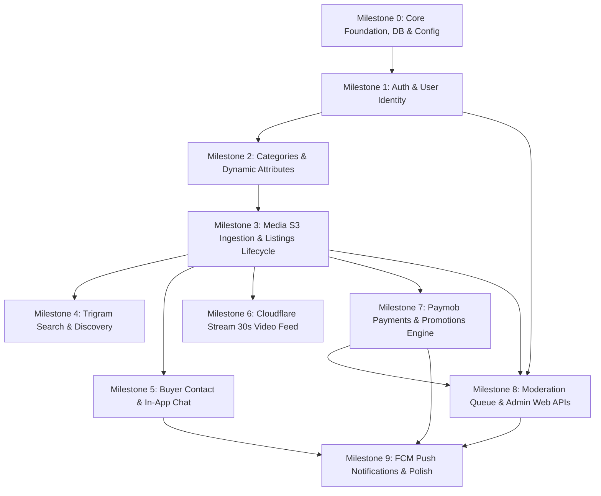

# Backend Implementation Plan — Market Space
**Execution Phase:** Phase 2 Blueprint (Pending Phase 1 Approval)  
**Architecture:** Modular Monolith in NestJS (TypeScript) + PostgreSQL 16 + Redis 7  

---

## 1. Target Directory & File Structure

```
backend/
├── src/
│   ├── main.ts                         # Application bootstrap with Fastify, CORS, Swagger
│   ├── app.module.ts                   # Root module orchestrating domain modules
│   ├── core/                           # Cross-cutting foundational services
│   │   ├── config/                     # Typed env config via @nestjs/config & Zod/Joi
│   │   ├── database/                   # Prisma ORM schema, client service, and repositories
│   │   ├── redis/                      # Redis connection service & caching utilities
│   │   ├── error/                      # Standard RFC 7807 Exception Filters & Error Envelopes
│   │   ├── guards/                     # JwtAuthGuard, RolesGuard, RateLimitGuard
│   │   └── interceptors/               # TransformResponseInterceptor, LoggingInterceptor
│   ├── modules/
│   │   ├── auth/                       # Phone OTP, login, JWT issuance, session management
│   │   │   ├── auth.controller.ts
│   │   │   ├── auth.service.ts
│   │   │   ├── dto/                    # SendOtpDto, VerifyOtpDto, RefreshTokenDto
│   │   │   └── strategies/             # JwtStrategy, RefreshTokenStrategy
│   │   ├── users/                      # User profile updates, preferences, soft-deletion
│   │   ├── categories/                 # Root/Subcategory taxonomy & dynamic field schemas
│   │   ├── listings/                   # Core classifieds CRUD, state machine transitions
│   │   │   ├── listings.controller.ts
│   │   │   ├── listings.service.ts
│   │   │   ├── listings-state-machine.ts
│   │   │   └── dto/                    # CreateListingDto, UpdateListingDto, FilterListingsDto
│   │   ├── media/                      # Direct S3/R2 presigned upload URLs & ownership checks
│   │   ├── search/                     # Trigram search engine & multi-faceted query builder
│   │   ├── chat/                       # Conversations, messages, read states, anti-spam
│   │   ├── video/                      # Cloudflare Stream direct-upload tokens & webhooks
│   │   ├── payments/                   # Paymob checkout, HMAC verification, promotions
│   │   ├── moderation/                 # Abuse reports, admin review queue, audit trail
│   │   └── notifications/              # FCM push dispatcher & notification inbox
│   └── workers/                        # Asynchronous BullMQ background worker processors
│       ├── worker.module.ts
│       ├── media-cleanup.processor.ts
│       ├── listing-expiry.processor.ts
│       ├── notification.processor.ts
│       └── payment-reconciliation.processor.ts
├── prisma/
│   ├── schema.prisma                   # PostgreSQL authoritative schema & indexes
│   ├── migrations/                     # Ordered SQL migration history
│   └── seeds/                          # Egyptian Governorates & Cities, Categories seed data
├── test/
│   ├── unit/                           # DTO, service logic, state-machine unit tests
│   ├── integration/                    # DB repository, Redis, R2 mock integration tests
│   └── e2e/                            # Full API lifecycle and security tests
├── Dockerfile                          # Multi-stage production Docker build
└── tsconfig.json
```

---

## 2. Module Implementation Order & Dependency Graph



---

## 3. Database Migration Sequence

1. `001_create_geographic_tables`: Governorates and cities tables with seed data for Egypt.
2. `002_create_users_and_sessions`: Users, user_roles, user_sessions, and otps tables.
3. `003_create_taxonomy_tables`: Categories and dynamic category_fields tables.
4. `004_create_listings_and_media`: Core listings table with `JSONB` attributes, GIN trigram indexes, and listing_media table.
5. `005_create_chat_tables`: Conversations and messages tables with compound indexes.
6. `006_create_payments_and_promotions`: Promotion packages, payments, and listing_promotions tables.
7. `007_create_moderation_and_audit`: Reports, moderator actions, and immutable audit_logs.

---

## 4. Milestone Verification Checklist (SRS & OpenAPI Alignment)

- [ ] **M0: Foundation:** Database migrations execute cleanly; `/health/live` and `/health/ready` return 200 OK.
- [ ] **M1: Auth:** Egyptian phone OTP sends, validates, handles 3-attempt throttling, issues JWT token pair.
- [ ] **M2: Taxonomy:** Category hierarchy returns localized names; dynamic fields validate types (SELECT, NUMBER, TEXT).
- [ ] **M3: Listings:** Presigned R2 URLs generated; listing lifecycle state machine enforces valid transitions; ownership checks block IDOR.
- [ ] **M4: Search:** Arabic trigram search matches titles with partial keywords in < 150ms.
- [ ] **M5: Contact & Chat:** Phone reveal counter increments; WhatsApp link creates clean text; in-app messages persist and paginate.
- [ ] **M6: Video:** Cloudflare Stream direct token issued; webhook verifies video readiness; vertical feed serves valid HLS URLs.
- [ ] **M7: Payments:** Paymob checkout returns valid order token; HMAC SHA512 webhook validated; listing marked featured idempotently.
- [ ] **M8: Moderation:** Moderator role guard protects queue; report resolution and administrative status overrides recorded in audit log.
- [ ] **M9: Notifications:** BullMQ worker consumes notification jobs and successfully dispatches FCM messages.
