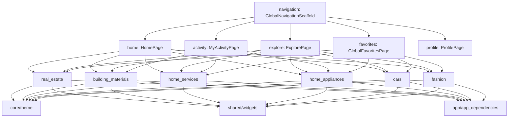

# 03 – Application Modules & Feature Specifications

## 1. Module Inventory & Status Overview

The Deal One mobile application (`market_space`) comprises thirteen (13) distinct application modules organized under `lib/features/`. Each module encapsulates its respective domain logic, presentation layer, and data repositories.

| Module Identifier | Vertical / Domain | UI / Presentation Status | Data Layer Status | Remote API Status |
|---|---|---|---|---|
| `real_estate` | Property Classifieds, Interactive Map & Reels | **IMPLEMENTED** | **MOCK / HARDCODED** (`MockRealEstateData`) | **NOT IMPLEMENTED** (Unwired) |
| `building_materials` | Industrial Construction Materials, RFQs, Shipping | **IMPLEMENTED** | **MOCK / HARDCODED** (`MockBuildingMaterialsData`) | **NOT IMPLEMENTED** (Unwired) |
| `home_services` | Maintenance Services, Technician Tracking & Booking | **IMPLEMENTED** | **MOCK / HARDCODED** (`HomeServicesRepositoryImpl`) | **NOT IMPLEMENTED** (Unwired) |
| `home_appliances` | Electronics & Home Decoration, Cart & Checkout | **IMPLEMENTED** | **MOCK / HARDCODED** (`MockHomeAppliancesData`) | **NOT IMPLEMENTED** (Unwired) |
| `cars` | Automotive Marketplace, Advanced Filters & Details | **IMPLEMENTED** | **MOCK / HARDCODED** (`MockCarsData`) | **NOT IMPLEMENTED** (Unwired) |
| `fashion` | Apparel & Accessories, Department Tabs & Cart | **IMPLEMENTED** | **MOCK / HARDCODED** (`MockFashionData`) | **NOT IMPLEMENTED** (Unwired) |
| `home` | Multi-Sector Discovery Hub, Dynamic Banners | **IMPLEMENTED** | **MOCK / HARDCODED** (`MockHomeData`) | **NOT IMPLEMENTED** (Unwired) |
| `explore` | Unified Cross-Sector Search Engine | **IMPLEMENTED** | **MOCK / HARDCODED** (Cross-Feature Mocks) | **NOT IMPLEMENTED** (Unwired) |
| `favorites` | Cross-Sector Bookmark Aggregator | **IMPLEMENTED** | **MOCK / HARDCODED** (`UnifiedFavoritesRepository`) | **NOT IMPLEMENTED** (Unwired) |
| `activity` | Unified Orders, Bookings & Inquiries Timeline | **IMPLEMENTED** | **MOCK / HARDCODED** (`UnifiedActivityRepository`) | **NOT IMPLEMENTED** (Unwired) |
| `profile` | User Profile, Addresses, Settings & Preferences | **IMPLEMENTED** | **PARTIALLY IMPLEMENTED** (`SharedPreferences`) | **NOT IMPLEMENTED** (Unwired) |
| `notifications` | Sector-Segmented Push & Transactional Alerts | **IMPLEMENTED** | **MOCK / HARDCODED** (`NotificationRepositoryImpl`) | **NOT IMPLEMENTED** (Unwired) |
| `navigation` | Global Shell, Bottom Navigation Bar & Switcher | **IMPLEMENTED** | **IMPLEMENTED** (`SectionNavigationRegistry`) | **N/A** (Client-side) |

---

## 2. Module Dependency Map

---

## 3. The Six Core Deal One Verticals

### 3.1 Module: Real Estate (`real_estate`)
- **Business Purpose**: Search, filter, view, map, and interact with residential and commercial properties in Egypt, along with an interactive multimedia reel feed (TikTok/Instagram-style property videos and photos).
- **Main Screens**:
  - `RealEstatePage` ([real_estate_page.dart](file:///home/ibrahim-elshishtawy/flutter%20project/market_space/market_space/lib/features/real_estate/presentation/pages/real_estate_page.dart)): Primary sector hub with category tabs (Apartments, Villas, Duplexes, Commercial), search header, filter chips, and property card list.
  - `RealEstateDetailPage` ([real_estate_detail_page.dart](file:///home/ibrahim-elshishtawy/flutter%20project/market_space/market_space/lib/features/real_estate/presentation/pages/real_estate_detail_page.dart)): Comprehensive listing detail with image carousel, specifications table (rooms, area, floor, finishing), broker contact buttons (Call, WhatsApp), mortgage calculator widget, and interactive location map.
  - `RealEstateMapPage` ([real_estate_map_page.dart](file:///home/ibrahim-elshishtawy/flutter%20project/market_space/market_space/lib/features/real_estate/map/presentation/pages/real_estate_map_page.dart)): Full-screen interactive map powered by `flutter_map` and OpenStreetMap tile layers, rendering interactive price markers and property preview bottom cards.
  - `ReelsPage` ([reels_page.dart](file:///home/ibrahim-elshishtawy/flutter%20project/market_space/market_space/lib/features/real_estate/reels/presentation/pages/reels_page.dart)): Vertical scrolling short-form video/photo feed with broker avatars, like/comment buttons, property pricing overlays, and direct detail routing.
  - `ReelPublishPage` ([reel_publish_page.dart](file:///home/ibrahim-elshishtawy/flutter%20project/market_space/market_space/lib/features/real_estate/reels/presentation/pages/reel_publish_page.dart)): Media upload simulator for publishing property reels.
  - `ReelAnalyticsPage` ([reel_analytics_page.dart](file:///home/ibrahim-elshishtawy/flutter%20project/market_space/market_space/lib/features/real_estate/reels/presentation/pages/reel_analytics_page.dart)): Performance metrics for published property reels (views, inquiries, saves).
  - `RealEstateFavoritesPage` ([real_estate_favorites_page.dart](file:///home/ibrahim-elshishtawy/flutter%20project/market_space/market_space/lib/features/real_estate/favorites/presentation/pages/real_estate_favorites_page.dart)): Bookmark management for properties.
  - `RealEstateNotificationsPage` ([real_estate_notifications_page.dart](file:///home/ibrahim-elshishtawy/flutter%20project/market_space/market_space/lib/features/real_estate/notifications/presentation/pages/real_estate_notifications_page.dart)): Real estate price drops and new listing alerts.
- **Controllers & Notifiers**:
  - `RealEstateController` ([real_estate_controller.dart](file:///home/ibrahim-elshishtawy/flutter%20project/market_space/market_space/lib/features/real_estate/presentation/controllers/real_estate_controller.dart)): Manages selected category, active search query, price/room filters, and pagination state.
  - `RealEstateFavoritesController` & `RealEstateNotificationController`.
- **Models**:
  - `RealEstateListingModel`, `RealEstateDetailModel`, `RealEstateFilterModel`, `ReelModel`, `ReelAnalyticsModel`.
- **Repositories**:
  - `MockRealEstateRepository` ([real_estate_repository.dart](file:///home/ibrahim-elshishtawy/flutter%20project/market_space/market_space/lib/features/real_estate/data/repositories/real_estate_repository.dart)), `ReelsRepositoryImpl` ([reels_repository.dart](file:///home/ibrahim-elshishtawy/flutter%20project/market_space/market_space/lib/features/real_estate/reels/data/repositories/reels_repository.dart)).
- **Services**: `flutter_map` OpenStreetMap integration with `latlong2`.
- **Target API Endpoints**: `/listings`, `/listings/{id}`, `/listings/favorites`, `/videos/feed` (Defined in `ApiEndpoints`, unwired in repository).
- **Navigation Dependencies**: Registered in `AppRouter` under `/real-estate`, `/real-estate/detail`, `/real-estate/map`, `/real-estate/reels`, `/real-estate/reels/publish`.
- **Local Storage Dependencies**: Memory-only during session.
- **Current Status**: **IMPLEMENTED (UI / Controller / Mock Data)**.

---

### 3.2 Module: Building Materials & Electrical Supplies (`building_materials`)
- **Business Purpose**: B2B and B2C commerce platform for heavy construction materials (Steel Rebar, Cement, Gypsum, Concrete Blocks, Bricks) and electrical contracting supplies. Includes live daily factory price tracking, an RFQ (Request For Quotation) creation wizard, freight shipping cost calculation, staged project delivery management, and bulk ordering.
- **Main Screens**:
  - `BuildingMaterialsPage` ([building_materials_page.dart](file:///home/ibrahim-elshishtawy/flutter%20project/market_space/market_space/lib/features/building_materials/presentation/pages/building_materials_page.dart)): Daily factory price ticker banner (Ezz Steel, Suez Cement, etc.), category navigation, featured supplier products.
  - `SteelRebarListingPage` ([steel_rebar_listing_page.dart](file:///home/ibrahim-elshishtawy/flutter%20project/market_space/market_space/lib/features/building_materials/presentation/pages/steel_rebar_listing_page.dart)): Steel rebar diameters (10mm, 12mm, 16mm, etc.) with factory pricing.
  - `BuildingMaterialCategoryDetailPage` ([building_material_category_detail_page.dart](file:///home/ibrahim-elshishtawy/flutter%20project/market_space/market_space/lib/features/building_materials/presentation/pages/building_material_category_detail_page.dart)): Material category product listings with filter tags.
  - `BuildingMaterialProductDetailPage` ([building_material_product_detail_page.dart](file:///home/ibrahim-elshishtawy/flutter%20project/market_space/market_space/lib/features/building_materials/presentation/pages/building_material_product_detail_page.dart)): Technical specs, minimum order quantity, unit pricing (ton/sqm), and supplier profile.
  - `RfqCreatePage` ([rfq_create_page.dart](file:///home/ibrahim-elshishtawy/flutter%20project/market_space/market_space/lib/features/building_materials/presentation/pages/rfq_create_page.dart)): Multi-step formal request-for-quotation form (material, quantity, project address, governorate, delivery deadline, specs).
  - `BuildingMaterialsCartPage` & `BuildingMaterialsCheckoutPage`: Specialized bulk checkout supporting truck type selection (Trailer, Flatbed, Half-truck) and scheduled milestone deliveries.
  - `BuildingMaterialsOrdersPage` & `BuildingMaterialsOrderDetailPage`: Historical and active orders with tracking status.
  - `BuildingMaterialsNotificationsPage`: Price movement and order status alerts.
- **Controllers & Notifiers**:
  - `BuildingMaterialsCartController`, `BuildingMaterialsOrderController`, `BuildingMaterialsNotificationController`.
- **Models**:
  - `MaterialProductModel`, `DailyPriceBannerModel`, `SteelDailyPriceModel`, `SteelRebarProductModel`, `CategoryDetailModel`, `RfqModel`, `StagedShipmentModel`, `BuildingMaterialCartModel`, `BuildingMaterialOrderModel`.
- **Repositories**:
  - `BuildingMaterialsRepositoryImpl` ([building_materials_repository.dart](file:///home/ibrahim-elshishtawy/flutter%20project/market_space/market_space/lib/features/building_materials/data/repositories/building_materials_repository.dart)), `BuildingMaterialsCartRepositoryImpl`, `BuildingMaterialsOrderRepositoryImpl`.
- **Services**:
  - `ShippingCalculator` ([shipping_calculator.dart](file:///home/ibrahim-elshishtawy/flutter%20project/market_space/market_space/lib/features/building_materials/presentation/services/shipping_calculator.dart)): Computes dynamic freight rates based on truck capacity, distance between Egyptian governorates, and weight tonnage.
  - `UnitConverter` ([unit_converter.dart](file:///home/ibrahim-elshishtawy/flutter%20project/market_space/market_space/lib/features/building_materials/presentation/services/unit_converter.dart)): Converts between tons, kilograms, pieces, pallets, and square meters.
- **Target API Endpoints**: Generic `/listings`, unwired in mock repository.
- **Navigation Dependencies**: Registered in `AppRouter` under `/building-materials`, `/building-materials/cart`, `/building-materials/checkout`, `/building-materials/rfq`, `/building-materials/orders`, etc.
- **Current Status**: **IMPLEMENTED (UI / Controller / Calculation Services / Mock Data)**.

---

### 3.3 Module: Home & Engineering Services (`home_services`)
- **Business Purpose**: On-demand and contract home maintenance and engineering services (Air Conditioning maintenance, Plumbing, Electrical works, Painting, Carpentry, Smart Home setup). Provides live technician dispatch tracking and a structured 6-step booking wizard.
- **Main Screens**:
  - `HomeServicesPage` ([home_services_page.dart](file:///home/ibrahim-elshishtawy/flutter%20project/market_space/market_space/lib/features/home_services/presentation/pages/home_services_page.dart)): Sector hub with quick service chips, promo packages, and popular service cards.
  - `HomeServiceDetailPage` ([home_service_detail_page.dart](file:///home/ibrahim-elshishtawy/flutter%20project/market_space/market_space/lib/features/home_services/presentation/pages/home_service_detail_page.dart)): Service scope, pricing tiers, customer reviews, and direct booking trigger.
  - `AcServiceDetailPage` ([ac_service_detail_page.dart](file:///home/ibrahim-elshishtawy/flutter%20project/market_space/market_space/lib/features/home_services/presentation/pages/ac_service_detail_page.dart)): Deep-dive AC maintenance description with checklist (chemical cleaning, freon check, electrical inspection).
  - `ServiceProviderDetailPage` ([service_provider_detail_page.dart](file:///home/ibrahim-elshishtawy/flutter%20project/market_space/market_space/lib/features/home_services/presentation/pages/service_provider_detail_page.dart)): Technician / engineering company profile, license credentials, and ratings.
  - `HomeServicesBookingWizardPage` ([home_services_booking_wizard_page.dart](file:///home/ibrahim-elshishtawy/flutter%20project/market_space/market_space/lib/features/home_services/presentation/pages/home_services_booking_wizard_page.dart)): 6-step sequential booking flow:
    1. Problem specification & sub-service selection
    2. Date & time slot picker
    3. Location address & apartment details
    4. Technician level selection (General technician vs. Certified engineer)
    5. Order summary & promo code input
    6. Confirmation & dispatch generation
  - `TechnicianTrackingPage` ([technician_tracking_page.dart](file:///home/ibrahim-elshishtawy/flutter%20project/market_space/market_space/lib/features/home_services/presentation/pages/technician_tracking_page.dart)): Real-time visual timeline showing: Booking Confirmed → Technician Assigned → On the Way → Arrived & Working → Completed.
  - `HomeServiceBookingDetailPage` ([home_service_booking_detail_page.dart](file:///home/ibrahim-elshishtawy/flutter%20project/market_space/market_space/lib/features/home_services/presentation/pages/home_service_booking_detail_page.dart)): Booking summary and receipt.
- **Controllers & Notifiers**:
  - `HomeServicesCatalogController`, `HomeServicesBookingController`, `HomeServicesFavoritesController`.
- **Models**:
  - `HomeServiceModel`, `ServiceProviderModel`, `ServiceBookingModel`, `TechnicianTrackingModel`.
- **Repositories**:
  - `HomeServicesRepositoryImpl`, `HomeServicesBookingRepositoryImpl`, `HomeServicesFavoritesRepositoryImpl`, `AcServiceRepository`.
- **Navigation Dependencies**: Registered in `AppRouter` under `/home-services`, `/home-services/catalog`, `/home-services/book`, `/home-services/tracking`, etc.
- **Current Status**: **IMPLEMENTED (UI / Controller / Wizard Flow / Mock Data)**.

---

### 3.4 Module: Home Appliances & Decoration (`home_appliances`)
- **Business Purpose**: E-commerce catalog for large home appliances (refrigerators, washing machines, cookers), small kitchen appliances, and home decoration items, with integrated cart, promo coupons, and address checkout.
- **Main Screens**:
  - `HomeAppliancesPage` ([home_appliances_page.dart](file:///home/ibrahim-elshishtawy/flutter%20project/market_space/market_space/lib/features/home_appliances/presentation/pages/home_appliances_page.dart)): Sector catalog, brand slider, discounted deals, and category shortcuts.
  - `ApplianceCategoryListingPage` ([appliance_category_listing_page.dart](file:///home/ibrahim-elshishtawy/flutter%20project/market_space/market_space/lib/features/home_appliances/presentation/pages/appliance_category_listing_page.dart)): Category-specific listing with brand, capacity, and price filters.
  - `HomeAppliancesCategoriesPage` ([home_appliances_categories_page.dart](file:///home/ibrahim-elshishtawy/flutter%20project/market_space/market_space/lib/features/home_appliances/categories/presentation/pages/home_appliances_categories_page.dart)): Grid of all appliance categories.
  - `HomeAppliancesCartPage` ([home_appliances_cart_page.dart](file:///home/ibrahim-elshishtawy/flutter%20project/market_space/market_space/lib/features/home_appliances/cart/presentation/pages/home_appliances_cart_page.dart)): Shopping cart with quantity increment/decrement, subtotal, shipping fee, and coupon application.
  - `HomeAppliancesCheckoutPage` ([home_appliances_checkout_page.dart](file:///home/ibrahim-elshishtawy/flutter%20project/market_space/market_space/lib/features/home_appliances/checkout/presentation/pages/home_appliances_checkout_page.dart)): Delivery address selection and payment method selector (Cash on Delivery, Credit Card).
  - `HomeAppliancesOrdersPage` ([home_appliances_orders_page.dart](file:///home/ibrahim-elshishtawy/flutter%20project/market_space/market_space/lib/features/home_appliances/orders/presentation/pages/home_appliances_orders_page.dart)): Order history.
  - `HomeAppliancesNotificationsPage` ([home_appliances_notifications_page.dart](file:///home/ibrahim-elshishtawy/flutter%20project/market_space/market_space/lib/features/home_appliances/notifications/presentation/pages/home_appliances_notifications_page.dart)): Sector-specific notifications.
- **Controllers & Notifiers**:
  - `HomeAppliancesCartController`, `HomeAppliancesOrderController`, `HomeAppliancesNotificationController`.
- **Models**:
  - `HomeApplianceProductModel`, `ApplianceCategoryModel`, `HomeApplianceCartItemModel`, `HomeApplianceOrderModel`.
- **Repositories**:
  - `HomeAppliancesRepositoryImpl`, `HomeAppliancesCartRepositoryImpl`, `HomeAppliancesOrderRepositoryImpl`, `HomeAppliancesNotificationRepositoryImpl`.
- **Navigation Dependencies**: Registered in `AppRouter` under `/home-appliances`, `/home-appliances/category`, `/home-appliances/cart`, `/home-appliances/checkout`, etc.
- **Current Status**: **IMPLEMENTED (UI / Controller / Cart & Checkout / Mock Data)**.

---

### 3.5 Module: Cars & Automotive (`cars`)
- **Business Purpose**: Comprehensive automotive marketplace for buying and selling new and pre-owned cars in Egypt. Supports detailed specifications (engine capacity, transmission, fuel type, body style, kilometer mileage, model year), brand filtering, and direct seller contact.
- **Main Screens**:
  - `CarsPage` ([cars_page.dart](file:///home/ibrahim-elshishtawy/flutter%20project/market_space/market_space/lib/features/cars/presentation/pages/cars_page.dart)): Automotive hub with search bar, brand selector chips (Toyota, Mercedes, Hyundai, Kia, BMW, etc.), sorting options, and rich car cards.
  - `CarDetailPage` ([car_detail_page.dart](file:///home/ibrahim-elshishtawy/flutter%20project/market_space/market_space/lib/features/cars/presentation/pages/car_detail_page.dart)): Car image gallery, key badge chips (year, mileage, transmission, engine), detailed description, location map snippet, seller profile card, and action buttons (Call, WhatsApp, Save to Favorites).
- **Controllers & Notifiers**:
  - `CarsController` ([cars_controller.dart](file:///home/ibrahim-elshishtawy/flutter%20project/market_space/market_space/lib/features/cars/presentation/controllers/cars_controller.dart)): Handles dynamic query filtering, brand selection, sorting (newest, price low/high, lowest mileage), pagination, and favorite toggling.
- **Models**:
  - `CarListingModel`, `CarBrandModel`, `CarFilterModel`.
- **Repositories**:
  - `MockCarsRepository` ([cars_repository.dart](file:///home/ibrahim-elshishtawy/flutter%20project/market_space/market_space/lib/features/cars/data/repositories/cars_repository.dart)).
- **Navigation Dependencies**: Registered in `AppRouter` under `/cars`, `/cars/detail?id=car-01`, `/cars/browse`.
- **Current Status**: **IMPLEMENTED (UI / Controller / Filter Engine / Mock Data)**.

---

### 3.6 Module: Clothes & Accessories (`fashion`)
- **Business Purpose**: Fashion e-commerce platform covering Men's, Women's, and Kids' apparel, shoes, bags, and accessories with size/color variant selection, brand filtering, discount tags, and cart management.
- **Main Screens**:
  - `FashionPage` ([fashion_page.dart](file:///home/ibrahim-elshishtawy/flutter%20project/market_space/market_space/lib/features/fashion/presentation/pages/fashion_page.dart)): Department tabs (Men, Women, Kids), promotional banners, category chips, featured products, and best-sellers.
  - `FashionProductDetailPage` ([fashion_product_detail_page.dart](file:///home/ibrahim-elshishtawy/flutter%20project/market_space/market_space/lib/features/fashion/presentation/pages/fashion_product_detail_page.dart)): Image carousel, color variant selector, size selector (S, M, L, XL, etc.), stock availability validation, size guide dialog, and "Add to Cart" sticky footer.
  - `FashionCartPage` ([fashion_cart_page.dart](file:///home/ibrahim-elshishtawy/flutter%20project/market_space/market_space/lib/features/fashion/presentation/pages/fashion_cart_page.dart)): Fashion shopping cart with item quantity modification, total pricing, and checkout button.
  - `FashionCategoriesPage` ([fashion_categories_page.dart](file:///home/ibrahim-elshishtawy/flutter%20project/market_space/market_space/lib/features/fashion/presentation/pages/fashion_categories_page.dart)): Full category grid.
- **Controllers & Notifiers**:
  - `FashionController` ([fashion_controller.dart](file:///home/ibrahim-elshishtawy/flutter%20project/market_space/market_space/lib/features/fashion/presentation/controllers/fashion_controller.dart)): Manages active department, search query, brand filter, and product lists.
  - `FashionCartController` ([fashion_cart_controller.dart](file:///home/ibrahim-elshishtawy/flutter%20project/market_space/market_space/lib/features/fashion/presentation/controllers/fashion_cart_controller.dart)): Manages item additions, variant selections (size/color), removals, and cart item counts.
- **Models**:
  - `FashionProductModel`, `FashionCategoryModel`, `FashionVariantModel`, `FashionCartItemModel`.
- **Repositories**:
  - `MockFashionRepository` ([fashion_repository.dart](file:///home/ibrahim-elshishtawy/flutter%20project/market_space/market_space/lib/features/fashion/data/repositories/fashion_repository.dart)).
- **Navigation Dependencies**: Registered in `AppRouter` under `/fashion`, `/fashion/detail?id=f-m01`, `/fashion/cart`, `/fashion/categories`.
- **Current Status**: **IMPLEMENTED (UI / Controller / Variants & Cart / Mock Data)**.

---

## 4. Supporting Application Modules

### 4.1 Module: Home (`home`)
- **Business Purpose**: The primary multi-sector entry hub. Features a top bar with location and notifications, search bar, hero banner carousel, six primary category tiles (routing directly to each vertical), and most requested services.
- **Main Files**: [home_page.dart](file:///home/ibrahim-elshishtawy/flutter%20project/market_space/market_space/lib/features/home/presentation/pages/home_page.dart), `HeroCarousel`, `HomeHeader`, `MainCategoriesSection`.
- **Status**: **IMPLEMENTED**.

### 4.2 Module: Explore (`explore`)
- **Business Purpose**: Global cross-sector search and discovery engine. Allows users to query keywords across all sectors or filter by a specific vertical chip.
- **Main Files**: [explore_page.dart](file:///home/ibrahim-elshishtawy/flutter%20project/market_space/market_space/lib/features/explore/presentation/pages/explore_page.dart), [explore_controller.dart](file:///home/ibrahim-elshishtawy/flutter%20project/market_space/market_space/lib/features/explore/presentation/controllers/explore_controller.dart).
- **Status**: **IMPLEMENTED**.

### 4.3 Module: Favorites (`favorites`)
- **Business Purpose**: Centralized cross-sector aggregator displaying all saved items across Real Estate, Cars, Fashion, Appliances, and Services with category filter chips and one-tap removal.
- **Main Files**: [global_favorites_page.dart](file:///home/ibrahim-elshishtawy/flutter%20project/market_space/market_space/lib/features/favorites/presentation/pages/global_favorites_page.dart), [unified_favorites_controller.dart](file:///home/ibrahim-elshishtawy/flutter%20project/market_space/market_space/lib/features/favorites/presentation/controllers/unified_favorites_controller.dart).
- **Status**: **IMPLEMENTED**.

### 4.4 Module: Activity (`activity`)
- **Business Purpose**: Single timeline aggregating all user transactions across sectors: Building Material Orders, RFQs, Home Service Bookings, and Appliance Orders, with status badges (In Progress, Confirmed, Shipped, Completed).
- **Main Files**: [my_activity_page.dart](file:///home/ibrahim-elshishtawy/flutter%20project/market_space/market_space/lib/features/activity/presentation/pages/my_activity_page.dart), [unified_activity_controller.dart](file:///home/ibrahim-elshishtawy/flutter%20project/market_space/market_space/lib/features/activity/presentation/controllers/unified_activity_controller.dart).
- **Status**: **IMPLEMENTED**.

### 4.5 Module: Profile (`profile`)
- **Business Purpose**: Account management, profile editing dialog (name, email, phone, city), saved addresses list, language toggle (Arabic/English), theme mode switch (Light/Dark), and logout simulation.
- **Main Files**: [profile_page.dart](file:///home/ibrahim-elshishtawy/flutter%20project/market_space/market_space/lib/features/profile/presentation/pages/profile_page.dart), [profile_controller.dart](file:///home/ibrahim-elshishtawy/flutter%20project/market_space/market_space/lib/features/profile/presentation/controllers/profile_controller.dart).
- **Status**: **IMPLEMENTED (UI / In-Memory State)**.

### 4.6 Module: Notifications (`notifications`)
- **Business Purpose**: Notification inbox with sector filtering chips (All, Real Estate, Materials, Services, Appliances, Cars, Fashion), unread counts, and "Mark all as read" capability.
- **Main Files**: [global_notifications_page.dart](file:///home/ibrahim-elshishtawy/flutter%20project/market_space/market_space/lib/features/notifications/presentation/pages/global_notifications_page.dart), [notification_controller.dart](file:///home/ibrahim-elshishtawy/flutter%20project/market_space/market_space/lib/core/notifications/presentation/state/notification_controller.dart).
- **Status**: **IMPLEMENTED**.

### 4.7 Module: Navigation (`navigation`)
- **Business Purpose**: Provides `GlobalNavigationScaffold` which houses an `IndexedStack` of 5 tabs (Home, Explore, Activity, Favorites, Profile) and dynamic section configurations from `SectionNavigationRegistry`.
- **Main Files**: [global_navigation_scaffold.dart](file:///home/ibrahim-elshishtawy/flutter%20project/market_space/market_space/lib/features/navigation/presentation/pages/global_navigation_scaffold.dart), [section_navigation_registry.dart](file:///home/ibrahim-elshishtawy/flutter%20project/market_space/market_space/lib/core/navigation/config/section_navigation_registry.dart).
- **Status**: **IMPLEMENTED**.

---

## 5. Missing or Unimplemented Modules

The following expected marketplace modules are **NOT IMPLEMENTED** in the Flutter codebase:
1. **Authentication & Identity Module**: No `/login`, `/register`, `/otp-verify`, or password recovery screens exist.
2. **General Classified Ad Creation Module**: There is no general "Post Ad" wizard for users to create or edit listings for cars, properties, fashion, or appliances (only RFQ creation for materials and Reel upload simulator exist).
3. **In-App Chat / Messaging Module**: Tapping chat icons displays a simulated `SnackBar`; no conversation list, chat room, or messaging controllers exist.

