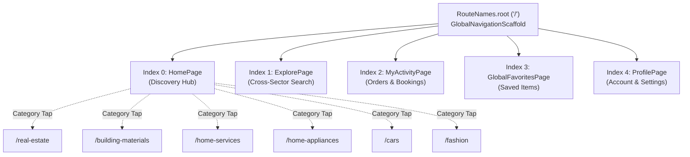
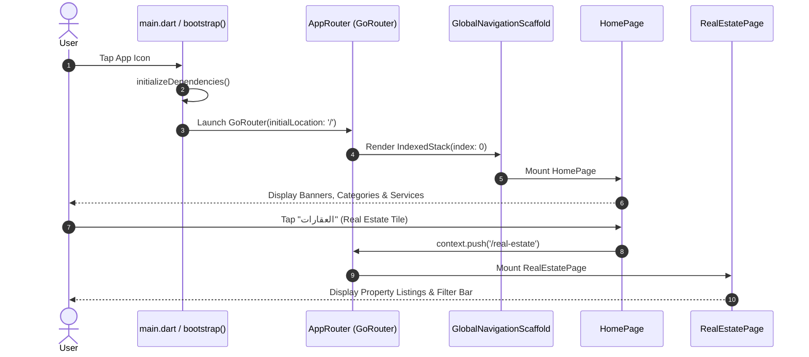
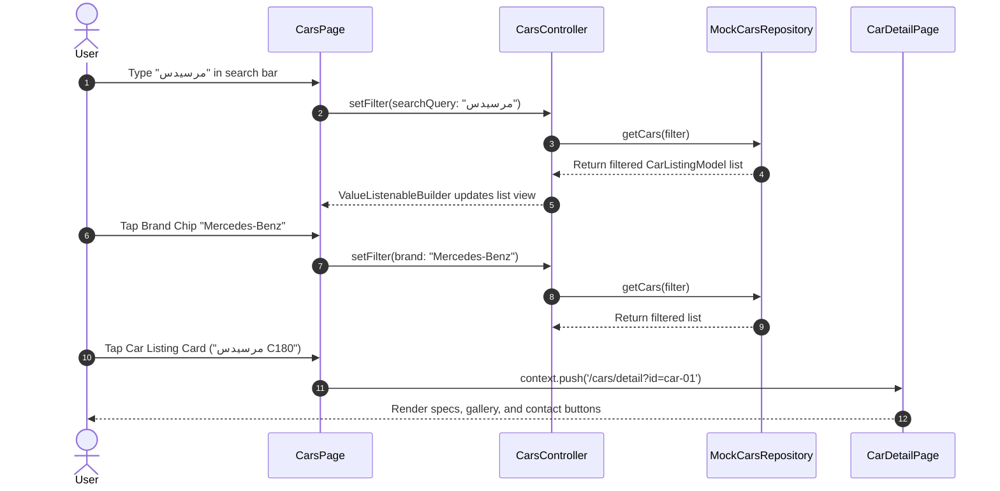
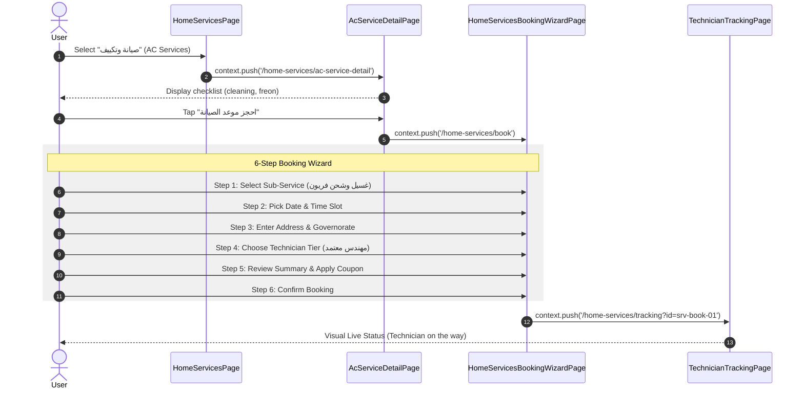
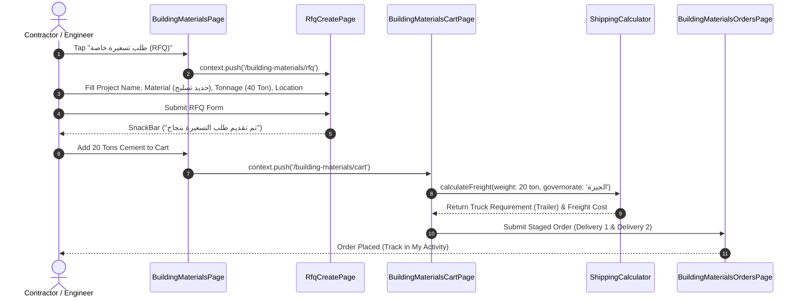
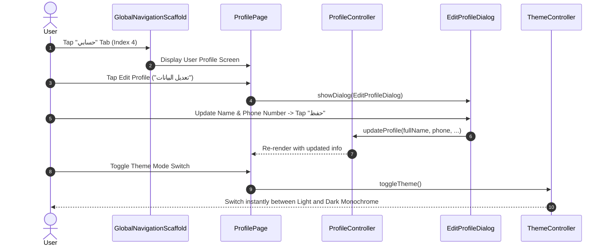

# 04 – Navigation Architecture & User Journeys

## 1. Navigation Subsystem Overview

The Deal One mobile application implements a declarative routing architecture using `go_router` (v18.0.2). Navigation is orchestrated through a root `GoRouter` instance configured in [lib/app/app_router.dart](file:///home/ibrahim-elshishtawy/flutter%20project/market_space/market_space/lib/app/app_router.dart) and anchored by a persistent multi-tab shell, `GlobalNavigationScaffold` ([lib/features/navigation/presentation/pages/global_navigation_scaffold.dart](file:///home/ibrahim-elshishtawy/flutter%20project/market_space/market_space/lib/features/navigation/presentation/pages/global_navigation_scaffold.dart)).

---

## 2. Navigation Architecture Specifications

| Dimension | Architectural Implementation | Code Evidence | Status |
|---|---|---|---|
| **Entry Point** | Direct boot into `RouteNames.root` (`/`) | [app_router.dart#L78](file:///home/ibrahim-elshishtawy/flutter%20project/market_space/market_space/lib/app/app_router.dart#L78) | **IMPLEMENTED** |
| **Splash Screen** | **None**. Application boots directly into `GlobalNavigationScaffold` | `main.dart` -> `bootstrap()` -> `MarketSpaceApp` | **NOT IMPLEMENTED** |
| **Onboarding Flow** | Storage key `StorageKeys.onboardingCompleted` exists, but no UI screens exist | [storage_keys.dart](file:///home/ibrahim-elshishtawy/flutter%20project/market_space/market_space/lib/core/storage/storage_keys.dart#L4) | **NOT IMPLEMENTED** |
| **Authentication Flow** | No `/login`, `/register`, or `/otp` routes configured | [route_names.dart](file:///home/ibrahim-elshishtawy/flutter%20project/market_space/market_space/lib/core/routing/route_names.dart) | **NOT IMPLEMENTED** |
| **Route Protection** | `SessionRouteGuard` implements `RouteGuard`, but unconditionally returns `null` | [route_guards.dart](file:///home/ibrahim-elshishtawy/flutter%20project/market_space/market_space/lib/core/routing/route_guards.dart#L18) | **PLACEHOLDER** |
| **Guest Access** | 100% of routes are publicly accessible without authentication | Entire `AppRouter` configuration | **IMPLEMENTED (Permissive)** |
| **Bottom Navigation** | 5-tab persistent `IndexedStack` inside `GlobalNavigationScaffold` | `global_navigation_scaffold.dart` | **IMPLEMENTED** |
| **Back Navigation** | `PopScope` intercepts system back: non-zero tabs redirect to tab 0 before exiting | `global_navigation_scaffold.dart#L42-L52` | **IMPLEMENTED** |
| **Deep Links** | Declarative URL routes are configured, but native intent schemes are missing | `AndroidManifest.xml` & `Info.plist` | **PARTIALLY IMPLEMENTED** |

---

## 3. Global Navigation Shell & Tab Indexing

The root route (`/`) mounts `GlobalNavigationScaffold`, maintaining five persistent screens inside an `IndexedStack` to preserve state, scroll positions, and user inputs across tab switches:



### Back-Navigation Guard (`PopScope`)
In `GlobalNavigationScaffold`:
```dart
PopScope(
  canPop: _currentIndex == 0,
  onPopInvokedWithResult: (didPop, _) {
    if (!didPop && _currentIndex != 0) {
      setState(() => _currentIndex = 0);
    }
  },
  child: Scaffold(...),
)
```
- When a user presses the hardware or gesture back button on **Explore**, **Activity**, **Favorites**, or **Profile**, the app redirects to the **Home** tab (Index 0).
- Only when the user is on the **Home** tab does pressing back trigger application dismissal (`canPop: true`).

---

## 4. Complete Application Route Inventory

Extracted directly from [lib/core/routing/route_names.dart](file:///home/ibrahim-elshishtawy/flutter%20project/market_space/market_space/lib/core/routing/route_names.dart) and [lib/app/app_router.dart](file:///home/ibrahim-elshishtawy/flutter%20project/market_space/market_space/lib/app/app_router.dart):

| Route Path | Route Name | Target Page Widget | Navigation Type |
|---|---|---|---|
| `/` | `root` | `GlobalNavigationScaffold(initialIndex: tab ?? 0)` | Root Shell |
| `/explore` | `explore` | `GlobalNavigationScaffold(initialIndex: 1)` | Root Shell Tab 1 |
| `/my-activity` | `my_activity` | `GlobalNavigationScaffold(initialIndex: 2)` | Root Shell Tab 2 |
| `/favorites` | `favorites` | `GlobalNavigationScaffold(initialIndex: 3)` | Root Shell Tab 3 |
| `/profile` | `profile` | `GlobalNavigationScaffold(initialIndex: 4)` | Root Shell Tab 4 |
| `/notifications` | `global_notifications` | `GlobalNotificationsPage` | Push Route |
| `/real-estate` | `real_estate` | `RealEstatePage` | Push Route |
| `/real-estate/detail` | `real_estate_detail` | `RealEstateDetailPage(listingId)` | Push Route (query: `id`) |
| `/real-estate/map` | `real_estate_map` | `RealEstateMapPage` | Push Route |
| `/real-estate/favorites` | `real_estate_favorites` | `RealEstateFavoritesPage` | Push Route |
| `/real-estate/notifications` | `real_estate_notifications` | `RealEstateNotificationsPage` | Push Route |
| `/real-estate/reels` | `real_estate_reels` | `ReelsPage` | Push Route |
| `/real-estate/reels/analytics`| `real_estate_reels_analytics`| `ReelAnalyticsPage(ownerId)` | Push Route (query: `ownerId`) |
| `/real-estate/reels/publish` | `real_estate_reels_publish` | `ReelPublishPage` | Push Route |
| `/building-materials` | `building_materials` | `BuildingMaterialsPage` | Push Route |
| `/building-materials/steel-rebar` | `steel_rebar_listing` | `SteelRebarListingPage` | Push Route |
| `/building-materials/category-detail` | `building_material_category_detail` | `BuildingMaterialCategoryDetailPage` | Push Route |
| `/building-materials/categories` | `building_materials_categories` | `BuildingMaterialsCategoriesPage` | Push Route |
| `/building-materials/cart` | `building_materials_cart` | `BuildingMaterialsCartPage` | Push Route |
| `/building-materials/checkout` | `building_materials_checkout` | `BuildingMaterialsCheckoutPage` | Push Route |
| `/building-materials/orders` | `building_materials_orders` | `BuildingMaterialsOrdersPage` | Push Route |
| `/building-materials/orders/detail` | `building_materials_order_detail` | `BuildingMaterialsOrderDetailPage` | Push Route |
| `/building-materials/notifications` | `building_materials_notifications` | `BuildingMaterialsNotificationsPage` | Push Route |
| `/building-materials/product-detail` | `building_materials_product_detail` | `BuildingMaterialProductDetailPage` | Push Route |
| `/building-materials/rfq` | `building_materials_rfq` | `RfqCreatePage` | Push Route |
| `/home-services` | `home_services` | `HomeServicesPage` | Push Route |
| `/home-services/catalog` | `home_services_catalog` | `HomeServicesPage(initialTabIndex: 1)` | Push Route |
| `/home-services/bookings` | `home_services_bookings` | `HomeServicesPage(initialTabIndex: 2)` | Push Route |
| `/home-services/favorites`| `home_services_favorites`| `HomeServicesPage(initialTabIndex: 3)` | Push Route |
| `/home-services/notifications` | `home_services_notifications` | `HomeServicesPage(initialTabIndex: 4)` | Push Route |
| `/home-services/service-detail`| `home_service_detail` | `HomeServiceDetailPage(serviceId)` | Push Route (query: `id`) |
| `/home-services/ac-service-detail` | `ac_service_detail` | `AcServiceDetailPage` | Push Route |
| `/home-services/provider-detail` | `home_service_provider_detail` | `ServiceProviderDetailPage(providerId)` | Push Route (query: `id`) |
| `/home-services/book` | `home_services_booking_wizard` | `HomeServicesBookingWizardPage` | Push Route |
| `/home-services/booking-detail` | `home_services_booking_detail` | `HomeServiceBookingDetailPage(bookingId)` | Push Route (query: `id`) |
| `/home-services/tracking` | `home_services_technician_tracking` | `TechnicianTrackingPage(bookingId)` | Push Route (query: `id`) |
| `/home-appliances` | `home_appliances` | `HomeAppliancesPage` | Push Route |
| `/home-appliances/category` | `appliance_category_listing` | `ApplianceCategoryListingPage` | Push Route |
| `/home-appliances/categories` | `home_appliances_categories` | `HomeAppliancesCategoriesPage` | Push Route |
| `/home-appliances/cart` | `home_appliances_cart` | `HomeAppliancesCartPage` | Push Route |
| `/home-appliances/checkout` | `home_appliances_checkout` | `HomeAppliancesCheckoutPage` | Push Route |
| `/home-appliances/orders` | `home_appliances_orders` | `HomeAppliancesOrdersPage` | Push Route |
| `/home-appliances/notifications` | `home_appliances_notifications` | `HomeAppliancesNotificationsPage` | Push Route |
| `/cars` | `cars` | `CarsPage` | Push Route |
| `/cars/browse` | `cars_browse` | `CarsPage` | Push Route |
| `/cars/detail` | `cars_detail` | `CarDetailPage(carId)` | Push Route (query: `id`) |
| `/fashion` | `fashion` | `FashionPage` | Push Route |
| `/fashion/detail` | `fashion_detail` | `FashionProductDetailPage(product)` | Push Route (query: `id`) |
| `/fashion/cart` | `fashion_cart` | `FashionCartPage` | Push Route |
| `/fashion/categories` | `fashion_categories` | `FashionCategoriesPage` | Push Route |

---

## 5. Mermaid User Journey Diagrams

### 5.1 Journey 1: Application Launch & Multi-Sector Navigation



---

### 5.2 Journey 2: Searching, Filtering & Viewing Listings (Cars Module)



---

### 5.3 Journey 3: Home Services 6-Step Booking Wizard & Tracking



---

### 5.4 Journey 4: Building Materials RFQ & Staged Checkout



---

### 5.5 Journey 5: User Profile Management & Settings



---

## 6. Analysis of Missing User Journeys

1. **User Registration & Login Journey**:
   - Status: **NOT IMPLEMENTED**.
   - The user cannot log in or authenticate; the app operates in persistent guest mode.
2. **General Classified Ad Creation & Editing Journey**:
   - Status: **NOT IMPLEMENTED**.
   - No generic "Post Ad" flow exists for cars, properties, appliances, or clothes. (Only RFQ submission for materials and Reel publishing simulation exist).
3. **Messaging & In-App Chat Journey**:
   - Status: **NOT IMPLEMENTED**.
   - Tapping "Chat" buttons triggers a local `SnackBar` notice (`ScaffoldMessenger`), with no chat screens or messaging controllers implemented.

