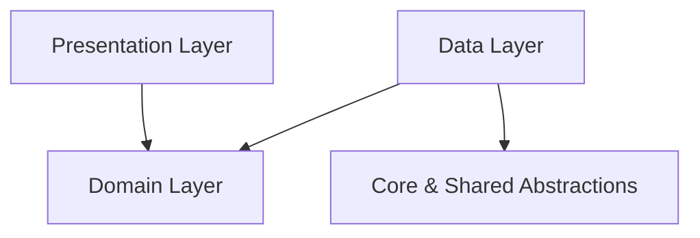

# Guide: Adding a New Feature

## Future Feature Architecture
When developing a new feature (e.g., `listings`), organize it into the following structure:

```text
lib/
  features/
    listings/
      data/
        models/
        data_sources/
        repositories/
      domain/
        models/
        repositories/
      presentation/
        controllers/
        views/
        widgets/
```

## Dependency Direction



## Step-by-Step Implementation Flow
1. Define Domain entities and repository contracts in `domain/repositories/`.
2. Implement remote/local data sources in `data/data_sources/` consuming `ApiClient`.
3. Implement repository in `data/repositories/` implementing the domain repository.
4. Expose UI state controllers in `presentation/controllers/`.
5. Connect screens in `presentation/views/` and register routes in `app_router.dart`.
