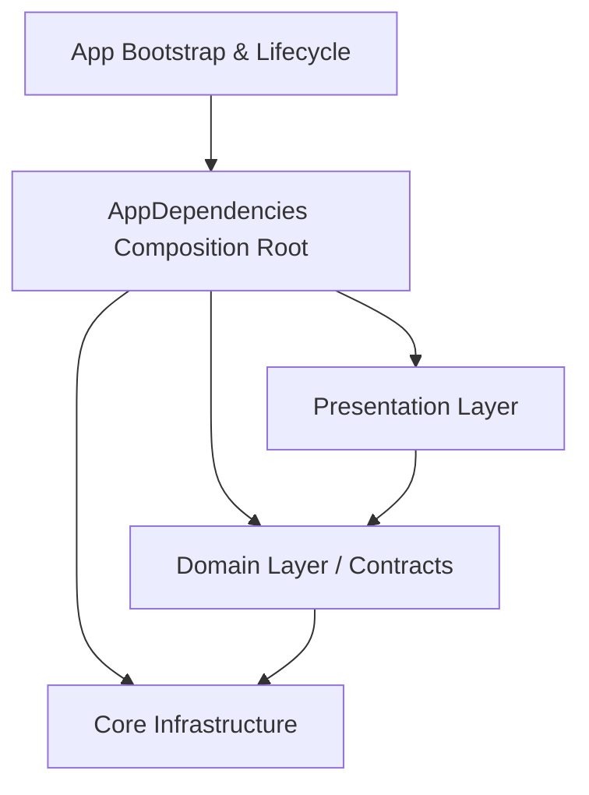

# Mobile Architecture Overview

## Architecture Overview
The Market Space mobile client is designed following Clean Architecture principles, separated into clear architectural layers:

## Architectural Boundaries
- Shared Core Infrastructure: Networking, storage, error mapping, sanitization, platform utilities, theme tokens, and localization.
- Application Bootstrap: Deterministic startup flow that validates configuration before running the widget tree.
- Future Feature Modules: Built using isolated data, domain, and presentation boundaries. Features depend on core abstractions, never concrete infrastructure directly.
