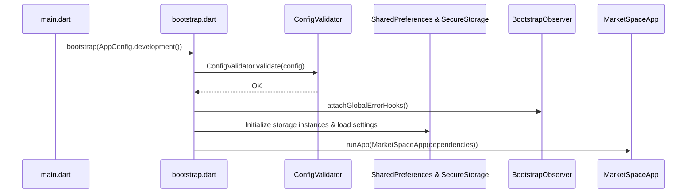

# Bootstrap and Environments Guide

## Startup Flow Sequence

## Environment Profiles
- `AppEnvironment.development`: Local development URL (`http://localhost:3000/api/v1`), logging enabled, mock mode enabled.
- `AppEnvironment.staging`: Staging server URL (`https://staging-api.marketspace.eg/api/v1`), logging enabled, mock mode disabled.
- `AppEnvironment.production`: Production server URL (`https://api.marketspace.eg/api/v1`), logging disabled, mock mode disabled.
