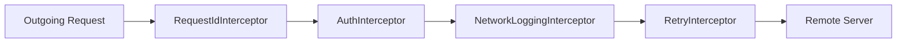

# Networking and Error Handling

## Network Interceptor Pipeline
Every outgoing request travels through a chain of interceptors:

## Error Handling Flow
Network exceptions and HTTP status codes are translated via `ErrorMapper` into strongly typed `AppFailure` instances:
- `400`: `ValidationFailure`
- `401`: `UnauthorizedFailure`
- `403`: `ForbiddenFailure`
- `404`: `NotFoundFailure`
- `429`: `RateLimitFailure`
- `>= 500`: `ServerFailure`
- Connection Timeout / Disconnected: `NetworkFailure` / `TimeoutFailure`
