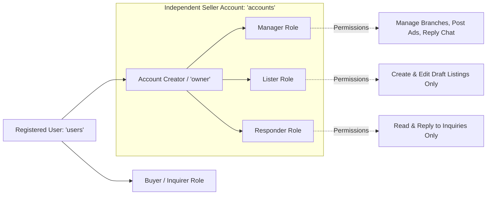

# 01 — Product UI Overview & Architectural Principles

## 1. Product Identity & Strategic Purpose

**Deal One** (Flutter application package: `market_space`) is an enterprise-grade, multi-sector commercial classifieds and discovery platform designed specifically for the Egyptian market. Built with Flutter for cross-platform mobile delivery (iOS and Android), Deal One provides a unified digital marketplace where consumers, businesses, property seekers, contractors, and merchants converge.

The platform unites six vital economic sectors into a cohesive, high-performance interface:
1. **Real Estate (العقارات):** Residential, commercial, and administrative properties for sale or rent, compound developments, interactive map browsing, and short video reels.
2. **Building Materials & Electrical Supplies (مواد البناء والكهرباء):** Heavy industrial construction materials (steel rebar, cement, bricks, aggregates), daily mill price ticker, bulk inquiries, and supplier showroom directories.
3. **Home & Engineering Services (الخدمات الهندسية والمنزلية):** Professional craftsmanship, MEP engineering, air conditioning maintenance, interior finishing, and trusted service provider discovery.
4. **Home Appliances & Decoration (الأجهزة المنزلية والديكور):** Household electronics, furniture, smart home devices, and decorative fixtures with granular technical specifications.
5. **Cars & Automotive (السيارات والمركبات):** Passenger vehicles, commercial transport, and motorcycles with multi-point technical filtering (make, model, manufacturing year, mileage, transmission, inspection condition).
6. **Clothes & Fashion Accessories (الملابس والإكسسوارات):** Multi-department fashion apparel (Men, Women, Kids), footwear, and lifestyle accessories categorized by size, color, and textile fabric.

---

## 2. The Architectural Foundation: Shared Core + Category-Driven Rules

Deal One operates under an architectural paradigm approved in **ADR-001, ADR-002, and ADR-003**:

$$\text{Architecture} = \text{Shared Core Systems} + \text{Category-Driven Rules} + \text{Evolving Transaction Modules}$$

```mermaid
graph TD
    subgraph Core [Shared Core Systems (ADR-002)]
        Auth[Authentication & OTP]
        Users[User Profiles]
        Accounts[Multi-Tenant Accounts]
        Media[Presigned R2 Media]
        Chat[In-App Chat Engine]
        Geo[Two-Tier Geography]
        Mod[Moderation & Audit]
        Quotas[Daily Limits & Quotas]
    end

    subgraph Rules [Category-Driven Dynamic Rules (ADR-003)]
        R_RE[Real Estate Schema & Filters]
        R_BM[Building Materials Schema & Filters]
        R_HS[Home Services Schema & Filters]
        R_HA[Home Appliances Schema & Filters]
        R_Cars[Automotive Schema & Filters]
        R_Fash[Fashion Schema & Filters]
    end

    subgraph Modes [Transaction Modules (ADR-008, ADR-009, ADR-010)]
        V1_Mode["V1: contact_only<br/>(In-App Chat, WhatsApp, Call)"]
        V2_Mode["V2: saved_searches<br/>(Scheduled Matching Alerts)"]
        V3_Mode["V3: commerce & booking<br/>(Cart, Checkout, Schedules)"]
    end

    Core --> Rules
    Rules --> V1_Mode
    Rules -.->|Future Roadmap| V2_Mode
    Rules -.->|Future Roadmap| V3_Mode
```

### Shared Core Responsibilities
- **Authentication & Sessions:** OTP SMS authentication with Cloudflare Turnstile bot detection, JWT access/refresh token rotation.
- **Identity & Multi-Tenancy:** A single human user (`users`) can own or join multiple independent commercial seller accounts (`accounts`), switching context seamlessly.
- **Geographic Hierarchy:** Egyptian administrative hierarchy (`governorates` $\to$ `cities` $\to$ `areas`) with centroid coordinates and confidential GPS tracking.
- **Communication Engine:** Direct, listing-bound in-app chat with 3-state delivery indicators (`sent`, `delivered`, `read`) and audited external contact reveals.
- **Moderation & Security:** Strict pre-publication content moderation (`draft` $\to$ `pending` $\to$ `approved` / `rejected`), abuse reporting, and daily operational quotas.

### Category-Driven Responsibilities
Each of the 6 sectors defines:
- Dedicated dynamic form attributes (`category_fields`) such as floor level, engine capacity, tonnage, or shoe size.
- Dynamic search facets and multi-parameter filter bottom sheets.
- Tailored listing cards highlighting domain-specific attributes (e.g., bedrooms for real estate, mileage for cars).
- Specialized public detail pages presenting relevant technical specifications.

---

## 3. Strict Three-Tier Scope Classification

To ensure zero ambiguity during UI implementation, every screen and feature is classified into one of three tiers:

| Tier | Definition | Examples |
|---|---|---|
| **Tier 1: CURRENT IMPLEMENTATION** | What currently exists in the Flutter codebase (`market_space/lib`). Features interactive UI powered by in-memory mock datasets. | `RealEstatePage`, `CarsPage`, `ExplorePage`, `GlobalFavoritesPage`, `GlobalNavigationScaffold`, prototype cart/checkout screens. |
| **Tier 2: APPROVED V1 REQUIREMENTS** | The official, approved production requirements for Launch V1. All listings operate in `contact_only` mode under strict moderation. | OTP SMS login, Seller Account Registration & Verification, Listing Creation Wizard with Dynamic Fields, Branch Manager, In-App Chat. |
| **Tier 3: FUTURE FEATURES** | Documented enhancements planned for subsequent phases. **Must NOT be exposed as active checkout/booking flows in V1**. | V2: Saved Search Alerts. V3: Online Payment Gateways, Shopping Cart, Direct Checkout, Order Management, Live Technician Dispatch. |

> [!WARNING]
> **Prototype UI Disclaimer**: The existing Flutter prototype contains screens for Shopping Cart (`building_materials_cart_page`, `fashion_cart_page`, `home_appliances_cart_page`), Checkout, Orders Feed, and Technician Live Tracking. These are **strictly Tier 1 / Tier 3 artifacts**. In the V1 production design, these buttons and routes must be hidden or replaced with approved `contact_only` inquiry flows.

---

## 4. V1 Approved Scope vs. Out-of-Scope Boundaries

### 4.1 In-Scope for Launch V1 (Approved & Required)
1. **Free-Listing Marketplace:** Sellers publish listings free of charge within their daily quota limits (`API-QTA-001`).
2. **Contact-Only Transactions (ADR-008):** Buyers communicate via in-app chat, direct WhatsApp message, or direct phone call.
3. **Mandatory Listing Moderation (ADR-007):** New and heavily modified listings enter a `pending` state until approved by admin staff.
4. **Independent Seller Accounts (ADR-005):** Users can establish distinct commercial profiles (`individual`, `company`, `factory`, `office`, `store`).
5. **Seller Account Verification (ADR-004):** Businesses upload official documentation (Commercial Register, Tax Card, Practice License) for admin review.
6. **Two-Tier Geographic Privacy (ADR-006):** Exact physical coordinates are stored privately; public users only see the approximate district centroid (`display_location`).
7. **Operational In-App Notifications (ADR-011):** Alerts for listing approvals, rejections (with reasons), incoming messages, and quota thresholds.
8. **Arabic-First Interface:** Complete RTL mirroring, Egyptian currency (`EGP` / `ج.م`), and Arabic typography.

### 4.2 Explicitly Out-of-Scope for V1 (Future Features)
1. **Online Payment Gateways:** Credit cards, Fawry, Vodafone Cash, or digital wallet integrations.
2. **Shopping Cart & Checkout Flows:** Multi-item cart calculation, delivery fee computation, and direct online purchases.
3. **Order Management System (OMS):** Order status tracking (`processing`, `shipped`, `delivered`), return processing, and merchant order fulfillment.
4. **Real-Time Inventory Tracking:** SKU-level stock counters, warehouse bin management, and out-of-stock auto-toggles.
5. **Automated Booking & Scheduling Engine:** Calendar availability slots, appointment booking wizards, technician dispatch mapping.
6. **Saved Search Matching Alerts (ADR-011):** Scheduled background cron workers notifying users of new matching listings (deferred to V2).

---

## 5. User Personas & Role-Based Access Control (RBAC)

The application accommodates distinct user types and commercial hierarchies:



### 5.1 End-User Roles
- **Guest Visitor:** Browses all sectors, views listing details, searches and filters without logging in. Prompted to authenticate when tapping Favorite or Contact.
- **Registered Buyer:** Authenticated personal user. Can bookmark listings, initiate in-app chats, reveal external contact numbers, and report fraudulent listings.
- **Personal Individual Seller:** Sells personal property or vehicles. Verified via National ID.
- **Commercial Merchant / Company:** Verified via Commercial Register and Tax Card. Manages multiple branches and team members.

### 5.2 Team Member RBAC Permissions (ADR-005 / `account_members`)
| Role Key | Role Name (AR) | Can Create Listings? | Can Edit Account / Branches? | Can Reply to Chat? | Can Manage Team? |
|---|---|:---:|:---:|:---:|:---:|
| `owner` | المالك الرئيسي | Yes | Yes | Yes | Yes |
| `manager` | مدير الحساب | Yes | Yes | Yes | No |
| `lister` | معلن / محرر إعلانات | Yes (Draft/Pending) | No | No | No |
| `responder` | مسؤول المحادثات | No | No | Yes | No |

---

## 6. Internationalization, Localization & RTL Conventions

### 6.1 Language Hierarchy & Locales
- **Primary Locale:** Arabic (`ar_EG`) — Egypt.
- **Secondary Locale:** English (`en_US`) — International fallback.
- **Dynamic Switching:** Users can toggle language on the fly via the Profile tab or Top Navigation Bar without restarting the application.

### 6.2 RTL Mirroring Standards
- **Layout Direction:** When `locale == 'ar'`, all horizontal layouts (`Row`, `Flex`, `Directionality`) mirror from right to left.
- **Icons & Glyphs:** Directional icons (back chevrons, forward arrows, breadcrumb dividers) mirror automatically (`Icons.arrow_back_rounded` mirrors in RTL). Non-directional icons (search magnifying glass, camera, phone, favorite heart) do NOT mirror.
- **Form Inputs:** Text alignment defaults to `TextAlign.right` in Arabic. Phone numbers and alphanumeric codes (OTP, VIN numbers) remain LTR (`TextAlign.left`).
- **Currency & Pricing:** Always display prices with the Egyptian Pound: `١٥,٠٠٠ ج.م` in Arabic mode, `15,000 EGP` in English mode.
- **Numerals:** Support standard Arabic-Indic digits (`١، ٢، ٣`) or Arabic Western digits (`1, 2, 3`) based on device settings, ensuring consistent decimal and thousands formatting.

