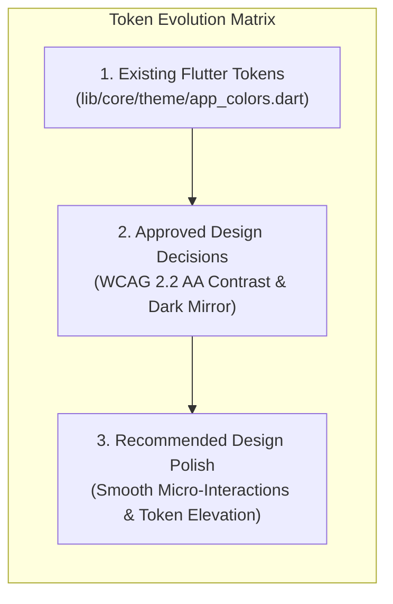

# 03 — Global Design System & Token Architecture

## 1. Design System Philosophy & Tri-State Token Classification

The Deal One visual architecture is grounded in an accessible, content-first **High-Contrast Monochrome Design System**. The chrome and layout elements rely on neutral grays, pure whites, and deep blacks to ensure maximum readability in outdoor Egyptian sunlight, while vibrant semantic accents provide instant operational feedback conforming to **WCAG 2.2 Level AA** contrast standards.

### Tri-State Token Governance



1. **Existing Tokens:** The concrete palette currently implemented in `lib/core/theme/` (`AppColors`, `AppSpacing`, `AppRadii`, `AppTextStyles`, `AppThemeData`).
2. **Approved Decisions:** The official contrast specifications, semantic states, and responsive token resolutions required for production launch.
3. **Recommended Improvements:** Ergonomic enhancements, such as subtle borders on dark surfaces to prevent optical blend and tactile touch targets.

---

## 2. Color System & Contrast Verification

### 2.1 Core Monochrome Palette

| Token Identifier | Light Mode Hex | Dark Mode Hex | Semantic Role & UI Placement | Min Contrast Ratio |
|---|---|---|---|:---:|
| `primary` | `#111111` | `#FFFFFF` | Primary call-to-action buttons, active tab indicators, major header text in light mode | **15.8:1** (AAA) |
| `onPrimary` | `#FFFFFF` | `#111111` | Text and icons placed on top of `primary` filled surfaces | **15.8:1** (AAA) |
| `background` | `#FFFFFF` | `#121212` | Default canvas background for all primary application screens | Canvas Base |
| `surface` | `#FFFFFF` | `#1C1C1C` | Elevated cards, persistent app bars, modal dialogs, bottom sheets | **14.2:1** vs dark bg |
| `surfaceSecondary` | `#F5F5F5` | `#262626` | Text input field fills, inactive filter chip backgrounds, search bars | Layer 2 Surface |
| `surfaceTertiary` | `#EEEEEE` | `#303030` | Skeleton shimmer gradients, subtle horizontal rules, disabled card backgrounds | Layer 3 Surface |
| `textPrimary` | `#111111` | `#FFFFFF` | High-emphasis headlines, product titles, price tags | **15.8:1** (AAA) |
| `textSecondary` | `#404040` | `#D0D0D0` | Medium-emphasis secondary text, category titles, timestamps | **7.4:1** (AAA) |
| `textMuted` | `#666666` | `#A0A0A0` | Low-emphasis metadata, unread count badges, input placeholder hints | **4.6:1** (AA) |
| `border` | `#E0E0E0` | `#383838` | Structural outlines for cards, text fields, and segmented dividers | Structural Rule |
| `divider` | `#E5E5E5` | `#303030` | Hairline dividers between list items and section blocks | 1.0dp Separator |
| `iconPrimary` | `#222222` | `#FFFFFF` | Primary navigation icons, action bar icons | **13.5:1** (AAA) |
| `iconSecondary` | `#555555` | `#C0C0C0` | Supporting metadata icons (pin, bed, car gear, clock) | **6.2:1** (AA) |
| `disabled` | `#BDBDBD` | `#707070` | Inactive button fills, disabled checkboxes and radio items | Disabled State |

---

### 2.2 Semantic Status Palette (WCAG 2.2 Level AA Verified)

Every semantic color pair is accompanied by an accessible 10% alpha tint container for alert banners, chips, and table badges:

| Semantic Status | Light Mode Fill | Light Tint Background | Dark Mode Fill | Dark Tint Background | Contrast (Text on Tint) |
|---|---|---|---|---|:---:|
| **Success** (`approved`, `available`) | `#16A34A` | `#F0FDF4` | `#22C55E` | `#052E16` | **5.4:1** (AA) |
| **Warning** (`pending`, `reserved`) | `#D97706` | `#FFFBEB` | `#FBBF24` | `#451A03` | **4.8:1** (AA) |
| **Error** (`rejected`, `offline`) | `#DC2626` | `#FEF2F2` | `#EF4444` | `#450A0A` | **5.9:1** (AA) |
| **Information** (`in_review`, `draft`) | `#2563EB` | `#EFF6FF` | `#3B82F6` | `#172554` | **5.6:1** (AA) |

---

## 3. Typography Hierarchy & Arabic Font Architecture

### 3.1 Typeface Selection
- **Primary Typeface (Arabic `ar`):** **Cairo** (`packages/cairo` or Google Fonts Cairo) / **Tajawal** as system fallback. Cairo provides exceptional baseline alignment and distinct legibility for Arabic numerals and complex ligatures.
- **Secondary Typeface (English `en`):** **Inter** / **Roboto** system default.
- **Monospace Font:** Jetpack Compose / Flutter native monospaced font for VIN numbers, transaction UUIDs, and OTP codes.

### 3.2 Type Scale Specifications (`AppTextStyles`)

```
================================================================================
Style Identifier   Font Size  Weight      Line Height  Usage Guideline
================================================================================
displayLarge       32.0 sp    Bold (w700) 1.25 (40dp)  Hero marketing banners & major statistics
displayMedium      28.0 sp    Bold (w700) 1.30 (36dp)  Primary sector headers (e.g. سوق العقارات)
headlineLarge (H1) 26.0 sp    Bold (w700) 1.30 (34dp)  Top-level screen titles
headlineMedium(H2) 22.0 sp    Semi (w600) 1.35 (30dp)  Section titles within feeds
headlineSmall (H3) 18.0 sp    Semi (w600) 1.40 (25dp)  Listing card titles & modal sheet headers
titleMedium        15.0 sp    Semi (w600) 1.40 (21dp)  Subheadings, supplier branch titles
bodyLarge          16.0 sp    Reg  (w400) 1.50 (24dp)  Long-form descriptions, terms & conditions
bodyMedium         14.0 sp    Reg  (w400) 1.50 (21dp)  Default body copy, filter labels, messages
bodySmall          12.5 sp    Reg  (w400) 1.40 (18dp)  Supporting secondary labels, address lines
labelLarge         14.0 sp    Semi (w600) 1.20 (17dp)  Primary and secondary button labels
labelMedium        14.0 sp    Med  (w500) 1.35 (19dp)  Form input field labels, tab items
labelSmall         12.0 sp    Med  (w500) 1.35 (16dp)  Badges, status chips, metadata tags
priceLarge         22.0 sp    Bold (w700) 1.20 (26dp)  Prominent price tag on detail screens
priceCard          16.0 sp    Bold (w700) 1.20 (20dp)  Price tag on feed cards (e.g. ٤,٥٠٠,٠٠٠ ج.م)
caption            13.0 sp    Reg  (w400) 1.40 (18dp)  Timestamps, photographer credits, view counts
================================================================================
```

---

## 4. Spacing Scale & Spatial System (`AppSpacing`)

Deal One implements an **8-Point Linear Spatial System** with intermediate 4-point and 2-point micro-steps:

| Token Name | Numerical Value | Flutter Implementation | Primary Spatial Usage |
|---|:---:|---|---|
| `AppSpacing.xxs` | **2.0 dp** | `const SizedBox(width: 2.0)` | Micro icon-to-badge gaps, border offsets |
| `AppSpacing.xs` | **4.0 dp** | `const SizedBox(height: 4.0)` | Tight vertical stack spacing (title to subtitle) |
| `AppSpacing.sm` | **8.0 dp** | `const EdgeInsets.all(8.0)` | Internal card padding, chip spacing, icon padding |
| `AppSpacing.md` | **12.0 dp** | `const EdgeInsets.all(12.0)` | Horizontal card content padding, list item gaps |
| `AppSpacing.lg` | **16.0 dp** | `const EdgeInsets.all(16.0)` | Standard screen margin, form field vertical spacing |
| `AppSpacing.xl` | **20.0 dp** | `const EdgeInsets.all(20.0)` | Major section separators, bottom sheet padding |
| `AppSpacing.xxl` | **24.0 dp** | `const EdgeInsets.all(24.0)` | Outer card container margins, modal headers |
| `AppSpacing.xxxl`| **32.0 dp** | `const EdgeInsets.all(32.0)` | Large hero carousel separation, empty state padding |
| `AppSpacing.huge`| **48.0 dp** | `const SizedBox(height: 48.0)` | Bottom padding for floating navigation bars |

---

## 5. Corner Radii & Elevation Standards (`AppRadii`)

### 5.1 Corner Radii Scale

```dart
class AppRadii {
  static const double xsValue = 4.0;    // xs: Subtle badges, internal progress bars
  static const double smValue = 8.0;    // sm: Filter chips, buttons, small thumbnails
  static const double mdValue = 12.0;   // md: Text fields, listing card images
  static const double lgValue = 16.0;   // lg: Listing cards, container sheets, dialogs
  static const double xlValue = 24.0;   // xl: Top edge of modal bottom sheets
  static const double fullValue = 999.0;// full: Circular pills, floating badges, avatars
}
```

### 5.2 Elevation, Depth & Shadow Architecture

Deal One avoids artificial heavy dropshadows, favoring crisp hairline borders in light mode and subtle luminance steps in dark mode:

| Elevation Level | Light Mode Shadow | Dark Mode Shadow | Dark Mode Surface Color | UI Context |
|---|---|---|---|---|
| **Level 0 (Flat)** | None | None | `#121212` | Screen canvas background |
| **Level 1 (Subtle)**| `0px 1px 3px rgba(0,0,0,0.06)` | `0px 1px 2px rgba(0,0,0,0.50)` + 1dp `#383838` border | `#1C1C1C` | Standard listing cards, grid items |
| **Level 2 (Float)** | `0px 4px 12px rgba(0,0,0,0.08)`| `0px 4px 16px rgba(0,0,0,0.60)` + 1dp `#383838` border | `#262626` | Top app bars, bottom navigation bar |
| **Level 3 (Modal)** | `0px 12px 32px rgba(0,0,0,0.14)`| `0px 16px 40px rgba(0,0,0,0.80)` + 1dp `#404040` border | `#303030` | Bottom sheets, action modals, dialogs |

---

## 6. Core Reusable Component Specifications

### 6.1 Buttons & Interactive Controls

#### Primary Button (`ElevatedButton`)
- **Height:** 48.0 dp (Mobile standard touch target).
- **Border Radius:** `AppRadii.md` (12.0 dp).
- **Light Theme:** Background `#111111`, Foreground `#FFFFFF`.
- **Dark Theme:** Background `#FFFFFF`, Foreground `#111111`.
- **Disabled State:** Background `AppColors.disabled` (`#BDBDBD` light / `#707070` dark), Text opacity 50%.
- **Active Press Feedback:** Scale transform down to `0.98` with `InkWell` splash.

#### Secondary Button (`OutlinedButton`)
- **Height:** 48.0 dp.
- **Border Radius:** `AppRadii.md`.
- **Border Width:** 1.5 dp in `AppColors.border`.
- **Light Theme:** Background transparent, Text `AppColors.textPrimary`.
- **Dark Theme:** Background transparent, Text `AppColors.darkTextPrimary`.

#### Destructive Action Button
- **Light Theme:** Background `#FEF2F2`, Text `#DC2626`, Border 1.0dp `#DC2626`.
- **Dark Theme:** Background `#450A0A`, Text `#EF4444`, Border 1.0dp `#EF4444`.

---

### 6.2 Form Inputs & Text Fields

- **Default Height:** 52.0 dp.
- **Corner Radius:** `AppRadii.md` (12.0 dp).
- **Background Fill:** `AppColors.surfaceSecondary` (`#F5F5F5` light / `#262626` dark).
- **Border (Resting):** 1.0 dp `AppColors.border`.
- **Border (Focused):** 2.0 dp `AppColors.primary` (`#111111` light / `#FFFFFF` dark).
- **Border (Error):** 2.0 dp `AppColors.error` (`#DC2626` light / `#EF4444` dark).
- **RTL Alignment:** Text aligns right (`TextAlign.right`) with prefix icon placed at the far right. Numeric inputs remain LTR.

---

### 6.3 Filter Chips & Status Badges

#### Filter Chip (`FilterChip`)
- **Height:** 36.0 dp.
- **Corner Radius:** `AppRadii.full` (999 dp) or `AppRadii.sm` (8 dp).
- **Unselected State:** Background `surfaceSecondary`, Text `textSecondary`, Border 1dp `border`.
- **Selected State:** Background `primary`, Text `onPrimary`, Border none.

#### Status Badges (`AppBadge`)
- **Height:** 24.0 dp.
- **Padding:** 4dp horizontal, 8dp vertical.
- **Approved / Available:** Green tint background `#F0FDF4` (`#052E16` dark) with bold text `#16A34A` (`#22C55E` dark).
- **Pending Moderation:** Amber tint background `#FFFBEB` with bold text `#D97706`.
- **Rejected / Scam:** Red tint background `#FEF2F2` with bold text `#DC2626`.

---

## 7. Dynamic Theme Management & Contextual Access

The application supports three persistent theme modes:
1. `ThemeMode.system`: Synchronized with operating system dark/light configuration.
2. `ThemeMode.light`: Force light monochrome appearance.
3. `ThemeMode.dark`: Force dark monochrome appearance with battery-saving OLED blacks.

### Dynamic Resolution Extension (`ThemeContextExtensions`)
To eliminate brittle conditionals, all widgets consume dynamic context helpers:
```dart
context.colors.background;      // Returns #FFFFFF or #121212
context.colors.textPrimary;     // Returns #111111 or #FFFFFF
context.textStyles.h2;          // Returns scaled Cairo headline
context.isRtl;                  // Returns Directionality.of(context) == TextDirection.rtl
```

