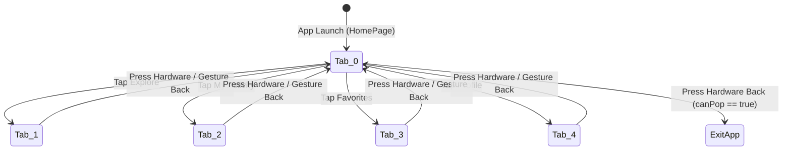
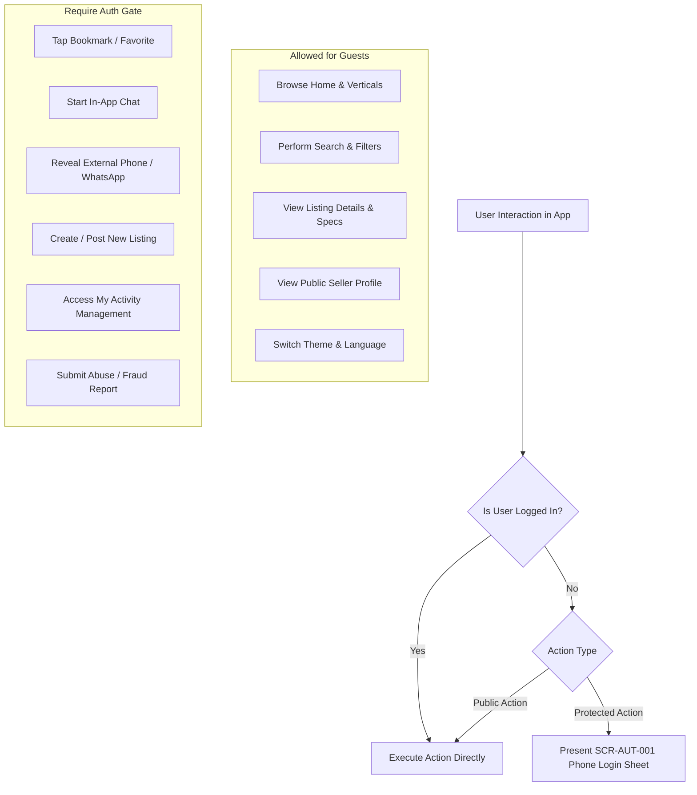

# 04 — Global Navigation Architecture & Master Sitemap

## 1. Global Navigation Overview

Deal One implements a declarative routing architecture using Flutter's official `go_router` (v18.0.2). Navigation is anchored by a persistent multi-tab shell, `GlobalNavigationScaffold` ([lib/features/navigation/presentation/pages/global_navigation_scaffold.dart](file:///home/ibrahim-elshishtawy/flutter%20project/market_space/market_space/lib/features/navigation/presentation/pages/global_navigation_scaffold.dart)), which hosts five primary tab surfaces within an `IndexedStack` to preserve state, active scroll offsets, and input entries across tab switches.

---

## 2. Complete Master Sitemap

```mermaid
graph TD
    classDef root fill:#111,stroke:#fff,stroke-width:2px,color:#fff;
    classDef tab fill:#2563eb,stroke:#1d4ed8,stroke-width:2px,color:#fff;
    classDef vertical fill:#16a34a,stroke:#15803d,stroke-width:2px,color:#fff;
    classDef modal fill:#d97706,stroke:#b45309,stroke-width:2px,color:#fff;
    classDef proto fill:#64748b,stroke:#475569,stroke-width:1px,color:#fff,stroke-dasharray: 4 4;

    AppRoot["Deal One App Entry<br/>RouteNames.root ('/')"]:::root

    AppRoot --> Tab0["Index 0: HomePage<br/>(Discovery Hub)"]:::tab
    AppRoot --> Tab1["Index 1: ExplorePage<br/>(Cross-Sector Search)"]:::tab
    AppRoot --> Tab2["Index 2: MyActivityPage<br/>(Listing Lifecycle Feed)"]:::tab
    AppRoot --> Tab3["Index 3: GlobalFavoritesPage<br/>(Bookmarks)"]:::tab
    AppRoot --> Tab4["Index 4: ProfilePage<br/>(Account & Settings)"]:::tab

    %% Verticals from Tab 0
    Tab0 --> V_RE["/real-estate"]:::vertical
    Tab0 --> V_BM["/building-materials"]:::vertical
    Tab0 --> V_HS["/home-services"]:::vertical
    Tab0 --> V_HA["/home-appliances"]:::vertical
    Tab0 --> V_Cars["/cars"]:::vertical
    Tab0 --> V_Fash["/fashion"]:::vertical

    %% Real Estate Sub-routes
    V_RE --> RE_Detail["/real-estate/detail?id=:id"]:::vertical
    V_RE --> RE_Map["/real-estate/map"]:::vertical
    V_RE --> RE_Reels["/real-estate/reels"]:::vertical
    RE_Reels -.-> RE_PubReel["/real-estate/reels/publish"]:::proto
    RE_Reels -.-> RE_AnaReel["/real-estate/reels/analytics"]:::proto

    %% Building Materials Sub-routes
    V_BM --> BM_Cat["/building-materials/categories"]:::vertical
    V_BM --> BM_CatDet["/building-materials/category-detail"]:::vertical
    V_BM --> BM_Steel["/building-materials/steel-rebar"]:::vertical
    V_BM --> BM_Prod["/building-materials/product-detail"]:::vertical
    V_BM -.-> BM_Cart["/building-materials/cart"]:::proto
    V_BM -.-> BM_RFQ["/building-materials/rfq"]:::proto

    %% Home Services Sub-routes
    V_HS --> HS_Detail["/home-services/service-detail"]:::vertical
    V_HS --> HS_Prov["/home-services/provider-detail"]:::vertical
    V_HS --> HS_AC["/home-services/ac-service-detail"]:::vertical
    V_HS -.-> HS_Book["/home-services/book"]:::proto
    V_HS -.-> HS_Track["/home-services/tracking"]:::proto

    %% Cars Sub-routes
    V_Cars --> Car_Detail["/cars/detail?id=:id"]:::vertical
    V_Cars --> Car_Filter["CarFilterModal (Sheet)"]:::modal

    %% Fashion Sub-routes
    V_Fash --> Fash_Detail["/fashion/detail?id=:id"]:::vertical
    V_Fash --> Fash_Cat["/fashion/categories"]:::vertical
    V_Fash -.-> Fash_Cart["/fashion/cart"]:::proto

    %% Common Modal Surfaces
    RE_Detail & BM_Prod & HS_Detail & Car_Detail & Fash_Detail --> ChatRoom["/chat/:conversation_id"]:::modal
    RE_Detail & BM_Prod & HS_Detail & Car_Detail & Fash_Detail --> ContactSheet["External Contact Sheet"]:::modal
    RE_Detail & BM_Prod & HS_Detail & Car_Detail & Fash_Detail --> ReportModal["Report Abuse Dialog"]:::modal

    %% Auth & Seller Flows
    Tab4 --> EditProf["Edit Profile Dialog"]:::modal
    Tab4 --> Addresses["Saved Addresses Modal"]:::modal
    Tab4 --> SellerHub["Seller Account Hub"]:::vertical
    SellerHub --> Switcher["Account Context Switcher"]:::modal
    SellerHub --> CreateAcc["Create Account Wizard"]:::vertical
    SellerHub --> Branches["Branch Manager"]:::vertical
```

---

## 3. Persistent Global Shell (`GlobalNavigationScaffold`)

The global navigation shell maintains five top-level tabs indexed from `0` to `4`:

| Tab Index | Navigation Route | Primary Page Widget | Core Functional Purpose |
|:---:|---|---|---|
| **0** | `RouteNames.root` (`/`) | `HomePage` | Central multi-sector discovery hub, promotional banners, and category access |
| **1** | `RouteNames.explore` (`/explore`) | `ExplorePage` | Cross-sector search engine, keyword auto-complete, and geographic radius search |
| **2** | `RouteNames.myActivity` (`/my-activity`)| `MyActivityPage` | **V1:** Merchant/Personal listing lifecycle management (`active`, `pending`, `rejected`, `sold`) |
| **3** | `RouteNames.favorites` (`/favorites`) | `GlobalFavoritesPage` | Aggregated user bookmarks across all 6 commercial sectors |
| **4** | `RouteNames.profile` (`/profile`) | `ProfilePage` | Personal settings, multi-account switcher, theme/language toggles, and help center |

### 3.1 Hardware & Gesture Back Navigation Policy (`PopScope`)
To ensure predictable back navigation on Android devices and edge-swipe gestures on iOS, `GlobalNavigationScaffold` wraps the root layout in a conditional `PopScope`:

- When the active tab index is non-zero (`1`, `2`, `3`, or `4`), pressing the system back button intercepts dismissal and redirects the user to **Tab 0 (Home)**.
- Only when the user is already on **Tab 0** does a back press allow the system to minimize or exit the application (`canPop = true`).
- Pushed routes (e.g. `/real-estate/detail`, `/cars/detail`) are pushed onto the root `Navigator` stack above `GlobalNavigationScaffold`, popping cleanly back to the originating tab.

---

## 4. Deep Linking & URL Hierarchy

Deal One supports deep linking into specific listing detail views, category feeds, and merchant profiles.

### 4.1 URL Specification Table
| Canonical URL Pattern | Target Screen Identifier | Query Parameters |
|---|---|---|
| `dealone://real-estate/detail` | `SCR-RES-002` | `id`: UUID or slug (e.g. `?id=aqar-101`) |
| `dealone://cars/detail` | `SCR-CAR-002` | `id`: UUID (e.g. `?id=car-8891`) |
| `dealone://building-materials/product-detail` | `SCR-MAT-005` | `productId`: UUID (e.g. `?productId=prod-steel-01`) |
| `dealone://home-services/service-detail` | `SCR-SRV-003` | `id`: UUID (e.g. `?id=srv-ac-wash`) |
| `dealone://fashion/detail` | `SCR-FAS-003` | `id`: UUID (e.g. `?id=fash-dress-02`) |
| `dealone://chat` | `SCR-CHT-002` | `id`: Conversation UUID (e.g. `?id=conv-4412`) |
| `dealone://notifications` | `SCR-NOT-001` | None |
| `dealone://seller/account` | `SCR-SEL-001` | `accountId`: UUID |

---

## 5. Guest Access Boundaries & Authentication Interceptors

Deal One is a permissive marketplace where guests can browse, search, and view listings freely. Authentication is only required when performing high-intent or identity-bound actions:

### Authentication Interceptor Workflow
1. When a guest taps a protected action (e.g., the Heart button or "Start Chat"), the interaction is suspended in-memory.
2. An interactive `LoginBottomSheet` (`SCR-AUT-001`) slides up smoothly.
3. The user inputs their phone number, passes Turnstile, and verifies the 6-digit SMS OTP (`SCR-AUT-002`).
4. Upon successful token minting, the login sheet dismisses, and the suspended action completes immediately (e.g., the listing is favorited and toast notification displays).

