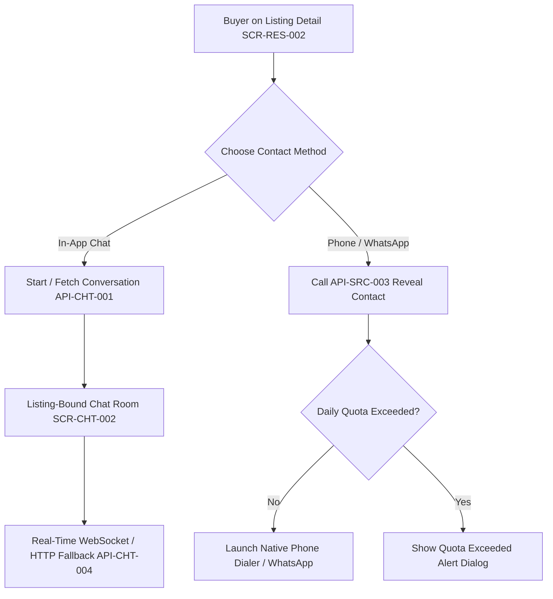

# 15 — In-App Chat & Communication UI Specification

## 1. Communication Architecture & Commercial Context

In accordance with **ADR-008 (Transaction Modes)**, the Deal One platform in V1 operates in **`contact_only`** mode. Communication is the engine that drives inquiries, negotiations, appointment setting, and deals.

The platform provides two complementary communication channels:
1. **Listing-Bound In-App Chat:** Secure, persistent messaging natively inside the app with real-time delivery receipts (`sent`, `delivered`, `read`).
2. **Audited External Contact Reveal:** Direct phone calls or WhatsApp messages, monitored via `API-SRC-003` to prevent scraping and enforce daily buyer quotas (`API-QTA-001`).



---

## 2. Screen Specifications

### Screen: Active Conversations List (`SCR-CHT-001`)

#### 1. Screen Identity
- **Screen ID:** `SCR-CHT-001`
- **Module:** Module J: Communication
- **Screen Name (AR):** قائمة المحادثات والرسائل الفورية
- **Screen Name (EN):** Active Conversations List
- **Current Status:** **NOT IMPLEMENTED**
- **V1 Status:** **APPROVED V1**
- **Primary User Role:** Buyer & Seller
- **Entry Routes:** Top App Bar Chat Icon, Profile Hub Shortcut
- **Exit Routes:** `SCR-CHT-002` (Chat Room)
- **API Dependency:** `API-CHT-002: List My Active Conversations` (`GET /api/v1/chat/conversations`)

#### 2. Layout Structure & UI Components
- **App Bar:** "المحادثات والرسائل" with Unread Filter Tab ("الكل", "غير مقروء").
- **Conversation List Items (`ConversationListItem`):**
  - **Right:** Avatar of the counterpart (or merchant logo).
  - **Center:** Contact Name + Listing Context Tag (e.g. "بخصوص: شقة بالم هيلز").
  - **Last Message Snippet:** Truncated text with 3-state delivery indicator.
  - **Left / Trailing:** Timestamp (e.g. "منذ ١٠ د") + Unread Count Badge (green circle with number).
  - **Thumbnail:** 40x40dp thumbnail of the listing being discussed.

---

### Screen: Listing-Bound Chat Room (`SCR-CHT-002`)

#### 1. Screen Identity
- **Screen ID:** `SCR-CHT-002`
- **Module:** Module J: Communication
- **Screen Name (AR):** غرفة الدردشة المباشرة حول الإعلان
- **Screen Name (EN):** Listing-Bound Chat Room
- **Current Status:** **NOT IMPLEMENTED**
- **V1 Status:** **APPROVED V1**
- **Primary User Role:** Buyer & Seller Team Member (`owner`, `manager`, `responder`)
- **API Dependencies:** `API-CHT-001: Start/Fetch Conversation` (`POST /api/v1/chat/conversations`), `API-CHT-003: Messages History` (`GET /api/v1/chat/conversations/:id/messages`), `API-CHT-004: Send Message` (`POST /api/v1/chat/conversations/:id/messages`)

#### 2. Layout Structure & UI Components

```
+-------------------------------------------------------------+
| APP BAR: [Back] [Avatar] "أحمد عبد الرحمن (معلن معتمد)" [More (⋮)] |
+-------------------------------------------------------------+
| PINNED LISTING HEADER CARD (SCR-CHT-002-A)                  |
| [Thumb (48dp)]  شقة للبيع بالتجمع الخامس - ١٨٥ م²           |
| السعر: ٤,٥٠٠,٠٠٠ ج.م  [عرض الإعلان >]                        |
+-------------------------------------------------------------+
| MESSAGE HISTORY BUBBLES CANVAS (Reverse ListView)           |
|                                                             |
|   [Date Separator: اليوم - ٢:٣٠ م]                          |
|                                                             |
|   +---------------------------------------+                 |
|   | مساء الخير، هل المعاينة متاحة غداً؟   | (Buyer Bubble)  |
|   | ٠٢:٣١ م  ✓✓                           | [Align: Left]   |
|   +---------------------------------------+                 |
|                                                             |
|         +-----------------------------------------+         |
|         | أهلاً بك! نعم متاحة من ٤ عصراً إلى ٨ م. | (Seller) |
|         | ٠٢:٣٤ م                                 | [Right] |
|         +-----------------------------------------+         |
+-------------------------------------------------------------+
| MESSAGE COMPOSER DOCK (SCR-CHT-002-B)                       |
| [Attachment (+)] [ Input: "اكتب رسالتك هنا..." ] [Send (➤)] |
+-------------------------------------------------------------+
```

#### 3. Message Delivery States & Visual Indicators
- **Sent (`sent`):** Single gray checkmark (`✓`). Message received by Deal One backend server.
- **Delivered (`delivered`):** Double gray checkmark (`✓✓`). Message pushed to recipient device via FCM / WebSocket.
- **Read (`read`):** Double green checkmark (`✓✓`). Recipient opened the chat room.

---

### Screen: External Contact Reveal Action Sheet (`SCR-CHT-003`)

#### 1. Screen Identity
- **Screen ID:** `SCR-CHT-003`
- **Module:** Module J: Communication
- **Screen Name (AR):** نافذة كشف أرقام التواصل الخارجي
- **Screen Name (EN):** External Contact Reveal Action Sheet
- **Current Status:** **NOT IMPLEMENTED**
- **V1 Status:** **APPROVED V1**
- **API Dependency:** `API-SRC-003: Reveal External Contact` (`POST /api/v1/search/listings/:id/reveal-contact`)

#### 2. Workflow & Security Controls
1. Buyer taps "اتصال هاتف" or "واتساب" on any listing detail page.
2. If the user is unauthenticated, the `LoginBottomSheet` (`SCR-AUT-001`) intercepts.
3. The app issues `POST /api/v1/search/listings/:id/reveal-contact` with `{ channel: "phone" | "whatsapp" }`.
4. Backend verifies buyer has not exceeded daily contact reveal quotas (`API-QTA-001`), increments the listing's `contact_reveals_count`, and returns:
   ```json
   {
     "success": true,
     "data": {
       "phone_number": "+201012732095",
       "whatsapp_url": "https://wa.me/201012732095?text=...",
       "remaining_daily_reveals": 14
     }
   }
   ```
5. Client immediately opens `url_launcher`:
   - `tel:+201012732095` for phone calls.
   - `https://wa.me/...` for WhatsApp messaging.

---

### Screen: Abuse & Fraud Report Dialog (`SCR-CHT-004`)

#### 1. Screen Identity
- **Screen ID:** `SCR-CHT-004`
- **Module:** Module J: Communication
- **Screen Name (AR):** نافذة الإبلاغ عن محتوى أو احتيال
- **Screen Name (EN):** Abuse & Fraud Report Dialog
- **Current Status:** **NOT IMPLEMENTED**
- **V1 Status:** **APPROVED V1**
- **API Dependency:** `API-REP-001: Submit Abuse Report` (`POST /api/v1/reports`)

#### 2. Reason Categories & User Flow
- **Report Reasons:**
  - `scam`: احتيال أو طلب تحويل أموال مسبق.
  - `false_info`: بيانات الإعلان أو الصور غير حقيقية ومضللة.
  - `duplicate`: إعلان مكرر لنفس السلعة.
  - `prohibited`: سلع أو أسلحة أو مواد مخالفة للقانون والشروط.
  - `other`: أسباب أخرى مع كتابة تفاصيل توضيحية.
- **Outcome:** Generates an immutable ticket in the Admin Moderation Queue (`reports` table) with immediate confirmation toast to user.

