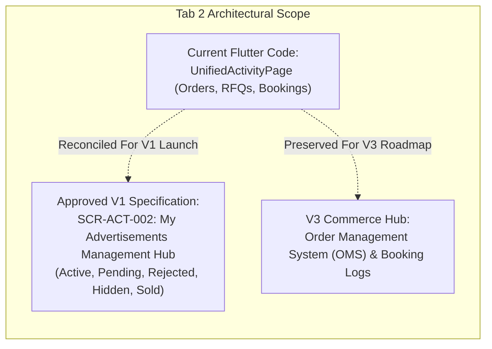

# 16 — Favorites, Activity & Notifications UI Specification

## 1. Architectural Reconciliation: The "My Activity" Mandate

> [!IMPORTANT]
> **Core Architectural Reconciliation**: In the current Flutter codebase, `MyActivityPage` ([lib/features/activity/presentation/pages/my_activity_page.dart](file:///home/ibrahim-elshishtawy/flutter%20project/market_space/market_space/lib/features/activity/presentation/pages/my_activity_page.dart)) displays mock orders, quotation requests (RFQs), and technician bookings under the banner *"طلباتي ومعاملاتي"*.
> 
> However, under approved decisions **ADR-001 (Hybrid Platform)**, **ADR-007 (Listing Lifecycle)**, and **ADR-008 (Transaction Modes)**, Deal One V1 is strictly a **free-listing marketplace in `contact_only` mode**. 
> 
> Therefore, in the approved V1 release, **Tab 2 ("نشاطي" / My Activity)** serves as the **Seller's Listing Management Feed ("إعلاناتي")** (`SCR-ACT-002`), powered by `API-LST-008`. The existing mock order/booking cards are classified as **Tier 3 (Future V3 Commerce Artifacts)**.



---

## 2. Screen Specifications

### Screen: Global Unified Favorites (`SCR-ACT-001`)

#### 1. Screen Identity
- **Screen ID:** `SCR-ACT-001`
- **Module:** Module K: Favorites & Activity
- **Screen Name (AR):** المفضلة الموحدة لكافة الأقسام
- **Screen Name (EN):** Global Unified Favorites Page
- **Current Status:** **IMPLEMENTED** ([lib/features/favorites/presentation/pages/global_favorites_page.dart](file:///home/ibrahim-elshishtawy/flutter%20project/market_space/market_space/lib/features/favorites/presentation/pages/global_favorites_page.dart))
- **V1 Status:** **APPROVED V1**
- **Primary User Role:** Registered User
- **Entry Routes:** Bottom Navigation Tab 3 (`/favorites`)
- **Exit Routes:** Listing Detail pages across all 6 sectors
- **API Dependencies:** `API-FAV-001: List My Favorites` (`GET /api/v1/favorites`), `API-FAV-002: Add Favorite` (`POST /api/v1/favorites`), `API-FAV-003: Remove Favorite` (`DELETE /api/v1/favorites/:listing_id`)

#### 2. Layout Structure & UI Components
- **Top Header:** "قائمة المفضلة" with total saved count pill ("١٨ إعلان محفوظ").
- **Sector Filtering Tabs:** Segmented row allowing users to filter saved bookmarks by sector: `[الكل] [عقارات] [سيارات] [أجهزة] [مواد بناء] [خدمات] [أزياء]`.
- **Bookmark Card Layout:** Renders sector-appropriate card with persistent Red Heart icon. Tapping the Heart triggers immediate optimistic removal with an "إلغاء الحذف" (Undo) SnackBar.
- **Empty State:** `AppEmptyState` with bookmark ribbon illustration, text ("لا توجد إعلانات في المفضلة بعد"), and "استكشف العروض الآن" button redirecting to Tab 0.

---

### Screen: My Advertisements Management Hub (`SCR-ACT-002`)

#### 1. Screen Identity
- **Screen ID:** `SCR-ACT-002`
- **Module:** Module K: Favorites & Activity
- **Screen Name (AR):** إدارة إعلاناتي وحالات النشر
- **Screen Name (EN):** My Advertisements Management Hub
- **Current Status:** **PARTIAL** (Replaces existing order-centric `MyActivityPage`)
- **V1 Status:** **APPROVED V1**
- **Primary User Role:** Seller / Account Member (`owner`, `manager`, `lister`)
- **Entry Routes:** Bottom Navigation Tab 2 (`/my-activity`)
- **Exit Routes:** `SCR-LST-001` (Create Listing), `SCR-LST-007` (Edit Listing), `SCR-ACT-004` (Rejection Notes)
- **API Dependency:** `API-LST-008: List Merchant's Listings` (`GET /api/v1/listings/merchant`)

#### 2. Layout Structure

```
+-------------------------------------------------------------+
| APP BAR: "إعلاناتي ونشاطي"          [ + أضف إعلاناً جديداً ] |
+-------------------------------------------------------------+
| ACTIVE ACCOUNT SELECTOR BANNER                              |
| [Logo] "النشر باسم: شركة الأهرام العقارية"  [تبديل الحساب v] |
+-------------------------------------------------------------+
| LIFECYCLE STATUS HORIZONTAL SEGMENTED BAR (SCR-ACT-003)     |
| [النشطة (١٢)] [قيد المراجعة (٣)] [المرفوضة (١)] [المخفية (٢)] [المباعة (٨)] |
+-------------------------------------------------------------+
| SELLER LISTING MANAGEMENT FEED                              |
|                                                             |
| +---------------------------------------------------------+ |
| | [Thumb 72dp]  شقة للبيع بالتجمع الخامس - ١٨٥ م²          | |
| | السعر: ٤,٥٠٠,٠٠٠ ج.م • تاريخ النشر: ١٠ أكتوبر           | |
| | [Status Badge: معتمد ومنشور ✔] [Views: ١,٤٢٠] [Calls: ٣٤] | |
| | [زر تعديل ✏️]   [زر إخفاء مؤقت 👁️]   [خيارات إضافية (⋮)]  | |
| +---------------------------------------------------------+ |
|                                                             |
| +---------------------------------------------------------+ |
| | [Thumb 72dp]  سيارة تويوتا كورولا ٢٠٢٢                  | |
| | [Status Badge: مرفوض من الرقابة ✖]                      | |
| | "السبب: رقم الهاتف الظاهر في صورة المعاينة مخالف للشروط"| |
| | [زر تعديل وإعادة إرسال]   [عرض ملاحظات الدعم بالتفصيل]  | |
| +---------------------------------------------------------+ |
+-------------------------------------------------------------+
```

---

### Screen: Moderation Rejection Notes Modal (`SCR-ACT-004`)

#### 1. Screen Identity
- **Screen ID:** `SCR-ACT-004`
- **Module:** Module K: Favorites & Activity
- **Screen Name (AR):** تفاصيل سبب رفض الإعلان وملاحظات الدعم
- **Screen Name (EN):** Moderation Rejection Notes Modal
- **Current Status:** **NOT IMPLEMENTED**
- **V1 Status:** **APPROVED V1 (Core Requirement - ADR-007)**
- **Data Source:** Backend `moderation_log` table

#### 2. Content & Resolution Workflow
- **Rejection Header:** Red warning badge + "تم رفض الإعلان لمخالفة سياسات النشر".
- **Rejection Reason Category:** e.g., `false_info`, `prohibited_contact_in_image`, `duplicate_listing`, `unrealistic_price`.
- **Reviewer Note (ملاحظات المراقب):** Exact message from platform admin (e.g. *"يرجى حذف رقم الهاتف المكتوب فوق صورة واجهة العقار، واستخدام الحقول المخصصة للتواصل"*).
- **Audit Timestamp:** Date and time of the rejection decision.
- **Action Buttons:**
  - "تعديل الإعلان وإعادة إرساله" $\to$ Opens `SCR-LST-007` with offending fields highlighted.
  - "حذف الإعلان نهائياً".

---

### Screen: Global Notifications Center (`SCR-NOT-001`)

#### 1. Screen Identity
- **Screen ID:** `SCR-NOT-001`
- **Module:** Module M: Notifications
- **Screen Name (AR):** مركز الإشعارات التشغيلية الموحد
- **Screen Name (EN):** Global Notifications Center
- **Current Status:** **IMPLEMENTED** ([lib/features/notifications/presentation/pages/global_notifications_page.dart](file:///home/ibrahim-elshishtawy/flutter%20project/market_space/market_space/lib/features/notifications/presentation/pages/global_notifications_page.dart))
- **V1 Status:** **APPROVED V1 (ADR-011)**
- **Primary User Role:** All
- **Entry Routes:** Top App Bar Notification Bell (`/notifications`)
- **API Dependencies:** `API-NOT-001: List Notifications` (`GET /api/v1/notifications`), `API-NOT-002: Mark Read` (`PATCH /api/v1/notifications/mark-read`)

#### 2. Operational Notification Types Supported in V1
| Notification Type | Trigger Event | Visual Icon & Tint | Deep Link Routing Target |
|---|---|---|---|
| `listing_approved` | Admin approved listing | Green Shield (`#16A34A`) | Target Listing Detail (`SCR-RES-002`) |
| `listing_rejected` | Admin rejected listing | Red Cross (`#DC2626`) | Rejection Notes Modal (`SCR-ACT-004`) |
| `chat_message` | Incoming chat message | Blue Chat (`#2563EB`) | Chat Room (`SCR-CHT-002`) |
| `account_verified` | Seller account approved| Gold Star (`#D97706`) | Seller Account Hub (`SCR-SEL-001`) |
| `quota_warning` | 80% daily quota consumed| Amber Alert (`#D97706`)| Quota Dashboard (`SCR-SEL-011`) |

---

### Screen: Listing Quick Actions Bottom Sheet (`SCR-ACT-005`)

#### 1. Screen Identity
- **Screen ID:** `SCR-ACT-005`
- **Module:** Module K: Favorites & Activity
- **Screen Name (AR):** قائمة التحكم السريع في الإعلان
- **Screen Name (EN):** Listing Quick Actions Bottom Sheet
- **Current Status:** **NOT IMPLEMENTED**
- **V1 Status:** **APPROVED V1**

#### 2. Available Seller Actions & API Mappings
- **تعديل الإعلان (Edit):** Routes to `SCR-LST-007`.
- **إخفاء مؤقت / إظهار (Toggle Visibility):** Calls `API-LST-004: Toggle Visibility` (`PATCH /api/v1/listings/:id/visibility`). Immediately hides listing from public search without forfeiting moderation approval.
- **تحديد كـ "تم البيع" أو "تم التأجير" (Mark Concluded):** Calls `API-LST-005: Update Availability` (`PATCH /api/v1/listings/:id/availability`) with `status = "sold" | "rented"`.
- **حذف الإعلان (Delete):** Calls `API-LST-006: Soft Delete Listing` (`DELETE /api/v1/listings/:id`) with double-confirmation dialog.

