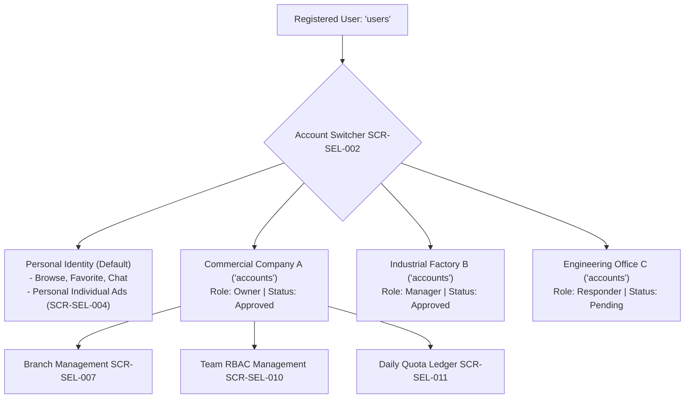

# 17 — Seller Account & Verification UI Specification

## 1. Multi-Tenant Architecture & Verification Principles

In accordance with **ADR-004 (Seller Verification)** and **ADR-005 (Multiple Independent Seller Accounts)**, Deal One decouples human personal user identities (`users`) from commercial selling entities (`accounts`):



### Strict Architectural Principles
1. **Multi-Tenancy:** A single human user can create, own, or join multiple independent commercial seller accounts. Switching accounts changes the active `X-Account-ID` header.
2. **Account Verification vs. Listing Approval Separation (ADR-004):**
   - **Account Verification** confirms the legal existence and identity of the merchant entity (`accounts.verification_status`).
   - **Listing Approval** inspects individual advertisements for policy compliance (`listings.moderation_status`).
   - **Crucial Rule:** An approved seller account does **NOT** bypass listing moderation. Every listing is reviewed independently.
3. **Public Exposure Gate:** No listing created by an account is published to the public search index until `accounts.verification_status == 'approved'`.

---

## 2. Screen Specifications

### Screen: Seller Account Hub & Overview (`SCR-SEL-001`)

#### 1. Screen Identity
- **Screen ID:** `SCR-SEL-001`
- **Module:** Module L: Seller Account
- **Screen Name (AR):** مركز الحسابات التجارية ولوحة التحكم
- **Screen Name (EN):** Seller Account Hub & Overview
- **Current Status:** **PARTIAL** (Basic entry point inside `ProfilePage`)
- **V1 Status:** **APPROVED V1**
- **Primary User Role:** Account Owner / Manager
- **Entry Routes:** Profile Page (`SCR-AUT-004`) $\to$ "إدارة الحسابات التجارية"
- **Exit Routes:** `SCR-SEL-002` (Switcher), `SCR-SEL-005` (Verification), `SCR-SEL-007` (Branches), `SCR-SEL-010` (Team), `SCR-SEL-011` (Quotas)
- **API Dependency:** `API-ACC-004: Get Account Details & Public Profile` (`GET /api/v1/accounts/:id`)

#### 2. Layout Structure

```
+-------------------------------------------------------------+
| APP BAR: "مركز إدارة الأعمال"          [تبديل الحساب (Switch)] |
+-------------------------------------------------------------+
| ACCOUNT BRANDING HERO CARD:                                 |
| [Logo (64dp)]  شركة الأهرام للمقاولات والتطوير العقاري       |
| [Status Badge: حساب تجاري موثق رسمي ✔]                      |
| نوع الكيان: شركة مساهمة • السجل التجاري: ٤٨٢٩١٠             |
| [زر تعديل بيانات المنشأة]     [زر معاينة البروفايل للجمهور] |
+-------------------------------------------------------------+
| DAILY QUOTA & LIMITS METRIC STRIP (SCR-SEL-011)             |
| إعلانات اليوم المتبقية: [ ٤ من ٥ ]  |  كشف أرقام: [ ١٤ من ٢٠ ] |
+-------------------------------------------------------------+
| CORE MANAGEMENT NAVIGATION TILES:                           |
| 1. [Store Icon] إدارة الفروع والمعارض (٣ فروع مضافة)        |
| 2. [Map Icon] مناطق تغطية الخدمة والتوصيل (٥ محافظات)        |
| 3. [Users Icon] فريق العمل والصلاحيات (٤ أعضاء)             |
| 4. [Shield Icon] المستندات والتحقق التجاري (مكتمل ✔)        |
| 5. [Ad Icon] إعلانات الحساب النشطة (١٨ إعلان منشور)         |
+-------------------------------------------------------------+
```

---

### Screen: Multi-Account Context Switcher (`SCR-SEL-002`)

#### 1. Screen Identity
- **Screen ID:** `SCR-SEL-002`
- **Module:** Module L: Seller Account
- **Screen Name (AR):** محول الحسابات التجارية المتعددة
- **Screen Name (EN):** Multi-Account Context Switcher Modal
- **Current Status:** **NOT IMPLEMENTED**
- **V1 Status:** **APPROVED V1 (Core Architectural Mandate - ADR-005)**
- **API Dependency:** `API-ACC-001: List My Seller Accounts` (`GET /api/v1/accounts/my`)

#### 2. Layout & Interaction
- **Modal Sheet Presentation:** Bottom sheet displaying all accounts associated with user's phone number.
- **Account Items:**
  - `[User Avatar]` الحساب الشخصي (مصطفى هيكل - مشتري وبائع فردي).
  - `[Company Logo]` شركة الأهرام العقارية (أنت: المالك `owner`).
  - `[Factory Logo]` مصنع الدلتا للصلب (أنت: مدير حساب `manager`).
- **Footer Action:** `[ + إنشاء حساب تجاري جديد ]` $\to$ Launches `SCR-SEL-003`.
- **Selection Behavior:** Tapping an account sets active `X-Account-ID` in `ApiClient`, invalidates cached activity feeds, and refreshes the UI context.

---

### Screen: Seller Type Selection Step (`SCR-SEL-004`)

#### 1. Screen Identity
- **Screen ID:** `SCR-SEL-004`
- **Module:** Module L: Seller Account
- **Screen Name (AR):** اختيار الكيان التجاري
- **Screen Name (EN):** Seller Type Selection Step
- **Current Status:** **NOT IMPLEMENTED**
- **V1 Status:** **APPROVED V1**

#### 2. Approved Seller Account Types (`account_type`)

| Type Key | Type Label (AR) | Description & Intended User | Approved Verification Requirements |
|---|---|---|---|
| `individual` | بائع فردي | أفراد يبيعون ممتلكات شخصية (شقق، سيارات، أثاث) | صورة بطاقة الرقم القومي سارية + إقرار صحة البيانات |
| `company` | شركة تجارية / عقارية | شركات التطوير والوساطة والتسويق العقاري والتجارة | السجل التجاري + البطاقة الضريبية + هوية المفوض |
| `factory` | مصنع / موزع معتمد | مصانع مواد البناء، كابلات الكهرباء، والموزعين الكبار | السجل الصناعي أو التجاري + البطاقة الضريبية |
| `office` | مكتب هندسي / مقدم خدمة | مهندسون، مقاولو تشطيب، وشركات الصيانة المتخصصة | ترخيص مزاولة المهنة / كارنيه النقابة / السجل التجاري |
| `store` | معرض / متجر تجزئة | معارض الأجهزة، معارض السيارات، وبوتيكات الأزياء | السجل التجاري أو عقد إيجار موثق للفرع / المعرض |

---

### Screen: Official Document Verification Upload (`SCR-SEL-005`)

#### 1. Screen Identity
- **Screen ID:** `SCR-SEL-005`
- **Module:** Module L: Seller Account
- **Screen Name (AR):** رفع المستندات الرسمية للتوثيق
- **Screen Name (EN):** Verification Documents Upload Screen
- **Current Status:** **NOT IMPLEMENTED**
- **V1 Status:** **APPROVED V1 (ADR-004)**
- **API Dependency:** `API-ACC-003: Upload Verification Documents` (`POST /api/v1/accounts/:id/verifications`)

#### 2. Layout Structure & UI Components
- **Header:** "توثيق الحساب التجاري" with progress indicator.
- **Entity Legal Name Field:** Must match the official commercial register.
- **Tax Registration Number Field:** 9-digit Egyptian tax card number (`رقم التسجيل الضريبي`).
- **Document Dropzones (Image / PDF):**
  - Dropzone 1: صورة السجل التجاري الساري (حديث لا يتجاوز ٣ أشهر).
  - Dropzone 2: صورة البطاقة الضريبية.
  - Dropzone 3: صورة بطاقة الرقم القومي للمفوض بالإدارة.
- **File Constraints:** Format: JPG, PNG, PDF. Max file size: 10MB per document. Uploaded directly via Presigned Cloudflare R2 URLs.
- **Primary Action Button:** "إرسال المستندات للتدقيق والاعتماد" $\to$ Transitions to `SCR-SEL-006`.

---

### Screen: Commercial Branches Manager (`SCR-SEL-007` & `SCR-SEL-008`)

#### 1. Screen Identity
- **Screen ID:** `SCR-SEL-007` (Branch Manager) & `SCR-SEL-008` (Add/Edit Branch Form)
- **Module:** Module L: Seller Account
- **Screen Name (AR):** إدارة فروع المنشأة التجارية
- **Screen Name (EN):** Commercial Branches Manager
- **Current Status:** **NOT IMPLEMENTED**
- **V1 Status:** **APPROVED V1**
- **API Dependencies:** `API-GEO-004: List Account Branches` (`GET /api/v1/accounts/:id/branches`), `API-GEO-003: Add Branch` (`POST /api/v1/accounts/:id/branches`)

#### 2. Branch Attributes & Form Fields (`SCR-SEL-008`)
- **Branch Name:** e.g. "فرع التجمع الخامس - مول تريفيوم".
- **Physical Address:** Detailed street address and landmark.
- **Administrative Location:** Governorate, City, and Area (`area_id`).
- **Exact GPS Pin:** Picked from map to guide public customers via Google Maps.
- **Direct Branch Phone:** Landline or dedicated branch mobile.
- **Working Hours (JSONB):** Open/close time per weekday (e.g. السبت إلى الخميس: ٩ ص إلى ١٠ م).
- **Main Branch Flag (`is_main`):** Checkbox to designate the headquarters showroom.

---

### Screen: Team Members & RBAC Manager (`SCR-SEL-010`)

#### 1. Screen Identity
- **Screen ID:** `SCR-SEL-010`
- **Module:** Module L: Seller Account
- **Screen Name (AR):** إدارة فريق العمل والصلاحيات
- **Screen Name (EN):** Team Members & RBAC Manager
- **Current Status:** **NOT IMPLEMENTED**
- **V1 Status:** **APPROVED V1 (ADR-005)**
- **API Dependencies:** `API-ACC-005: List Team Members`, `API-ACC-006: Invite Member`, `API-ACC-007: Remove Member`

#### 2. Member Invitation & Role Allocation Workflow
1. Owner taps "دعوة عضو جديد لفريق العمل".
2. Inputs member's registered Egyptian mobile number.
3. Selects role from approved RBAC matrix:
   - `manager`: Full management except account deletion.
   - `lister`: Can create and draft listings only.
   - `responder`: Can access and reply to in-app customer chats only.
4. Member receives instant in-app notification and SMS invite link.

