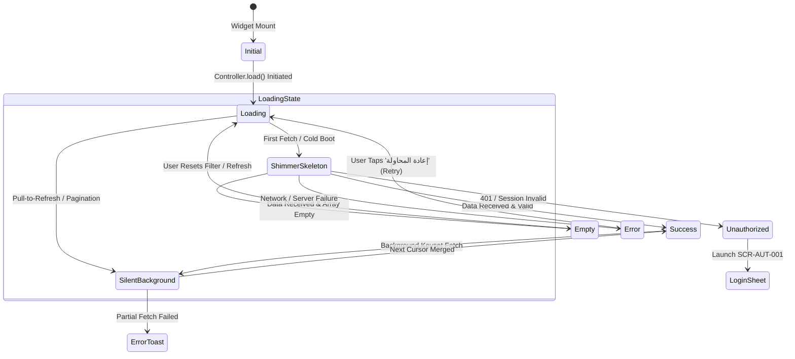

# 19 — UI States & Error Handling Architecture

## 1. Universal UI State Machine

Every screen and data-dependent widget in the Deal One application implements a robust, deterministic state machine driven by Flutter's `ValueNotifier<AsyncState<T>>` or `AsyncSnapshot`:



---

## 2. Comprehensive State Matrix

| State Identifier | Triggering Condition | Visual Presentation & UI Feedback | User Recovery Action |
|---|---|---|---|
| **1. Initial** | Controller instantiated prior to fetch | Neutral background; zero flash | Handled in `initState()` |
| **2. Loading (Cold)** | Initial remote API request underway | Fullscreen Shimmer Skeletons matching exact layout geometry | Back button allows cancellation |
| **3. Loading (Warm)** | Keyset pagination or Pull-to-refresh | Bottom centered $24\text{ dp}$ spinner or `RefreshIndicator` | User continues browsing visible items |
| **4. Success (Populated)** | API returns `200 OK` with non-empty payload | Standard populated cards and feeds with fade-in animation | Full normal interaction |
| **5. Empty Results** | API returns `200 OK` with empty data array (`[]`)| `AppEmptyState` with context-specific vector art and clear copy | "إعادة ضبط الفلاتر" or "توسيع النطاق" |
| **6. Error (Network)** | Client experiences `SocketException` / Timeout | `AppErrorView` with offline icon: "تعذر الاتصال بالخادم" | "إعادة المحاولة" button |
| **7. Error (500 Server)**| API returns `500 INTERNAL_SERVER_ERROR` | `AppErrorView` with server icon: "حدث خطأ غير متوقع، نعمل على حله" | "إعادة المحاولة" button |
| **8. Offline (Airplane)**| Device disconnected from Wi-Fi and Cellular | Top floating alert banner: "أنت تتصفح في وضع عدم الاتصال" | Cached data shown with gray tint |
| **9. Unauthorized (401)** | Expired JWT or guest attempting protected action | `LoginBottomSheet` (`SCR-AUT-001`) slides up smoothly | Complete OTP sign-in |
| **10. Quota Exceeded** | `API-QTA-001` returns 0 remaining daily listings | Modal Alert: "لقد استهلكت كامل حصتك اليومية من الإعلانات" | "تواصل مع الدعم لترقية الحساب" |
| **11. Action Disabled** | Incomplete required fields or terms unchecked | Button color muted (`#BDBDBD`), cursor non-interactive | Complete required input fields |

---

## 3. Shimmer Skeleton Standards

To prevent jarring layout shifts (Cumulative Layout Shift - CLS), skeleton loaders strictly mirror the structural dimensions of their target cards:
- **Shimmer Base Color (Light Mode):** `#EEEEEE` (`AppColors.surfaceTertiary`).
- **Shimmer Highlight Color (Light Mode):** `#F5F5F5` (`AppColors.surfaceSecondary`).
- **Shimmer Base Color (Dark Mode):** `#262626` (`AppColors.darkSurfaceSecondary`).
- **Shimmer Highlight Color (Dark Mode):** `#303030` (`AppColors.darkSurfaceTertiary`).
- **Animation Duration:** 1,200 ms linear sweep from top-right to bottom-left (in RTL mode).

---

## 4. Form Validation & Error Messaging Standards

All forms (Listing creation, Seller account registration, Branch creation) follow strict Egyptian localization guidelines:

```
+--------------------------------------------------------------+
| [Label: السعر بالجنيه المصري *]                             |
| +----------------------------------------------------------+ |
| | [ 0                                                    ] | |
| +----------------------------------------------------------+ |
| [!] برجاء إدخال سعر صحيح أكبر من الصفر                       | (AppColors.error)
+--------------------------------------------------------------+
```

### Specific Validation Error Catalog
| Input Field | Error Trigger Condition | Localized Error String (AR) |
|---|---|---|
| **رقم الهاتف** | Does not match Egyptian mobile format | "برجاء إدخال رقم هاتف مصري صحيح يبدأ بـ 010 أو 011 أو 012 أو 015" |
| **رمز OTP** | Incorrect 6-digit code entered | "رمز التحقق غير صحيح، يرجى التأكد وإعادة المحاولة" |
| **السعر** | Negative value or zero | "يجب أن يكون السعر أكبر من أو يساوي ١ جنيه مصري" |
| **عنوان الإعلان** | Less than 10 characters | "عنوان الإعلان قصير جداً، يرجى كتابة عنوان واضح من ١٠ أحرف على الأقل" |
| **صور الإعلان** | Zero photos uploaded | "يجب إضافة صورة واحدة على الأقل لنشر الإعلان" |
| **المستندات الرسمية**| File size exceeds 10MB or invalid format | "حجم الملف يتجاوز الحد الأقصى (١٠ ميجابايت) أو صيغة الملف غير مدعومة" |

---

## 5. SnackBars, Toast Banners & In-App Alerts

### 5.1 Success Toast
- **Background:** `#16A34A` (Success fill) or Dark tint `#052E16` with `#22C55E` border.
- **Icon:** Checkmark circle icon (`Icons.check_circle_rounded`).
- **Duration:** 3,000 ms.
- **Example:** "تمت إضافة الإعلان إلى المفضلة بنجاح".

### 5.2 Error SnackBar with Undo
- **Background:** `#111111` (Monochrome surface) with red leading icon.
- **Action Label:** "تراجع" (Undo) in `#22C55E` text.
- **Example:** "تمت إزالة الإعلان من المفضلة".

