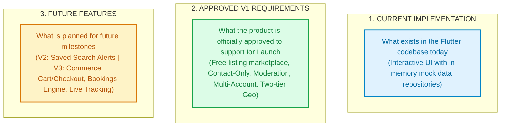

# Deal One — Complete UI/UX System Design Specification
## Authoritative Architecture, Screen Inventories, Component Catalog, and Design Tokens

**Platform Name:** Deal One (Market Space)  
**Document Suite Version:** 2.0 (Implementation-Ready)  
**Target Platform:** Flutter Mobile Application (iOS & Android)  
**Primary Language / Direction:** Arabic (`ar_EG`) RTL Primary | English (`en_US`) LTR Secondary  
**Target Audience:** Principal Product Designers, Senior UI/UX Architects, Flutter Design System Engineers, AI UI Implementation Agents  

---

## 1. Executive Summary & Purpose of this Specification

This documentation suite represents the **authoritative, implementation-ready UI/UX System Design Document** for the **Deal One** mobile application. It has been reverse-engineered from the running Flutter codebase (`market_space/lib`), cross-referenced against the 11 Mobile Architecture Audits (`docs/mobile-system-design/`), grounded in the approved Product Requirements (`mock_data/Deal_One_SRS.md`, `mock_data/Deal_One_Business_Analysis.md`, `mock_data/Deal_One_Architecture_Decisions.md`), and reconciled with the 52 backend endpoints defined in the Backend Blueprint (`backend_blueprint/03_API_SPECIFICATION.md`).

This suite is deliberately structured so that a separate **UI/UX Designer** or **AI UI Implementation Agent** can design, review, or code every screen, component, state, and interaction without repeatedly asking for missing product requirements or confusing prototype mockups with approved production scope.

---

## 2. The Three-Tier Feature Classification Mandate

Every screen, user journey, widget, and data field across this specification is categorized under one of three strict classifications:



> [!IMPORTANT]
> **Core Architectural Rule**: Deal One V1 is strictly a **free-listing marketplace operating in `contact_only` transaction mode**. Online payments, cart, checkout, order management, technician live GPS dispatch, and booking calendars are **strictly Future Features (V3)**. Any existing Flutter screens showcasing cart, checkout, or booking wizards are classified as **Prototype UI Only** and must never be released as approved V1 commerce features without explicit business sign-off.

---

## 3. Documentation Suite Index & Consumption Roadmap

The 22 documents in this suite are organized into seven logical volumes. An implementing designer or AI agent should consume them in the indicated sequence:

```
docs/ui-ux-system-design/
├── README.md                                  # [THIS FILE] Master index, roadmap & consumption guidelines
│
├── Volume I: System Foundations & Discovery
│   ├── 01_PRODUCT_UI_OVERVIEW.md              # Product identity, commercial sectors & core scope boundaries
│   ├── 02_COMPLETE_SCREEN_INVENTORY.md        # Master directory of all 65+ screens across 14 modules (A through N)
│   ├── 03_GLOBAL_DESIGN_SYSTEM.md             # Color tokens, typography, spacing, radii & WCAG 2.2 AA contrast rules
│   └── 04_GLOBAL_NAVIGATION_AND_SITEMAP.md    # Declarative GoRouter routing, 5 persistent tabs, modal sheets & sitemap
│
├── Volume II: Discovery & Commercial Vertical Specifications
│   ├── 05_HOME_AND_DISCOVERY_SCREENS.md       # Multi-sector Home Feed, Hero Banners, Section Selector & Nearby Listings
│   ├── 06_REAL_ESTATE_UI_SPECIFICATION.md     # Properties, Map Search, Reels, Compounds & Broker Profiles
│   ├── 07_BUILDING_MATERIALS_UI_SPECIFICATION.md # Heavy construction, Steel Rebar daily ticker & Supplier Profiles
│   ├── 08_HOME_SERVICES_UI_SPECIFICATION.md   # Maintenance services, Provider Profiles, Coverage Areas & Contacts
│   ├── 09_HOME_APPLIANCES_UI_SPECIFICATION.md # Electronics & Decor catalog, Brand Stores & Specification Filters
│   ├── 10_CARS_UI_SPECIFICATION.md            # Automotive marketplace, Multi-parameter filters & Dealerships
│   └── 11_FASHION_UI_SPECIFICATION.md         # Apparel catalog, Department tabs, Sizes/Colors & Boutiques
│
├── Volume III: User Lifecycle & Marketplace Interactions
│   ├── 12_AUTHENTICATION_AND_ACCOUNT_SCREENS.md # OTP Phone Auth, Turnstile security, Profile & Address Management
│   ├── 13_LISTING_CREATION_AND_EDITING.md     # Category-driven multi-step listing wizard, R2 Media upload & Geo-tagging
│   ├── 14_SEARCH_AND_FILTERS_UI_SPECIFICATION.md # Cross-sector search, Dynamic attribute filters & PostGIS radius sorting
│   ├── 15_CHAT_AND_COMMUNICATION_UI.md        # In-app listing-bound chat, Delivery receipts & External contact reveal
│   ├── 16_FAVORITES_ACTIVITY_AND_NOTIFICATIONS.md # Bookmarks, My Advertisements Management Feed & In-App Alerts
│   └── 17_SELLER_ACCOUNT_AND_VERIFICATION.md  # Multi-tenant account switcher, Commercial Verification & Branch Manager
│
├── Volume IV: Components, States & Traceability
│   ├── 18_REUSABLE_COMPONENTS_CATALOG.md      # Atomic buttons, inputs, category listing cards & dialog standards
│   ├── 19_UI_STATES_AND_ERROR_HANDLING.md     # Skeletons, empty states, error retry, offline modes & validation errors
│   └── 20_SCREEN_TO_API_TRACEABILITY.md       # Traceability matrix mapping screens to 52 Backend REST endpoints
│
└── Volume V: Implementation & Governance
    ├── 21_UI_AGENT_IMPLEMENTATION_GUIDE.md    # Step-by-step engineering handbook & acceptance criteria for AI agents
    └── 22_UI_UX_GAPS_AND_OPEN_DECISIONS.md    # Reconciled conflicts, open product decisions & architectural debt
```

---

## 4. How to Use This Documentation Suite

### For UI/UX Designers (Figma / Sketch / Adobe XD)
1. Begin with [03_GLOBAL_DESIGN_SYSTEM.md](03_GLOBAL_DESIGN_SYSTEM.md) to establish local styles (Monochrome palette, semantic color fills, Cairo/Tajawal typography scales, 4px/8px layout grids).
2. Use [18_REUSABLE_COMPONENTS_CATALOG.md](18_REUSABLE_COMPONENTS_CATALOG.md) to build atomic component variants and commercial card designs.
3. Reference the vertical specifications ([06](06_REAL_ESTATE_UI_SPECIFICATION.md) through [11](11_FASHION_UI_SPECIFICATION.md)) for screen-by-screen layouts, component hierarchies, and content hierarchies.
4. Adhere strictly to the RTL design guidelines specified in [03_GLOBAL_DESIGN_SYSTEM.md](03_GLOBAL_DESIGN_SYSTEM.md) and [01_PRODUCT_UI_OVERVIEW.md](01_PRODUCT_UI_OVERVIEW.md).

### For AI UI Implementation Agents (Flutter / Mobile Developers)
1. Read [21_UI_AGENT_IMPLEMENTATION_GUIDE.md](21_UI_AGENT_IMPLEMENTATION_GUIDE.md) before writing any code. It contains the execution priority order and dependency trees.
2. Review the **Screen Identity** and **Layout Structure** sections of the relevant screen specification document.
3. Verify the required API endpoints and data payloads using [20_SCREEN_TO_API_TRACEABILITY.md](20_SCREEN_TO_API_TRACEABILITY.md). Do not introduce fake or ungrounded data fields.
4. Check [19_UI_STATES_AND_ERROR_HANDLING.md](19_UI_STATES_AND_ERROR_HANDLING.md) to ensure every state (loading skeleton, empty view, error retry, offline notification, unauthorized gate) is implemented.
5. If you encounter any ambiguity or contradictory UI behavior, consult [22_UI_UX_GAPS_AND_OPEN_DECISIONS.md](22_UI_UX_GAPS_AND_OPEN_DECISIONS.md) to check the verified resolution.

---

## 5. Architectural Alignment Summary

| Dimension | Specification Standard | Codebase Verification |
|---|---|---|
| **Design Language** | High-Contrast Monochrome + WCAG 2.2 AA Semantic Colors | `lib/core/theme/app_colors.dart` |
| **Typography** | Cairo (Arabic) & Inter / Roboto (English) | `lib/core/theme/app_text_styles.dart` |
| **Grid & Spacing** | 8pt Spatial Grid (2px, 4px, 8px, 12px, 16px, 20px, 24px, 32px, 48px) | `lib/core/theme/app_spacing.dart` |
| **Corner Radii** | 4px (xs), 8px (sm), 12px (md), 16px (lg), 24px (xl), 999px (full) | `lib/core/theme/app_radii.dart` |
| **Navigation Shell** | `GoRouter` declarative routing with 5-tab `IndexedStack` persistent shell | `lib/features/navigation/presentation/` |
| **Primary Transaction Mode** | `contact_only` (In-App Chat, Direct WhatsApp, Cellular Voice Call) | ADR-008 & Backend Blueprint |
| **Moderation Engine** | 3-Axis Orthogonal Lifecycle: Moderation, Publication, Availability | ADR-007 & `listings` schema |
| **Multi-Tenancy** | Single User Identity (`users`) $\to$ Multiple Independent Accounts (`accounts`) | ADR-005 & `account_members` |
| **Geographic Privacy** | Two-Tier Coordinates: Exact GPS (Confidential) vs Approximate Area (Public) | ADR-006 & PostGIS `areas` |

