# 01 – Mobile System Overview: Deal One MVP

## 1. Executive Summary

The **Deal One Mobile MVP** (internal package name: `market_space`) is a multi-sector commerce and classifieds mobile application built using the Flutter framework (targeting Dart SDK `^3.13.3`). The application provides an integrated digital marketplace targeting the Egyptian commercial ecosystem across six primary industrial and consumer verticals:
1. **Real Estate** (`/real-estate`)
2. **Building Materials & Electrical Supplies** (`/building-materials`)
3. **Home & Engineering Services** (`/home-services`)
4. **Home Appliances & Decoration** (`/home-appliances`)
5. **Cars & Automotive** (`/cars`)
6. **Clothes & Fashion Accessories** (`/fashion`)

The application is architected around a **Hybrid Feature-First with Layered MVVM** pattern. It uses **InheritedWidget** (`AppDependenciesScope` in [app_dependencies.dart](file:///home/ibrahim-elshishtawy/flutter%20project/market_space/market_space/lib/app/app_dependencies.dart)) as an ambient service locator / Dependency Injection container, **GoRouter** ([app_router.dart](file:///home/ibrahim-elshishtawy/flutter%20project/market_space/market_space/lib/app/app_router.dart)) for declarative URL-based routing and multi-branch navigation, and a lightweight reactive state management model driven by native Flutter primitives (`ValueNotifier<T>` and `ListenableBuilder`).

---

## 2. Architectural Style Analysis

| Architectural Dimension | Identified Implementation | Evidence / Primary Source Files |
|---|---|---|
| **Primary Architectural Pattern** | Hybrid Feature-First Layered MVVM | [lib/features/](file:///home/ibrahim-elshishtawy/flutter%20project/market_space/market_space/lib/features/) containing isolated domain modules with `presentation/`, `data/`, and `domain/` sub-layers |
| **Dependency Injection / Service Locator** | Custom `InheritedWidget` (`AppDependenciesScope`) | [app_dependencies.dart](file:///home/ibrahim-elshishtawy/flutter%20project/market_space/market_space/lib/app/app_dependencies.dart#L10-L100) |
| **State Management** | Native `ValueNotifier<T>` + `ListenableBuilder` (with select `ChangeNotifier` controllers) | [real_estate_controller.dart](file:///home/ibrahim-elshishtawy/flutter%20project/market_space/market_space/lib/features/real_estate/presentation/controllers/real_estate_controller.dart), [home_page.dart](file:///home/ibrahim-elshishtawy/flutter%20project/market_space/market_space/lib/features/home/presentation/pages/home_page.dart) |
| **Routing & Navigation** | Declarative routing with `GoRouter` + persistent `IndexedStack` shell | [app_router.dart](file:///home/ibrahim-elshishtawy/flutter%20project/market_space/market_space/lib/app/app_router.dart), [global_navigation_scaffold.dart](file:///home/ibrahim-elshishtawy/flutter%20project/market_space/market_space/lib/features/navigation/presentation/pages/global_navigation_scaffold.dart) |
| **HTTP Networking Engine** | Scaffolding using `dio` v5.7.0 (`DioApiClient`) with custom interceptors | [api_client.dart](file:///home/ibrahim-elshishtawy/flutter%20project/market_space/market_space/lib/core/network/api_client.dart#L25) |
| **Local Persistence** | `shared_preferences` (v2.3.5) & `flutter_secure_storage` (v9.2.2) | [preferences_service.dart](file:///home/ibrahim-elshishtawy/flutter%20project/market_space/market_space/lib/core/storage/preferences_service.dart), [secure_storage_service.dart](file:///home/ibrahim-elshishtawy/flutter%20project/market_space/market_space/lib/core/storage/secure_storage_service.dart) |
| **Internationalization (i18n)** | Official `flutter_localizations` + `intl` (Arabic default `ar_EG`, English fallback `en_US`) | [l10n.yaml](file:///home/ibrahim-elshishtawy/flutter%20project/market_space/market_space/l10n.yaml), [app_ar.arb](file:///home/ibrahim-elshishtawy/flutter%20project/market_space/market_space/lib/l10n/app_ar.arb) |

### Key Architectural Characteristics

1. **Feature Separation**: Each business vertical is encapsulated in its own folder under `lib/features/<feature_name>/`. Features own their data contracts, mock implementations, domain models, and presentation widgets.
2. **Ambient Dependency Propagation**: Instead of using third-party DI frameworks like `get_it` or `injectable`, the application initializes an immutable `AppDependencies` container in `lib/bootstrap/bootstrap.dart` and mounts it above `MaterialApp.router` via `AppDependenciesScope`.
3. **Decoupled Section Navigation**: The application uses a dynamic navigation registry pattern (`SectionNavigationRegistry` in [section_navigation_registry.dart](file:///home/ibrahim-elshishtawy/flutter%20project/market_space/market_space/lib/core/navigation/config/section_navigation_registry.dart)) allowing different verticals to customize bottom bars, search filters, and floating actions while maintaining a unified global scaffold.
4. **Current Disconnect Between Network Layer and Feature Repositories**: While a complete network stack (`DioApiClient`, interceptors, endpoints) exists under `lib/core/network/`, **100% of feature repositories currently consume in-memory mock data** (e.g. `MockRealEstateData`, `MockCarsData`, `MockFashionData`).

---

## 3. Technology Stack Inventory

| Component / Layer | Technology / Package | Declared Version | Actual Usage in Code | Status |
|---|---|---|---|---|
| **Core Framework** | Flutter SDK (Material 3 enabled) | Flutter `>=3.0.0` | Root widget tree, theme, animations | **IMPLEMENTED** |
| **Language** | Dart | `^3.13.3` | Null safety, modern patterns | **IMPLEMENTED** |
| **Declarative Router** | `go_router` | `^14.6.2` | Application route hierarchy & navigation | **IMPLEMENTED** |
| **HTTP Client** | `dio` | `^5.7.0` | `DioApiClient` wrapper, interceptors | **PARTIALLY IMPLEMENTED** (Core exists, features do not call it) |
| **Key-Value Storage** | `shared_preferences` | `^2.3.5` | Theme, locale, recent searches, selected sector | **IMPLEMENTED** |
| **Encrypted Storage** | `flutter_secure_storage` | `^9.2.2` | Access token, refresh token storage | **IMPLEMENTED** |
| **Mapping Engine** | `flutter_map` + `latlong2` | `^7.0.2` / `^0.9.1` | Real estate interactive map using OpenStreetMap | **IMPLEMENTED** |
| **Carousel / Sliders** | `carousel_slider` | `^5.0.0` | Home banners, product image galleries | **IMPLEMENTED** |
| **SVG Rendering** | `flutter_svg` | `^2.0.16` | Iconography, sector badges | **IMPLEMENTED** |
| **UUID Generator** | `uuid` | `^4.5.1` | Request correlation IDs (`x-request-id`) | **IMPLEMENTED** |
| **Image Caching** | Not installed (`cached_network_image` absent) | N/A | Raw `Image.network` via `SafeNetworkImage` | **NOT IMPLEMENTED** |
| **Database (SQLite/Hive)** | None installed | N/A | No local relational/document database | **NOT IMPLEMENTED** |
| **Firebase Services** | None installed | N/A | No Firebase Core, Auth, Messaging, or Crashlytics | **NOT IMPLEMENTED** |
| **State Management Library** | None installed (`flutter_bloc`, `riverpod` absent) | N/A | Native `ValueNotifier<T>` / `ListenableBuilder` | **IMPLEMENTED** |

---

## 4. High-Level System Architecture Diagram

```mermaid
graph TD
    subgraph Client_App ["Deal One Flutter Application (market_space)"]
        subgraph Bootstrap_Layer ["Bootstrap & DI Layer"]
            Main["main.dart"] --> Bootstrap["bootstrap.dart"]
            Bootstrap --> AppDeps["AppDependencies (Core Services)"]
            AppDeps --> AppScope["AppDependenciesScope (InheritedWidget)"]
            AppScope --> AppWidget["App (MaterialApp.router)"]
        end

        subgraph Routing_Layer ["Routing & Navigation Layer"]
            AppWidget --> Router["AppRouter (GoRouter)"]
            Router --> NavScaffold["GlobalNavigationScaffold (IndexedStack)"]
            NavScaffold --> NavRegistry["SectionNavigationRegistry"]
        end

        subgraph Feature_Presentation ["Presentation Layer (MVVM)"]
            NavScaffold --> HomeTab["Home Page (Multi-Sector Hub)"]
            NavScaffold --> ExploreTab["Explore Page (Global Search)"]
            NavScaffold --> ActivityTab["Activity Page (Unified Timeline)"]
            NavScaffold --> FavoritesTab["Favorites Page (Unified Bookmarks)"]
            NavScaffold --> ProfileTab["Profile Page (Settings & Account)"]
            
            HomeTab --> SectorModules["Sector Pages & Details"]
            SectorModules --> RE["Real Estate (/real-estate)"]
            SectorModules --> BM["Building Materials (/building-materials)"]
            SectorModules --> HS["Home Services (/home-services)"]
            SectorModules --> HA["Home Appliances (/home-appliances)"]
            SectorModules --> CR["Cars (/cars)"]
            SectorModules --> FS["Fashion (/fashion)"]
        end

        subgraph State_Management ["State Management (Native Reactive)"]
            Controllers["Feature Controllers / Notifiers<br/>(ValueNotifier<T>, ListenableBuilder)"]
        end

        subgraph Data_Layer ["Data Layer (Repositories & Models)"]
            RE_Repo["MockRealEstateRepository"]
            BM_Repo["BuildingMaterialsRepository"]
            HS_Repo["HomeServicesRepositoryImpl"]
            HA_Repo["MockHomeAppliancesData"]
            CR_Repo["MockCarsRepository"]
            FS_Repo["MockFashionRepository"]
            Fav_Repo["UnifiedFavoritesRepository"]
            Act_Repo["UnifiedActivityRepository"]
            Notif_Repo["NotificationRepository"]
        end

        subgraph Core_Services ["Core Services & Storage"]
            PrefService["PreferencesService (SharedPreferences)"]
            SecStorage["SecureStorageService (FlutterSecureStorage)"]
            ApiClientCore["ApiClient (DioApiClient)"]
        end
    end

    subgraph External_Boundary ["External Services & Backend"]
        BackendAPI["Deal One REST API (Planned)"]
        OSM_Tiles["OpenStreetMap Tile Servers"]
    end

    %% Bindings
    SectorModules -.-> Controllers
    Controllers --> RE_Repo & BM_Repo & HS_Repo & HA_Repo & CR_Repo & FS_Repo
    HomeTab & FavoritesTab & ActivityTab --> Fav_Repo & Act_Repo & Notif_Repo

    %% Storage connections
    Controllers -.-> PrefService
    PrefService -.-> SecStorage

    %% External Connections
    ApiClientCore -.->|Currently Unwired| BackendAPI
    RE -->|Tile Layer| OSM_Tiles
```

---

## 5. Architectural Findings Summary

1. **Complete UI Prototyping with Real Egyptian Market Data**: The application features exceptionally rich, realistic domain models tailored specifically to the Egyptian market (using `EGP` currency, Cairo/Giza/Delta geographic zones, Arabic technical terms for building materials like Ezz Steel, specialized AC maintenance steps, and real car brands).
2. **Clean UI State Separation**: The presentation layer avoids bloating stateful widgets by extracting controller logic into dedicated `ValueNotifier`-backed controllers (`RealEstateController`, `ExploreController`, `RfqCreateController`).
3. **Orphaned Network Foundation**: The team constructed a production-grade `DioApiClient` with SSL pinning placeholders, request IDs, token interceptors, and timeout configs, but deferred integrating it into the feature repositories.
4. **Offline Isolation**: Because all data is in-memory and all images load via direct HTTPS URLs, the app operates almost entirely offline (excluding remote image rendering and map tiles).
