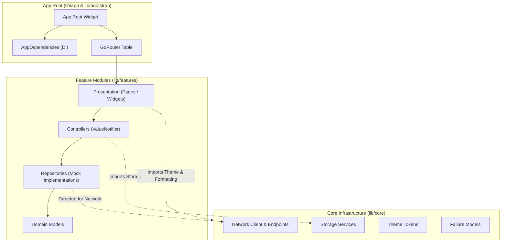

# 02 – Flutter Project Structure & Component Responsibilities

## 1. Directory Tree Overview

The Deal One codebase is organized under a modular, feature-oriented structure with strict boundaries separating core framework utilities, shared primitives, and feature-specific business modules.

```
market_space/
├── android/                           # Android native runner & build scripts
├── ios/                               # iOS native runner & configuration
├── assets/                            # Static media and mock assets
│   ├── icons/                         # SVG and PNG UI icons
│   ├── images/                        # Static local illustrations & placeholders
│   └── mock_data/                     # Raw JSON mock responses
├── lib/
│   ├── app/                           # Top-level application shell & DI
│   ├── bootstrap/                     # Pre-run initialization & error observers
│   ├── core/                          # Cross-cutting infrastructure & design system
│   ├── features/                      # Isolated business feature modules (13 modules)
│   ├── l10n/                          # Localization ARB source files
│   ├── shared/                        # Shared UI components & legacy bridge
│   └── main.dart                      # Application binary entry point
├── test/                              # Automated test suites (unit & widget)
├── analysis_options.yaml              # Static analysis and linting rules
├── l10n.yaml                          # Flutter localization configuration
└── pubspec.yaml                       # Package manifest and asset declarations
```

---

## 2. Directory Responsibilities and Key File Breakdown

### 2.1 `lib/main.dart` & `lib/bootstrap/`
- **Responsibility**: Binary entry point, environment parameter extraction, global error traps, and async service pre-flight initialization.
- **Key Files**:
  - [lib/main.dart](file:///home/ibrahim-elshishtawy/flutter%20project/market_space/market_space/lib/main.dart): Invokes `bootstrap(...)` passing initial configuration.
  - [lib/bootstrap/bootstrap.dart](file:///home/ibrahim-elshishtawy/flutter%20project/market_space/market_space/lib/bootstrap/bootstrap.dart): Initializes `WidgetsFlutterBinding`, configures `PlatformDispatcher.onError` and `FlutterError.onError`, instantiates `AppConfig`, initializes `SharedPreferences` and `FlutterSecureStorage`, registers `AppDependencies`, and launches `runApp()`.
  - [lib/bootstrap/bootstrap_observer.dart](file:///home/ibrahim-elshishtawy/flutter%20project/market_space/market_space/lib/bootstrap/bootstrap_observer.dart): Implements `WidgetsBindingObserver` to monitor app lifecycle events (`resumed`, `inactive`, `paused`, `detached`).

### 2.2 `lib/app/`
- **Responsibility**: Application root assembly, dependency propagation via Flutter's element tree, and top-level router binding.
- **Key Files**:
  - [lib/app/app.dart](file:///home/ibrahim-elshishtawy/flutter%20project/market_space/market_space/lib/app/app.dart): Root `StatefulWidget` (`App`) creating `MaterialApp.router`. Binds `ThemeNotifier`, `LocaleNotifier`, `AppThemeData`, and routes.
  - [lib/app/app_dependencies.dart](file:///home/ibrahim-elshishtawy/flutter%20project/market_space/market_space/lib/app/app_dependencies.dart): Houses `AppDependencies` container and `AppDependenciesScope` (`InheritedWidget`). Exposes static helper `AppDependenciesScope.of(context)`.
  - [lib/app/app_router.dart](file:///home/ibrahim-elshishtawy/flutter%20project/market_space/market_space/lib/app/app_router.dart): Configures `GoRouter` instance, root navigation key, sub-routes, route builders, and error pages.

### 2.3 `lib/core/` (Cross-Cutting Infrastructure)

| Subdirectory | Core Responsibility | Key Implementation Files |
|---|---|---|
| `core/config/` | Environment & runtime configuration | [app_config.dart](file:///home/ibrahim-elshishtawy/flutter%20project/market_space/market_space/lib/core/config/app_config.dart), [config_validator.dart](file:///home/ibrahim-elshishtawy/flutter%20project/market_space/market_space/lib/core/config/config_validator.dart) |
| `core/constants/` | Global keys & design constants | [app_constants.dart](file:///home/ibrahim-elshishtawy/flutter%20project/market_space/market_space/lib/core/constants/app_constants.dart) |
| `core/errors/` | Custom exceptions & failure models | [failures.dart](file:///home/ibrahim-elshishtawy/flutter%20project/market_space/market_space/lib/core/errors/failures.dart), [error_handler.dart](file:///home/ibrahim-elshishtawy/flutter%20project/market_space/market_space/lib/core/errors/error_handler.dart) |
| `core/navigation/` | Sector navigation configurations | [section_navigation_registry.dart](file:///home/ibrahim-elshishtawy/flutter%20project/market_space/market_space/lib/core/navigation/config/section_navigation_registry.dart), [navigation_config.dart](file:///home/ibrahim-elshishtawy/flutter%20project/market_space/market_space/lib/core/navigation/config/navigation_config.dart) |
| `core/network/` | HTTP client, endpoints & interceptors | [api_client.dart](file:///home/ibrahim-elshishtawy/flutter%20project/market_space/market_space/lib/core/network/api_client.dart), [api_endpoints.dart](file:///home/ibrahim-elshishtawy/flutter%20project/market_space/market_space/lib/core/network/api_endpoints.dart), `interceptors/` |
| `core/routing/` | Route name definitions & route guards | [route_names.dart](file:///home/ibrahim-elshishtawy/flutter%20project/market_space/market_space/lib/core/routing/route_names.dart), [route_guards.dart](file:///home/ibrahim-elshishtawy/flutter%20project/market_space/market_space/lib/core/routing/route_guards.dart) |
| `core/security/` | Session management & token provider | [secure_token_provider.dart](file:///home/ibrahim-elshishtawy/flutter%20project/market_space/market_space/lib/core/security/secure_token_provider.dart), [session_state.dart](file:///home/ibrahim-elshishtawy/flutter%20project/market_space/market_space/lib/core/security/session_state.dart) |
| `core/storage/` | SharedPreferences & secure storage | [preferences_service.dart](file:///home/ibrahim-elshishtawy/flutter%20project/market_space/market_space/lib/core/storage/preferences_service.dart), [secure_storage_service.dart](file:///home/ibrahim-elshishtawy/flutter%20project/market_space/market_space/lib/core/storage/secure_storage_service.dart), [storage_keys.dart](file:///home/ibrahim-elshishtawy/flutter%20project/market_space/market_space/lib/core/storage/storage_keys.dart) |
| `core/theme/` | Design system tokens & Material theme | [app_colors.dart](file:///home/ibrahim-elshishtawy/flutter%20project/market_space/market_space/lib/core/theme/app_colors.dart), [app_theme_data.dart](file:///home/ibrahim-elshishtawy/flutter%20project/market_space/market_space/lib/core/theme/app_theme_data.dart), [app_spacing.dart](file:///home/ibrahim-elshishtawy/flutter%20project/market_space/market_space/lib/core/theme/app_spacing.dart), [app_radii.dart](file:///home/ibrahim-elshishtawy/flutter%20project/market_space/market_space/lib/core/theme/app_radii.dart), [app_text_styles.dart](file:///home/ibrahim-elshishtawy/flutter%20project/market_space/market_space/lib/core/theme/app_text_styles.dart) |
| `core/utils/` | Formatting and formatting helpers | [formatters.dart](file:///home/ibrahim-elshishtawy/flutter%20project/market_space/market_space/lib/core/utils/formatters.dart) |

### 2.4 `lib/features/` (Application Verticals and Core Flows)

The 13 business and navigational modules located under `lib/features/` follow an internal sub-structure consisting of:
- `data/`: Repositories, mock datasets, models, and JSON serialization.
- `presentation/`: Pages, sub-widgets, bottom sheets, and presentation controllers.
- `domain/` (present in selected features like `home_services`): Abstract entities and repository contracts.

```
lib/features/
├── activity/                          # Aggregated timeline of user actions (orders, bookings, requests)
├── building_materials/                # Heavy construction commodities (Steel, Cement, Bricks, RFQs)
├── cars/                              # Automotive marketplace (listings, filter sheets, brands)
├── explore/                           # Multi-sector search discovery with recent searches
├── fashion/                           # Apparel & accessories catalog, department navigation & cart
├── favorites/                         # Cross-vertical unified bookmark repository & UI
├── home/                              # Central multi-sector launchpad & banner hub
├── home_appliances/                   # Consumer electronics, white goods & decoration
├── home_services/                     # Maintenance catalog, technician tracking & 6-step booking wizard
├── navigation/                        # Global scaffold, bottom nav bar & sector switcher
├── notifications/                     # Sector-filtered push & transactional notifications
├── profile/                           # User settings, addresses, language/theme toggles
└── real_estate/                       # Properties, map view (OSM), and short video/photo reels
```

### 2.5 `lib/shared/` (Cross-Module Widgets & Legacy Artifacts)
- **Shared Production Widgets**:
  - [safe_network_image.dart](file:///home/ibrahim-elshishtawy/flutter%20project/market_space/market_space/lib/shared/widgets/safe_network_image.dart): Defensive wrapper for `Image.network` handling empty URLs, protocol validation, loading shimmers, and error fallbacks.
  - [app_error_view.dart](file:///home/ibrahim-elshishtawy/flutter%20project/market_space/market_space/lib/shared/widgets/app_error_view.dart): Standardized error state widget with retry callbacks.
  - [app_loading_indicator.dart](file:///home/ibrahim-elshishtawy/flutter%20project/market_space/market_space/lib/shared/widgets/app_loading_indicator.dart): Adaptive progress indicator styled with theme tokens.
- **Orphaned / Legacy Artifact**:
  - [market_home_screen.dart](file:///home/ibrahim-elshishtawy/flutter%20project/market_space/market_space/lib/shared/widgets/market_home_screen.dart) and [market_repository.dart](file:///home/ibrahim-elshishtawy/flutter%20project/market_space/market_space/lib/shared/data/market_repository.dart): An early GCC-currency (AED/SAR) prototype screen. It is unreferenced by `AppRouter` and completely unreachable from the live UI.

### 2.6 Native Configurations
- **Android (`android/app/src/main/`)**:
  - [AndroidManifest.xml](file:///home/ibrahim-elshishtawy/flutter%20project/market_space/market_space/android/app/src/main/AndroidManifest.xml): Configures Flutter activity, launch theme, and window sizing.
  - **Critical Defect**: Missing `<uses-permission android:name="android.permission.INTERNET"/>` in the main release manifest (only present in `debug` and `profile` manifests).
- **iOS (`ios/Runner/`)**:
  - [Info.plist](file:///home/ibrahim-elshishtawy/flutter%20project/market_space/market_space/ios/Runner/Info.plist): Standard Flutter runner configuration. No custom camera, location, or photo library permission strings (`NSCameraUsageDescription`, `NSLocationWhenInUseUsageDescription`) are declared.

---

## 3. Architectural Boundary Integrity



### Boundary Assessment
- **Clean Feature Independence**: Features generally do not import other features directly, except via unified aggregators (`UnifiedFavoritesRepository` in `features/favorites` and `UnifiedActivityRepository` in `features/activity` which import domain models from other features).
- **Core Leakage**: None observed. Feature-specific logic does not leak into `lib/core/`.
