# 03 – Application Modules & Feature Specifications

## 1. Module Inventory & Status Overview

The Deal One mobile application comprises thirteen (13) distinct modules organized under `lib/features/`. Each module encapsulates its respective domain logic, presentation layer, and data repositories.

| Module Identifier | Vertical / Domain | Current Implementation Status | Data Source Type |
|---|---|---|---|
| `real_estate` | Property Classifieds, Interactive Map & Reels | **IMPLEMENTED** (UI/Domain) / **MOCK** (Data) | In-Memory Mock (`MockRealEstateData`) |
| `building_materials` | Industrial Construction Materials, RFQs, Shipping | **IMPLEMENTED** (UI/Domain) / **MOCK** (Data) | In-Memory Mock (`BuildingMaterialsRepository`) |
| `home_services` | Maintenance Services, Technician Tracking & Booking | **IMPLEMENTED** (UI/Domain) / **MOCK** (Data) | In-Memory Mock (`HomeServicesRepositoryImpl`) |
| `home_appliances` | Electronics & Home Decoration, Cart & Checkout | **IMPLEMENTED** (UI/Domain) / **MOCK** (Data) | In-Memory Mock (`MockHomeAppliancesData`) |
| `cars` | Automotive Marketplace, Advanced Filters & Details | **IMPLEMENTED** (UI/Domain) / **MOCK** (Data) | In-Memory Mock (`MockCarsData`) |
| `fashion` | Apparel & Accessories, Department Tabs & Cart | **IMPLEMENTED** (UI/Domain) / **MOCK** (Data) | In-Memory Mock (`MockFashionData`) |
| `home` | Multi-Sector Discovery Hub, Dynamic Banners | **IMPLEMENTED** | Composed from Feature Models & Registries |
| `explore` | Unified Cross-Sector Search Engine | **IMPLEMENTED** | In-Memory Filter across all 6 Verticals |
| `favorites` | Cross-Sector Bookmark Aggregator | **IMPLEMENTED** | In-Memory Reactive List (`UnifiedFavoritesRepository`) |
| `activity` | Unified Orders, Bookings & Inquiries Timeline | **IMPLEMENTED** | In-Memory Reactive List (`UnifiedActivityRepository`) |
| `profile` | User Profile, Addresses, Settings & Preferences | **IMPLEMENTED** (UI) / **PARTIAL** (Persistence) | `SharedPreferences` + Hardcoded User Mock |
| `notifications` | Sector-Segmented Push & Transactional Alerts | **IMPLEMENTED** (UI) / **MOCK** (Data) | In-Memory Notifier (`NotificationRepository`) |
| `navigation` | Global Shell, Bottom Navigation Bar & Switcher | **IMPLEMENTED** | `IndexedStack` + `SectionNavigationRegistry` |

---

## 2. Detailed Module Breakdown

### 2.1 Module: Real Estate (`real_estate`)
- **Business Purpose**: Search, filter, view, map, and interact with residential and commercial properties in Egypt, along with an interactive multimedia reel feed (TikTok/Instagram-style property videos and photos).
- **Main Screens**:
  - `RealEstatePage` ([real_estate_page.dart](file:///home/ibrahim-elshishtawy/flutter%20project/market_space/market_space/lib/features/real_estate/presentation/pages/real_estate_page.dart)): Primary sector hub with category tabs (Apartments, Villas, Duplexes, Commercial), search header, filter chips, and property card list.
  - `RealEstateDetailPage` ([real_estate_detail_page.dart](file:///home/ibrahim-elshishtawy/flutter%20project/market_space/market_space/lib/features/real_estate/presentation/pages/real_estate_detail_page.dart)): Comprehensive listing detail with image carousel, specifications table (rooms, area, floor, finishing), broker contact buttons (Call, WhatsApp), mortgage calculator widget, and interactive location map.
  - `RealEstateMapPage` ([real_estate_map_page.dart](file:///home/ibrahim-elshishtawy/flutter%20project/market_space/market_space/lib/features/real_estate/presentation/pages/real_estate_map_page.dart)): Full-screen interactive map powered by `flutter_map` and OpenStreetMap tile layers, rendering interactive price markers and property preview bottom cards.
  - `RealEstateReelsPage` ([real_estate_reels_page.dart](file:///home/ibrahim-elshishtawy/flutter%20project/market_space/market_space/lib/features/real_estate/presentation/pages/real_estate_reels_page.dart)): Vertical scrolling short-form video/photo feed with broker avatars, like/comment buttons, property pricing overlays, and direct detail routing.
  - `RealEstateFavoritesPage` & `RealEstateSavedSearchesPage`: Filtered view of property bookmarks and saved alert filters.
- **Controllers & Notifiers**:
  - `RealEstateController` ([real_estate_controller.dart](file:///home/ibrahim-elshishtawy/flutter%20project/market_space/market_space/lib/features/real_estate/presentation/controllers/real_estate_controller.dart)): Manages selected category, active search query, price/room filters, and pagination state.
- **Models**:
  - `RealEstateListing`: Represents property entity (title, price, area, location, specs, broker information, coordinates).
  - `RealEstateReel`: Represents multimedia reel (video URL, thumbnail, property ID, metrics).
- **Repository**:
  - `MockRealEstateRepository` ([mock_real_estate_repository.dart](file:///home/ibrahim-elshishtawy/flutter%20project/market_space/market_space/lib/features/real_estate/data/repositories/mock_real_estate_repository.dart)): Generates Egyptian listings across New Cairo, Sheikh Zayed, New Capital, and North Coast.
- **Target API Endpoints**: Defined in `ApiEndpoints` (`/real-estate/listings`, `/real-estate/listings/{id}`), but currently wired to mock data.

---

### 2.2 Module: Building Materials & Electrical Supplies (`building_materials`)
- **Business Purpose**: B2B and B2C commerce platform for heavy construction materials (Steel Rebar, Cement, Gypsum, Concrete Blocks, Bricks) and electrical contracting supplies. Includes live daily factory price tracking, an RFQ (Request For Quotation) creation wizard, freight shipping cost calculation, staged project delivery management, and bulk ordering.
- **Main Screens**:
  - `BuildingMaterialsPage` ([building_materials_page.dart](file:///home/ibrahim-elshishtawy/flutter%20project/market_space/market_space/lib/features/building_materials/presentation/pages/building_materials_page.dart)): Daily factory price ticker banner (Ezz Steel, Suez Cement, etc.), category navigation, featured supplier products.
  - `BuildingMaterialsCategoryDetailPage` ([building_materials_category_detail_page.dart](file:///home/ibrahim-elshishtawy/flutter%20project/market_space/market_space/lib/features/building_materials/presentation/pages/building_materials_category_detail_page.dart)): Material variants grid (e.g. 10mm, 12mm, 16mm steel rebar) with volume tier pricing.
  - `RfqCreatePage` ([rfq_create_page.dart](file:///home/ibrahim-elshishtawy/flutter%20project/market_space/market_space/lib/features/building_materials/presentation/pages/rfq_create_page.dart)): Multi-step formal request-for-quotation form (project name, governorate, required quantities in metric tons/pallets, delivery timeline, payment terms).
  - `BuildingMaterialsCartPage` & `BuildingMaterialsCheckoutPage`: Specialized bulk checkout with delivery truck requirements (Trailer, Flatbed, Half-truck) and scheduled milestone deliveries.
- **Key Services & Logic**:
  - `ShippingCalculator` ([shipping_calculator.dart](file:///home/ibrahim-elshishtawy/flutter%20project/market_space/market_space/lib/features/building_materials/presentation/services/shipping_calculator.dart)): Computes dynamic freight rates based on truck capacity, distance between Egyptian governorates, and weight tonnage.
- **Models**:
  - `MaterialProduct`, `DailyPriceQuote`, `RfqRequest`, `StagedShipment`, `BuildingOrder`.
- **Repository**:
  - `BuildingMaterialsRepository` ([building_materials_repository.dart](file:///home/ibrahim-elshishtawy/flutter%20project/market_space/market_space/lib/features/building_materials/data/repositories/building_materials_repository.dart)): In-memory repository with simulated network delays.

---

### 2.3 Module: Home & Engineering Services (`home_services`)
- **Business Purpose**: On-demand and contract home maintenance and engineering services (Air Conditioning maintenance, Plumbing, Electrical works, Painting, Carpentry, Smart Home setup). Provides live technician dispatch tracking and a structured 6-step booking wizard.
- **Main Screens**:
  - `HomeServicesCatalogPage` ([home_services_catalog_page.dart](file:///home/ibrahim-elshishtawy/flutter%20project/market_space/market_space/lib/features/home_services/presentation/pages/home_services_catalog_page.dart)): Service categories, promotional maintenance bundles, emergency service triggers.
  - `AcServiceDetailPage` ([ac_service_detail_page.dart](file:///home/ibrahim-elshishtawy/flutter%20project/market_space/market_space/lib/features/home_services/presentation/pages/ac_service_detail_page.dart)): Deep-dive service description with transparent checklist (chemical cleaning, freon check, electrical inspection), transparent pricing, and direct booking trigger.
  - `HomeServicesBookingWizardPage` ([home_services_booking_wizard_page.dart](file:///home/ibrahim-elshishtawy/flutter%20project/market_space/market_space/lib/features/home_services/presentation/pages/home_services_booking_wizard_page.dart)): 6-step sequential booking flow:
    1. Problem specification & sub-service selection
    2. Date & time slot picker
    3. Location address & apartment details
    4. Technician level selection (General technician vs. Certified engineer)
    5. Order summary & promo code input
    6. Confirmation & dispatch generation
  - `TechnicianTrackingPage` ([technician_tracking_page.dart](file:///home/ibrahim-elshishtawy/flutter%20project/market_space/market_space/lib/features/home_services/presentation/pages/technician_tracking_page.dart)): Real-time visual timeline showing: Booking Confirmed → Technician Assigned → On the Way → Arrived & Working → Completed.
- **Domain Layer**:
  - Has clean separation with `ServiceBooking`, `Technician`, and abstract `HomeServicesRepository` in `domain/repositories/` implemented by `HomeServicesRepositoryImpl`.

---

### 2.4 Module: Home Appliances & Decoration (`home_appliances`)
- **Business Purpose**: E-commerce catalog for large domestic appliances (Refrigerators, Washers, Cookers), small kitchen electronics, and interior home decoration accessories.
- **Main Screens**:
  - `HomeAppliancesCatalogPage` ([home_appliances_catalog_page.dart](file:///home/ibrahim-elshishtawy/flutter%20project/market_space/market_space/lib/features/home_appliances/presentation/pages/home_appliances_catalog_page.dart)): Product grid, brand filters, discount badges, sort sheet.
  - `HomeAppliancesCartPage` & `HomeAppliancesCheckoutPage`: Consumer cart, item quantity stepper, order summary with installment calculators (e.g. ValU, Sympl, bank installments), and delivery tracking timeline.
- **Models & Data**:
  - `ApplianceProduct`, `ApplianceOrder`, `MockHomeAppliancesData`.

---

### 2.5 Module: Cars & Automotive (`cars`)
- **Business Purpose**: Automotive marketplace offering new and pre-owned vehicle classifieds across Egypt.
- **Main Screens**:
  - `CarsPage` ([cars_page.dart](file:///home/ibrahim-elshishtawy/flutter%20project/market_space/market_space/lib/features/cars/presentation/pages/cars_page.dart)): Automotive feed with brand horizontal selector (Mercedes, BMW, Toyota, Hyundai, MG), price ranges, and condition pills (New, Used).
  - `CarDetailPage` ([car_detail_page.dart](file:///home/ibrahim-elshishtawy/flutter%20project/market_space/market_space/lib/features/cars/presentation/pages/car_detail_page.dart)): Detailed car profile displaying mileage (km), transmission type (Automatic/Manual), engine capacity (CC), fuel type, inspection report status, and seller contact action bar.
  - `CarFilterSheet` ([car_filter_sheet.dart](file:///home/ibrahim-elshishtawy/flutter%20project/market_space/market_space/lib/features/cars/presentation/widgets/car_filter_sheet.dart)): Bottom sheet enabling filtering by Year of Make, Price Range, Mileage, Governorates, and Transmission.
- **Repository**:
  - `MockCarsRepository` ([mock_cars_repository.dart](file:///home/ibrahim-elshishtawy/flutter%20project/market_space/market_space/lib/features/cars/data/repositories/mock_cars_repository.dart)) providing realistic car listings.

---

### 2.6 Module: Fashion & Accessories (`fashion`)
- **Business Purpose**: Retail apparel and lifestyle accessories catalog divided by demographic departments (Men, Women, Kids, Shoes & Bags).
- **Main Screens**:
  - `FashionCatalogPage` ([fashion_catalog_page.dart](file:///home/ibrahim-elshishtawy/flutter%20project/market_space/market_space/lib/features/fashion/presentation/pages/fashion_catalog_page.dart)): Department selector tabs, seasonal banners, trending fashion items.
  - `FashionCartPage`: Standalone clothing shopping bag with size and color selectors.
- **Repository**:
  - `MockFashionRepository` ([mock_fashion_repository.dart](file:///home/ibrahim-elshishtawy/flutter%20project/market_space/market_space/lib/features/fashion/data/repositories/mock_fashion_repository.dart)).

---

### 2.7 Supporting Core Modules

#### A. Home Module (`home`)
- **Purpose**: High-level aggregator acting as the primary entry tab.
- **Key Screen**: `HomePage` ([home_page.dart](file:///home/ibrahim-elshishtawy/flutter%20project/market_space/market_space/lib/features/home/presentation/pages/home_page.dart)).
- **Features**: Sliver header with search bar, sector selector chips, dynamic hero promotion carousel using `carousel_slider`, most requested services section, and featured items across all sectors.

#### B. Explore Module (`explore`)
- **Purpose**: Global discovery and search engine.
- **Key Screen**: `ExplorePage` ([explore_page.dart](file:///home/ibrahim-elshishtawy/flutter%20project/market_space/market_space/lib/features/explore/presentation/pages/explore_page.dart)).
- **Features**: Cross-vertical search field, trending keyword tags, sector filter chips, search history tags persisted locally via `SharedPreferences`, and unified search results list.

#### C. Favorites Module (`favorites`)
- **Purpose**: Universal bookmark center aggregating saved items across all 6 sectors.
- **Key Class**: `UnifiedFavoritesRepository` ([unified_favorites_repository.dart](file:///home/ibrahim-elshishtawy/flutter%20project/market_space/market_space/lib/features/favorites/data/repositories/unified_favorites_repository.dart)).
- **Features**: Exposes `ValueNotifier<List<UnifiedFavoriteItem>>`. Reusable heart toggle button across all card components.

#### D. Activity Module (`activity`)
- **Purpose**: Aggregated transaction and interaction history.
- **Key Screen**: `ActivityPage` ([activity_page.dart](file:///home/ibrahim-elshishtawy/flutter%20project/market_space/market_space/lib/features/activity/presentation/pages/activity_page.dart)).
- **Key Class**: `UnifiedActivityRepository` ([unified_activity_repository.dart](file:///home/ibrahim-elshishtawy/flutter%20project/market_space/market_space/lib/features/activity/data/repositories/unified_activity_repository.dart)).
- **Features**: Aggregates e-commerce orders (Building Materials, Appliances, Fashion), service bookings (Home Services), and inquiry requests (Real Estate, Cars).

#### E. Profile Module (`profile`)
- **Purpose**: User account hub, settings, delivery addresses, and app preferences.
- **Key Screen**: `ProfilePage` ([profile_page.dart](file:///home/ibrahim-elshishtawy/flutter%20project/market_space/market_space/lib/features/profile/presentation/pages/profile_page.dart)).
- **Features**: User header, delivery addresses manager, theme mode toggle (Light/Dark/System), language switch (Arabic/English), notification permission toggles, and mock logout button.

#### F. Notifications Module (`notifications`)
- **Purpose**: Centralized push and transactional alert center with sector tabs.
- **Key Screen**: `NotificationsPage` ([notifications_page.dart](file:///home/ibrahim-elshishtawy/flutter%20project/market_space/market_space/lib/features/notifications/presentation/pages/notifications_page.dart)).
- **Key Class**: `NotificationRepository` ([notification_repository.dart](file:///home/ibrahim-elshishtawy/flutter%20project/market_space/market_space/lib/features/notifications/data/repositories/notification_repository.dart)).
- **Features**: Allows filtering notifications by sector (All, Real Estate, Materials, Services, Appliances, Cars, Fashion) with individual unread count notifiers.

#### G. Navigation Module (`navigation`)
- **Purpose**: Global application shell containing the persistent bottom navigation bar and dynamic section configurations.
- **Key Screen**: `GlobalNavigationScaffold` ([global_navigation_scaffold.dart](file:///home/ibrahim-elshishtawy/flutter%20project/market_space/market_space/lib/features/navigation/presentation/pages/global_navigation_scaffold.dart)).

---

## 3. Module Dependency Diagram

```mermaid
graph TD
    NavModule["navigation (GlobalNavigationScaffold)"]
    
    HomeMod["home (HomePage)"]
    ExploreMod["explore (ExplorePage)"]
    ActivityMod["activity (ActivityPage)"]
    FavMod["favorites (FavoritesPage)"]
    ProfMod["profile (ProfilePage)"]
    NotifMod["notifications (NotificationsPage)"]
    
    RE["real_estate"]
    BM["building_materials"]
    HS["home_services"]
    HA["home_appliances"]
    Cars["cars"]
    Fashion["fashion"]

    NavModule --> HomeMod
    NavModule --> ExploreMod
    NavModule --> ActivityMod
    NavModule --> FavMod
    NavModule --> ProfMod

    HomeMod -.->|Launches Vertical| RE
    HomeMod -.->|Launches Vertical| BM
    HomeMod -.->|Launches Vertical| HS
    HomeMod -.->|Launches Vertical| HA
    HomeMod -.->|Launches Vertical| Cars
    HomeMod -.->|Launches Vertical| Fashion

    ExploreMod -.->|Searches Across| RE & BM & HS & HA & Cars & Fashion
    FavMod -.->|Aggregates Bookmarks| RE & BM & HS & HA & Cars & Fashion
    ActivityMod -.->|Aggregates Transactions| BM & HS & HA & Fashion & RE & Cars
    ProfMod -.->|Navigates To| NotifMod
```

