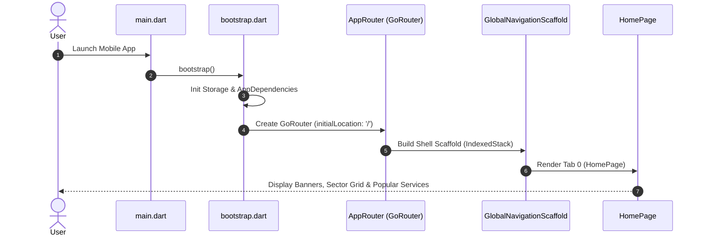
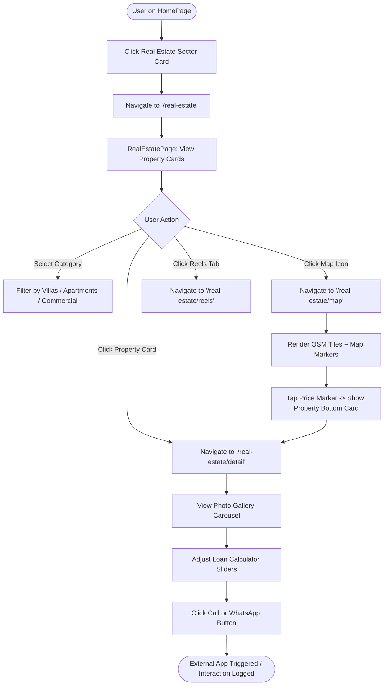
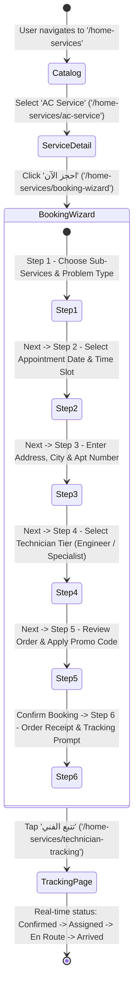
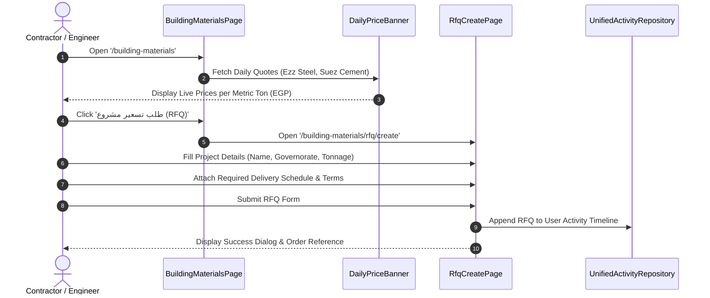
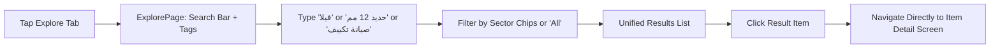

# 04 – Navigation & User Flows

## 1. Navigation Architecture Overview

Navigation in Deal One is driven by `GoRouter` (v14.6.2) defined in [lib/app/app_router.dart](file:///home/ibrahim-elshishtawy/flutter%20project/market_space/market_space/lib/app/app_router.dart). The application uses a hybrid navigation strategy combining a root-level persistent **Tab Shell** (`GlobalNavigationScaffold`) and imperative/declarative **Sub-Route Pushes** for detail screens, wizards, and specialized flows.

```
Root App Entry Point: '/' -> GlobalNavigationScaffold (IndexedStack)
├── Tab 0: Home ('/')
├── Tab 1: Explore ('/explore')
├── Tab 2: Activity ('/activity')
├── Tab 3: Favorites ('/favorites')
└── Tab 4: Profile ('/profile')
```

Sub-routes are pushed on top of the root navigator (`rootNavigatorKey`), hiding the global bottom navigation bar when navigating into full-screen experiences like detail pages, checkout funnels, and maps.

---

## 2. Complete Application Route Inventory

The following table documents all declared routes in `app_router.dart`:

| Route Path | Route Name Constant | Target Screen Widget | Navigation Type | Access Level |
|---|---|---|---|---|
| `/` | `RouteNames.root` | `GlobalNavigationScaffold` | Shell Root | Public |
| `/real-estate` | `RouteNames.realEstate` | `RealEstatePage` | Push / Nav | Public |
| `/real-estate/detail` | `RouteNames.realEstateDetail` | `RealEstateDetailPage` | Push | Public |
| `/real-estate/map` | `RouteNames.realEstateMap` | `RealEstateMapPage` | Push | Public |
| `/real-estate/reels` | `RouteNames.realEstateReels` | `RealEstateReelsPage` | Push | Public |
| `/real-estate/favorites` | `RouteNames.realEstateFavorites` | `RealEstateFavoritesPage` | Push | Public |
| `/real-estate/saved-searches`| `RouteNames.realEstateSavedSearches`| `RealEstateSavedSearchesPage` | Push | Public |
| `/building-materials` | `RouteNames.buildingMaterials` | `BuildingMaterialsPage` | Push / Nav | Public |
| `/building-materials/category` | `RouteNames.buildingMaterialsCategoryDetail` | `BuildingMaterialsCategoryDetailPage` | Push | Public |
| `/building-materials/cart` | `RouteNames.buildingMaterialsCart` | `BuildingMaterialsCartPage` | Push | Public |
| `/building-materials/checkout` | `RouteNames.buildingMaterialsCheckout` | `BuildingMaterialsCheckoutPage` | Push | Public |
| `/building-materials/rfq/create` | `RouteNames.buildingMaterialsRfqCreate` | `RfqCreatePage` | Push | Public |
| `/home-services` | `RouteNames.homeServices` | `HomeServicesCatalogPage` | Push / Nav | Public |
| `/home-services/ac-service` | `RouteNames.acServiceDetail` | `AcServiceDetailPage` | Push | Public |
| `/home-services/booking-wizard` | `RouteNames.homeServicesBookingWizard` | `HomeServicesBookingWizardPage` | Push | Public |
| `/home-services/technician-tracking` | `RouteNames.homeServicesTechnicianTracking` | `TechnicianTrackingPage` | Push | Public |
| `/home-appliances` | `RouteNames.homeAppliances` | `HomeAppliancesCatalogPage` | Push / Nav | Public |
| `/home-appliances/cart` | `RouteNames.homeAppliancesCart` | `HomeAppliancesCartPage` | Push | Public |
| `/home-appliances/checkout` | `RouteNames.homeAppliancesCheckout` | `HomeAppliancesCheckoutPage` | Push | Public |
| `/cars` | `RouteNames.cars` | `CarsPage` | Push / Nav | Public |
| `/cars/detail` | `RouteNames.carDetail` | `CarDetailPage` | Push | Public |
| `/fashion` | `RouteNames.fashion` | `FashionCatalogPage` | Push / Nav | Public |
| `/fashion/cart` | `RouteNames.fashionCart` | `FashionCartPage` | Push | Public |
| `/notifications` | `RouteNames.notifications` | `NotificationsPage` | Push | Public |

---

## 3. Route Protection, Splash & Authentication Flow Reality

- **Splash Screen**: **NOT IMPLEMENTED**. The application boots synchronously from `main.dart` through `bootstrap.dart` into `AppRouter` without an animated splash or branded launch delay.
- **Onboarding Flow**: **NOT IMPLEMENTED**. There is no onboarding tutorial or welcome carousel for new users.
- **Authentication Screens**: **NOT IMPLEMENTED**. Although auth endpoints exist in `ApiEndpoints`, there are no UI screens for Login, Phone Verification, OTP input, or Registration.
- **Route Protection**: **PLACEHOLDER**. `SessionRouteGuard` ([route_guards.dart](file:///home/ibrahim-elshishtawy/flutter%20project/market_space/market_space/lib/core/routing/route_guards.dart)) implements the `RouteGuard` contract, but its `evaluateRedirect()` method unconditionally returns `null`:
  ```dart
  class SessionRouteGuard implements RouteGuard {
    @override
    String? evaluateRedirect(BuildContext context, GoRouterState state) {
      // Unconditionally permits navigation to any route without session checks
      return null;
    }
  }
  ```
  Consequently, all screens in the application operate with full guest access.

---

## 4. Reverse-Engineered User Journey Diagrams

### 4.1 Application Launch & Global Shell Journey


### 4.2 Real Estate Discovery & Interactive Map Journey


### 4.3 Home Services: 6-Step Booking Wizard Journey


### 4.4 Building Materials: Daily Factory Prices & RFQ Submission


### 4.5 Global Cross-Sector Search Journey

