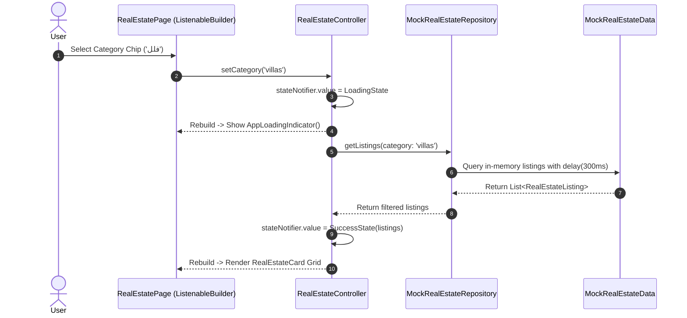
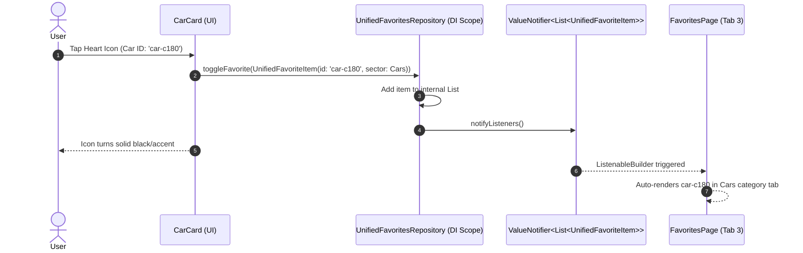
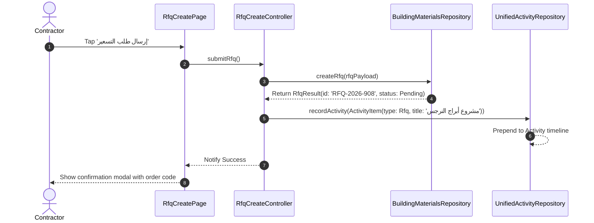

# 05 – State Management & Data Flow Architecture

## 1. State Management Philosophy & Technologies

The Deal One mobile application deliberately avoids heavy external state management libraries (such as `flutter_bloc`, `riverpod`, or `mobx`). Instead, it implements a **Native Reactive State Management** pattern built exclusively upon Flutter's built-in primitives:

1. **`ValueNotifier<T>`**: Primary observable container holding fine-grained UI state.
2. **`ListenableBuilder` / `ValueListenableBuilder<T>`**: Rebuild optimization widgets that listen to value changes and rebuild only the dependent subtrees.
3. **`ChangeNotifier`**: Used selectively for controllers managing multi-property state complexes (such as `ExploreController`).
4. **`InheritedWidget` (`AppDependenciesScope`)**: Used as the ambient injector to supply singleton repositories and services down the widget tree without global singletons.

---

## 2. State Ownership & Controller Lifecycles

### 2.1 Feature Controllers Table

| Controller / Notifier Class | Host Module | Base Primitive | Observed State Payload | Lifecycle Scope |
|---|---|---|---|---|
| `RealEstateController` | `real_estate` | `ValueNotifier<RealEstateState>` | Category, filter params, listings, loading/error | Screen-scoped (`StatefulWidget`) |
| `ExploreController` | `explore` | `ChangeNotifier` | Search query, active sector, search history, result list | Screen-scoped (`StatefulWidget`) |
| `RfqCreateController` | `building_materials` | `ChangeNotifier` | Step index, form validation, project payload | Flow-scoped (`RfqCreatePage`) |
| `ThemeNotifier` | `core/theme` | `ValueNotifier<ThemeMode>` | System, Light, or Dark mode | App-scoped (`AppDependencies`) |
| `LocaleNotifier` | `core/localization` | `ValueNotifier<Locale>` | Active language (`ar` or `en`) | App-scoped (`AppDependencies`) |
| `UnifiedFavoritesRepository` | `favorites` | `ValueNotifier<List<UnifiedFavoriteItem>>` | Aggregated list of cross-sector bookmarks | App-scoped (`AppDependencies`) |
| `UnifiedActivityRepository` | `activity` | `ValueNotifier<List<UnifiedActivityItem>>` | Aggregated list of orders and bookings | App-scoped (`AppDependencies`) |
| `NotificationRepository` | `notifications` | `ValueNotifier<Map<String, int>>` | Unread badge counts per vertical | App-scoped (`AppDependencies`) |

---

## 3. State Lifecycle & Mutation Pattern

A typical feature controller follows this exact lifecycle:

```dart
class RealEstateController {
  final MockRealEstateRepository _repository;
  
  // 1. Observable State Container
  final ValueNotifier<RealEstateState> stateNotifier = 
      ValueNotifier<RealEstateState>(RealEstateState.initial());

  RealEstateController(this._repository);

  // 2. Action / Event Handler
  Future<void> fetchListings({String? category}) async {
    stateNotifier.value = stateNotifier.value.copyWith(isLoading: true, errorMessage: null);
    try {
      final items = await _repository.fetchListings(category: category);
      stateNotifier.value = stateNotifier.value.copyWith(
        isLoading: false,
        listings: items,
      );
    } catch (e) {
      stateNotifier.value = stateNotifier.value.copyWith(
        isLoading: false,
        errorMessage: e.toString(),
      );
    }
  }

  // 3. Clean Disposal
  void dispose() {
    stateNotifier.dispose();
  }
}
```

In the presentation layer, the UI avoids rebuilding the whole page by wrapping reactive nodes in `ListenableBuilder`:

```dart
ListenableBuilder(
  listenable: controller.stateNotifier,
  builder: (context, child) {
    final state = controller.stateNotifier.value;
    if (state.isLoading) return const AppLoadingIndicator();
    if (state.errorMessage != null) return AppErrorView(message: state.errorMessage!);
    return ListView.builder(...);
  },
);
```

---

## 4. Cross-Feature State Communication

Cross-feature communication is achieved through **Shared App-Scoped Notifiers** instantiated at bootstrap inside `AppDependencies`:

1. **Favoriting an Item from any Vertical**:
   - The user taps the bookmark icon on a `RealEstateCard`, `CarCard`, or `MaterialCard`.
   - The card invokes `AppDependenciesScope.of(context).favoritesRepository.toggleFavorite(item)`.
   - `UnifiedFavoritesRepository` mutates its in-memory list and notifies all listeners.
   - The `FavoritesPage` (under Tab 3) automatically reflects the newly bookmarked item.

2. **Triggering an Order or Booking**:
   - When a user confirms a booking in `HomeServicesBookingWizardPage` or submits an RFQ in `RfqCreatePage`.
   - The wizard calls `AppDependenciesScope.of(context).activityRepository.recordActivity(...)`.
   - `UnifiedActivityRepository` updates its stream/notifier.
   - The `ActivityPage` (under Tab 2) updates immediately.

3. **Badge Synchronization**:
   - `NotificationRepository` exposes `unreadCountsNotifier`.
   - `GlobalNavigationScaffold` and `HomeNavBar` listen to `unreadCountsNotifier` to show real-time notification badges on the profile or bell icons without manual polling.

---

## 5. End-to-End Data Flow Sequence Diagrams

### 5.1 Real Estate Search & Filter Flow


### 5.2 Universal Favorite Toggle Flow


### 5.3 RFQ Submission & Activity Recording Flow

