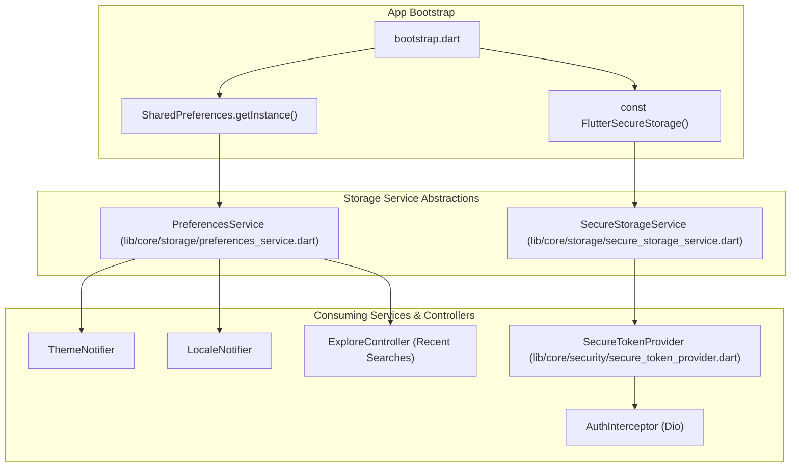

# 07 – Database, Local Storage & Caching Architecture

## 1. Local Storage Technology Matrix

The mobile client uses a minimalist local persistence stack consisting exclusively of two storage engines. No embedded document or relational database (such as SQLite, Drift, Hive, or ObjectBox) is implemented.

| Storage Technology | Package & Version | Underlying OS Implementation | Security Level | Purpose in Deal One |
|---|---|---|---|---|
| **Preferences Storage** | `shared_preferences` (v2.3.5) | Android: `SharedPreferences` iOS: `NSUserDefaults` | Non-encrypted plain key-value | User UI preferences, theme, language, and search history |
| **Encrypted Storage** | `flutter_secure_storage` (v9.2.2) | Android: `EncryptedSharedPreferences` iOS: `Keychain` | Hardware-backed AES encryption | JWT access tokens, refresh tokens, session keys |
| **Relational Database** | None | N/A | N/A | **NOT IMPLEMENTED** |
| **Disk Image Caching** | None (`cached_network_image` absent) | Default HTTP cache (RAM / OS temp) | In-memory only | **NOT IMPLEMENTED** (Raw `Image.network`) |

---

## 2. Storage Key Inventory & Data Lifecycle

The application standardizes all storage keys through static constants defined in [lib/core/storage/storage_keys.dart](file:///home/ibrahim-elshishtawy/flutter%20project/market_space/market_space/lib/core/storage/storage_keys.dart):

| Storage Layer | Key Identifier | Constant Name | Data Type | Expected Values | Lifecycle / Eviction Policy |
|---|---|---|---|---|---|
| **SharedPreferences** | `app_theme_mode` | `StorageKeys.themeMode` | `String` | `'system'`, `'light'`, `'dark'` | Persisted across app restarts; updated on user toggle |
| **SharedPreferences** | `app_language_code` | `StorageKeys.languageCode` | `String` | `'ar'`, `'en'` | Persisted across app restarts; updated on language toggle |
| **SharedPreferences** | `app_selected_sector` | `StorageKeys.selectedSector` | `String` | `'real-estate'`, `'cars'`, etc. | Persisted; restores last active sector on boot |
| **SharedPreferences** | `explore_recent_searches_list` | N/A (Inline in `ExploreController`) | `List<String>` | Array of query strings (max 10) | FIFO queue; cleared when user taps "Clear history" |
| **SecureStorage** | `auth_access_token` | `StorageKeys.accessToken` | `String` | Base64-encoded JWT token | Cleared on explicit logout or token invalidation |
| **SecureStorage** | `auth_refresh_token`| `StorageKeys.refreshToken`| `String` | Refresh token string | Cleared on explicit logout or session expiry |

---

## 3. Storage Service Architecture

### 3.1 Preferences Service Implementation
- **File**: [lib/core/storage/preferences_service.dart](file:///home/ibrahim-elshishtawy/flutter%20project/market_space/market_space/lib/core/storage/preferences_service.dart)
- **Responsibilities**: Provides type-safe wrappers (`getThemeMode()`, `setThemeMode()`, `getLanguageCode()`, `setLanguageCode()`) around raw `SharedPreferences` reads and writes, preventing type-cast exceptions during startup.

### 3.2 Secure Storage Service Implementation
- **File**: [lib/core/storage/secure_storage_service.dart](file:///home/ibrahim-elshishtawy/flutter%20project/market_space/market_space/lib/core/storage/secure_storage_service.dart)
- **Responsibilities**: Wraps `FlutterSecureStorage` with error-handling fallback logic, guaranteeing that token reads and write operations never crash application launch even if the hardware keystore or keychain is temporarily locked.

---

## 4. In-Memory Caching & Image Persistence Audit

### 4.1 In-Memory Repository State
Because the application does not yet utilize an offline database, runtime data caching is managed in-memory by singleton repository instances bound inside `AppDependencies`:
- `UnifiedFavoritesRepository`: Maintains an in-memory `List<UnifiedFavoriteItem>` in a `ValueNotifier`. It preserves bookmarks during an active session, but all bookmarks reset upon app termination.
- `UnifiedActivityRepository`: Maintains order histories and RFQ submissions in an in-memory list; state resets when the process terminates.

### 4.2 Network Image Caching Deficiency
- **Current Widget**: [SafeNetworkImage](file:///home/ibrahim-elshishtawy/flutter%20project/market_space/market_space/lib/shared/widgets/safe_network_image.dart) wraps Flutter's standard `Image.network`.
- **Finding**: Without `cached_network_image` or a dedicated disk HTTP cache, image assets (property photos, car listings, materials banners) must be re-downloaded over the cellular network whenever the OS clears Flutter's runtime image memory cache (`PaintingBinding.instance.imageCache`).
- **Risk**: High mobile data consumption and frequent empty-image flickers on low-bandwidth Egyptian mobile networks.
