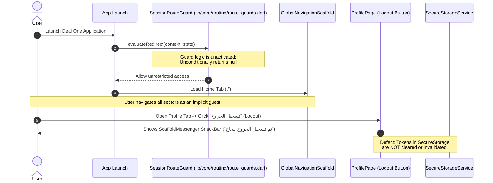

# 09 – Authentication, Security & Permissions Analysis

## 1. Security Feature Implementation Status

The table below classifies the implementation status of all authentication and security mechanisms across the Deal One mobile codebase:

| Security Feature | Implementation Classification | Concrete Evidence in Codebase |
|---|---|---|
| **OTP Verification Flow** | **NOT IMPLEMENTED** | Endpoints declared in `ApiEndpoints`, but no UI screens, controllers, or forms exist |
| **User Registration / Login** | **NOT IMPLEMENTED** | No auth forms or login buttons exist; app boots directly into `GlobalNavigationScaffold` |
| **Token Storage** | **IMPLEMENTED** | `SecureTokenProvider` stores access/refresh tokens in `FlutterSecureStorage` |
| **Token Refresh Mechanism** | **PARTIALLY IMPLEMENTED** | Coded in `AuthInterceptor`, but never executed because HTTP API calls are unwired |
| **Logout Functionality** | **MOCK / HARDCODED** | `ProfilePage` triggers a mock snackbar without clearing secure storage or invalidating tokens |
| **Session Persistence** | **PARTIALLY IMPLEMENTED** | `SessionState` exists in core, but session is never validated against a remote server |
| **Route Protection / Guards** | **PLACEHOLDER** | `SessionRouteGuard` implements `RouteGuard`, but unconditionally returns `null` |
| **Role-Based UI Filtering** | **NOT IMPLEMENTED** | No distinction between Guest, Buyer, Broker, or Contractor roles in the UI |
| **Biometric Authentication** | **NOT IMPLEMENTED** | `local_auth` package is not installed; no fingerprint/FaceID logic exists |
| **Internet Access (Android)**| **CRITICAL DEFECT** | `android.permission.INTERNET` is missing from `android/app/src/main/AndroidManifest.xml` |
| **Camera & Gallery Permissions** | **NOT IMPLEMENTED** | Missing from both `AndroidManifest.xml` and `ios/Runner/Info.plist` |
| **Location Services Permission**| **NOT IMPLEMENTED** | No location runtime permissions declared, despite presence of `flutter_map` |
| **Push Notification Permissions**| **NOT IMPLEMENTED** | No native APNS or FCM notification permissions configured |

---

## 2. Authentication Flow Reality

---

## 3. Cryptographic Token Storage & In-Flight Security

### 3.1 Token Storage Security
- **Class**: [SecureTokenProvider](file:///home/ibrahim-elshishtawy/flutter%20project/market_space/market_space/lib/core/security/secure_token_provider.dart)
- **Engine**: [SecureStorageService](file:///home/ibrahim-elshishtawy/flutter%20project/market_space/market_space/lib/core/storage/secure_storage_service.dart) wrapping `flutter_secure_storage`.
- **Operating System Backends**:
  - **Android**: Uses Android Keystore to encrypt tokens with AES cipher inside `EncryptedSharedPreferences`.
  - **iOS**: Uses Apple Keychain with `kSecAttrAccessibleAfterFirstUnlockThisDeviceOnly`.
- **Audit Assessment**: Token storage design is secure and follows standard enterprise mobile security practices.

### 3.2 In-Flight Transport Security
- **Base URL**: Declared with HTTPS protocol (`https://api.deal-one.com/v1`).
- **TLS Pinning**: **NOT IMPLEMENTED**. `DioApiClient` does not configure a custom `SecurityContext` or `badCertificateCallback` to enforce certificate pinning or public key hashes.
- **Request Tracing**: `RequestIdInterceptor` adds `x-request-id` headers, supporting audit logs and backend security tracing.

---

## 4. Mobile Operating System Permissions Audit

### 4.1 Android Permissions (`android/app/src/main/AndroidManifest.xml`)
Inspection of [AndroidManifest.xml](file:///home/ibrahim-elshishtawy/flutter%20project/market_space/market_space/android/app/src/main/AndroidManifest.xml) reveals:
- **Severe Defect**: The main manifest **completely omits** the `<uses-permission android:name="android.permission.INTERNET"/>` tag.
- While the permission exists in `android/app/src/debug/AndroidManifest.xml` and `android/app/src/profile/AndroidManifest.xml`, any release APK/AAB compiled via `flutter build apk --release` will be denied internet socket access by the Android OS, causing all HTTP requests, tile downloads, and network images to fail silently.
- No declarations for:
  - `android.permission.ACCESS_FINE_LOCATION`
  - `android.permission.READ_MEDIA_IMAGES`
  - `android.permission.CAMERA`

### 4.2 iOS Permissions (`ios/Runner/Info.plist`)
Inspection of [Info.plist](file:///home/ibrahim-elshishtawy/flutter%20project/market_space/market_space/ios/Runner/Info.plist) reveals:
- Missing `NSCameraUsageDescription` (needed for property video reels and listing photos).
- Missing `NSPhotoLibraryUsageDescription` (needed for uploading RFQ attachments or avatar photos).
- Missing `NSLocationWhenInUseUsageDescription` (needed for locating user on the real estate interactive map).
- Attempting to invoke native image pickers or location lookups on iOS will cause immediate application termination by the iOS watchdog.
