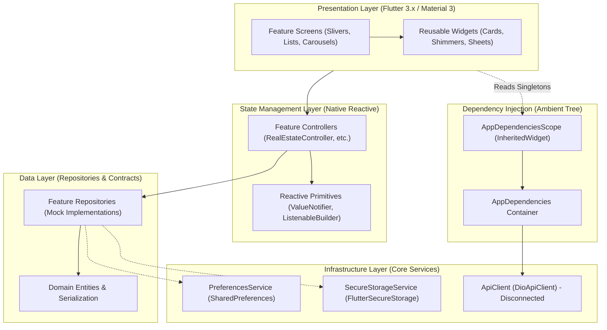
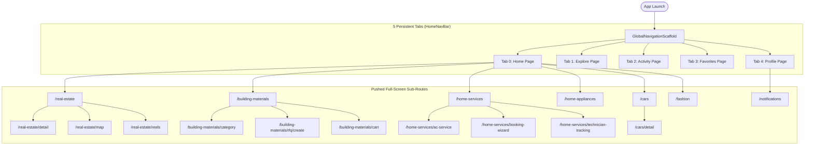
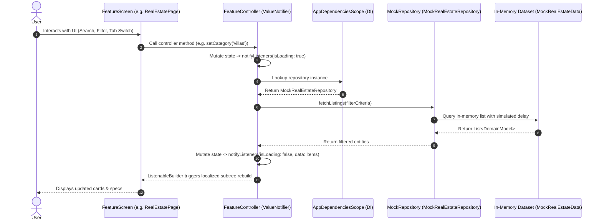
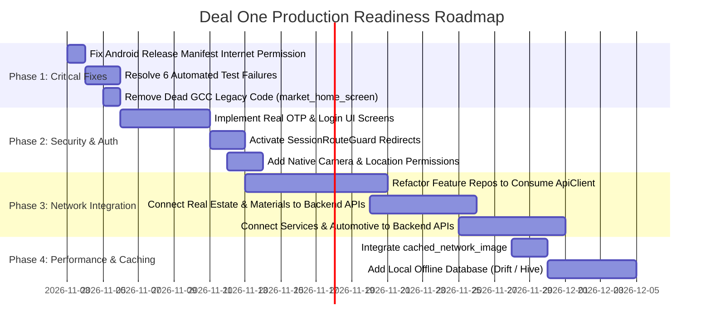

# 11 – Consolidated Mobile System Design Document: Deal One MVP

## 1. Document Overview & Executive Synthesis

This consolidated document synthesizes the architectural reverse-engineering of the **Deal One Mobile Application** (`market_space` MVP). It connects the detailed analyses performed across documents `01` through `10`, presenting a unified technical reference for mobile architects, engineering leads, and backend integration teams.

### Core Documentation Suite Cross-References
- [01 – Mobile System Overview](file:///home/ibrahim-elshishtawy/flutter%20project/market_space/market_space/docs/mobile-system-design/01%20%E2%80%93%20Mobile_System_Overview.md): High-level system overview, technology stack, and architectural style.
- [02 – Flutter Project Structure](file:///home/ibrahim-elshishtawy/flutter%20project/market_space/market_space/docs/mobile-system-design/02%20%E2%80%93%20Flutter_Project_Structure.md): File hierarchy, layer boundaries, and directory responsibilities.
- [03 – Application Modules](file:///home/ibrahim-elshishtawy/flutter%20project/market_space/market_space/docs/mobile-system-design/03%20%E2%80%93%20Application_Modules.md): Comprehensive inventory of all 13 business and utility modules.
- [04 – Navigation and User Flows](file:///home/ibrahim-elshishtawy/flutter%20project/market_space/market_space/docs/mobile-system-design/04%20%E2%80%93%20Navigation_and_User_Flows.md): Route table, GoRouter configuration, and Mermaid journey flows.
- [05 – State Management and Data Flow](file:///home/ibrahim-elshishtawy/flutter%20project/market_space/market_space/docs/mobile-system-design/05%20%E2%80%93%20State_Management_and_Data_Flow.md): `ValueNotifier` reactive lifecycles and sequence diagrams.
- [06 – API Integration Design](file:///home/ibrahim-elshishtawy/flutter%20project/market_space/market_space/docs/mobile-system-design/06%20%E2%80%93%20API_Integration_Design.md): Network infrastructure, Dio client, interceptors, and endpoint inventory.
- [07 – Local Data and Caching](file:///home/ibrahim-elshishtawy/flutter%20project/market_space/market_space/docs/mobile-system-design/07%20%E2%80%93%20Local_Data_and_Caching.md): SharedPreferences, FlutterSecureStorage, and caching analysis.
- [08 – UI/UX Design System](file:///home/ibrahim-elshishtawy/flutter%20project/market_space/market_space/docs/mobile-system-design/08%20%E2%80%93%20UI_UX_Design_System.md): Visual design tokens, themes, typography, and reusable widgets.
- [09 – Authentication and Security](file:///home/ibrahim-elshishtawy/flutter%20project/market_space/market_space/docs/mobile-system-design/09%20%E2%80%93%20Authentication_and_Security.md): Auth status, session guards, and native OS permissions.
- [10 – Mobile Architecture Audit](file:///home/ibrahim-elshishtawy/flutter%20project/market_space/market_space/docs/mobile-system-design/10%20%E2%80%93%20Mobile_Architecture_Audit.md): Technical debt findings, risk matrix, and test failure audit.

---

## 2. Actual System Architecture Summary

The Deal One mobile application is implemented using a **Hybrid Feature-First Layered MVVM** architecture. Rather than introducing external state management frameworks, the application relies on native Flutter mechanisms to maintain a lean, responsive runtime footprint:

---

## 3. Technology Stack Inventory

| Component | Selected Technology | Version | Operational Status |
|---|---|---|---|
| **Language & SDK** | Dart / Flutter | `^3.13.3` | **IMPLEMENTED** |
| **Routing** | `go_router` | `^14.6.2` | **IMPLEMENTED** |
| **Dependency Injection** | `InheritedWidget` (`AppDependenciesScope`) | Native | **IMPLEMENTED** |
| **State Management** | `ValueNotifier<T>`, `ListenableBuilder` | Native | **IMPLEMENTED** |
| **HTTP Networking** | `dio` + 4 Custom Interceptors | `^5.7.0` | **SCAFFOLDED / UNWIRED** |
| **Encrypted Storage** | `flutter_secure_storage` | `^9.2.2` | **IMPLEMENTED** |
| **Preferences Storage** | `shared_preferences` | `^2.3.5` | **IMPLEMENTED** |
| **Map Rendering** | `flutter_map` + `latlong2` | `^7.0.2` / `^0.9.1` | **IMPLEMENTED** (OSM Tiles) |
| **Image Disk Caching** | None (`cached_network_image` absent) | N/A | **NOT IMPLEMENTED** |
| **Relational Database** | None (SQLite/Drift/Hive absent) | N/A | **NOT IMPLEMENTED** |
| **Firebase / Push** | None | N/A | **NOT IMPLEMENTED** |

---

## 4. End-to-End Navigation Architecture

The root navigation shell uses a multi-tab `IndexedStack` inside `GlobalNavigationScaffold`:

---

## 5. Main Data Flow Sequence: UI to In-Memory Repositories

---

## 6. Architecture Strengths vs. Weaknesses

### 6.1 Architectural Strengths
1. **Zero External State Bloat**: Utilizing `ValueNotifier` and `ListenableBuilder` keeps the compiled binary small, avoids framework lock-in, and eliminates the boilerplate commonly associated with BLoC or Redux.
2. **Deep Local Market Domain Modeling**: The models and mock datasets accurately mirror real commercial practices in Egypt (Ezz Steel factory rates, EGP pricing, Cairo/Giza/Delta geographic distribution, AC maintenance check procedures).
3. **Dynamic Section Navigation**: The `SectionNavigationRegistry` enables flexible navigation styling, allowing different commercial sectors to introduce custom floating actions and bottom bars while retaining a single global shell.
4. **Structured Networking Scaffolding**: `DioApiClient` provides a clean foundation with request tracing (`x-request-id`), retry policies with exponential backoff, and 401 token refresh queueing.

### 6.2 Architectural Weaknesses
1. **Network Layer Disconnection**: Repositories do not consume `ApiClient`. The app is an isolated in-memory prototype that cannot communicate with a live backend.
2. **Missing Android Internet Permission**: `android.permission.INTERNET` is omitted from `android/app/src/main/AndroidManifest.xml`, causing release builds to fail all network socket operations.
3. **No Persistent Disk Image Cache**: Absence of `cached_network_image` causes heavy image bandwidth consumption and visual UI flickering across screen navigations.
4. **Lack of Authentication UI & Inactive Route Guards**: `SessionRouteGuard` returns `null` unconditionally, meaning all screens run in unrestricted guest mode with no way for a user to log in or register.
5. **Automated Test Regressions**: 6 out of 182 unit and widget tests fail due to out-of-sync mock datasets and navigation expectations.

---

## 7. Gap Analysis & Transition Roadmap to Production Readiness

### 7.1 Mandatory Fixes (Must be completed before Staging Release)
1. **Add `INTERNET` permission** to `android/app/src/main/AndroidManifest.xml`.
2. **Synchronize automated tests** in `app_bottom_navigation_test.dart` and `real_estate_page_test.dart` to restore 100% CI pass rate.
3. **Inject `ApiClient` into repositories** and wire real HTTP endpoints.
4. **Add `cached_network_image`** to prevent recurring network image re-fetches.
5. **Implement genuine OTP verification and Login UI** and enforce route protection via `SessionRouteGuard`.

### 7.2 Optional Enhancements (Future Releases)
1. **Local Offline Persistence**: Introduce `drift` (SQLite) or `hive` to enable offline viewing of property listings, saved RFQs, and order receipts.
2. **Push Notifications**: Integrate Firebase Cloud Messaging (`firebase_messaging`) to support real-time technician dispatch updates and daily price alerts.
3. **Biometric Authentication**: Integrate `local_auth` for quick fingerprint/FaceID re-authentication.
