# ورك فلو التطبيقات الثلاثة: Deal One

**اسم المنتج:** Deal One
**الإصدار:** 1.0
**التاريخ:** 1 نوفمبر 2026
**الحالة:** مسودة للمراجعة
**المراجع المرتبطة:** Deal_One_System_Design.md، Deal_One_SRS.md، Deal_One_Business_Analysis.md

---

## 0. نظرة عامة على المنتجات الثلاثة

Deal One هيتبنى كـ **تطبيقين موبايل** و**داشبورد إدارة** واحد، كلهم بيتكلموا مع **Backend واحد**.

| المنتج | المستخدم | الغرض الأساسي | المنصة |
|---|---|---|---|
| **تطبيق العميل** | المشتري، المستأجر، المهتم | يلاقي إعلانات، يبحث، يتواصل، يشتري | Android وiOS |
| **تطبيق التاجر** | الفرد اللي بيعلن، الشركة، المصنع، المكتب، المنفذ، المستثمر | ينشر، يدير إعلاناته ومنتجاته، يتابع المهتمين | Android وiOS |
| **داشبورد الإدارة** | فريق الدعم والأدمن | يراجع، يوافق، يدير الحدود والإعدادات والبيانات | ويب |

### 0.1 القاعدة الذهبية
**الشخص الواحد ممكن يكون عميل وتاجر في نفس الوقت.** الحساب الشخصي (User) بيشتغل في التطبيقين، والتطبيق بيعرض له الواجهة حسب الدور اللي فتحه:
- لو دخل من تطبيق العميل: يشوف الإعلانات والبحث والمحادثات.
- لو دخل من تطبيق التاجر: يشوف حساباته والإعلانات والمنتجات والمهتمين.

بس **الحساب التجاري** (Account) ليه تطبيق واحد أساسي هو تطبيق التاجر، وممكن يتشاف من تطبيق العميل كصفحة عرض عامة.

### 0.2 مبادئ مشتركة بين التطبيقين
- التسجيل والدخول واحد، وبيتعمل مرة واحدة.
- Turnstile على الخطوات الحساسة في التطبيقين.
- الحدود اليومية بتتعرض للمستخدم، وبتتحسب بتوقيت القاهرة.
- الإشعارات بتتبعت عبر FCM لكلا التطبيقين.
- كل الصور بتتحول وتتصغر في الـ backend.
- الإعلانات بتمر على الدعم قبل النشر (لا استثناء).

---

## الجزء الأول: تطبيق العميل (المشتري والمستأجر)

### 1.1 المستخدم المستهدف
- شخص عايز يشتري حاجة (عربية، أجهزة، ملابس، أثاث، مواد بناء).
- شخص عايز يستأجر أو يشتري شقة.
- شخص عايز خدمة (مكتب هندسي، صيانة، خدمات منزلية).
- شخص بيتصفح بس ومهتم.

### 1.2 الشاشات الأساسية
| الشاشة | الوظيفة |
|---|---|
| **الرئيسية** | إعلانات مميزة، الأقسام الستة، إعلانات قريبة منك |
| **البحث** | شريط بحث، فلاتر، نتايج |
| **تفاصيل الإعلان** | صور، سعر، وصف، معلومات البائع، زر تواصل |
| **المفضلة** | الإعلانات اللي حفظها |
| **المحادثات** | كل المحادثات الشات |
| **حسابي** | الملف الشخصي، الإعدادات، حدودي اليومية |

Bottom navigation بخمس تبويبات: الرئيسية، البحث، المفضلة، المحادثات، حسابي.

### 1.3 ورك فلو: التسجيل والدخول (العميل)

**المحفّز:** المستخدم بيفتح التطبيق لأول مرة.

1. يشوف الرئيسية مباشرة (تصفح كزائر).
2. لما يحاول يحفظ، يتواصل، أو يعمل مفضلة → يطلب تسجيل دخول.
3. يختار رقم الموبايل أو الإيميل.
4. Turnstile يتحقق.
5. OTP يتبعت، ويدخله المستخدم.
6. الحساب يتنشأ (لو جديد)، والجلسة تتفتح.
7. يرجع للإجراء اللي كان بيعمله (مثلاً يضيف للمفضلة).

**القرارات:**
- المستخدم حاول يتواصل من غير تسجيل → يظهر شاشة تسجيل بس، والبحث والتصفح يفضلوا مفتوحين.
- OTP غلط → رسالة، ومحاولة أخرى.

**النتيجة:** المستخدم داخل بحساب شخصي، ومتصفح بحرية.

### 1.4 ورك فلو: التصفح والبحث

**المحفّز:** المستخدم بيفتح الرئيسية أو البحث.

**الخطوات:**
1. الرئيسية بتعرض: إعلانات مميزة، ثم الأقسام، ثم إعلانات قريبة (لو الـ GPS مسموح).
2. المستخدم يختار قسم أو يكتب كلمة بحث.
3. يضيف فلاتر: المنطقة، نطاق السعر، نوع الإعلان، الحقول الخاصة (مثلاً عدد الغرف).
4. يختار الترتيب: الأحدث، الأقرب، السعر.
5. النتايج بتتعرض بصفحات، مع Skeleton أثناء التحميل.
6. المستخدم يضغط على إعلان.

**القرارات:**
- المستخدم رفض الـ GPS → يتعرض بالمنطقة بس، ويظهر زر "فعّل الموقع" لو عايز يرجع.
- مفيش نتايج → رسالة مع اقتراح توسيع الفلاتر، وخيار حفظ البحث.

**الحالات الإضافية:**
- المستخدم يحفظ البحث → يتلقى تنبيه لما يظهر إعلان جديد (مرحلة ثانية).

### 1.5 ورك فلو: تفاصيل الإعلان

**المحفّز:** المستخدم بيفتح إعلان.

**المعروض:**
- الصور (سوايب)، العنوان، السعر، الوصف.
- الحقول الخاصة بالقسم.
- الموقع على الخريطة (منطقة تقريبية أو الفرع).
- اسم البائع، ونوع الحساب، وحالة التوثيق (متحقق منه أو لا).
- زر القناة حسب إعداد الإعلان:
  - **داخل التطبيق:** زر "تواصل" (يفتح الشات).
  - **خارجي:** زر "واتساب" وزر "اتصال".
- زر المفضلة.
- زر "إبلاغ عن الإعلان".

**القرارات:**
- الإعلان مباع أو منتهي → رسالة واضحة، وزر التواصل مخفي.
- الإعلان بسعر "بالتفاوض" → السعر يظهر كـ "بالتفاوض".

### 1.6 ورك فلو: التواصل من العميل

**أ. التواصل داخل التطبيق (شات):**
1. المستخدم يضغط "تواصل".
2. لو أول مرة لهذا الإعلان: Turnstile.
3. محادثة تنشأ (إعلان + مشتري).
4. المستخدم يكتب ويبعت.
5. حالة الرسالة: مرسلة ← وصلت ← اتقرت.
6. لو البائع رد، إشعار FCM.

**ب. التواصل الخارجي (واتساب أو اتصال):**
1. المستخدم يضغط "واتساب" أو "اتصال".
2. Turnstile (أول مرة لكل إعلان).
3. الحد اليومي لإظهار الرقم يتحسب.
4. الرقم يظهر، ويفتح التطبيق الخارجي.

**القرارات:**
- الحد اليومي للرسايل خلص → رسالة بوقت التجديد.
- المستخدم حظره البائع → الرسالة ماتوصلش، وتظهر له حالة "لم تُسلم".

### 1.7 ورك فلو: المفضلة

**المحفّز:** المستخدم بيضغط القلب على إعلان.

1. الإعلان يتضاف للمفضلة.
2. لو الإعلان اتحذف أو اتباع أو انتهى، يظهر في المفضلة بحالة واضحة، من غير ما يختفي فجأة.
3. المستخدم يقدر يشيل إعلان من المفضلة.
4. لو الإعلان اتغيّر سعره، إشعار (مرحلة ثانية).

### 1.8 ورك فلو: الإبلاغ عن إعلان

**المحفّز:** المستخدم شاف إعلان مشبوه أو مخالف.

1. المستخدم يضغط "إبلاغ".
2. يختار السبب: نصب، محتوى غير لائق، معلومات غلط، إعلان مكرر، أخرى.
3. يكتب تفاصيل (اختياري).
4. البلاغ يتسجل، ويوصل للدعم.
5. المستخدم يشوف رسالة شكر، من غير ما يعرف نتيجة التحقيق.

**القرارات:**
- المستخدم بلّغ على نفس الإعلان أكتر من مرة → البلاغ الأول بس بيتحسب.
- المستخدم بيبلغ كتير جداً → Rate limiting على البلاغات.

### 1.9 ورك فلو: حساب العميل

**الشاشات:** الملف الشخصي، تعديل البيانات، الإعدادات، حدودي اليومية، الإشعارات، الخصوصية، حذف الحساب.

**الإجراءات:**
- تعديل الاسم والصورة.
- تغيير رقم الموبايل (مع تحقق من الرقم الجديد).
- إدارة الإشعارات (أنواعها).
- عرض حدود اليوم: الرسايل المتبقية، وإظهار الأرقام المتبقي.
- حذف الحساب: تأكيد، ثم شرح ما يتحذف، ثم تنفيذ.

**القرارات:**
- المستخدم عنده حساب بيع نشط → الحذف ماينفعش إلا لو الحسابات اتقفلت الأول، أو يتحول لحذف الحساب الشخصي مع الاحتفاظ بالحسابات التجارية لحد قرار الإدارة.

### 1.10 ملاحظات تجربة العميل
- الزائر يشوف كل حاجة ماعدا التواصل والمفضلة.
- الصور تتحمل بالتدريج (Lazy loading).
- الشاشات الفاضية ليها رسائل واضحة وزر يوجه للخطوة الجاية.
- لا يوجد خطوات لتقييم أو مراجعات في النسخة الأولى.

---

## الجزء الثاني: تطبيق التاجر (الحسابات التجارية)

### 2.1 أنواع الحسابات التجارية

| النوع | مين بيسجل | ماذا يعلن | الوثائق المطلوبة | طريقة البيع الافتراضية |
|---|---|---|---|---|
| **فرد (Individual)** | شخص عادي | عربية، أجهزة، ملابس، شقة، أي حاجة شخصية | بطاقة هوية (اختياري في الأول) | تواصل |
| **شركة عقارية (Company)** | وسيط أو مكتب عقاري | وحدات بيع وإيجار، مشاريع | سجل تجاري، بطاقة ضريبية، بطاقة هوية المسؤول | تواصل |
| **مصنع أو موزع (Factory)** | مصنع أو موزع مواد بناء أو كهرباء | منتجات بكميات وأسعار | سجل صناعي أو تجاري، بطاقة ضريبية | تواصل أو دفع أونلاين |
| **مكتب هندسي أو مقدم خدمة (Office)** | مكتب هندسي، صيانة، خدمات منزلية | خدمات ومناطق شغل | سجل تجاري أو ترخيص مزاولة | تواصل |
| **منفذ بيع (Store)** | محل ملابس، أجهزة، قطع غيار | منتجات، فروع، أونلاين | سجل تجاري | تواصل أو دفع أونلاين |
| **مستثمر أو مطور (Investor)** | مطور عقاري أو مستثمر | مشاريع بوحدات متعددة | سجل تجاري، ترخيص مشروع (إن وجد) | تواصل |

> **تحقق مطلوب:** نوع "المستثمر" ما كانش موجود في الـ SRS السابق، وتمت إضافته هنا. لازم تأكيد إنه مطلوب كنوع منفصل، ولا يندمج مع الشركة العقارية.

### 2.2 مصفوفة الصلاحيات حسب نوع الحساب

| الميزة | فرد | شركة عقارية | مصنع | مكتب | منفذ | مستثمر |
|---|---|---|---|---|---|---|
| نشر إعلانات | ✓ | ✓ | ✓ | ✓ | ✓ | ✓ |
| فروع متعددة | ✗ | ✓ | ✓ | ✓ | ✓ | ✓ |
| كتالوج منتجات بالمخزون | ✗ | ✗ | ✓ | ✗ | ✓ | ✗ |
| مشاريع (مجموعات وحدات) | ✗ | ✓ | ✗ | ✗ | ✗ | ✓ |
| مناطق خدمة | ✗ | ✗ | ✗ | ✓ | ✗ | ✗ |
| أعضاء فريق | ✗ | ✓ | ✓ | ✓ | ✓ | ✓ |
| دفع أونلاين | ✗ | ✗ | ✓ | ✗ | ✓ | ✗ |
| حد إعلانات يومي أعلى | ✗ | ✓ | ✓ | ✓ | ✓ | ✓ |
| صفحة تعريفية عامة | ✗ | ✓ | ✓ | ✓ | ✓ | ✓ |
| تقارير المشاهدات والمهتمين | ✗ | ✓ | ✓ | ✓ | ✓ | ✓ |

**ملاحظة:** الحدود الرقمية للحد اليومي بتتحدد من الأدمن لكل نوع. الجدول ده بيوضح الصلاحيات، مش الأرقام.

### 2.3 الشاشات الأساسية
| الشاشة | الوظيفة |
|---|---|
| **الرئيسية (لوحة التاجر)** | ملخص: إعلانات نشطة، مهتمين جدد، رسايل غير مقروءة، حالة الموافقات |
| **الإعلانات** | كل الإعلانات بحالاتها، مع فلترة وبحث |
| **إضافة إعلان** | فورم حسب القسم والحقول |
| **المنتجات** (للمصنع والمنفذ) | كتالوج بالمخزون والأسعار |
| **المشاريع** (للشركة والمستثمر) | مجموعات وحدات تحت مشروع واحد |
| **الفروع** | قائمة الفروع وعناوينها وإحداثياتها |
| **المحادثات** | الشات الوارد |
| **التقارير** | المشاهدات، والمهتمين، والتواصل |
| **الحساب** | بيانات الحساب، طريقة البيع، الأعضاء، الوثائق، الإعدادات |
| **حدودي اليومية** | الاستخدام والحد |

Bottom navigation بخمس تبويبات: الرئيسية، الإعلانات، إضافة، المحادثات، الحساب. (المنتجات والمشاريع والفروع تتفتح من داخل الحساب أو الإعلانات حسب النوع.)

### 2.4 ورك فلو: إنشاء حساب تجاري

**المحفّز:** المستخدم عايز يعلن كتاجر.

1. من الحساب الشخصي، يختار "إنشاء حساب تجاري".
2. يختار نوع الحساب (من الجدول فوق).
3. يحدد الاسم التجاري والوصف والشعار.
4. يختار طريقة البيع الافتراضية:
   - لو النوع يسمح بالاتنين (مصنع، منفذ): يختار دفع أونلاين أو تواصل.
   - لو النوع تواصل فقط: الاختيار مش متاح.
5. يضيف الفروع (لو النوع يسمح): العنوان، المنطقة، الموقع.
6. يضيف مناطق الخدمة (لو مكتب).
7. يرفع الوثائق حسب النوع.
8. يراجع البيانات ويرسل.
9. الحساب يدخل `pending`، ومعاه إشعار: "طلبك قيد المراجعة".

**القرارات:**
- نوع فرد → وثيقة هوية بس.
- الوثائق ناقصة → زر الإرسال مش بيتفعل، والرسالة توضح الناقص.
- المستخدم عنده حساب مرفوض قبل كده → يظهر سبب الرفض، ويقدر يعدل ويرسل من جديد.

**النتيجة:** حساب تجاري في `pending`.

### 2.5 ورك فلو: حالة التوثيق بعد الإرسال

| الحالة | ماذا يرى التاجر | ماذا يحدث للإعلانات |
|---|---|---|
| **pending** | شاشة انتظار، وتقدير وقت المراجعة | الإعلانات بتتحفظ كمسودات، ومش بتتنشر |
| **approved** | رسالة ترحيب، وزر "أضف إعلانك الأول" | الإعلانات بتتراجع وتنشر |
| **rejected** | سبب الرفض، وزر "عدّل وأرسل" | مفيش إعلانات منشورة |
| **suspended** | رسالة توقف، وزر التواصل مع الدعم | الإعلانات مخفية |

### 2.6 ورك فلو: إضافة إعلان (التاجر)

**المحفّز:** التاجر عايز ينشر إعلان.

1. يختار "إضافة إعلان".
2. يختار القسم والقسم الفرعي.
3. الفورم يتعرض حسب حقول القسم.
4. يدخل العنوان والوصف.
5. السعر:
   - حساب على دفع أونلاين: السعر إلزامي.
   - حساب على تواصل: السعر اختياري (يقدر يكتب "بالتفاوض").
6. يختار نوع الإعلان (بيع، إيجار، منتج، خدمة، صيانة، قطع غيار حسب القسم).
7. يختار الفرع، أو الموقع (لو مكتب بمناطق خدمة، يختار المناطق).
8. يختار قناة التواصل: داخل التطبيق أو خارجي (واتساب أو اتصال، مع الرقم).
9. يرفع الصور (من 1 لحد 10، والصورة الأولى هي الرئيسية).
10. يحفظ كمسودة، أو يرسل للمراجعة.
11. Turnstile يتحقق عند الإرسال.
12. الإعلان يدخل `pending`.

**القرارات:**
- حساب دفع أونلاين والسعر فاضي → الحقل إلزامي.
- قسم المنتجات (للمصنع أو المنفذ) → الكمية إلزامية.
- الحد اليومي خلص → رسالة بوقت التجديد، والمسودة تتحفظ.
- الإعلان مكرر → تحذير، ويتحول للمراجعة اليدوية.

### 2.7 ورك فلو: إدارة المنتجات (للمصنع والمنفذ)

**المحفّز:** التاجر عايز يدير كتالوج منتجاته.

1. يفتح "المنتجات".
2. يضيف منتج: اسم، وصف، صور، قسم، سعر، كمية متاحة، وحدة (قطعة، متر، كيس، إلخ).
3. كل منتج بيتعامل كإعلان مستقل بيمر على الدعم، أو كمجموعة بتتراجع مرة واحدة (يحدد الأدمن).
4. التاجر يعدل الكمية والسعر بسرعة من غير ما يتعاد للمراجعة لو التعديل ضمن حدود معينة (يحدد الأدمن).
5. لما الكمية تخلص، المنتج يتحول لـ "غير متوفر" تلقائياً، ويتخفي من الدفع.

**القرارات:**
- الكمية صفر → المنتج "غير متوفر".
- التعديل على السعر بنسبة كبيرة → رجوع للمراجعة.

### 2.8 ورك فلو: إدارة المشاريع (للشركة والمستثمر)

**المحفّز:** التاجر عايز يعرض مشروع بوحدات كتير.

1. ينشئ "مشروع" بالاسم والموقع والوصف والصور العامة.
2. يضيف وحدات تحت المشروع، كل وحدة بتتعامل كإعلان مستقل (شقة، فيلا، محل).
3. ممكن يضيف مواعيد تسليم وحالة المشروع (تحت الإنشاء، جاهز).
4. المشروع يتراجع من الدعم مرة واحدة، والوحدات بتتراجع معاه أو بعدين حسب الإعدادات.
5. لو وحدة اتباعت، الحالة بتتحدث في المشروع تلقائياً.

**القرارات:**
- المشروع اتعدل بشكل جوهري → يرجع للمراجعة.
- وحدة اتضافت لمشروع منشور → تتراجع منفصل.

### 2.9 ورك فلو: إدارة الفروع

**المحفّز:** التاجر عايز يضيف أو يعدل فرع.

1. يفتح "الفروع" ويضيف فرع.
2. يدخل: اسم الفرع، العنوان، المنطقة، الموقع على الخريطة، ساعات العمل، أرقام التواصل.
3. الفرع يتحفظ، ويتقدر يستخدمه في الإعلانات.
4. تعديل عنوان الفرع يأثر على الإعلانات المرتبطة به (يعرض رسالة تأكيد).
5. حذف فرع فيه إعلانات منشورة → لازم ينقل الإعلانات لفرع تاني أو يتخفوا.

### 2.10 ورك فلو: مناطق الخدمة (للمكتب الهندسي ومقدم الخدمة)

**المحفّز:** مكتب عايز يحدد المناطق اللي بيشتغل فيها.

1. يضيف مناطق من القائمة (المنطقة الإدارية).
2. ممكن يضيف نصف قطر حول موقع المكتب.
3. الخدمة تظهر للمستخدمين اللي في المناطق دي، والبحث بالـ GPS بيأخذها في الاعتبار.

### 2.11 ورك فلو: التواصل من التاجر

**المحفّز:** وصلت رسالة أو مهتم.

1. التاجر يفتح "المحادثات".
2. يشوف المحادثات مرتبة بالأحدث، مع عدد الرسايل غير المقروءة.
3. يفتح المحادثة، ويرد.
4. لو الإعلان قناته خارجي، التاجر يشوف إشعار "مهتم اتصل بالرقم" (بدون محادثة).
5. التاجر يقدر يقفل المحادثة أو يحدد إنها "تمت" أو "ملغاة" (لأغراض التقارير).

**القرارات:**
- التاجر متأخر في الرد → تنبيه، ومؤشر على الإعلان.

### 2.12 ورك فلو: تقارير التاجر

**المعروض:**
- عدد المشاهدات لكل إعلان، لكل يوم، ولكل أسبوع.
- عدد المحادثات الجديدة.
- عدد مرات إظهار الرقم.
- نسبة الإعلانات اللي اتباعت.
- أفضل الإعلانات أداءً.

**القرارات:**
- التقارير الأساسية متاحة لكل الحسابات، والتقارير التفصيلية للحسابات المدفوعة (المرحلة الثانية).

### 2.13 ورك فلو: تغيير طريقة البيع

**المحفّز:** التاجر عايز يغير طريقة البيع.

1. يفتح الحساب ← طريقة البيع.
2. يختار الطريقة الجديدة (لو النوع بيسمح).
3. النظام يحسب عدد الإعلانات اللي هتتأثر (إعلانات بدون سعر ثابت، منتجات بدون كمية).
4. يظهر تحذير واضح بالعدد.
5. التاجر يؤكد.
6. التغيير يطبق فوراً.
7. الطلبات والمحادثات القديمة تكمل بالطريقة القديمة.

### 2.14 ورك فلو: أعضاء الفريق (الشركات والمصانع والمكاتب)

**المحفّز:** التاجر عايز يضيف موظف يدير الحساب.

1. يدعو الموظف برقم الموبايل أو الإيميل.
2. الموظف يقبل الدعوة من تطبيقه.
3. يختار الصلاحية: مدير (كل شيء)، إعلانات (نشر وتعديل)، محادثات (رد فقط).
4. التاجر يقدر يشيل الموظف في أي وقت.
5. كل عملية بتتسجل باسم الموظف اللي عملها.

**القرارات:**
- الموظف ما عندوش الصلاحية → زرار مش ظاهر أو رسالة رفض.

### 2.15 ورك فلو: حدود التاجر اليومية

**المعروض:** إعلانات اليوم (المستخدم من الحد)، رسايل اليوم، إظهارات الرقم، ووقت التجديد (منتصف الليل بتوقيت القاهرة).

**القرارات:**
- وصل 80% من الحد → إشعار داخل التطبيق.
- وصل الحد → رسالة واضحة مع وقت التجديد، والمسودات تتحفظ.

---

## الجزء الثالث: داشبورد الإدارة

### 3.1 الأدوار والصلاحيات

| الشاشة | دعم | أدمن |
|---|---|---|
| الرئيسية | ✓ | ✓ |
| الإعلانات قيد المراجعة | ✓ | ✓ |
| الحسابات والتوثيق | ✓ | ✓ |
| البلاغات | ✓ | ✓ |
| الأقسام والحقول | عرض | تعديل |
| المناطق | عرض | تعديل |
| الحدود اليومية | عرض | تعديل |
| الإعدادات | ✗ | ✓ |
| إدارة الأدوار | ✗ | ✓ |
| السجلات | عرض لنفسه | عرض كامل |

### 3.2 الشاشات الأساسية

#### أ. الرئيسية (لوحة المتابعة)

```
┌──────────────────────────────────────────────────────────────┐
│ Deal One الإدارة            [بحث]          [الدعم: أحمد ▾]   │
├──────────┬───────────────────────────────────────────────────┤
│ الرئيسية │  بطاقات KPI                                      │
│ الإعلانات│  ┌──────────┐┌──────────┐┌──────────┐┌──────────┐ │
│  - قيد    │  │ قيد      ││ حسابات   ││ بلاغات   ││ إعلانات  │ │
│    المراجعة│  │ المراجعة ││ جديدة    ││ مفتوحة   ││ اليوم    │ │
│ الحسابات │  │   124    ││   18     ││   7      ││   342    │ │
│ البلاغات │  └──────────┘└──────────┘└──────────┘└──────────┘ │
│ الأقسام  │                                                  │
│ المناطق  │  رسم: الإعلانات الجديدة (آخر 30 يوم)              │
│ الحدود   │  ──────────────────────────────────────────────  │
│ الإعدادات│                                                  │
│ السجلات  │  أعلى الأقسام نشاطاً        أعلى المناطق نشاطاً   │
│ الأدوار  │  ─────────────────          ─────────────────     │
│          │                                                  │
└──────────┴──────────────────────────────────────────────────┘
```

**المعروض:**
- بطاقات: إعلانات قيد المراجعة، حسابات جديدة، بلاغات مفتوحة، إعلانات اليوم.
- رسم للإعلانات الجديدة (آخر 30 يوم).
- أعلى الأقسام والمناطق نشاطاً.
- متوسط وقت المراجعة (لتتبع الـ SLA).
- تنبيهات: إعلانات متأخرة في المراجعة، ارتفاع مفاجئ في البلاغات، ارتفاع فشل Turnstile.

#### ب. الإعلانات قيد المراجعة (أهم شاشة)

```
┌──────────────────────────────────────────────────────────────┐
│ قيد المراجعة (124)   [قسم ▾] [منطقة ▾] [الأقدم أولاً ▾]        │
├──────────────────────────────────────────────────────────────┤
│ ┌────────────────────────────────────┐ ┌────────────────────┐ │
│ │ شقة 3 غرف للإيجار - مدينة نصر      │ │ تفاصيل              │ │
│ │ منذ 2 ساعة · شركة النور العقارية   │ │ ───────────────     │ │
│ │ [صورة] [صورة] [صورة] [+3]          │ │ القسم: عقارات       │ │
│ │                                    │ │ السعر: 8,000 ج      │ │
│ │ تنبيهات: إعلان مشابه (2)           │ │ الحقول: ...         │ │
│ └────────────────────────────────────┘ │ المنطقة: ...        │ │
│                                        │                     │ │
│                                        │ [موافقة] [رفض ▾]     │ │
│                                        │                     │ │
│                                        │ سبب الرفض:          │ │
│                                        │ ○ بيانات غير صحيحة   │ │
│                                        │ ○ صور غير مناسبة     │ │
│                                        │ ○ قسم خاطئ          │ │
│                                        │ ○ مكرر              │ │
│                                        │ ○ أخرى: [نص حر]     │ │
│                                        └────────────────────┘ │
└──────────────────────────────────────────────────────────────┘
```

**الإجراءات:**
- موافقة، أو رفض مع سبب من قائمة أو نص حر.
- تحويل لموظف أعلى (تصعيد).
- تعليق داخلي (لا يظهر للبائع).
- فتح ملف الحساب.

**التنبيهات:** إعلانات مشابهة (تكرار)، إعلانات من حسابات جديدة، إعلانات فيها كلمات مشبوهة.

**SLA:** الإعلانات اللي تجاوزت 24 ساعة بتظهر بلون مختلف.

#### ج. الحسابات والتوثيق

```
┌──────────────────────────────────────────────────────────────┐
│ الحسابات   [بحث]   [نوع ▾] [الحالة ▾: قيد التوثيق]             │
├──────────────────────────────────────────────────────────────┤
│ الاسم                 النوع      الحالة       تاريخ الطلب      │
│ شركة النور العقارية   شركة       قيد التوثيق    1 نوفمبر       │
│ معرض الأمل للأثاث    منفذ        قيد التوثيق    31 أكتوبر      │
│ ...                                                          │
└──────────────────────────────────────────────────────────────┘
```

**عند فتح حساب:**
- البيانات الأساسية.
- الوثائق المرفوعة (عرض آمن).
- الإعلانات المرتبطة به.
- سجل القرارات.
- إجراءات: توثيق، رفض (مع سبب)، تعليق، إعادة طلب وثائق.

#### د. البلاغات

```
┌──────────────────────────────────────────────────────────────┐
│ البلاغات (7)   [الحالة ▾: مفتوح]   [السبب ▾]                  │
├──────────────────────────────────────────────────────────────┤
│ إعلان: "سيارة بسعر مغري"   السبب: نصب   عدد البلاغات: 4        │
│ إعلان: "شقة للبيع"          السبب: مكرر  عدد البلاغات: 1        │
└──────────────────────────────────────────────────────────────┘
```

**الإجراءات:** مراجعة الإعلان المبلغ عنه، إخفاء مؤقت، إزالة، تحذير للبائع، رفض البلاغ.

**القاعدة:** لو إعلان اتبلغ عنه عدد معين من المستخدمين في وقت قصير، يتخفي تلقائياً لحد المراجعة.

#### هـ. الأقسام والحقول (للأدمن)

```
┌──────────────────────────────────────────────────────────────┐
│ الأقسام                                                       │
│ ▸ العقارات                                                    │
│    ▸ شقق للبيع                                                │
│       الحقول: المساحة (رقم، إلزامي) · عدد الغرف (رقم)          │
│       [تعديل] [إضافة حقل] [تعطيل القسم]                         │
│    ▸ شقق للإيجار                                               │
│ ▸ مواد البناء والكهرباء                                        │
│ ▸ الخدمات                                                     │
│ ▸ الأجهزة المنزلية والديكور                                    │
│ ▸ السيارات                                                    │
│ ▸ الملابس والإكسسوارات                                         │
└──────────────────────────────────────────────────────────────┘
```

**الإجراءات:** إضافة قسم فرعي، تعديل حقول، تعطيل قسم، ترتيب الأقسام.

#### و. المناطق (للأدمن)
- قائمة المناطق مرتبة حسب المدينة.
- إضافة منطقة بالاسم والإحداثيات.
- دمج منطقتين، أو تعطيل منطقة.

#### ز. الحدود اليومية (للأدمن)

```
┌──────────────────────────────────────────────────────────────┐
│ الحدود اليومية                                                │
│                                                              │
│ نوع الحساب     إعلانات   رسايل    إظهار الرقم               │
│ فرد            [  5 ]    [ 50 ]   [ 10 ]                     │
│ شركة عقارية    [ 50 ]    [200 ]   [100 ]                     │
│ مصنع           [ 30 ]    [150 ]   [ 80 ]                     │
│ مكتب           [ 20 ]    [100 ]   [ 50 ]                     │
│ منفذ           [ 30 ]    [150 ]   [ 80 ]                     │
│ مستثمر         [ 50 ]    [200 ]   [100 ]                     │
│                                                              │
│ [حفظ التغييرات]   (يتطبق فوراً)                               │
│                                                              │
│ استثناءات حسابات معينة: [بحث عن حساب]                         │
└──────────────────────────────────────────────────────────────┘
```

**القيم في الشاشة دي تجريبية، والأدمن هو اللي بيحدد الأرقام الفعلية.**

**المعروض مع الحد:** متوسط الاستخدام لكل نوع حساب، والحسابات اللي بتوصل للحد بانتظام (مؤشر لو الحد قليل).

#### ح. الإعدادات (للأدمن)
- مدة الإعلان (بالأيام).
- عدد الصور المسموح.
- مدة الـ OTP ومحاولاته.
- حد البلاغات التلقائي للإخفاء.
- SLA المراجعة (بالساعات).
- الإشعارات الافتراضية.
- قائمة الكلمات الممنوعة.

**كل تغيير بيتسجل في السجلات.**

#### ط. السجلات
- كل قرار دعم وأدمن (موافقة، رفض، توثيق، تعليق).
- كل تغيير في الحدود والإعدادات والأقسام.
- كل تسجيل دخول للوحة الإدارة.
- فلترة بالتاريخ والموظف والنوع، وتصدير CSV.

#### ي. الأدوار
- إضافة موظف جديد بإيميل.
- تحديد الدور: دعم أو أدمن.
- تعطيل موظف (من غير حذف، عشان السجل يفضل).

### 3.3 ورك فلو الدعم اليومي

**المحفّز:** بداية الوردية.

1. الموظف يسجل دخول.
2. يفتح قائمة الإعلانات قيد المراجعة، مرتبة بالأقدم.
3. يراجع إعلان إعلان: المحتوى، الصور، القسم، التكرار.
4. يقرر: موافقة، أو رفض مع سبب، أو تصعيد.
5. يراجع البلاغات المفتوحة.
6. يراجع الحسابات قيد التوثيق.
7. آخر الوردية: مراجعة الإعلانات المتأخرة، وتسليم للوردية الجاية.

### 3.4 ورك فلو تصعيد الحالات

```
موظف دعم
  ├── حالة عادية → يقرر
  ├── حالة مشكوك فيها → تصعيد لمشرف
  │                        ├── يقرر
  │                        └── تصعيد للأدمن (احتيال، قانوني)
  └── حالة حرجة (احتيال كبير، بلاغ قانوني) → أدمن مباشرة
```

### 3.5 ورك فلو الأدمن: إدارة الحدود

1. الأدمن يفتح صفحة الحدود.
2. يشوف متوسط الاستخدام لكل نوع حساب.
3. يعدل القيمة.
4. النظام يعرض تأثير التغيير (كم حساب هيتأثر).
5. الأدمن يؤكد.
6. التغيير يتطبق فوراً، ويتسجل.

### 3.6 ورك فلو الأدمن: تعطيل حساب

1. يفتح الحساب ويراجع الإعلانات والبلاغات والسجل.
2. يختار "تعليق" أو "حظر".
3. يكتب السبب (إلزامي).
4. الحساب يتعطل، والإعلانات تتخفي فوراً.
5. الجلسات تتلغي.
6. القرار يتسجل ويظهر لصاحب الحساب.

---

## الجزء الرابع: قاعدة البيانات (التخطيط)

### 4.1 الجداول الجديدة والمعدلة عن النسخة السابقة

| الجدول | الجديد؟ | الغرض |
|---|---|---|
| `users` | معدل | أضيف `is_active` |
| `accounts` | معدل | أضيف نوع `investor`، و`status` (pending/approved/rejected/suspended) |
| `account_members` | **جديد** | أعضاء فريق الحساب وصلاحياتهم |
| `branches` | معدل | ساعات العمل |
| `service_areas` | **جديد** | مناطق خدمة المكتب (`office`) |
| `projects` | **جديد** | مشاريع المستثمر والشركة |
| `listings` | معدل | `project_id` اختياري، `stock_quantity` للمنتجات، `view_count` |
| `products` | **جديد** | كتالوج المنتجات للمصنع والمنفذ (مرتبط بإعلان) |
| `favorites` | **جديد** | مفضلة المستخدم |
| `saved_searches` | **جديد** | عمليات بحث محفوظة (مرحلة ثانية) |
| `reports` | **جديد** | بلاغات المستخدمين على الإعلانات |
| `notifications` | **جديد** | الإشعارات الداخلية (لعرضها في التطبيق) |
| `listing_stats_daily` | **جديد** | إحصائيات يومية (مشاهدات، إظهار رقم) |
| `staff_users` | **جديد** | موظفو الدعم والأدمن (منفصلين عن المستخدمين) |
| `staff_roles` | **جديد** | الأدوار والصلاحيات للموظفين |

### 4.2 مخطط العلاقات (ERD)

```mermaid
erDiagram
  USERS ||--o{ ACCOUNTS : owns
  USERS ||--o{ ACCOUNT_MEMBERS : joins
  ACCOUNTS ||--o{ ACCOUNT_MEMBERS : has
  ACCOUNTS ||--o{ BRANCHES : has
  ACCOUNTS ||--o{ PROJECTS : publishes
  ACCOUNTS ||--o{ LISTINGS : publishes
  ACCOUNTS ||--o{ SERVICE_AREAS : covers
  ACCOUNTS ||--o{ DAILY_QUOTAS : tracked_in
  PROJECTS ||--o{ LISTINGS : groups
  BRANCHES |o--o{ LISTINGS : shown_at
  AREAS ||--o{ BRANCHES : located_in
  AREAS ||--o{ LISTINGS : located_in
  AREAS ||--o{ SERVICE_AREAS : covered
  CATEGORIES ||--o{ CATEGORIES : parent_of
  CATEGORIES ||--o{ CATEGORY_FIELDS : defines
  CATEGORIES ||--o{ LISTINGS : classifies
  LISTINGS ||--o{ LISTING_VALUES : has
  CATEGORY_FIELDS ||--o{ LISTING_VALUES : described_by
  LISTINGS ||--o{ MEDIA : shows
  LISTINGS ||--o{ PRODUCTS : contains
  LISTINGS ||--o{ FAVORITES : saved_in
  LISTINGS ||--o{ REPORTS : reported_in
  LISTINGS ||--o{ CONVERSATIONS : discussed_in
  LISTINGS ||--o{ LISTING_STATS_DAILY : measured_in
  USERS ||--o{ FAVORITES : saves
  USERS ||--o{ SAVED_SEARCHES : creates
  USERS ||--o{ REPORTS : files
  USERS ||--o{ NOTIFICATIONS : receives
  USERS ||--o{ USER_DEVICES : signs_in_with
  USERS ||--o{ CONVERSATIONS : starts
  CONVERSATIONS ||--o{ MESSAGES : contains
  LISTINGS ||--o{ ORDERS : sold_via
  USERS ||--o{ ORDERS : buys
  ORDERS ||--o| PAYMENTS : paid_by
  STAFF_USERS ||--o{ MODERATION_LOG : decides
  STAFF_USERS }o--|| STAFF_ROLES : has
  LISTINGS ||--o{ MODERATION_LOG : reviewed_in
  ACCOUNTS ||--o{ MODERATION_LOG : verified_in
  REPORTS ||--o{ MODERATION_LOG : resolved_in
  SETTINGS ||--o{ AUDIT_LOG : changed_in
  STAFF_USERS ||--o{ AUDIT_LOG : acts_in

  USERS {
    uuid id PK
    string phone
    string email
    string password_hash
    string full_name
    bool is_active
    timestamp created_at
  }
  ACCOUNTS {
    uuid id PK
    uuid owner_user_id FK
    string account_type "individual, company, factory, office, store, investor"
    string display_name
    string status "pending, approved, rejected, suspended"
    string sales_mode "contact, online_payment"
    timestamp created_at
  }
  ACCOUNT_MEMBERS {
    uuid id PK
    uuid account_id FK
    uuid user_id FK
    string role "manager, lister, responder"
    timestamp invited_at
  }
  BRANCHES {
    uuid id PK
    uuid account_id FK
    uuid area_id FK
    string address
    float lat
    float lng
    string working_hours
  }
  SERVICE_AREAS {
    uuid id PK
    uuid account_id FK
    uuid area_id FK
    int radius_km
  }
  PROJECTS {
    uuid id PK
    uuid account_id FK
    string name
    string status "under_construction, ready"
    date delivery_date
    string description
  }
  AREAS {
    uuid id PK
    string city
    string name
    float lat
    float lng
  }
  CATEGORIES {
    uuid id PK
    uuid parent_id FK
    string name
    string slug
    bool is_active
  }
  CATEGORY_FIELDS {
    uuid id PK
    uuid category_id FK
    string key
    string label
    string field_type "text, number, select, bool"
    bool required
  }
  LISTINGS {
    uuid id PK
    uuid account_id FK
    uuid project_id FK
    uuid category_id FK
    uuid area_id FK
    uuid branch_id FK
    string title
    decimal price
    string listing_kind "sale, rent, buy, product, service, parts, repair"
    string contact_channel "in_app, external"
    string status "draft, pending, approved, rejected, sold, expired, hidden, removed"
    int view_count
    float lat
    float lng
    timestamp approved_at
    timestamp expires_at
  }
  LISTING_VALUES {
    uuid id PK
    uuid listing_id FK
    uuid field_id FK
    string value
  }
  PRODUCTS {
    uuid id PK
    uuid listing_id FK
    string unit "piece, meter, bag, kg"
    int stock_quantity
    bool is_available
  }
  MEDIA {
    uuid id PK
    uuid listing_id FK
    string url
    int sort_order
  }
  FAVORITES {
    uuid id PK
    uuid user_id FK
    uuid listing_id FK
    timestamp created_at
  }
  SAVED_SEARCHES {
    uuid id PK
    uuid user_id FK
    string filters_json
    bool notify
  }
  REPORTS {
    uuid id PK
    uuid listing_id FK
    uuid user_id FK
    string reason "scam, inappropriate, false_info, duplicate, other"
    string status "open, resolved, dismissed"
    timestamp created_at
  }
  LISTING_STATS_DAILY {
    uuid id PK
    uuid listing_id FK
    date day
    int views
    int contact_reveals
    int conversations
  }
  CONVERSATIONS {
    uuid id PK
    uuid listing_id FK
    uuid buyer_id FK
    uuid account_id FK
    string status "open, closed, done, cancelled"
    timestamp created_at
  }
  MESSAGES {
    uuid id PK
    uuid conversation_id FK
    uuid sender_id FK
    text body
    timestamp sent_at
    timestamp delivered_at
    timestamp read_at
  }
  NOTIFICATIONS {
    uuid id PK
    uuid user_id FK
    string type
    string title
    string body
    bool is_read
    timestamp created_at
  }
  USER_DEVICES {
    uuid id PK
    uuid user_id FK
    string fcm_token
    string platform "android, ios"
    timestamp last_seen_at
  }
  DAILY_QUOTAS {
    uuid id PK
    uuid account_id FK
    string quota_type "listings, messages, contact_reveal"
    date day
    int used_count
    int limit_snapshot
  }
  ORDERS {
    uuid id PK
    uuid listing_id FK
    uuid buyer_id FK
    decimal amount
    string status
  }
  PAYMENTS {
    uuid id PK
    uuid order_id FK
    string provider
    string provider_ref
    string status
  }
  STAFF_USERS {
    uuid id PK
    string email
    string password_hash
    uuid role_id FK
    bool is_active
  }
  STAFF_ROLES {
    uuid id PK
    string name "support, admin"
    string permissions_json
  }
  MODERATION_LOG {
    uuid id PK
    uuid staff_id FK
    string target_type "listing, account, report"
    uuid target_id
    string action "approve, reject, suspend, remove, hide, verify"
    text note
    timestamp created_at
  }
  SETTINGS {
    string key PK
    string value
    string scope "global, account_type"
    uuid updated_by FK
    timestamp updated_at
  }
  AUDIT_LOG {
    uuid id PK
    string actor_type "user, staff, system"
    uuid actor_id
    string action
    string target_type
    uuid target_id
    json before_value
    json after_value
    timestamp created_at
  }
```



### 4.3 ملاحظات على التصميم
- **`staff_users` منفصل عن `users`:** علشان موظفي الدعم ما يتخلطوش مع المستخدمين العاديين، ولتسجيل دخول منفصل ومحمي للوحة الإدارة.
- **`account_members`:** يسمح بفريق عمل داخل الحساب، وكل عملية تتسجل باسم الموظف.
- **`projects`:** مجموعة وحدات تحت اسم واحد، والوحدة (listing) بتتبع المشروع اختيارياً.
- **`products`:** الكمية والوحدة بتتخزن هنا، والـ listing يفضل هو وحدة النشر والمراجعة.
- **`listing_stats_daily`:** إحصائيات مجمعة يومياً عشان ما نحملش الـ DB بكتابة مشاهدات لحظية.
- **`audit_log`:** سجل شامل لكل التغييرات الحساسة، منفصل عن `moderation_log` اللي خاص بقرارات الإعلانات والحسابات.
- **`notifications`:** مخزنة في الـ DB عشان تظهر داخل التطبيق حتى لو الإشعار الخارجي فات.
- **الـ IDs كلها UUID**، والوقت بـ UTC، والعرض بتوقيت القاهرة.

---

## الجزء الخامس: مصفوفة الربط بين التطبيقات والداشبورد

| الإجراء | من يبدأه | أين يظهر | من يوافق |
|---|---|---|---|
| إنشاء حساب تجاري | التاجر (تطبيق التاجر) | الداشبورد: الحسابات | الدعم |
| نشر إعلان | التاجر | الداشبورد: قيد المراجعة | الدعم |
| إبلاغ عن إعلان | العميل (تطبيق العميل) | الداشبورد: البلاغات | الدعم |
| تعديل حد يومي | الأدمن (الداشبورد) | التطبيقين (عرض الحد) | الأدمن |
| تعطيل حساب | الأدمن (الداشبورد) | التطبيقين (رسالة للمستخدم) | الأدمن |
| تغيير طريقة البيع | التاجر | الداشبورد: السجل | تلقائي |
| إضافة موظف فريق | التاجر | لا يظهر للدعم | تلقائي (بالدعوة) |

---

## الجزء السادس: نقاط محتاجة قرار

1. **المستثمر (Investor):** هل نوع منفصل ولا يندمج مع الشركة العقارية؟
2. **المنتجات:** هل كل منتج إعلان مستقل بيتراجع، ولا المنتجات بتتراجع كمجموعة؟ والتعديل السريع للكمية والسعر، ما هي الحدود اللي تسمح بيه من غير مراجعة؟
3. **المشاريع:** هل الوحدات بتتراجع مع المشروع، ولا كل وحدة لوحدها؟
4. **أعضاء الفريق:** هل نبدأ بيهم في النسخة الأولى، ولا في المرحلة الثانية؟
5. **حذف الحساب الشخصي** عندما يكون عنده حساب تجاري: نقرر سياسة الحذف (تعليق، أو نقل ملكية، أو حذف مع الإعلانات).
6. **الإخفاء التلقائي بالبلاغات:** كام بلاغ في كام ساعة يخفي الإعلان تلقائياً؟
7. **تطبيق منفصل للتاجر** ولا تطبيق واحد بتبديل وضع (مع الفرق في الـ Store listing والمراجعة).
8. **صلاحيات الدعم والأدمن في الحدود:** هل الدعم يقدر يطلع استثناء لحساب معين، ولا الأدمن بس؟

---

## سجل التعديلات

| الإصدار | التاريخ | الوصف |
|---|---|---|
| 1.0 | 1 نوفمبر 2026 | المسودة الأولى لورك فلو التطبيقين والداشبورد وقاعدة البيانات |
