# ورك فلو تطبيقات Deal One ولوحة الإدارة
## الإصدار المحدث المتوافق مع القرارات المعمارية المعتمدة (ADR-001 إلى ADR-012)

**اسم المنتج:** Deal One  
**الإصدار:** 2.0 (محدث ومتوافق مع المعمارية الشاملة)  
**التاريخ:** 1 نوفمبر 2026  
**الحالة:** معتمد رسمياً (Approved)  
**المراجع المرتبطة:**  
- سجل القرارات المعمارية: `Deal_One_Architecture_Decisions.md`  
- وثيقة المعمارية الشاملة: `Deal_One_Master_Architecture.md`  
- وثيقة متطلبات البرنامج: `Deal_One_SRS.md`  
- وثيقة تصميم النظام: `Deal_One_System_Design.md`  

---

## مقدمة وهيكل الوثيقة
تغطي هذه الوثيقة تدفقات العمل (Workflows) والتفاعل لثلاث واجهات رئيسية:
1. **تطبيق العميل (Customer App Context):** للمشتري والباحث عن العقارات والسيارات والخدمات والسلع.
2. **تطبيق التاجر (Merchant App Context):** لأصحاب الأنشطة التجارية (أفراد، شركات عقارية، مصانع، مكاتب، ومتاجر) لإدارة الفروع والإعلانات وفريق العمل.
3. **لوحة الإدارة والرقابة (Admin Dashboard):** لموظفي الدعم والرقابة ومديري المنصة لتدقيق الحسابات واعتماد الإعلانات وضبط الحدود.
4. **مخطط قاعدة البيانات الشامل (ERD) ومصفوفة الربط:** التوصيف الدقيق للكيانات والعلاقات ومراحل التنفيذ (V1, V2, V3).

---

## الجزء الأول: تطبيق العميل (المشتري والباحث)

### 1.1 المستخدم المستهدف
- مستخدم يبحث عن شقة للإيجار أو الشراء، سيارة مستعملة، مواد بناء لمشروع، فني صيانة، أجهزة منزلية، أو ملابس.
- يتصفح التطبيق كزائر بحرية تامة دون إجبار على التسجيل إلا عند الرغبة في التواصل أو التفضيل.

### 1.2 الشاشات الأساسية لتطبيق العميل
1. **الرئيسية (Home Feed):** شريط البحث، شريط الأقسام الستة، إعلانات مميزة، إعلانات قريبة جغرافياً (PostGIS).
2. **شاشة الاستكشاف والبحث (Search & Explore):** فلاتر عامة، فلاتر مخصصة للقسم، وفرز حسب المسافة أو الأحدث.
3. **تفاصيل الإعلان (Listing Details):** معرض الصور، السعر والمواصفات، الموقع التقريبي العام، قناة التواصل (شات / واتساب / اتصال).
4. **شاشة الشات والمحادثات (Chat Room):** محادثة فورية مرتبطة بالإعلان مع التاجر أو فريق عمله.
5. **المفضلة (Favorites):** حفظ ومتابعة الإعلانات المهتم بها.
6. **الملف الشخصي والإعدادات (Profile):** بيانات الحساب، سجل المحادثات، ومحول السياق لحسابات البيع (Account Switcher).

### 1.3 ورك فلو: التسجيل والدخول
**المحفّز:** يفتح الزائر التطبيق ويرغب في حفظ إعلان أو بدء محادثة.
1. يضغط على زر التواصل أو المفضلة، فيطلب التطبيق تسجيل الدخول.
2. يختار التسجيل بالهاتف عبر رمز OTP أو البريد الإلكتروني وكلمة المرور.
3. التحقق الأمني الذكي عبر Cloudflare Turnstile.
4. إدخال رمز التحقق (صالح 5 دقائق)، ويتم إنشاء جلسة مستخدم شخصي (`users`).
5. إصدار `access_token` (15 دقيقة) و`refresh_token` (30 يوماً).
6. العودة التلقائية للشاشة والعملية التي كان ينفذها قبل التسجيل.

### 1.4 ورك فلو: التصفح والبحث الجغرافي (ADR-006)
**المحفّز:** المستخدم يبحث عن عقار أو سلعة في نطاق جغرافي محدد.
1. يفتح شاشة البحث ويكتب الكلمات المفتاحية أو يختار القسم والقسم الفرعي.
2. يحدد الفلاتر العامة (نطاق السعر، التاريخ) والفلاتر المخصصة بحسب القسم.
3. **المعالجة الجغرافية:**
   - **في حال منح إذن الـ GPS:** يُرسل التطبيق إحداثيات المستخدم ليقوم خادم الباك إند عبر `PostGIS (ST_Distance)` بحساب المسافة الدقيقة وفرز النتائج من الأقرب للأبعد.
   - **في حال رفض إذن الـ GPS:** يختار المستخدم المحافظة والمنطقة الإدارية (`area_id`) يدوياً، ويعرض التطبيق نتائج المنطقة مرتبة بالأحدث دون أي توقف أو خلل في التجربة.
4. يقتصر ظهور النتائج حصرياً على الإعلانات المطابقة للشروط:
   `moderation_status = approved AND publication_status = published AND availability_status = available AND account.verification_status = approved`.
5. *(ملاحظة: خيار حفظ البحث وتلقي تنبيهات مجدولة هو ميزة مخصصة للمرحلة الثانية V2).*

### 1.5 ورك فلو: تفاصيل الإعلان والتواصل (ADR-006, ADR-008)
**المحفّز:** يضغط المستخدم على بطاقة إعلان في نتائج البحث.
1. تعرض الشاشة:
   - معرض الصور التفاعلي (من 1 إلى 10 صور).
   - العنوان، السعر والعملة (جنيه مصري)، ونوع الإعلان.
   - المواصفات والحقول الديناميكية الخاصة بالقسم.
   - **الموقع الجغرافي الظاهر (`display_lat`, `display_lng` / `area_id`):** موقع تقريبي يوضح الحي والمنطقة لحماية خصوصية المنازل والمركبات، بينما تظهر العناوين الدقيقة لفروع المحلات والشركات.
   - اسم الكيان التجاري وشارة التوثيق الرسمية (`approved`).
2. **قنوات التواصل المتاحة (نمط V1 المعتمد: `contact_only`):**
   - **زر "تواصل داخل التطبيق":** يفتح شاشة الشات الفوري الآمن.
   - **زر "واتساب" أو "اتصال":** يخضع للحد اليومي لكشف الأرقام للمستخدم، وعند الضغط يظهر الرقم ويفتح التطبيق الخارجي.

### 1.6 ورك فلو: المفضلة والبلاغات
- **المفضلة:** تظل الإعلانات في المفضلة حتى لو بيعت أو انتهت صلاحيتها، مع إظهار شارة بالحالة (`مباع` أو `محجوز` أو `مؤرشف`) لمنع اختفائها المفاجئ.
- **البلاغات:** في حال وجود إعلان مضلل أو مخالف، يضغط المستخدم "إبلاغ"، يحدد السبب، ويُنشأ بلاغ في جدول `reports` ليظهر فوراً في طابور الرقابة.

---

## الجزء الثاني: تطبيق التاجر (الحسابات التجارية)

### 2.1 أنواع الحسابات التجارية ومتطلباتها (ADR-004, ADR-005)
| نوع الحساب (`account_type`) | الفئة المستهدفة | طبيعة النشاط والإعلانات | متطلبات التوثيق الإلزامية | نمط المعاملات V1 |
|---|---|---|---|---|
| **فرد (individual)** | بائع فردي | بيع سيارته، شقته، أثاثه، أو أجهزته الشخصية | بطاقة هوية وطنية معتمدة وسياسات مكافحة النصب | تواصل فقط (`contact_only`) |
| **شركة عقارية (company)** | وسيط أو مطور عقاري | شقق، فيلات، أراضي، مشاريع ووحدات عقارية | سجل تجاري، بطاقة ضريبية، تفويض رسمي | تواصل فقط (`contact_only`) |
| **مصنع أو موزع (factory)** | منتج أو موزع خامات | مواد بناء، أسمنت، حديد، كابلات، تشطيبات | سجل صناعي/تجاري، بطاقة ضريبية | تواصل فقط (`contact_only`) |
| **مكتب هندسي (office)** | استشاريون وفنيون | تصميم معماري، مقاولات، صيانة منزلية | ترخيص مزاولة مهنة أو سجل تجاري | تواصل فقط (`contact_only`) |
| **منفذ بيع (store)** | معرض أو متجر | أجهزة، ديكور، سيارات، ملابس | سجل تجاري أو عقد إيجار موثق للفرع | تواصل فقط (`contact_only`) |

*(ملاحظة: الحسابات الاستثمارية العقارية تعامل ضمن فئة `company` مع إمكانية ربط الإعلانات بكيان المشروع `projects`).*

### 2.2 مصفوفة صلاحيات فريق العمل بالحساب التجاري (`account_members`)
| الصلاحية | المالك (`owner`) | المدير (`manager`) | المعلن (`lister`) | المستجيب (`responder`) |
|---|:---:|:---:|:---:|:---:|
| تعديل بيانات الحساب والشعار والوثائق | نعم | لا | لا | لا |
| إدارة الفروع ومناطق الخدمة | نعم | نعم | لا | لا |
| دعوة وحذف أعضاء الفريق | نعم | لا | لا | لا |
| إنشاء وتعديل وحذف الإعلانات | نعم | نعم | نعم | لا |
| قراءة والرد على محادثات الشات | نعم | نعم | نعم | نعم |
| استعراض الإحصائيات وسجل الحصص | نعم | نعم | نعم | لا |

### 2.3 ورك فلو: إنشاء حساب تجاري وتوثيقه (ADR-004, ADR-005)
**المحفّز:** المستخدم يرغب في إنشاء كيان تجاري مستقل.
1. يفتح المستخدم شاشة "حساباتي التجارية" ويضغط "إنشاء حساب جديد".
2. يختار نوع الحساب (`account_type`).
3. يدخل الاسم التجاري، النبذة التعريفية، الشعار، والفرع الرئيسي.
4. يرفع المستندات الرسمية بصيغة صور أو PDF.
5. يُنشأ الحساب بحالة `verification_status = pending`، ويُعين المستخدم كـ `owner`.
6. ترسل المستندات للوحة الدعم، ويصل إشعار للمستخدم بتأكيد استلام الطلب.
7. **قاعدة حاسمة:** لا يُسمح بظهور أي إعلان ينشئه هذا الحساب للجمهور إلا بعد مراجعة الدعم وتغيير حالة التوثيق إلى `approved`.

### 2.4 ورك فلو: إضافة إعلان جديد وإدارته (ADR-003, ADR-006, ADR-007)
**المحفّز:** التاجر أو المعلن يرغب في نشر عرض جديد.
1. يختار التاجر "إضافة إعلان"، ويحدد القسم الرئيسي والفرعي.
2. تظهر حقول القسم الديناميكية (`category_fields`) بناءً على المعمارية المخصصة لكل قسم:
   - العقارات: المساحة، الغرف، الدور، نوع العرض (بيع/إيجار)، والتشطيب.
   - السيارات: الماركة، الموديل، سنة الصنع، الكيلومترات، وناقل الحركة.
   - مواد البناء: نوع المادة، وحدة القياس (طن، متر، شيكارة)، والكمية المتوفرة.
3. يحدد العنوان التسويقي، الوصف، والسعر.
4. **تحديد المواقع (وفق ADR-006):**
   - اختيار المنطقة الإدارية (`area_id`).
   - تحديد الإحداثيات الفعلية (`physical_lat`, `physical_lng`) التي تُحفظ بسرية تامة.
   - يولد النظام الموقع الظاهر التقريبي (`display_lat`, `display_lng`) للمعاينة العامة.
5. اختيار قناة التواصل: داخل التطبيق (شات) أو خارجي (واتساب / هاتف).
6. رفع صور الإعلان (حتى 10 صور) عبر روابط Presigned URLs سحابية مباشرة.
7. حفظ الإعلان:
   - مسودة: `moderation_status = draft`، `publication_status = unpublished`.
8. الضغط على "إرسال للمراجعة":
   - فحص Turnstile والحد اليومي للإعلانات في Redis.
   - تحديث الحالة إلى `moderation_status = pending`.
   - توثيق الإرسال في `moderation_log` وإشعار طابور الدعم.

### 2.5 ورك فلو: دورة حياة الإعلانات للتجار (ADR-007)
- **الإعلانات المعتمدة:** `moderation_status = approved` و `publication_status = published`.
- **الإخفاء المؤقت:** يمكن للتاجر إخفاء إعلانه يدوياً (`publication_status = hidden`) وإعادته للنشر لاحقاً دون الحاجة لإعادة مراجعة إذا لم يحدث تعديل جوهري.
- **تحديث حالة التوفر (`availability_status`):** يمكن للتاجر تحويل حالة الإعلان إلى `reserved` (محجوز) أو `sold` (تم البيع) أو `rented` (تم التأجير).
- **التعديل الجوهري:** عند تعديل السعر أو الصور الأساسية، يتحول الإعلان إلى `moderation_status = pending` وتوثق العملية في `audit_log` وتُراجع قبل العودة للظهور العام.
- **التعامل مع الرفض:** إذا رفض الإعلان، يتحول إلى `moderation_status = rejected` ويظهر للتاجر سبب وملاحظات الرفض المسجلة في `moderation_log` لتعديلها وإعادة إرسالها دون أن يفقد النظام تاريخ التدقيق السابق.

### 2.6 ورك فلو: إدارة الفروع ومناطق الخدمة (ADR-006)
- **الفروع (`branches`):** يمكن للحساب إضافة عدة فروع جغرافية وتحديد موقع كل فرع وعنوانه وساعات عمله لربط الإعلانات بها وتوجيه الزبائن للفرع الأقرب.
- **مناطق الخدمة (`service_areas`):** للمكاتب الهندسية ومقدمي الخدمات والمصانع؛ تحديد المحافظات والمناطق الإدارية أو نطاق جغرافي بالكيلومترات لربط ظهور الإعلانات بالنطاق المستهدف.

---

## الجزء الثالث: لوحة الإدارة والرقابة (Admin Dashboard)

### 3.1 هيكل لوحة الإدارة ومستخدميها
- موظفو النظام معزولون في جدول `staff_users` مع أدوار محددة في `staff_roles` (موظف دعم، مشرف رقابة، مدير نظام).
- تسجيل دخول منفصل محمي بمصادقة ثنائية ومسجل في `audit_log`.

### 3.2 ورك فلو: تدقيق وتوثيق الحسابات التجارية (ADR-004)
1. يفتح موظف الدعم قائمة "طلبات التوثيق الجديدة" (`verification_status = pending`).
2. يستعرض المستندات الرسمية المرفوعة (سجل تجاري، بطاقة ضريبية، ترخيص).
3. يتخذ القرار:
   - **اعتماد التوثيق:** تحديث `verification_status = approved`، تسجيل القرار في `moderation_log`، وإرسال إشعار FCM فوري للمعلن.
   - **رفض التوثيق:** تحديد سبب الرفض (مستندات غير واضحة، سجل منتهي، بيانات غير متطابقة) مع كتابة ملاحظة توضيحية تسجل في `moderation_log` وإشعار المعلن لرفع المستندات المصححة.

### 3.3 ورك فلو: مراجعة الإعلانات وتدقيق المحتوى (ADR-007)
1. يستعرض المراقب قائمة الإعلانات المعلقة (`moderation_status = pending`) مرتبة بالأقدمية.
2. فحص مطابقة الصور والوصف والسعر لشروط القسم وسياسات المنصة.
3. **قرار الاعتماد:** تحويل `moderation_status = approved` و `publication_status = published`، تسجيل في `moderation_log`، ونشر الإعلان فوراً في البحث.
4. **قرار الرفض:** إلزام المراقب باختيار سبب رفض قياسي من القائمة، تسجيله مع الختم الزمني في `moderation_log`، وإرسال إشعار للمعلن لإصلاح الخطأ.

### 3.4 ورك فلو: الرقابة على البلاغات والمخالفات
1. استعراض البلاغات الواردة من المستخدمين في جدول `reports`.
2. فحص الإعلان المبلغ عنه وعدد البلاغات وتاريخ الحساب.
3. اتخاذ الإجراء المناسب:
   - حفظ البلاغ كبلاغ كيدي (`dismissed`).
   - إخفاء الإعلان أو حذفه مع توجيه إنذار للمعلن.
   - إيقاف الحساب التجاري فورياً في حالات النصب الصريحة (`accounts.is_active = false`).

### 3.5 ورك فلو: إدارة الحصص والحدود اليومية
1. ضبط القيم الافتراضية للحصص في `platform_settings` (إعلانات، رسائل، كشف أرقام).
2. استعراض ومتابعة عدادات Redis وسجل `daily_quotas`.
3. إمكانية منح استثناء لرفع الحدود لحساب معين أو زيادة حصته التشغيلية.

---

## الجزء الرابع: قاعدة البيانات والمخطط المعماري الشامل (ERD)

### 4.1 تصنيف الجداول والكيانات بحسب مراحل التطوير

#### أ. جداول المرحلة الأولى (V1 Required Tables):
- `users`: المستخدمون المسجلون وهوياتهم الأساسية.
- `user_devices`: أجهزة المستخدمين، رموز FCM، والـ Refresh Tokens.
- `accounts`: حسابات البيع التجارية وحالات التوثيق (`account_type, verification_status, is_active`).
- `account_members`: فريق عمل الحساب التجاري وصلاحياتهم (`owner, manager, lister, responder`).
- `branches`: فروع الكيانات التجارية ومواقعها.
- `service_areas`: مناطق تغطية مقدمي الخدمات والمصانع.
- `projects`: المشاريع العقارية الكبرى لتجميع الوحدات المعلن عنها.
- `areas`: المحافظات والمناطق الإدارية والمدن.
- `categories`: شجرة الأقسام الستة المعتمدة وفروعها.
- `category_fields`: تعريفات الحقول الديناميكية الخاصة بكل قسم.
- `listings`: الإعلانات المشتركة بمحاور الحالات الثلاثة والموقعين الفعلي والظاهر.
- `listing_values`: قيم الحقول المخصصة لكل إعلان (أو حقل `attributes JSONB`).
- `media`: صور الإعلانات وسلسلة ترتيبها.
- `favorites`: مفضلات المستخدمين وحالاتها.
- `conversations`: المحادثات الفورية المرتبطة بالإعلانات.
- `messages`: رسائل الشات وحالات التسليم والقراءة.
- `notifications`: الإشعارات التشغيلية الموجهة للمستخدمين.
- `daily_quotas`: السجل التاريخي اليومي للحصص والحدود.
- `platform_settings`: الإعدادات العامة للمنصة وحدود الحصص الافتراضية.
- `reports`: بلاغات المستخدمين ضد الإعلانات والحسابات.
- `staff_users`: موظفو الدعم والرقابة ومديرو النظام.
- `staff_roles`: مصفوفة الصلاحيات الداخلية لموظفي النظام.
- `moderation_log`: سجل قرارات الرقابة على الإعلانات والحسابات والبلاغات.
- `audit_log`: سجل التدقيق الإداري الشامل للعمليات الحساسة.

#### ب. جداول المرحلة الثانية (V2 Planned Tables):
- `saved_searches`: معايير البحث المحفوظة للمستخدمين.
- `search_alerts`: تنبيهات الإعلانات الجديدة المطابقة للبحث المحفوظ.
- `listing_stats_daily`: إحصائيات التفاعل والمشاهدات اليومية المجمعة.
- `seller_subscriptions`: اشتراكات التجار والباقات الترويجية.

#### ج. جداول المرحلة الثالثة (V3 Planned Tables — Commerce & Booking):
- `products`: كتالوج منتجات التاجر الداخلي.
- `product_variants`: متغيرات المنتجات (المقاسات، الألوان، الخامات).
- `inventory_items`: المخزون الفعلي المتوفر لكل متغير داخل فرع محدد.
- `orders`: طلبات الشراء الإلكتروني.
- `order_items`: تفاصيل الأصناف داخل الطلب.
- `payments`: بوابات الدفع الإلكتروني والعمليات المالية.
- `refunds`: تسويات الاسترجاع والرد المالي.
- `availability_slots`: الفترات الزمنية المتاحة للحجز والمعاينة.
- `bookings`: حجوزات المواعيد والخدمات وسياسات الإلغاء.

---

### 4.2 مخطط علاقات الكيانات المعتمد (ERD)

```mermaid
erDiagram
  USERS ||--o{ ACCOUNTS : "owns"
  USERS ||--o{ ACCOUNT_MEMBERS : "joins"
  USERS ||--o{ FAVORITES : "saves"
  USERS ||--o{ SAVED_SEARCHES : "creates_v2"
  USERS ||--o{ REPORTS : "files"
  USERS ||--o{ NOTIFICATIONS : "receives"
  USERS ||--o{ USER_DEVICES : "signs_in_with"
  USERS ||--o{ CONVERSATIONS : "starts"

  ACCOUNTS ||--o{ ACCOUNT_MEMBERS : "has"
  ACCOUNTS ||--o{ BRANCHES : "operates"
  ACCOUNTS ||--o{ PROJECTS : "publishes"
  ACCOUNTS ||--o{ LISTINGS : "publishes"
  ACCOUNTS ||--o{ SERVICE_AREAS : "covers"
  ACCOUNTS ||--o{ DAILY_QUOTAS : "tracked_in"

  PROJECTS ||--o{ LISTINGS : "groups"
  BRANCHES |o--o{ LISTINGS : "shown_at"

  AREAS ||--o{ BRANCHES : "located_in"
  AREAS ||--o{ LISTINGS : "located_in"
  AREAS ||--o{ SERVICE_AREAS : "covered"

  CATEGORIES ||--o{ CATEGORIES : "parent_of"
  CATEGORIES ||--o{ CATEGORY_FIELDS : "defines"
  CATEGORIES ||--o{ LISTINGS : "classifies"

  LISTINGS ||--o{ LISTING_VALUES : "has_values"
  CATEGORY_FIELDS ||--o{ LISTING_VALUES : "described_by"
  LISTINGS ||--o{ MEDIA : "shows"
  LISTINGS ||--o{ FAVORITES : "saved_in"
  LISTINGS ||--o{ REPORTS : "reported_in"
  LISTINGS ||--o{ CONVERSATIONS : "discussed_in"
  LISTINGS ||--o{ LISTING_STATS_DAILY : "measured_in_v2"

  CONVERSATIONS ||--o{ MESSAGES : "contains"

  STAFF_USERS ||--o{ MODERATION_LOG : "decides"
  STAFF_USERS }o--|| STAFF_ROLES : "assigned_role"
  LISTINGS ||--o{ MODERATION_LOG : "reviewed_in"
  ACCOUNTS ||--o{ MODERATION_LOG : "verified_in"
  REPORTS ||--o{ MODERATION_LOG : "resolved_in"

  PLATFORM_SETTINGS ||--o{ AUDIT_LOG : "tracked_in"
  STAFF_USERS ||--o{ AUDIT_LOG : "acts_in"

  USERS {
    uuid id PK
    string phone
    string email
    string password_hash
    string full_name
    bool is_active
    timestamp created_at
  }

  ACCOUNTS {
    uuid id PK
    uuid owner_user_id FK
    string account_type "individual, company, factory, office, store"
    string display_name
    string verification_status "pending, approved, rejected"
    bool is_active
    timestamp created_at
  }

  ACCOUNT_MEMBERS {
    uuid id PK
    uuid account_id FK
    uuid user_id FK
    string role "owner, manager, lister, responder"
    timestamp invited_at
  }

  BRANCHES {
    uuid id PK
    uuid account_id FK
    uuid area_id FK
    string address
    float lat
    float lng
    string working_hours
  }

  SERVICE_AREAS {
    uuid id PK
    uuid account_id FK
    uuid area_id FK
    int radius_km
  }

  PROJECTS {
    uuid id PK
    uuid account_id FK
    string name
    string status "under_construction, ready"
    date delivery_date
    string description
  }

  AREAS {
    uuid id PK
    string city
    string name
    float lat
    float lng
  }

  CATEGORIES {
    uuid id PK
    uuid parent_id FK
    string name
    string slug
    bool is_active
  }

  CATEGORY_FIELDS {
    uuid id PK
    uuid category_id FK
    string key
    string label
    string field_type "text, number, select, bool"
    bool required
  }

  LISTINGS {
    uuid id PK
    uuid account_id FK
    uuid project_id FK
    uuid category_id FK
    uuid area_id FK
    uuid branch_id FK
    string title
    decimal price
    string listing_kind "sale, rent, buy, service, product"
    string contact_channel "in_app, external"
    string moderation_status "draft, pending, approved, rejected"
    string publication_status "unpublished, published, hidden, archived"
    string availability_status "available, reserved, sold, rented, out_of_stock, discontinued"
    float physical_lat
    float physical_lng
    float display_lat
    float display_lng
    timestamp approved_at
    timestamp expires_at
  }

  LISTING_VALUES {
    uuid id PK
    uuid listing_id FK
    uuid field_id FK
    string value
  }

  MEDIA {
    uuid id PK
    uuid listing_id FK
    string url
    int sort_order
  }

  FAVORITES {
    uuid id PK
    uuid user_id FK
    uuid listing_id FK
    timestamp created_at
  }

  SAVED_SEARCHES {
    uuid id PK
    uuid user_id FK
    string filters_json
    bool notify
  }

  REPORTS {
    uuid id PK
    uuid listing_id FK
    uuid user_id FK
    string reason "scam, inappropriate, false_info, duplicate, other"
    string status "open, resolved, dismissed"
    timestamp created_at
  }

  LISTING_STATS_DAILY {
    uuid id PK
    uuid listing_id FK
    date day
    int views
    int contact_reveals
    int conversations
  }

  CONVERSATIONS {
    uuid id PK
    uuid listing_id FK
    uuid buyer_id FK
    uuid account_id FK
    string status "open, closed, archived"
    timestamp created_at
  }

  MESSAGES {
    uuid id PK
    uuid conversation_id FK
    uuid sender_id FK
    text body
    string status "sent, delivered, read"
    timestamp sent_at
    timestamp delivered_at
    timestamp read_at
  }

  NOTIFICATIONS {
    uuid id PK
    uuid user_id FK
    string type
    string title
    string body
    bool is_read
    timestamp created_at
  }

  USER_DEVICES {
    uuid id PK
    uuid user_id FK
    string fcm_token
    string platform "android, ios"
    timestamp last_seen_at
  }

  DAILY_QUOTAS {
    uuid id PK
    uuid account_id FK
    string quota_type "listings, messages, contact_reveal"
    date day
    int used_count
    int limit_snapshot
  }

  STAFF_USERS {
    uuid id PK
    string email
    string password_hash
    uuid role_id FK
    bool is_active
  }

  STAFF_ROLES {
    uuid id PK
    string name "support, supervisor, admin"
    string permissions_json
  }

  MODERATION_LOG {
    uuid id PK
    uuid staff_id FK
    string target_type "listing, account, report"
    uuid target_id
    string action "approve, reject, suspend, verify"
    string reason
    text notes
    timestamp created_at
  }

  PLATFORM_SETTINGS {
    string key PK
    string value
    string scope "global, account_type"
    uuid updated_by FK
    timestamp updated_at
  }

  AUDIT_LOG {
    uuid id PK
    string actor_type "user, staff, system"
    uuid actor_id
    string action
    string target_type
    uuid target_id
    json before_value
    json after_value
    timestamp created_at
  }
```

---

## الجزء الخامس: مصفوفة ربط الإجراءات بين التطبيقات والداشبورد

| الإجراء | من يبدأه | مسار الظهور | جهة المراجعة والاعتماد | النتيجة وقاعدة البيانات |
|---|---|---|---|---|
| **إنشاء حساب تجاري** | المستخدم (تطبيق التاجر) | لوحة الإدارة: قائمة التوثيق | موظف الدعم / الرقابة | تحديث `verification_status` إلى `approved` أو `rejected` مع تسجيل في `moderation_log` |
| **إضافة فرع تجاري** | التاجر المصرح له | يظهر فورياً للتاجر وفي قائمة الفروع | تلقائي (معتمد بصلاحية الحساب) | إدراج سجل في جدول `branches` |
| **نشر إعلان جديد** | التاجر المصرح له | لوحة الإدارة: طابور المراجعة | موظف الدعم / الرقابة | تحويل `moderation_status = approved` وظهوره للعامة، مع تسجيل السبب في `moderation_log` في حال الرفض |
| **تعديل إعلان منشور (جوهري)** | التاجر المصرح له | لوحة الإدارة: طابور مراجعة التعديلات | موظف الدعم / الرقابة | سحب مؤقت من البحث وتحويله لـ `pending` لحين الاعتماد |
| **إخفاء إعلان معتمد** | التاجر المصرح له | يختفي من البحث فورياً | تلقائي برغبة التاجر | تحويل `publication_status = hidden` |
| **تغيير حالة التوفر** | التاجر المصرح له | يظهر بشارة مخصصة | تلقائي برغبة التاجر | تحويل `availability_status` إلى `reserved` أو `sold` |
| **إبلاغ عن مخالفة** | العميل (تطبيق العميل) | لوحة الإدارة: طابور البلاغات | موظف الدعم / المشرف | تسجيل في `reports` واتخاذ قرار حفظ أو حظر مع التوثيق في `moderation_log` |
| **تعديل حد يومي** | مدير النظام (الأدمن) | يتحدث في Redis والتطبيقات فوراً | الأدمن حصراً | تحديث `platform_settings` وتوثيق العملية في `audit_log` |
| **تعطيل حساب تجاري** | مدير النظام (الأدمن) | إخفاء فوري لكامل إعلانات الحساب | الأدمن حصراً | تحديث `accounts.is_active = false` وإدراج سجل تدقيق في `audit_log` |

---

## الجزء السادس: القرارات المعمارية المفتوحة وقابليتها للحل

1. **التعامل مع حسابات الشركات العقارية والمشاريع:**
   - **الحل المعتمد:** تصنيف الكيان كـ `company`، مع تمكينه من إنشاء كيانات تجميعية للمشاريع الكبرى (`projects`) ترتبط بها إعلانات الوحدات المختلفة (`listings.project_id`).
2. **فصل إعلانات مواد البناء والمتاجر عن التجارة الكاملة:**
   - **الحل المعتمد:** في المرحلة V1، تنشر عروض المصانع والمتاجر كإعلانات ذات حقول ديناميكية (سعر، مواصفة، كمية، وحدة) بنمط `contact_only`. ويتم ترحيل الكتالوج الكامل والـ SKU وإدارة المخزون متعدد الفروع للنسخة V3.
3. **حفظ تاريخ مراجعة الإعلانات المعدلة:**
   - **الحل المعتمد:** عدم الكتابة فوق السجلات القديمة؛ جدول `moderation_log` هو سجل تدقيق تزايدي (Append-Only) يحفظ كل محاولة اعتماد أو رفض بأسبابها وهوية فاعلها.
