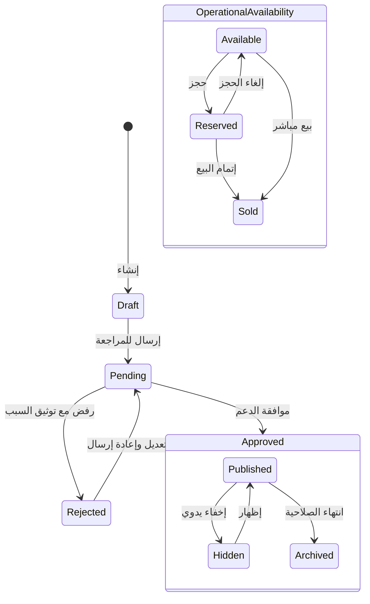

# وثيقة المعمارية الشاملة للواجهة الخلفية والنظام (Master Architecture)
## منصة Deal One — المنصة الهجينة متعددة الأقسام

**اسم المنتج:** Deal One  
**الإصدار:** 1.0 (المرجع المعماري الرئيسي الشامل)  
**التاريخ:** 1 نوفمبر 2026  
**الحالة:** معتمد ونافذ (Approved & Authoritative)  
**المراجع المرتبطة:**  
- سجل القرارات المعمارية: `Deal_One_Architecture_Decisions.md` (ADR-001 إلى ADR-012)  
- تقرير تدقيق الاتساق: `Deal_One_Documentation_Consistency_Report.md`  
- تحليل الأعمال: `Deal_One_Business_Analysis.md`  
- مواصفات المتطلبات: `Deal_One_SRS.md`  
- تصميم النظام: `Deal_One_System_Design.md`  
- ورك فلو التطبيقات: `Deal_One_Apps_Workflows.md`  
- معمارية الفلاتر: `Deal_One_Filter_Architecture.md`  
- معمارية فلاتر: `Deal_One_Flutter_Architecture.md`  

---

## 1. الرؤية المعمارية والمبادئ الحاكمة (Architectural Principles)

### 1.1 الاستراتيجية الهجينة المعتمدة (ADR-001)
تتبنى Deal One نموذج **المنصة الهجينة متعددة الأقسام (Hybrid Multi-Category Platform)**، بحيث تخدم قطاعات متباينة في طبيعتها واحتياجاتها التشغيلية عبر قاعدة نظام واحدة ومستقرة.
تنطلق المنصة في **المرحلة الأولى (V1)** كمنصة استكشاف، إعلانات مبوبة موثقة، وتواصل مباشر (`contact_only`)، مع تأسيس معماري صارم يمهد لإدخال التجارة والمخزون والحجوزات مستقبلاً بحسب طبيعة كل قسم دون الحاجة لإعادة هندسة النظام.

**المبدأ المعماري الحاكم:**
$$\text{Shared Core} + \text{Category-Driven Rules} + \text{Independently Evolving Transaction Modules}$$

### 1.2 النمط المعماري: المونوليث المعياري (Modular Monolith) (ADR-012)
- **قاعدة كود موحدة (Single Codebase):** الباك إند مبني وفق نمط Modular Monolith؛ حيث يقسم الكود منطقياً إلى حزم ووحدات مستقلة (Bounded Contexts).
- **قواعد الاتصال بين الوحدات:**
  1. لا يسمح لأي وحدة بالوصول المباشر لقاعدة بيانات أو جداول وحدة أخرى عبر استعلامات SQL؛ بل يتم التواصل حصراً عبر واجهات برمجية داخلية معلنة (Module Public Interfaces / Domain Services).
  2. منع الاعتمادات الدائرية (No Circular Dependencies) بين الوحدات.
  3. مشاركة خدمات البنية التحتية الأساسية (قاعدة البيانات، التخزين، التخزين المؤقت، سجل الأحداث).
  4. قابلية الاستخراج التدريجي (Extractability): تصميم الوحدات يتيح فصل أي وحدة لاحقاً إلى خدمة مستقلة (Microservice) إذا تطلب حجم الضغط أو الهيكل التنظيمي ذلك.

---

## 2. وحدات النواة المشتركة (Shared Core Modules) (ADR-002)

تخدم النواة المشتركة كافة الأقسام وتمنع تكرار الكود، وتتألف من الوحدات التالية:

```
┌────────────────────────────────────────────────────────────────────────┐
│                        DEAL ONE SHARED CORE                            │
├─────────────────────┬──────────────────────┬───────────────────────────┤
│ 1. Identity & Auth  │ 2. Accounts & Members│ 3. Branches & Locations   │
│ (Users, OTP, JWT)   │ (Multi-tenant, RBAC) │ (Physical, Display, PostGIS)│
├─────────────────────┼──────────────────────┼───────────────────────────┤
│ 4. Categories Core  │ 5. Listings Core     │ 6. Media Engine           │
│ (Hierarchical, Keys)│ (3 Status Axes)      │ (Presigned R2, Validation)│
├─────────────────────┼──────────────────────┼───────────────────────────┤
│ 7. Search & Filter  │ 8. Chat & Real-time  │ 9. Moderation & Audit     │
│ (PostGIS, GIN, Keys)│ (WebSocket, Outbox)  │ (Append-Only Log, Actions)│
├─────────────────────┼──────────────────────┼───────────────────────────┤
│ 10. Notifications   │ 11. Daily Quotas     │ 12. Platform Settings     │
│ (FCM Operational)   │ (Redis Midnight Cairo│ (Scoped Config, Overrides)│
└─────────────────────┴──────────────────────┴───────────────────────────┘
```

1. **وحدة الهوية والمصادقة (Identity & Auth Module):**
   - إدارة المستخدمين (`users`)، التحقق عبر الهاتف (OTP) والبريد، والتحقق الأمني الذكي عبر Cloudflare Turnstile.
   - إدارة الجلسات (`access_token` 15 دقيقة، `refresh_token` 30 يوماً).
2. **وحدة حسابات البيع وفريق العمل (Accounts & Members Module):**
   - إدارة حسابات البيع المستقلة (`accounts`) متعددة الكيانات للمستخدم الواحد.
   - مصفوفة صلاحيات فريق العمل بالحساب (`account_members`: `owner, manager, lister, responder`).
3. **وحدة الفروع والنظام الجغرافي (Branches & Location Module):**
   - إدارة الفروع ومناطق الخدمة والمناطق الإدارية (`areas`).
   - تطبيق العزل بين الموقع الفعلي والظاهر (ADR-006).
4. **وحدة الأقسام والحقول (Categories & Attributes Module):**
   - شجرة الأقسام، الحقول المخصصة (`category_fields`)، وقواعد التحقق الديناميكية.
5. **وحدة الإعلانات الأساسية (Listings Core Module):**
   - إدارة دورة حياة الإعلانات بمحاور الحالات الثلاثة المستقلة (ADR-007).
6. **وحدة الوسائط والتخزين (Media Engine Module):**
   - إصدار روابط رفع سحابية مباشرة وموقعة (Presigned URLs) إلى Cloudflare R2، والتحقق من صحة الصور وأبعادها.
7. **وحدة البحث والفهرسة (Search & Indexing Module):**
   - استعلامات البحث الهجين بالكلمات والمناطق والـ PostGIS الجغرافي والفلاتر المخصصة بـ JSONB GIN.
8. **وحدة الشات الفوري (Chat & Real-Time Module):**
   - محادثات آمنة ثنائية الأطراف عبر WebSocket مدعومة بـ Redis Pub/Sub ونمط Outbox في تطبيق الموبايل.
9. **وحدة الرقابة والتدقيق (Moderation & Audit Module):**
   - طوابير المراجعة للحسابات والإعلانات والبلاغات، مع سجل رقابة تزايدي لا يحذف (`moderation_log`) وسجل تدقيق إداري شامل (`audit_log`).
10. **وحدة الإشعارات التشغيلية (Notifications Module):**
    - بث إشعارات FCM اللحظية للأحداث التشغيلية (توثيق الحساب، مراجعة الإعلان، استلام رسائل).
11. **وحدة الحصص والحدود اليومية (Quotas Engine Module):**
    - تتبع الاستهلاك عبر Redis والتصفير الآلي عند منتصف الليل بتوقيت القاهرة (`Africa/Cairo`).
12. **وحدة إعدادات المنصة (Platform Settings Module):**
    - ضبط القيم والحدود الافتراضية محلياً وعاماً.

---

## 3. المعمارية الموجهة بطبيعة القسم (Category-Driven Architecture) (ADR-003)

### 3.1 توصيف الأقسام الستة المعتمدة
| القسم | المسمى البرمجي (`slug`) | محددات العمل والسمات الخاصة | أنواع الإعلانات المدعومة | التطور المستقبلي (V3) |
|---|---|---|---|---|
| **العقارات** | `real-estate` | المساحة، الغرف، الحمامات، الدور، التشطيب، الموقع العقاري | بيع، إيجار | طلبات معاينة وحجوزات زيارة |
| **مواد البناء والكهرباء** | `building-materials` | الصنف، وحدة القياس (طن، متر، شيكارة)، الكمية، المواصفة الفنية | منتج، توزيع، بيع | كتالوج أصناف، مخزون، وطلبات B2B |
| **الخدمات** | `services` | نوع الخدمة، نطاق التغطية الجغرافية، رخصة المزاولة | خدمة | مواعيد وحجوزات زيارات فنية |
| **الأجهزة المنزلية والديكور** | `appliances-decor` | الماركة، الحالة (جديد/مستعمل)، المواصفات، الأبعاد | بيع، شراء | كتالوج ومخزون ودفع إلكتروني |
| **السيارات** | `cars` | الماركة، الموديل، سنة الصنع، الكيلومترات، ناقل الحركة | بيع، شراء، صيانة، قطع غيار | فحص ومعاينة وعربون حجز |
| **الملابس والإكسسوارات** | `fashion` | المقاس، اللون، الخامة، الجنس، الفئة | منتجات، بيع | متغيرات SKU، مخزون، ودفع إلكتروني |

### 3.2 نموذج البيانات الهجين (Hybrid Data Modeling)
- **جدول `listings` المشترك:** يحمل الأعمدة الموحدة المشتركة (المعرف، المعرفات الخارجية للقسم والتاجر والفرع، العنوان، الوصف، السعر، العملة، قنوات التواصل، محاور الحالات الثلاثة، والإحداثيات).
- **الجداول التفصيلية المخصصة (Dedicated Detail Tables):** للأقسام الكبرى ذات الاستعلامات المعقدة والمتكررة (مثل العقارات والسيارات)، يمكن إنشاء جداول متخصصة مرتبطة بالإعلان عند بلوغ أحجام استعلامية ضخمة لضمان أعلى أداء وفهرسة صارمة.
- **الحقول المرنة عبر JSONB و EAV:** تعتمد المنصة حقل `attributes (JSONB)` في جدول `listings` مفهرساً بـ GIN لاستيعاب الحقول الديناميكية المعرفة في `category_fields` بسرعة وسلاسة.

---

## 4. المعمارية الجغرافية والخصوصية (Geographic Architecture) (ADR-006)

```
[1. الموقع الفعلي السري (Physical Location)]
   • إحداثيات GPS حقيقية دقيقة (Point 4326)
   • تحفظ في حقول خاصة (physical_lat / physical_lng)
   • مفهرسة بـ PostGIS GIST Index لحساب المسافات الدقيقة
   • سرية ولا تُعرض إطلاقاً للمستخدم العادي في السكن والسيارات

[2. الموقع الظاهر للجمهور (Display Location)]
   • إحداثيات مشوشة عمداً (إزاحة 300-600 متر أو مركز الحي الإداري)
   • تحفظ في (display_lat / display_lng)
   • تعرض على الخريطة العامة في تطبيق الموبايل لحماية خصوصية الأفراد

[3. نطاق التغطية والخدمة (Service Area)]
   • مضلعات ونطاقات خدمة (service_areas) للمكاتب الهندسية ومقدمي الخدمات
```

**سياسة التعامل مع إذن الـ GPS:**
- في حالة منح الإذن: فرز النتائج بدقة باستخدام دالة `ST_Distance` في PostGIS.
- في حالة رفض الإذن: ينساب التطبيق مباشرة وبسلاسة للاختيار اليدوي للمحافظة والمنطقة (`area_id`) دون انقطاع، ويتم فرز نتائج الحي بالأحدث.

---

## 5. منظومة توثيق التجار وتعدد الحسابات (ADR-004, ADR-005)

### 5.1 مستويات التوثيق بحسب نوع الحساب
| نوع الحساب (`account_type`) | الكيان المستهدف | المستندات الإلزامية للتوثيق | اشتراط مراجعة الدعم |
|---|---|---|:---:|
| `individual` | فرد بائع | بطاقة هوية وطنية سارية، والتحقق من الهاتف | نعم |
| `company` | شركة أو وسيط عقاري | سجل تجاري، بطاقة ضريبية، تفويض رسمي | نعم |
| `factory` | مصنع أو موزع مواد بناء | سجل صناعي/تجاري، بطاقة ضريبية | نعم |
| `office` | مكتب هندسي / مقدم خدمة | ترخيص مزاولة المهنة أو سجل تجاري | نعم |
| `store` | معرض أو متجر | سجل تجاري أو عقد إيجار موثق للمحل | نعم |

**قاعدة الفصل المعماري:** توثيق حساب البيع يثبت الهوية والصفة القانونية للكيان، ولكنه **لا يثبت تلقائياً صحة أو ملكية كل إعلان**؛ فكل إعلان يخضع بدوره لمسار مراجعة مستقل (`moderation_status`).

### 5.2 استقلالية الحسابات المتعددة للمستخدم الواحد
- المستخدم يمتلك حساباً شخصياً موحداً (`users`).
- يحق لنفس المستخدم إنشاء أو امتلاك أو إدارة أكثر من حساب بيع تجاري مستقل (`accounts`).
- البيانات، الفروع، الإعلانات، الحصص اليومية، وفريق العمل معزولة تماماً لكل حساب بيع.
- يوفر تطبيق الموبايل محول سياق (Account Switcher) للتنقل السريع بين الحسابات.

---

## 6. محرك دورة حياة الإعلانات وأنماط المعاملات (ADR-007, ADR-008)

### 6.1 محاور الحالات الثلاثة المتعامدة (Orthogonal Listing Lifecycle States)


1. **محور الرقابة (`moderation_status`):** `draft` (مسودة), `pending` (قيد المراجعة), `approved` (معتمد), `rejected` (مرفوض).
2. **محور النشر (`publication_status`):** `unpublished` (غير منشور), `published` (منشور متاح للعامة), `hidden` (مخفي مؤقتاً برغبة التاجر), `archived` (مؤرشف لانتهاء المدة أو بقرار إداري).
3. **محور التوفر (`availability_status`):** `available` (متاح), `reserved` (محجوز), `sold` (مباع), `rented` (مؤجر), `out_of_stock` (نفد المخزون), `discontinued` (متوقف).

### 6.2 سجل الرقابة التزايدي (`moderation_log`)
- كل قرار اعتماد أو رفض يسجل كمدخل غير قابل للتعديل يوثق (المعرف، نوع الهدف، المعرف الهدف، هوية الموظف، القرار، سبب الرفض، الملاحظات، والختم الزمني).
- عند تعديل إعلان مرفوض وإعادة إرساله، **يظل تاريخ الرفض محفوظاً في السجل ولا يُمسح**.

### 6.3 حصر معاملات V1 في نمط التواصل (`contact_only`)
- لا توجد بوابات دفع إلكتروني أو checkout في V1.
- التواصل يتم حصرياً عبر:
  1. الشات الفوري الآمن داخل التطبيق عبر WebSocket.
  2. التواصل الخارجي (واتساب / هاتف محمول) المحكوم بحصة كشف الأرقام اليومية للمستخدم لمنع استخراج البيانات والسبام.

---

## 7. حدود وحدات التجارة والحجوزات المستقبلية (Boundaries of Future Modules)

### 7.1 وحدة التجارة الإلكترونية (Commerce Module — V3 Planned) (ADR-009)
تُبنى كوحدة أعمال مستقلة في المرحلة الثالثة وتتضمن:
- **المنتج في الكتالوج (`Product`):** السلعة المعرفة في سجل التاجر الداخلي.
- **متغيرات المنتج (`ProductVariant`):** مواصفات المقاس، اللون، والخامة برمز SKU فريد.
- **عناصر المخزون (`InventoryItem`):** الكمية المتوفرة فعلياً من المتغير في فرع محدد (`branch_id`).
- **الطلبات والسلة (`Carts, Orders, OrderItems`):** دورة حياة الشراء الإلكتروني.
- **المدفوعات والمحافظ (`Payments, Refunds, Payouts`):** المعاملات المالية وتسوية الحسابات.
*(الإعلان Listing هو واجهة العرض الترويجي التي قد ترتبط بمنتج في الكتالوج، لكنهما كيانان منفصلان تماماً).*

### 7.2 وحدة الحجوزات والمواعيد (Booking Module — V3 Planned) (ADR-010)
تُبنى كوحدة أعمال مستقلة للأقسام المؤهلة (العقارات، الخدمات، السيارات) وتتضمن:
- **الفترات الزمنية المتاحة (`AvailabilitySlots`):** جدول المواعيد المتاحة للمعاينات والزيارات الفنية.
- **سياسات الحجز والإلغاء (`BookingPolicies`):** شروط التأكيد والإلغاء المسبق.
- **سجل الحجوزات (`Bookings`):** دورة حياة الحجز (`pending, confirmed, completed, cancelled`).

---

## 8. خارطة طريق المراحل المعتمدة (Phased Roadmap)

```
        V1: Discovery & Advertising             V2: Engagement & Growth            V3: Commerce & Booking
   ┌───────────────────────────────────┐    ┌───────────────────────────────┐    ┌─────────────────────────────┐
   │ • المصادقة والهوية وتعدد الحسابات │    │ • البحث المحفوظ والتنبيهات    │    │ • كتالوج المنتجات والمتغيرات │
   │ • توثيق التجار ومستندات الفئات    │    │   (Saved Searches & Alerts)   │    │ • إدارة المخزون متعدد الفروع │
   │ • إدارة الفروع ومناطق الخدمة      │───►│ • تحليلات تفصيلية للتاجر      │───►│ • سلة التسوق والشراء المباشر │
   │ • شجرة الأقسام والحقول الديناميكية│    │ • باقات الاشتراكات والترويج   │    │ • بوابات الدفع وتسوية العمولات│
   │ • دورة حياة الإعلانات (3 محاور)   │    │ • نماذج الاستفسارات المتخصصة  │    │ • محرك الحجوزات والمواعيد   │
   │ • الرقابة وسجل التدقيق التزايدي   │    └───────────────────────────────┘    └─────────────────────────────┘
   │ • البحث الجغرافي وحماية المواقع   │
   │ • الشات الفوري (نمط contact_only) │
   │ • الحصص اليومية وتوقيت القاهرة    │
   └───────────────────────────────────┘
```

---

## 9. التوافق والاتساق الكامل لوثائق المشروع

تتوافق هذه المعمارية الشاملة تماماً وبشكل لا لبس فيه مع جميع الوثائق المحدثة للمشروع:
- **وثيقة تحليل الأعمال (`Deal_One_Business_Analysis.md`):** متوافقة في نموذج المراحل والورك فلو وحصر V1 في التواصل المباشر.
- **وثيقة المتطلبات (`Deal_One_SRS.md`):** متوافقة في بنية المتطلبات الوظيفية، محاور الحالات الثلاثة للإعلان، وتعدد الحسابات وفريق العمل.
- **وثيقة تصميم النظام (`Deal_One_System_Design.md`):** متوافقة في هيكلية المونوليث المعياري، نموذج قاعدة البيانات، وجداول الـ ERD.
- **وثيقة ورك فلو التطبيقات (`Deal_One_Apps_Workflows.md`):** متوافقة في تدفقات العميل والتاجر ولوحة الإدارة ومخطط الـ Mermaid ERD.
- **وثيقة معمارية الفلاتر (`Deal_One_Filter_Architecture.md`):** متوافقة في استعلامات البحث الهجين، PostGIS، وفصل المواقع، وفهرسة الحالات المستقلة.
- **وثيقة معمارية فلاتر (`Deal_One_Flutter_Architecture.md`):** متوافقة في نمذجة الـ Freezed Domain Models وحالات الإعلانات والمواقع الجغرافية.
