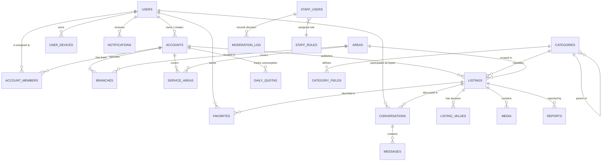

# وثيقة تصميم النظام (System Design): Deal One
## المعمارية المعتمدة للمنصة الهجينة (Hybrid Multi-Category Platform)

**اسم المنتج:** Deal One  
**الإصدار:** 2.0 (محدث ومتوافق مع القرارات المعمارية المعتمدة)  
**التاريخ:** 1 نوفمبر 2026  
**الحالة:** معتمد رسمياً (Approved)  
**المراجع المرتبطة:**  
- سجل القرارات المعمارية: `Deal_One_Architecture_Decisions.md` (ADR-001 إلى ADR-012)  
- وثيقة المعمارية الشاملة: `Deal_One_Master_Architecture.md`  
- وثيقة تحليل الأعمال: `Deal_One_Business_Analysis.md`  
- وثيقة متطلبات البرنامج: `Deal_One_SRS.md`  

---

## 1. نظرة عامة على المشروع وأهدافه المعمارية

### 1.1 الأهداف المعمارية
1. **المنصة الهجينة (ADR-001):** بناء أساس برمجي قوي يبدأ في النسخة الأولى (V1) كمنصة استكشاف وإعلانات وتواصل (`contact_only`)، مع جهوزية معمارية لإدراج التجارة والحجوزات والمخزون تدريجياً في المرحلة الثالثة (V3).
2. **النواة المشتركة (ADR-002):** توحيد الأنظمة الأساسية (المصادقة، الهوية، الحسابات، الوسائط، البحث، الشات، الرقابة، الحدود) لخدمة كافة الأقسام دون تكرار.
3. **قواعد أعمال موجهة بطبيعة القسم (ADR-003):** إتاحة حقول وفلاتر وتحققات ديناميكية مستقلة لكل قطاع.
4. **المونوليث المعياري (ADR-012):** اعتماد نمط Modular Monolith عالي الانضباط للواجهة الخلفية لتجنب التعقيد التشغيلي غير المبرر للخدمات المصغرة (Microservices).

### 1.2 خارج نطاق النسخة الأولى (Out of Scope for V1)
- بوابات الدفع الإلكتروني والبطاقات والمحافظ الرقمية.
- سلة التسوق والشراء الإلكتروني المباشر (Checkout).
- إدارة كتالوج المنتجات المعقدة والمتغيرات والمخزون اللحظي (V3 Commerce).
- محرك الحجوزات والمواعيد والتقويمات الزمنية (V3 Booking).
- تنبيهات الإعلانات الجديدة للبحث المحفوظ (V2 Saved Searches).

---

## 2. المستخدمون وأنواع الحسابات والأدوار (ADR-004, ADR-005)

### 2.1 المستخدم الفردي (`users`)
المستخدم يمتلك هوية شخصية واحدة مسجلة برقم هاتف أو بريد إلكتروني، تتيح له التصفح، البحث، حفظ المفضلة، محادثة المعلنين، وإنشاء حساب بيع تجاري أو أكثر.

### 2.2 حسابات البيع المستقلة (`accounts`)
يمتلك المستخدم الواحد إمكانية إنشاء **عدة حسابات بيع مستقلة تماماً**. كل حساب يمثل كياناً منفصلاً ببياناته وفروعه ومستنداته وأعضاء فريقه وحصصه اليومية.

أنواع الحسابات (`account_type`):
1. `individual`: فرد يبيع أو يؤجر ممتلكات شخصية (هوية وطنية وسياسات مكافحة النصب).
2. `company`: شركة ووساطة وتسويق عقاري (سجل تجاري، بطاقة ضريبية، بيانات المفوض).
3. `factory`: مصنع أو موزع مواد بناء وتجهيزات (سجل صناعي/تجاري وبطاقة ضريبية).
4. `office`: مكتب هندسي، استشارات، أو مقدم خدمات تشطيب وصيانة (ترخيص مهني / سجل).
5. `store`: متجر أو معرض أجهزة، ديكور، سيارات، أو ملابس (سجل تجاري / عقد إيجار).

### 2.3 فريق عمل الحساب (`account_members`)
يدعم الحساب التجاري دعوة مستخدمين مسجلين للانضمام لفريق العمل مع تحديد الصلاحيات:
- `owner`: المالك الكامل للحساب، الفروع، والمستندات.
- `manager`: إدارة الفروع، نشر وتعديل الإعلانات، والرد على المحادثات.
- `lister`: إضافة ومسودة وتعديل الإعلانات فقط.
- `responder`: قراءة والرد على المحادثات الفورية للعملاء فقط.

---

## 3. قرارات المنتج الأساسية المعتمدة (مثبتة ومحققة)

| البند | القرار المعماري المعتمد | المرجع |
|---|---|---|
| **نمط المعاملات V1** | حصر V1 في نمط **التواصل فقط (`contact_only`)**، وإلغاء مفتاح الحساب العام. | ADR-008 |
| **قنوات التواصل** | يحدد المعلن لكل إعلان: **داخل التطبيق (شات فوري)** أو **خارجي (واتساب / اتصال)**. | ADR-008 |
| **تكلفة الإعلانات V1** | **مجانية** لجميع الحسابات ضمن الحصص والحدود اليومية المعتمدة. | خطة الإطلاق |
| **حوكمة النشر** | كل إعلان يمر رقابياً على **فريق الدعم (`moderation_status = pending`)** قبل ظهوره للعامة. | ADR-007 |
| **دورة حياة الإعلان** | **3 محاور حالات مستقلة**: الرقابة (`moderation`)، النشر (`publication`)، التوفر (`availability`). | ADR-007 |
| **المعمارية الجغرافية** | فصل **الموقع الفعلي السري** عن **الموقع الظاهر التقريبي** ومناطق التغطية والخدمة. | ADR-006 |
| **حماية المنافذ** | فحص **Cloudflare Turnstile** على كل العمليات الحساسة (دخول، نشر، شات، بلاغات). | الأمان |
| **الحصص والحدود اليومية** | تدار عبر **Redis** وتتصفر تلقائياً عند **12:00 منتصف الليل بتوقيت القاهرة (`Africa/Cairo`)**. | ADR-011 |
| **نمط الباك إند** | **مونوليث معياري (Modular Monolith)** عالي الانضباط بحدود نطاقات صريحة. | ADR-012 |

---

## 4. معمارية النظام ومكوناته التقنية (Architecture & Components)

### 4.1 المكونات الرئيسية
```
                        [تطبيقات الموبايل: Flutter Monorepo]
                        (Customer App / Merchant Context)
                                       │
                                       ▼ HTTPS / WSS
                       [Cloudflare Edge Services]
                 (DNS, WAF, DDoS Protection, Turnstile)
                                       │
                                       ▼
                       [Modular Monolith Backend]
          ┌────────────────────────────────────────────────────────┐
          │  • Auth & Identity        • Accounts & Members (RBAC)  │
          │  • Categories & Fields    • Listings Core & Media      │
          │  • Geographic (PostGIS)   • Search & Indexing Engine   │
          │  • Chat (WebSocket/PubSub)• Moderation Log & Auditing  │
          │  • Quotas (Redis Engine)  • Notifications (FCM Engine) │
          └────────────────────────────────────────────────────────┘
                    │                      │                 │
                    ▼                      ▼                 ▼
          [PostgreSQL + PostGIS]     [Redis Cluster]   [Cloudflare R2]
          (البيانات العلائقية والجغرافية)  (الحصص والـ PubSub) (تخزين الصور المباشر)
```

1. **تطبيقات الموبايل (Flutter Apps):**
   - كود موحد داخل Monorepo (باستخدام Melos)، يشارك الموديلات (Freezed)، طبقة الشبكة (Dio + Retrofit)، وإدارة الحالة (Riverpod).
2. **شبكة الحماية السحابية (Cloudflare Edge):**
   - WAF لفحص الترويسات وحظر الهجمات، Turnstile للتحقق من البشرية، وتخزين R2 لحفظ الصور بتكلفة egress منعدمة.
3. **الواجهة الخلفية (Modular Monolith Backend):**
   - تطبيق موحد عديم الحالة (Stateless) قابل للتوسع الأفقي. الوحدات معزولة منطقياً وتتواصل عبر واجهات برمجية داخلية واضحة (Module Public Interfaces).
4. **قاعدة البيانات الأساسية (PostgreSQL + PostGIS):**
   - حفظ الكيانات، العلاقات، القيود الصارمة، والبيانات الجغرافية ثنائية الأبعاد (Point/Polygon).
5. **مخزن الذاكرة السريعة (Redis):**
   - عدادات الحصص اللحظية ذات الـ TTL اليومي، جلسات المستخدمين المؤقتة، وقنوات Pub/Sub لبث رسائل الـ WebSocket بين خوادم التطبيق.
6. **خدمة الإشعارات (Firebase Cloud Messaging - FCM):**
   - إرسال الإشعارات التشغيلية اللحظية (اعتماد الإعلانات، وصول الرسائل، توثيق الحسابات).
7. **لوحة الإدارة والرقابة (Admin Web Dashboard):**
   - واجهة ويب مؤمنة تتصل بنقاط نهاية موظفي النظام (`/api/v1/admin/*`).

---

## 5. الحسابات والمصادقة والتوثيق (ADR-004, ADR-005)

### 5.1 التسجيل والمصادقة
- التسجيل عبر الهاتف مع OTP أو البريد مع كلمة مرور مشفرة بـ Argon2id.
- إجبار التحقق بـ Cloudflare Turnstile قبل إرسال OTP أو قبول الدخول.
- الجلسات: `access_token` صالح لمدة 15 دقيقة، و`refresh_token` صالح لمدة 30 يوماً ومقترن بجهاز المستخدم في جدول `user_devices`.

### 5.2 إنشاء وإدارة حسابات البيع
1. يختار المستخدم إنشاء حساب بيع، ويحدد نوعه (`individual, company, factory, office, store`).
2. يدخل البيانات التجارية، الشعار، ومستندات التوثيق الرسمية.
3. ينشئ الحساب الفرع الرئيسي وعنوانه وإحداثياته.
4. يدخل الحساب تلقائياً في حالة `verification_status = pending`.
5. في النسخة الأولى (V1)، نمط المعاملات هو `contact_only` دون الحاجة لأي مفتاح إعداد عام يغير سلوك الحساب.

### 5.3 حالات التوثيق والرقابة على الحسابات
- `pending`: الحساب تحت مراجعة فريق الدعم، **وإعلاناته محجوبة تماماً عن الظهور العام**.
- `approved`: الحساب موثق ورسمي، وإعلاناته المعتمدة تظهر في البحث والتغذية.
- `rejected`: الحساب مرفوض لوجود نقص في المستندات أو عدم مطابقة، مع تسجيل السبب في `moderation_log`.

---

## 6. الأقسام والإعلانات ودورة الحياة (ADR-003, ADR-006, ADR-007)

### 6.1 الأقسام الستة المعتمدة
| القسم | المعرف الإنجليزي | طبيعة الحقول الخاصة | أنواع الإعلانات المدعومة |
|---|---|---|---|
| **العقارات** | `real-estate` | المساحة، الغرف، الحمامات، الدور، التشطيب | بيع، إيجار |
| **مواد البناء والكهرباء** | `building-materials` | الصنف، وحدة القياس، الكمية، المواصفة الفنية | بيع وتوزيع (منتج) |
| **الخدمات** | `services` | نوع الخدمة، نطاق التغطية، ترخيص المهنة | خدمات منزلية وهندسية |
| **الأجهزة والديكور** | `appliances-decor` | الماركة، الحالة، الموديل، الأبعاد | بيع، شراء |
| **السيارات** | `cars` | الماركة، الموديل، سنة الصنع، الكيلومترات، ناقل الحركة | بيع، شراء، صيانة، قطع غيار |
| **الملابس والإكسسوارات** | `fashion` | المقاس، اللون، الخامة، الجنس، الحالة | بيع، منتجات |

### 6.2 الحقول الخاصة والتحقق الديناميكي
- تعرف الحقول في جدول `category_fields` وتتضمن النوع (`text, number, select, bool`) وقيود التحقق (إلزامي/اختياري، نطاق القيم).
- تُخزن القيم إما في جدول `listing_values` أو كحقل `attributes (JSONB)` في جدول الإعلانات مفهرس بـ GIN.

### 6.3 المعمارية الجغرافية للإعلان (ADR-006)
- **الموقع الفعلي (`physical_lat`, `physical_lng`):** يحفظ بسرية في قاعدة البيانات للاستعلامات الفنية وحساب المسافات الدقيقة عبر PostGIS.
- **الموقع الظاهر (`display_lat`, `display_lng`):** موقع تقريبي (تشويش متعمد أو مركز الحي) يعرض للمستخدمين لحماية خصوصية المنازل والمركبات.
- **المنطقة الإدارية (`area_id`):** اختيار إلزامي للمحافظة والحي، يضمن استمرار البحث حتى لو رفض المستخدم منح صلاحية الـ GPS.

### 6.4 دورة حياة الإعلان المتعامدة (ADR-007)

```
[1. محور الرقابة - Moderation Status]
   draft ──► pending ──► approved
               ▲            │
               │            ▼
               └── rejected (مع توثيق السبب في moderation_log)

[2. محور النشر - Publication Status]
   unpublished ──► published ◄──► hidden
                          │
                          ▼
                       archived

[3. محور التوفر - Availability Status]
   available ◄──► reserved ──► sold / rented / out_of_stock
```

- **قاعدة النشر:** يظهر الإعلان للعامة فقط عند تحقق:
  `moderation_status = approved AND publication_status = published AND availability_status = available AND account.verification_status = approved`
- **التعديل الجوهري:** تعديل السعر أو الصور أو القسم ينقل الإعلان تلقائياً إلى `moderation_status = pending` لمراجعة التعديل مع بقاء تاريخ الرفض أو الاعتماد السابق موثقاً في `moderation_log`.

---

## 7. التواصل والمحادثات الفورية (ADR-008)

### 7.1 قنوات التواصل في V1
1. **شات فوري داخل التطبيق (In-App Chat):**
   - اتصال ثنائي الاتجاه عبر WebSocket محمي بمصادقة الـ JWT.
   - يعتمد المخدم على Redis Pub/Sub لنقل الرسائل بين خوادم التطبيق المختلفة.
   - حالات الرسالة: `sent -> delivered -> read`.
2. **تواصل خارجي (External):**
   - إظهار رقم الهاتف أو فتح رابط واتساب بعد فحص واستهلاك الحد اليومي للمستخدم (`contact_reveal`).

---

## 8. قاعدة البيانات ومخطط الكيانات (Database Design & ERD)

### 8.1 تصنيف الجداول المعمارية بحسب مراحل التطوير

#### أ. جداول المرحلة الأولى (V1 Required Tables):
1. `users`: المستخدمون والملفات الشخصية الأساسية.
2. `user_devices`: جلسات الأجهزة، الـ Refresh Tokens، ورموز FCM.
3. `accounts`: حسابات البيع التجارية وحالات التوثيق (`verification_status`).
4. `account_members`: أعضاء فريق العمل في حساب البيع وصلاحياتهم (`role`).
5. `branches`: فروع الكيان التجاري ومواقعها وساعات عملها.
6. `service_areas`: مناطق ونطاقات التغطية لمقدمي الخدمات والموزعين.
7. `areas`: المناطق والمحافظات والمدن الإدارية في مصر.
8. `categories`: شجرة الأقسام الرئيسية والفرعية.
9. `category_fields`: مواصفات الحقول الخاصة لكل قسم.
10. `listings`: الإعلانات المشتركة بمحاور الحالات الثلاثة والموقعين الفعلي والظاهر.
11. `listing_values`: قيم الحقول الخاصة (أو حقل `attributes JSONB` في `listings`).
12. `media`: صور ووسائط الإعلانات وترتيب عرضها.
13. `favorites`: الإعلانات المفضلة للمستخدمين.
14. `conversations`: المحادثات الفورية المرتبطة بالإعلانات وأطرافها.
15. `messages`: رسائل الشات وحالات التسليم والقراءة.
16. `notifications`: الإشعارات التشغيلية داخل التطبيق.
17. `daily_quotas`: سجل الاستهلاك اليومي للحدود والحصص.
18. `platform_settings`: إعدادات المنصة وقيم الحدود الافتراضية.
19. `reports`: بلاغات المستخدمين ضد الإعلانات المخالفة.
20. `staff_users`: موظفو الدعم والرقابة والمديرون (معزولون عن المستخدمين العاديين).
21. `staff_roles`: مصفوفة صلاحيات موظفي النظام.
22. `moderation_log`: سجل قرارات الرقابة على الإعلانات والحسابات والبلاغات.
23. `audit_log`: سجل التدقيق الشامل للعمليات الحساسة وتعديلات الإعدادات.

#### ب. جداول المرحلة الثانية (V2 Planned Tables):
24. `saved_searches`: معايير البحث المحفوظة للمستخدمين.
25. `search_alerts`: تنبيهات الإعلانات الجديدة المطابقة للبحث المحفوظ.
26. `listing_stats_daily`: إحصائيات المشاهدات والتفاعل اليومية المجمعة.
27. `seller_subscriptions`: اشتراكات التجار والباقات المدفوعة.

#### ج. جداول المرحلة الثالثة (V3 Planned Tables — Commerce & Booking):
28. `products`: السلع المعرفة في كتالوج التاجر الداخلي.
29. `product_variants`: مواصفات ومتغيرات السلعة (المقاس، اللون، الخامة).
30. `inventory_items`: المخزون الفعلي المتوفر لكل متغير داخل فرع محدد.
31. `orders` & `order_items`: دورة حياة الطلبات التجارية وتفاصيلها.
32. `payments` & `refunds`: العمليات المالية والمحافظ وتسوية المستحقات.
33. `availability_slots`: الفترات الزمنية المتاحة للحجز والمعاينة.
34. `bookings`: حجوزات المواعيد والخدمات وسياسات الإلغاء.

---

### 8.2 العلاقات الأساسية في مخطط قاعدة البيانات (ERD Core)



---

### 8.3 الفهارس والاستعلامات الجغرافية (Indexing & Query Optimization)
- `listings(category_id, moderation_status, publication_status, availability_status, area_id)` للفلترة الأساسية السريعة.
- فهرس جغرافي مكاني `GIST` على حقل `physical_location (geometry Point)` للبحث بالمسافة ونصف القطر عبر PostGIS.
- فهرس `GIN` على عمود `attributes (JSONB)` لحقول الأقسام المخصصة.
- قيد فريد `daily_quotas(account_id, day, quota_type)` لمنع تكرار العدادات.

---

## 9. خطة المراحل والتنفيذ (Roadmap & Implementation Phases)

### 9.1 المرحلة الأولى: V1 — الاستكشاف والتواصل (Discovery & Advertising)
- **النواة المشتركة:** المصادقة، الهوية الشخصية، وتعدد حسابات البيع المستقلة.
- **التوثيق:** تدقيق مستندات التجار واعتماد الحسابات بحسب نوعها.
- **الفروع والمواقع:** إدارة الفروع، وتطبيق الفصل بين الموقع الفعلي والظاهر.
- **الأقسام والإعلانات:** شجرة الأقسام، الحقول الخاصة، ومحاور الحالات الثلاثة للإعلان.
- **الرقابة:** طابور مراجعة الإعلانات، وسجل الرقابة غير القابل للحذف `moderation_log`.
- **البحث:** بحث بالكلمات، الفلترة الجغرافية بـ PostGIS، والفلترة بحقول القسم.
- **التواصل:** نمط `contact_only` عبر الشات الفوري (WebSocket) وإظهار أرقام الهاتف المحكومة بالحد اليومي.
- **الحدود والإدارة:** عدادات Redis سريعة التصفير بتوقيت القاهرة، ولوحة إدارة كاملة.

### 9.2 المرحلة الثانية: V2 — التفاعل ونمو الأعمال (Engagement & Seller Growth)
- إطلاق ميزة **البحث المحفوظ (Saved Searches)** وإرسال تنبيهات بالإعلانات الجديدة المطابقة.
- تحليلات أداء متقدمة للتجار (إحصائيات المشاهدات اليومية، مصادر الزيارات).
- باقات الاشتراكات الشهرية وترقية الحصص والإعلانات المميزة (Featured Ads).
- نماذج استفسارات مخصصة لقطاع العقارات والمشاريع والخدمات.

### 9.3 المرحلة الثالثة: V3 — التجارة الإلكترونية والحجوزات (Commerce & Booking)
- إدخال كتالوج المنتجات والمتغيرات والمخزون متعدد الفروع للقطاعات المؤهلة (ملابس، مواد بناء، أجهزة).
- سلة التسوق والشراء المباشر (Cart, Checkout, Orders).
- بوابات الدفع الإلكتروني، تسوية المستحقات، وحساب العمولات.
- محرك الحجوزات والمواعيد والتقويمات لقطاعات الخدمات والعقارات والسيارات.

---

## 10. القرارات المعمارية المفتوحة (Open Decisions for Review)

| # | القرار المفتوح | الخيارات المتاحة | التوصية المعمارية |
|---|---|---|---|
| 1 | **تطبيق الموبايل للتجار:** هل يتم نشر تطبيق مستقل في المتاجر أم الاعتماد على تطبيق واحد بمحول سياق؟ | أ. تطبيقان منفصلان في المتجر.<br>ب. تطبيق موحد مع تبديل وضع الحساب. | **التوصية:** البدء بـ Monorepo مشترك مع إمكانية تصدير تطبيقين أو تطبيق موحد؛ التطبيق الموحد يقلل تكلفة التسويق في البداية. |
| 2 | **تحديد الحصص الافتراضية للإعلانات والرسائل:** القيم العددية للحدود اليومية المبدئية. | خيارات حسب نوع الحساب (مثلاً 5 للأفراد، 50 للشركات). | اعتماد قيم أولية مرنة في `platform_settings` قابلة للتعديل اللحظي من الأدمن دون تعديل الكود. |
| 3 | **مدة بقاء الإعلان قبل الأرشفة:** الفترة الزمنية للأرشفة التلقائية. | 30 يوماً، 60 يوماً، أو 90 يوماً بحسب القسم. | 30 يوماً للملابس والأجهزة، و60 يوماً للسيارات والعقارات قابلة للتجديد من المعلن. |
